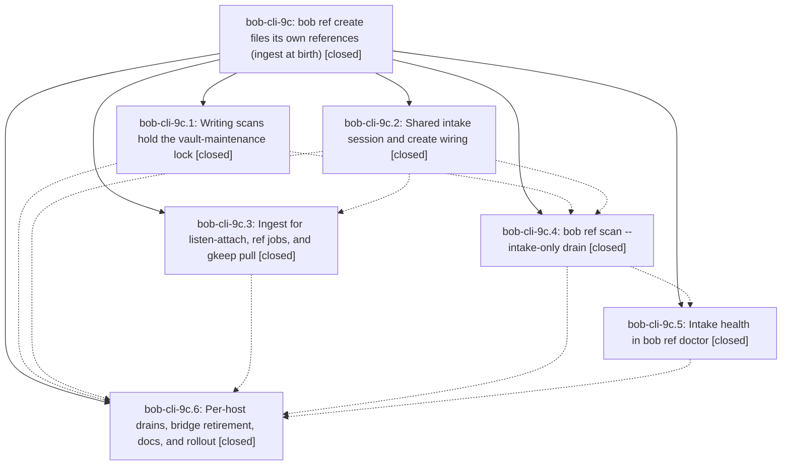

# Bead: bob-cli-9c — bob ref create files its own references (ingest at birth)

[Bead Pages](../README.md) / bob-cli-9c

**Status:** ✓ closed · **Resolution:** done · **Type:** ▸ plan · **Tier:** epic
**Owner:** `bryanbugyi34@gmail.com` · **Created by:** [bbugyi200.athena.research.4s.linker.w0](https://github.com/bobs-org/bob-cli--agents/blob/main/sessions/bbugyi200.athena.research.4s.linker.w0.md) · **Assignee:** `bob-cli-9c.land`
**Created:** 2026-10-18 14:40:03 EDT · **Closed:** 2026-10-18 18:02:56 EDT
**Plan:** [202610/ref\_ingest\_at\_birth.md](https://github.com/bobs-org/bob-cli--plans/blob/main/202610/ref_ingest_at_birth.md)

<!-- sase:links:start -->

## Links

| Relation | Artifact | Why |
| --- | --- | --- |
| implemented-by | [plan:202610/ref_ingest_at_birth.md][1] | derived from the plan's `bead_id:` frontmatter field |

_Plus 2 automatic references — see [Referenced By](#referenced-by)._

[1]: https://github.com/bobs-org/bob-cli--plans/blob/main/202610/ref_ingest_at_birth.md

<!-- sase:links:end -->

## Description

A successful `bob ref create` on athena, apollo, or the Mac leaves the reference in the library — PDF in `lib/`, ref note written, reading task filed — committed and pushed as one commit, so `bob ref scan` becomes a repair tool instead of a daily step. When inline ingest cannot run, the PDF stays queued in that host's `xlib/` with a visible reason and a per-host `bob ref scan --intake-only` timer files it later.

## Notes

[2026-10-18T21:27:02Z · bob-cli-9c.land] LANDING TRIAGE (bob-cli-9c.land): One PROPOSED FOLLOW-UP was found across the children: bob-cli-9c.4 note #1, the flaky lib test native::highlights_ref::fetch::tests::curl_pins_the_checked_address_with_resolve failing with ETXTBSY on its fake-curl.sh. Outcome: semantic duplicate of the existing ready flake bob-cli-5l (lib-test executable stubs exec with ETXTBSY under parallel cargo test --lib). Corroborated with sase bead +1 (now +6) rather than a new task; it is not caused by this epic. No other phase proposed follow-ups. The remaining epic-caused defects found during landing verification (intake bugs, test gaps, stale docs) are epic work and go into the landing tale, not into task beads.

[2026-10-18T22:02:56Z · bob-cli-9c.land] Landing review of all six closed phases against plan:202610/ref_ingest_at_birth.md and their commits (85eac25a, c4ac06fb, fa7745fc, 5848c39d, 47036193, 2a11d051). Live rollout: athena and apollo bob-ref-intake.timer print `intake: nothing queued`; Mac runs the new bob (`-k`, `scan -i`, doctor `intake_last`), chezmoi 9ee5fd2a, no pre_scan_hook or bob_xlib_pull; vault commit 6f3c4d02 is a real create ingest of PDF + note + parent. Post-epic commits de78e982 (added_at) and 82413421 (pasted-screenshot image notes) need no integration. bob-cli-9c.4 ETXTBSY fetch flake was +1'd onto bob-cli-5l, not epic work. No --epic-symbol entries.

Part A: needs_write_pdfs CommandError.code + intake classification; IntakeSession drops scan.lock then bob_sync.lock; ensure_safe_to_write before execute_pdf_sync; scoped commit paths captured before the write; finish_intake silent (ignored paths and status warnings via progress); ingest_url kill-switch before clip; Incomplete maps to queued reason incomplete with scan (not scan -i) copy; commit-failure wording; intake-only JSON dry-run ok ignores queued; doctor intake_last first-line cap.

Part B: ingest follow-up dry-run, peer sase.md, origin HEAD, lock-busy no commit, invalid env, ingest_on_create absent → None, help -k, listen audio frontmatter/embed/diff-tree, jobs one ingest commit, gkeep filed-path git vault, scan-intake needs_write_pdfs + dry-run queued ok true, doctor multiline intake_last.

Part C: README/docs synopses and capture/xlib/lib wording; JSON ok + pre_scan_hook export claim; clip.rs module doc; ref-jobs/gkeep incomplete reasons.

just check passed (cargo fmt --check, clippy, cargo test --no-fail-fast): 0 failed. The ETXTBSY flake did not fire.

## Phases

| Bead | Title | Status | Size | Created | Agents | Commits |
|---|---|---|---|---|---:|---:|
| [bob-cli-9c.1](bob-cli-9c.1.md) | Writing scans hold the vault-maintenance lock | ✓ closed | small | 2026-10-18 | 1 | 1 |
| [bob-cli-9c.2](bob-cli-9c.2.md) | Shared intake session and create wiring | ✓ closed | medium | 2026-10-18 | 1 | 1 |
| [bob-cli-9c.3](bob-cli-9c.3.md) | Ingest for listen-attach, ref jobs, and gkeep pull | ✓ closed | medium | 2026-10-18 | 1 | 1 |
| [bob-cli-9c.4](bob-cli-9c.4.md) | bob ref scan --intake-only drain | ✓ closed | medium | 2026-10-18 | 1 | 1 |
| [bob-cli-9c.5](bob-cli-9c.5.md) | Intake health in bob ref doctor | ✓ closed | small | 2026-10-18 | 1 | 1 |
| [bob-cli-9c.6](bob-cli-9c.6.md) | Per-host drains, bridge retirement, docs, and rollout | ✓ closed | medium | 2026-10-18 | 1 | 2 |

## Lineage

## Agents

| Agent | Bead | Commits |
|---|---|---:|
| [bbugyi200.athena.bob-cli-9c.1](https://github.com/bobs-org/bob-cli--agents/blob/main/sessions/bbugyi200.athena.bob-cli-9c.1.md) | [bob-cli-9c.1](bob-cli-9c.1.md) | 1 |
| [bbugyi200.athena.bob-cli-9c.2](https://github.com/bobs-org/bob-cli--agents/blob/main/agents/bbugyi200.athena.bob-cli-9c.2/README.md) | [bob-cli-9c.2](bob-cli-9c.2.md) | 1 |
| [bbugyi200.athena.bob-cli-9c.3](https://github.com/bobs-org/bob-cli--agents/blob/main/agents/bbugyi200.athena.bob-cli-9c.3/README.md) | [bob-cli-9c.3](bob-cli-9c.3.md) | 1 |
| [bbugyi200.athena.bob-cli-9c.4](https://github.com/bobs-org/bob-cli--agents/blob/main/agents/bbugyi200.athena.bob-cli-9c.4/README.md) | [bob-cli-9c.4](bob-cli-9c.4.md) | 1 |
| [bbugyi200.athena.bob-cli-9c.5](https://github.com/bobs-org/bob-cli--agents/blob/main/agents/bbugyi200.athena.bob-cli-9c.5/README.md) | [bob-cli-9c.5](bob-cli-9c.5.md) | 1 |
| [bbugyi200.athena.bob-cli-9c.6](https://github.com/bobs-org/bob-cli--agents/blob/main/sessions/bbugyi200.athena.bob-cli-9c.6.md) | [bob-cli-9c.6](bob-cli-9c.6.md) | 1 |
| [bbugyi200.athena.bob-cli-9c.land](https://github.com/bobs-org/bob-cli--agents/blob/main/sessions/bbugyi200.athena.bob-cli-9c.land.md) | [bob-cli-9c](README.md) | 1 |

## Commits

| Repo | Commit | Subject | Bead | Committed |
|---|---|---|---|---|
| bob-cli | [`85eac25`](https://github.com/bobs-org/bob-cli/commit/85eac25aa112e0888ec09955ef0bc587e3c514ea) | feat(ref): hold vault-maintenance lock during writing scans | [bob-cli-9c.1](bob-cli-9c.1.md) | 2026-10-18 14:58:58 EDT |
| bob-cli | [`c4ac06f`](https://github.com/bobs-org/bob-cli/commit/c4ac06fb47633fcf1b26e592031a6c32c0087a8e) | feat(highlights): ingest references during create | [bob-cli-9c.2](bob-cli-9c.2.md) | 2026-10-18 15:15:47 EDT |
| bob-cli | [`fa7745f`](https://github.com/bobs-org/bob-cli/commit/fa7745fc71c0fe0cb2fafe4c78270e3b5d890837) | feat(ref): add scan --intake-only xlib drain | [bob-cli-9c.4](bob-cli-9c.4.md) | 2026-10-18 15:39:40 EDT |
| bob-cli | [`5848c39`](https://github.com/bobs-org/bob-cli/commit/5848c39d367eedf354e3276f493541ce66c40bb2) | feat(ref): ingest listen-attach, jobs, and gkeep clips at birth | [bob-cli-9c.3](bob-cli-9c.3.md) | 2026-10-18 15:48:43 EDT |
| bob-cli | [`4703619`](https://github.com/bobs-org/bob-cli/commit/47036193185db067bce5f55690eaf0ed832466b7) | feat(ref): show intake health in bob ref doctor | [bob-cli-9c.5](bob-cli-9c.5.md) | 2026-10-18 15:54:24 EDT |
| chezmoi | [`chezmoi@9ee5fd2`](https://github.com/bbugyi200/dotfiles/commit/9ee5fd2aa664f6986d0921b5bc15e3c3ae200253) | feat(chezmoi)!: retire cross-host highlights intake bridge | [bob-cli-9c.6](bob-cli-9c.6.md) | 2026-10-18 16:22:07 EDT |
| bob-cli | [`2a11d05`](https://github.com/bobs-org/bob-cli/commit/2a11d0514103a08ef5c29b4100196c5543e2028e) | feat(ref): roll out per-host intake drains | [bob-cli-9c.6](bob-cli-9c.6.md) | 2026-10-18 16:58:03 EDT |
| bob-cli | [`f4cdf0b`](https://github.com/bobs-org/bob-cli/commit/f4cdf0bd31876a0b2b0f5183711090c22bae3ab8) | feat(highlights): land ingest-at-birth silent intake and kill-switch | [bob-cli-9c](README.md) | 2026-10-18 18:05:25 EDT |

<!-- sase:referenced-by:start -->

## Referenced By

| Relation | Artifact | Why | Uses |
| --- | --- | --- | ---: |
| read-by | [agent:bob-cli-9c.3][1] | Need parent epic scope and phase list | 1 |
| read-by | [agent:bob-cli-9c.4][2] | epic context | 1 |

[1]: https://github.com/bobs-org/bob-cli--agents/blob/main/agents/bbugyi200.athena.bob-cli-9c.3/README.md
[2]: https://github.com/bobs-org/bob-cli--agents/blob/main/agents/bbugyi200.athena.bob-cli-9c.4/README.md

<!-- sase:referenced-by:end -->
