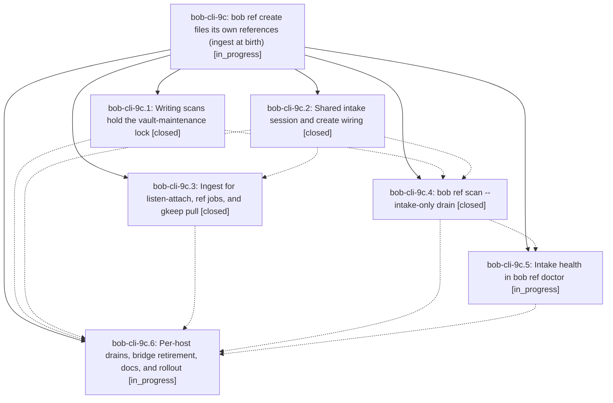

# Bead: bob-cli-9c — bob ref create files its own references (ingest at birth)

[Bead Pages](../README.md) / bob-cli-9c

**Status:** ◐ in_progress · **Type:** ▸ plan · **Tier:** epic
**Owner:** `bryanbugyi34@gmail.com` · **Created by:** [bbugyi200.athena.research.4s.linker.w0](https://github.com/bobs-org/bob-cli--agents/blob/main/sessions/bbugyi200.athena.research.4s.linker.w0.md) · **Assignee:** `bob-cli-9c.land`
**Created:** 2026-10-18 14:40:03 EDT
**Plan:** [202610/ref\_ingest\_at\_birth.md](https://github.com/bobs-org/bob-cli--plans/blob/main/202610/ref_ingest_at_birth.md)

<!-- sase:links:start -->

## Links

| Relation | Artifact | Why |
| --- | --- | --- |
| implemented-by | [plan:202610/ref_ingest_at_birth.md][1] | derived from the plan's `bead_id:` frontmatter field |

_Plus 2 automatic references — see [Referenced By](#referenced-by)._

[1]: https://github.com/bobs-org/bob-cli--plans/blob/main/202610/ref_ingest_at_birth.md

<!-- sase:links:end -->

## Description

A successful `bob ref create` on athena, apollo, or the Mac leaves the reference in the library — PDF in `lib/`, ref note written, reading task filed — committed and pushed as one commit, so `bob ref scan` becomes a repair tool instead of a daily step. When inline ingest cannot run, the PDF stays queued in that host's `xlib/` with a visible reason and a per-host `bob ref scan --intake-only` timer files it later.

## Phases

| Bead | Title | Status | Size | Created | Agents | Commits |
|---|---|---|---|---|---:|---:|
| [bob-cli-9c.1](bob-cli-9c.1.md) | Writing scans hold the vault-maintenance lock | ✓ closed | small | 2026-10-18 | 1 | 1 |
| [bob-cli-9c.2](bob-cli-9c.2.md) | Shared intake session and create wiring | ✓ closed | medium | 2026-10-18 | 1 | 1 |
| [bob-cli-9c.3](bob-cli-9c.3.md) | Ingest for listen-attach, ref jobs, and gkeep pull | ✓ closed | medium | 2026-10-18 | 1 | 1 |
| [bob-cli-9c.4](bob-cli-9c.4.md) | bob ref scan --intake-only drain | ✓ closed | medium | 2026-10-18 | 1 | 1 |
| [bob-cli-9c.5](bob-cli-9c.5.md) | Intake health in bob ref doctor | ◐ in_progress | small | 2026-10-18 | 1 | 1 |
| [bob-cli-9c.6](bob-cli-9c.6.md) | Per-host drains, bridge retirement, docs, and rollout | ◐ in_progress | medium | 2026-10-18 | 1 | 0 |

## Lineage

## Agents

| Agent | Bead | Commits |
|---|---|---:|
| [bbugyi200.athena.bob-cli-9c.1](https://github.com/bobs-org/bob-cli--agents/blob/main/sessions/bbugyi200.athena.bob-cli-9c.1.md) | [bob-cli-9c.1](bob-cli-9c.1.md) | 1 |
| [bbugyi200.athena.bob-cli-9c.2](https://github.com/bobs-org/bob-cli--agents/blob/main/agents/bbugyi200.athena.bob-cli-9c.2/README.md) | [bob-cli-9c.2](bob-cli-9c.2.md) | 1 |
| [bbugyi200.athena.bob-cli-9c.3](https://github.com/bobs-org/bob-cli--agents/blob/main/agents/bbugyi200.athena.bob-cli-9c.3/README.md) | [bob-cli-9c.3](bob-cli-9c.3.md) | 1 |
| [bbugyi200.athena.bob-cli-9c.4](https://github.com/bobs-org/bob-cli--agents/blob/main/agents/bbugyi200.athena.bob-cli-9c.4/README.md) | [bob-cli-9c.4](bob-cli-9c.4.md) | 1 |
| [bbugyi200.athena.bob-cli-9c.5](https://github.com/bobs-org/bob-cli--agents/blob/main/agents/bbugyi200.athena.bob-cli-9c.5/README.md) | [bob-cli-9c.5](bob-cli-9c.5.md) | 1 |
| [bbugyi200.athena.bob-cli-9c.6](https://github.com/bobs-org/bob-cli--agents/blob/main/agents/bbugyi200.athena.bob-cli-9c.6/README.md) | [bob-cli-9c.6](bob-cli-9c.6.md) | 0 |
| [bbugyi200.athena.bob-cli-9c.land](https://github.com/bobs-org/bob-cli--agents/blob/main/agents/bbugyi200.athena.bob-cli-9c.land/README.md) | [bob-cli-9c](README.md) | 0 |

## Commits

| Repo | Commit | Subject | Bead | Committed |
|---|---|---|---|---|
| bob-cli | [`85eac25`](https://github.com/bobs-org/bob-cli/commit/85eac25aa112e0888ec09955ef0bc587e3c514ea) | feat(ref): hold vault-maintenance lock during writing scans | [bob-cli-9c.1](bob-cli-9c.1.md) | 2026-10-18 14:58:58 EDT |
| bob-cli | [`c4ac06f`](https://github.com/bobs-org/bob-cli/commit/c4ac06fb47633fcf1b26e592031a6c32c0087a8e) | feat(highlights): ingest references during create | [bob-cli-9c.2](bob-cli-9c.2.md) | 2026-10-18 15:15:47 EDT |
| bob-cli | [`fa7745f`](https://github.com/bobs-org/bob-cli/commit/fa7745fc71c0fe0cb2fafe4c78270e3b5d890837) | feat(ref): add scan --intake-only xlib drain | [bob-cli-9c.4](bob-cli-9c.4.md) | 2026-10-18 15:39:40 EDT |
| bob-cli | [`5848c39`](https://github.com/bobs-org/bob-cli/commit/5848c39d367eedf354e3276f493541ce66c40bb2) | feat(ref): ingest listen-attach, jobs, and gkeep clips at birth | [bob-cli-9c.3](bob-cli-9c.3.md) | 2026-10-18 15:48:43 EDT |
| bob-cli | [`4703619`](https://github.com/bobs-org/bob-cli/commit/47036193185db067bce5f55690eaf0ed832466b7) | feat(ref): show intake health in bob ref doctor | [bob-cli-9c.5](bob-cli-9c.5.md) | 2026-10-18 15:54:24 EDT |

<!-- sase:referenced-by:start -->

## Referenced By

| Relation | Artifact | Why | Uses |
| --- | --- | --- | ---: |
| read-by | [agent:bob-cli-9c.3][1] | Need parent epic scope and phase list | 1 |
| read-by | [agent:bob-cli-9c.4][2] | epic context | 1 |

[1]: https://github.com/bobs-org/bob-cli--agents/blob/main/agents/bbugyi200.athena.bob-cli-9c.3/README.md
[2]: https://github.com/bobs-org/bob-cli--agents/blob/main/agents/bbugyi200.athena.bob-cli-9c.4/README.md

<!-- sase:referenced-by:end -->
