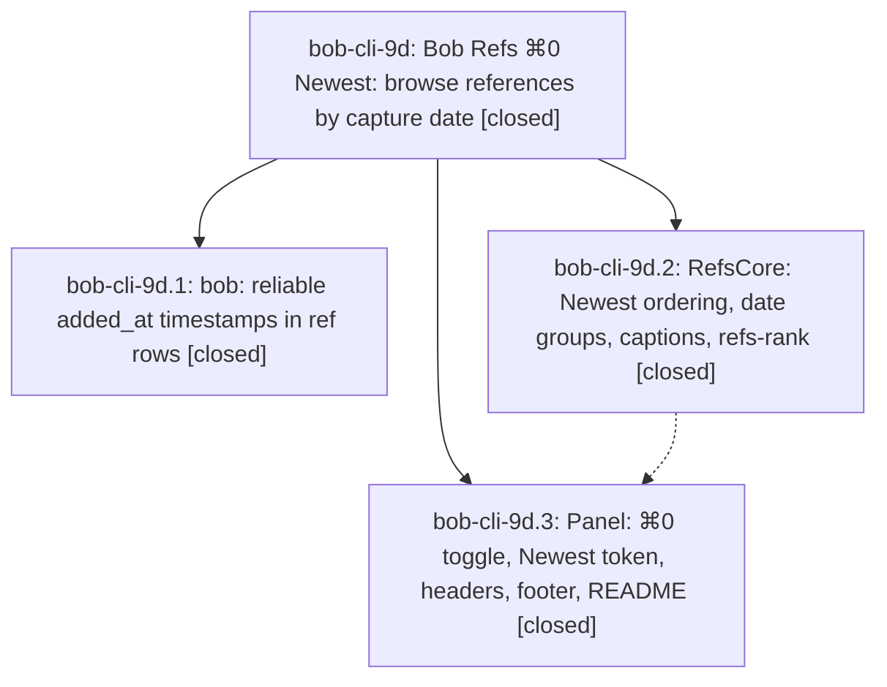

# Bead: bob-cli-9d — Bob Refs ⌘0 Newest: browse references by capture date

[Bead Pages](../README.md) / bob-cli-9d

**Status:** ✓ closed · **Resolution:** done · **Type:** ▸ plan · **Tier:** epic
**Owner:** `bryanbugyi34@gmail.com` · **Created by:** [bbugyi200.athena.11j](https://github.com/bobs-org/bob-cli--agents/blob/main/sessions/bbugyi200.athena.11j.md) · **Assignee:** `bob-cli-9d.land`
**Created:** 2026-10-18 15:40:20 EDT · **Closed:** 2026-10-18 17:17:42 EDT
**Plan:** [202610/refs\_newest\_mode.md](https://github.com/bobs-org/bob-cli--plans/blob/main/202610/refs_newest_mode.md)

<!-- sase:links:start -->

## Links

| Relation | Artifact | Why |
| --- | --- | --- |
| implemented-by | [plan:202610/refs_newest_mode.md][1] | derived from the plan's `bead_id:` frontmatter field |

_Plus 2 automatic references — see [Referenced By](#referenced-by)._

[1]: https://github.com/bobs-org/bob-cli--plans/blob/main/202610/refs_newest_mode.md

<!-- sase:links:end -->

## Description

In the Bob Refs panel, ⌘0 toggles a Newest mode: every reference in a date-grouped timeline, newest capture first, still filterable by typing. bob also reports a capture timestamp that is complete, rename-safe, and accurate to the minute where the vault knows the time.

## Notes

[2026-10-18T20:49:42Z · bob-cli-9d.land] LANDING AUDIT: Read the epic, all three children, and every note; reviewed plan:202610/refs_newest_mode.md and source/commits de78e98 (bob-cli), 5a0bff5 and 7d6063a (bob-mac-capture). Decisions honored: Newest resets on show; these epic commits edited no memory notes. Audited concurrent bob-cli changes 5848c39, 4703619, b291f23, 6bc432b, 0f47802 and Mac 2c007c7. The new intake producers converge on write_single_pdf_sync/execute_pdf_sync, whose v1 and v2 new-note branches stamp created; other concurrent changes do not conflict with Newest. No epic-symbol exemptions found. No parent_bead is linked. FOLLOW-UP TRIAGE: bob-cli-9d.2 note #1 proposed carrying gitAddedAt through plain refresh. Verified 7d6063a does that after the sweep, filters both maps to surviving paths, and uses mergingGitDates for the git pass; its new refresh regression exercises preservation. Declined a standalone follow-up because this was epic work and is already implemented by bob-cli-9d.3. No other PROPOSED FOLLOW-UP entries or unrelated issues found. REMAINING EPIC WORK: Existing RefsLibraryTests.testTriggersDuringRefreshRunExactlyOneFollowUp and testSnapshotPassKeepsGitDatesMergedDuringItsSweep still use refs-list-git.json, which lacks added_at on both git rows, while asserting only one git pass. An executable Swift probe using the unchanged production RefsSnapshot implementation with those fixture records confirms that both ref/blogs/small_opened.md and ref/books/small_book.md remain in pathsNeedingGitDates after merge and plain refresh. Update normal current-bob fixtures and preserve separate old-bob coverage, then verify and finish closeout through a small tale. This is introduced by the epic, not an unrelated infrastructure task. Native XCTest was not run; SSH to mac timed out. Re-run just check, portable-check, and the actual current-bob-to-refs-rank live pipeline before closing; prior phase green reports are not fresh landing verification.

[2026-10-18T20:51:14Z · bob-cli-9b.land] DISCOVERED ISSUE: bob-cli-9b.land observed macOS CI run https://github.com/bobs-org/bob-mac-capture/actions/runs/39164361288 on 2c007c74c086223718fe55a61b5cdc230af890f3 fail during Test compilation: Tests/RefsCoreTests/RefsNewestTests.swift:12 static let zone conflicts with NSObject.zone() through the Objective-C selector. git blame traces the declaration and its calendar use to 5a0bff53 (bob-cli-9d.2). Lint and Build passed; Test could not run, so Bundle and launch/install gates were skipped. Rename the test timezone helper and its uses, then compile/run XCTest on macOS CI; Linux portable-check and the macOS stub typecheck do not expose this inherited XCTestCase/NSObject conflict. The bare-x epic did not edit this file. sase_new_task searched same-type and all-type reports, swept the last-week tasks, and found no semantic duplicate; routed to this causally responsible active epic instead of creating a task.

[2026-10-18T21:17:42Z · bob-cli-9d.land--1] LANDING CLOSEOUT: Re-read the epic and all three phases; all children are closed, and the epic has no parent_bead. Honored newest_persistence=reset and memory_added_time_record=no; no memory notes changed. Integrated bob-cli de78e98 with Mac RefsCore 5a0bff5 and panel 7d6063a. Fixture repair: refs-list-git.json now carries added_at for both git rows; refresh tests assert both exact dates and instants and use the fixture directly, with legacy decode-if-absent coverage retained. The bob-cli-9d.2 note #1 gitAddedAt refresh follow-up was resolved in 7d6063a; no separate task was filed. Verification passed: just check; Mac just portable-check (1,370 tests, zero failures); live bob ref list -R all -A -f json -g through refs-rank --newest produced 1,075 rows, zero null added, 471 non-null added_at; sources captured=26, created=165, git=282, zorg_block=602. Newest groups: TODAY 8, YESTERDAY 18, weekdays Oct 12-16, OCTOBER 117, SEPTEMBER 138, AUGUST 61, JULY 23, JUNE 35; UNDATED empty. Mac scratch bundle/typecheck remains unverified because SSH to the Mac timed out. No symvision recipe is available; epic-symbols reports no entries. plan:202610/refs_newest_mode.md status changed from wip to done only. No standalone follow-up was needed.

## Phases

| Bead | Title | Status | Size | Created | Agents | Commits |
|---|---|---|---|---|---:|---:|
| [bob-cli-9d.1](bob-cli-9d.1.md) | bob: reliable added\_at timestamps in ref rows | ✓ closed | medium | 2026-10-18 | 1 | 1 |
| [bob-cli-9d.2](bob-cli-9d.2.md) | RefsCore: Newest ordering, date groups, captions, refs-rank | ✓ closed | medium | 2026-10-18 | 1 | 1 |
| [bob-cli-9d.3](bob-cli-9d.3.md) | Panel: ⌘0 toggle, Newest token, headers, footer, README | ✓ closed | medium | 2026-10-18 | 1 | 1 |

## Lineage

## Agents

| Agent | Bead | Commits |
|---|---|---:|
| [bbugyi200.athena.bob-cli-9d.1](https://github.com/bobs-org/bob-cli--agents/blob/main/sessions/bbugyi200.athena.bob-cli-9d.1.md) | [bob-cli-9d.1](bob-cli-9d.1.md) | 1 |
| [bbugyi200.athena.bob-cli-9d.2](https://github.com/bobs-org/bob-cli--agents/blob/main/agents/bbugyi200.athena.bob-cli-9d.2/README.md) | [bob-cli-9d.2](bob-cli-9d.2.md) | 1 |
| [bbugyi200.athena.bob-cli-9d.3](https://github.com/bobs-org/bob-cli--agents/blob/main/agents/bbugyi200.athena.bob-cli-9d.3/README.md) | [bob-cli-9d.3](bob-cli-9d.3.md) | 1 |
| [bbugyi200.athena.bob-cli-9d.land](https://github.com/bobs-org/bob-cli--agents/blob/main/sessions/bbugyi200.athena.bob-cli-9d.land.md) | [bob-cli-9d](README.md) | 2 |

## Commits

| Repo | Commit | Subject | Bead | Committed |
|---|---|---|---|---|
| bob-mac-capture | [`bob-mac-capture@5a0bff5`](https://github.com/bobs-org/bob-mac-capture/commit/5a0bff53388edce1c3f12908bfd7f1f9565b6ea3) | feat(refs): add Newest ordering, date groups, and refs-rank --newest | [bob-cli-9d.2](bob-cli-9d.2.md) | 2026-10-18 15:58:15 EDT |
| bob-cli | [`de78e98`](https://github.com/bobs-org/bob-cli/commit/de78e982011b3424aa3d18f62aeb797daa0ba643) | feat(ref): add reliable added\_at timestamps | [bob-cli-9d.1](bob-cli-9d.1.md) | 2026-10-18 16:23:07 EDT |
| bob-mac-capture | [`bob-mac-capture@7d6063a`](https://github.com/bobs-org/bob-mac-capture/commit/7d6063a66a38e289644ef3a69a3abcad173af9a4) | feat(refs): add ⌘0 Newest mode to the Bob Refs panel | [bob-cli-9d.3](bob-cli-9d.3.md) | 2026-10-18 16:38:35 EDT |
| bob-mac-capture | [`bob-mac-capture@cbd4e42`](https://github.com/bobs-org/bob-mac-capture/commit/cbd4e423533abc734e139ade0f6b8d9ea73e9720) | test(refs): complete Newest git instant fixture coverage | [bob-cli-9d](README.md) | 2026-10-18 17:18:19 EDT |
| bob-cli--plans | [`bob-cli--plans@fec33fa`](https://github.com/bobs-org/bob-cli--plans/commit/fec33fa93ac4d47d729371db880a1bcdbd73cea2) | docs(refs): mark Newest plan complete | [bob-cli-9d](README.md) | 2026-10-18 17:20:48 EDT |

<!-- sase:referenced-by:start -->

## Referenced By

| Relation | Artifact | Why | Uses |
| --- | --- | --- | ---: |
| read-by | [agent:bob-cli-9d.3][1] | Need parent epic scope and sibling phases | 1 |
| read-by | [agent:bob-cli-9d.land--1][2] | Need current epic scope, notes, and status to close approved work | 3 |

[1]: https://github.com/bobs-org/bob-cli--agents/blob/main/agents/bbugyi200.athena.bob-cli-9d.3/README.md
[2]: https://github.com/bobs-org/bob-cli--agents/blob/main/sessions/bbugyi200.athena.bob-cli-9d.land.md

<!-- sase:referenced-by:end -->
