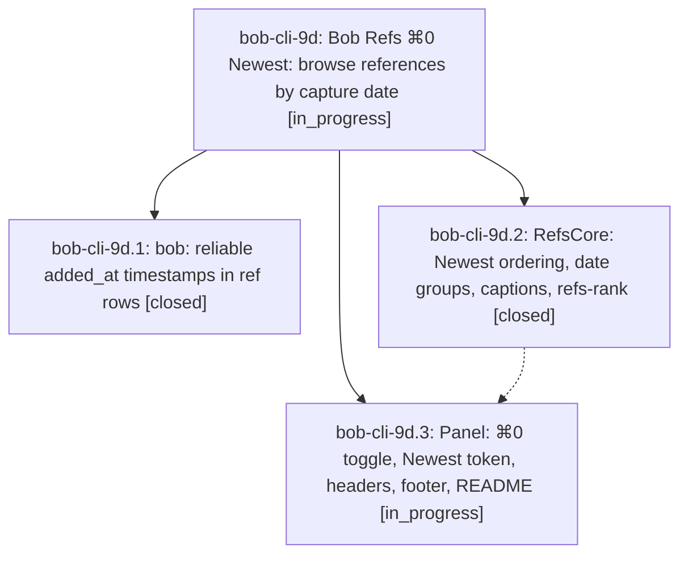

# Bead: bob-cli-9d — Bob Refs ⌘0 Newest: browse references by capture date

[Bead Pages](../README.md) / bob-cli-9d

**Status:** ◐ in_progress · **Type:** ▸ plan · **Tier:** epic
**Owner:** `bryanbugyi34@gmail.com` · **Created by:** [bbugyi200.athena.11j](https://github.com/bobs-org/bob-cli--agents/blob/main/sessions/bbugyi200.athena.11j.md) · **Assignee:** `bob-cli-9d.land`
**Created:** 2026-10-18 15:40:20 EDT
**Plan:** [202610/refs\_newest\_mode.md](https://github.com/bobs-org/bob-cli--plans/blob/main/202610/refs_newest_mode.md)

<!-- sase:links:start -->

## Links

| Relation | Artifact | Why |
| --- | --- | --- |
| implemented-by | [plan:202610/refs_newest_mode.md][1] | derived from the plan's `bead_id:` frontmatter field |

[1]: https://github.com/bobs-org/bob-cli--plans/blob/main/202610/refs_newest_mode.md

<!-- sase:links:end -->

## Description

In the Bob Refs panel, ⌘0 toggles a Newest mode: every reference in a date-grouped timeline, newest capture first, still filterable by typing. bob also reports a capture timestamp that is complete, rename-safe, and accurate to the minute where the vault knows the time.

## Phases

| Bead | Title | Status | Size | Created | Agents | Commits |
|---|---|---|---|---|---:|---:|
| [bob-cli-9d.1](bob-cli-9d.1.md) | bob: reliable added\_at timestamps in ref rows | ✓ closed | medium | 2026-10-18 | 1 | 1 |
| [bob-cli-9d.2](bob-cli-9d.2.md) | RefsCore: Newest ordering, date groups, captions, refs-rank | ✓ closed | medium | 2026-10-18 | 1 | 0 |
| [bob-cli-9d.3](bob-cli-9d.3.md) | Panel: ⌘0 toggle, Newest token, headers, footer, README | ◐ in_progress | medium | 2026-10-18 | 1 | 0 |

## Lineage

## Agents

| Agent | Bead | Commits |
|---|---|---:|
| [bbugyi200.athena.bob-cli-9d.1](https://github.com/bobs-org/bob-cli--agents/blob/main/sessions/bbugyi200.athena.bob-cli-9d.1.md) | [bob-cli-9d.1](bob-cli-9d.1.md) | 1 |
| [bbugyi200.athena.bob-cli-9d.2](https://github.com/bobs-org/bob-cli--agents/blob/main/agents/bbugyi200.athena.bob-cli-9d.2/README.md) | [bob-cli-9d.2](bob-cli-9d.2.md) | 0 |
| [bbugyi200.athena.bob-cli-9d.3](https://github.com/bobs-org/bob-cli--agents/blob/main/agents/bbugyi200.athena.bob-cli-9d.3/README.md) | [bob-cli-9d.3](bob-cli-9d.3.md) | 0 |
| [bbugyi200.athena.bob-cli-9d.land](https://github.com/bobs-org/bob-cli--agents/blob/main/agents/bbugyi200.athena.bob-cli-9d.land/README.md) | [bob-cli-9d](README.md) | 0 |

## Commits

| Repo | Commit | Subject | Bead | Committed |
|---|---|---|---|---|
| bob-cli | [`de78e98`](https://github.com/bobs-org/bob-cli/commit/de78e982011b3424aa3d18f62aeb797daa0ba643) | feat(ref): add reliable added\_at timestamps | [bob-cli-9d.1](bob-cli-9d.1.md) | 2026-10-18 16:23:07 EDT |
