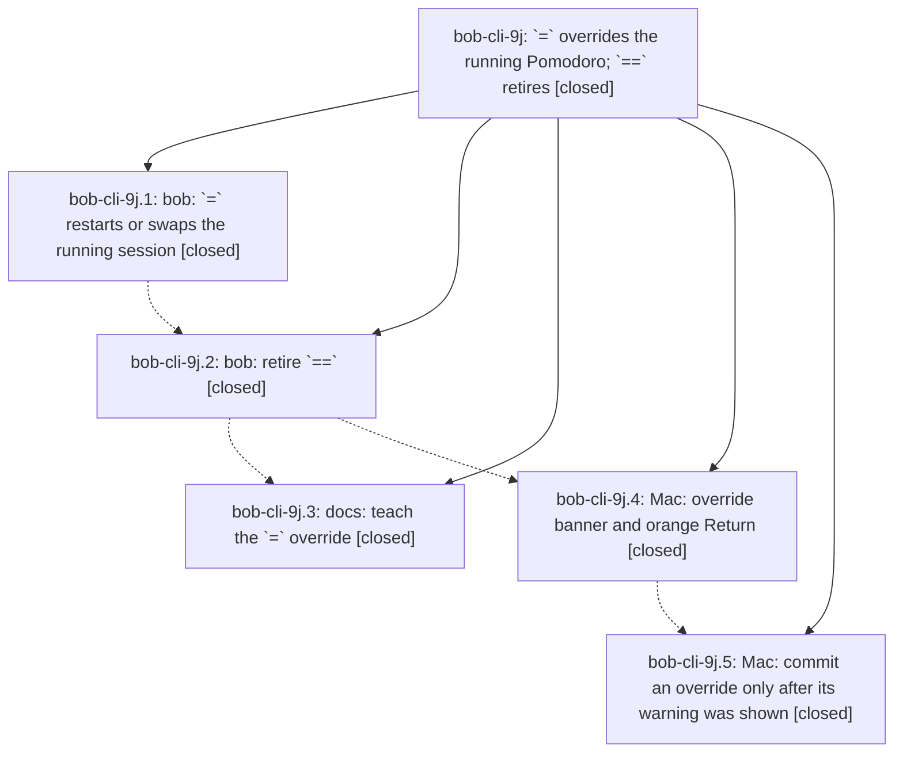

# Bead: bob-cli-9j — \`=\` overrides the running Pomodoro; \`==\` retires

[Bead Pages](../README.md) / bob-cli-9j

**Status:** ✓ closed · **Resolution:** done · **Type:** ▸ plan · **Tier:** epic
**Owner:** `bryanbugyi34@gmail.com` · **Created by:** [bbugyi200.apollo.91](https://github.com/bobs-org/bob-cli--agents/blob/main/sessions/bbugyi200.apollo.91.md) · **Assignee:** `bob-cli-9j.land`
**Created:** 2026-10-18 16:26:20 EDT · **Closed:** 2026-10-18 20:20:02 EDT
**Plan:** [202610/eq\_overrides\_running\_pomodoro.md](https://github.com/bobs-org/bob-cli--plans/blob/main/202610/eq_overrides_running_pomodoro.md)

<!-- sase:links:start -->

## Links

| Relation | Artifact | Why |
| --- | --- | --- |
| implemented-by | [plan:202610/eq_overrides_running_pomodoro.md][1] | derived from the plan's `bead_id:` frontmatter field |
| related | [bead:bob-cli-9n][2] | Its = override surfaces and capture-complete override context get homes in bob-cli-9k's remaining work; avoid colliding with 9j's landing tale |

_Plus 2 automatic references — see [Referenced By](#referenced-by)._

[1]: https://github.com/bobs-org/bob-cli--plans/blob/main/202610/eq_overrides_running_pomodoro.md
[2]: https://github.com/bobs-org/bob-cli--beads/blob/main/pages/bob-cli-9n/README.md

<!-- sase:links:end -->

## Description

A whole-item `=` start restarts or swaps the running Pomodoro by itself, `==` becomes a retired teaching error, and Bob Mac Capture shows a clear, unmissable override warning and never commits an override whose warning was not on screen.

## Notes

[2026-10-18T23:51:51Z · bob-cli-9j.land] LAND FOLLOW-UP TRIAGE (bob-cli-9j.land, before the remaining-work tale): (1) The decisions-web record for = overriding the running Pomodoro, proposed by 9j.1 #1, 9j.2 #1, 9j.3 #1, 9j.4 #1, and 9j.5 #1, is one item. /sase_new_task found no duplicate, so I created memory task bob-cli-9l (ready, small, path decisions/eq-overrides-the-running-pomodoro.md). No memory was edited, because decision_record=no. (2) 9j.1 #2 (just check Mermaid/pandoc clean-base failures) duplicates open bob-cli-9i. I corroborated it with +1: b9788c45 gated both skip helpers on pdftotext, so diagrams_/lifted/pandoc_maps pass 11/11 on 930b3495, but 9i's lossy-fallback remedy is still open. I declined a new task. I also noted on active bob-cli-87 that b9788c45 widened its lifted-link test. (3) 9j.4 #2 (capture-complete omits override on an empty =# or =3#) was caused by this epic: b9788c45 added a name.is_empty() guard in pomodoro_start_override_at that contradicts the plan ('The swap picker status now appears for =# while a session runs'; 9j.1 test list '=# with one session running'). It is remaining epic work for the tale, not a task. (4) Discovered: bob-mac-capture macOS CI Test step does not compile (RefsNewestTests.zone vs NSObject.zone(), plus RefsLibraryTests using a helper from another target), introduced by closed bob-cli-9d. It is not caused by this epic. No duplicate existed, so I created ci task bob-cli-9m (ready, small), linked to bob-cli-8j and bob-cli-9d. Build passes for 4c391eb and 12219ef, so the macOS app targets compile, but no Mac XCTest ran on CI.

[2026-10-19T00:20:02Z · bob-cli-9j.land--1] Verification closeout: after formatting the changed completion assertion, just check passed (cargo fmt --check; cargo clippy --all-targets --all-features passed with existing warnings; cargo test --no-fail-fast passed: 2,987 library tests, 0 failed, 1 ignored; CLI, task parity, and doc targets all passed). Relevant tests passed: pomodoro_start_name_context_reports_ledger_behavior; named_start_completion_carries_keeps_ledger_and_running; capture_complete_pomodoro_start_name_json_covers_empty_and_new_queries; capture_complete_override_name_json_carries_keeps_ledger_and_running. Athena just portable-check: 1,381 tests, 0 failures. Mac bundle succeeded; just typecheck-tests reports the known unrelated RefsNewestTests target compile issue. Prior phase commits remain 5ec1390e, b9788c45, ec9009fd. Follow-up triage remains: bob-cli-9l for the declined decision record; bob-cli-9i for clean-base Mermaid/pandoc failures, corroborated on bob-cli-87; bob-cli-9m tracks the unrelated RefsNewestTests CI compile issue. No epic-symbols or symvision command/recipe is configured in this checkout. Working-tree diff reviewed; git diff --check passes.

## Phases

| Bead | Title | Status | Size | Created | Agents | Commits |
|---|---|---|---|---|---:|---:|
| [bob-cli-9j.1](bob-cli-9j.1.md) | bob: \`=\` restarts or swaps the running session | ✓ closed | medium | 2026-10-18 | 1 | 1 |
| [bob-cli-9j.2](bob-cli-9j.2.md) | bob: retire \`==\` | ✓ closed | medium | 2026-10-18 | 1 | 1 |
| [bob-cli-9j.3](bob-cli-9j.3.md) | docs: teach the \`=\` override | ✓ closed | medium | 2026-10-18 | 1 | 1 |
| [bob-cli-9j.4](bob-cli-9j.4.md) | Mac: override banner and orange Return | ✓ closed | medium | 2026-10-18 | 1 | 1 |
| [bob-cli-9j.5](bob-cli-9j.5.md) | Mac: commit an override only after its warning was shown | ✓ closed | small | 2026-10-18 | 1 | 1 |

## Lineage

## Agents

| Agent | Bead | Commits |
|---|---|---:|
| [bbugyi200.apollo.bob-cli-9j.1](https://github.com/bobs-org/bob-cli--agents/blob/main/agents/bbugyi200.apollo.bob-cli-9j.1/README.md) | [bob-cli-9j.1](bob-cli-9j.1.md) | 1 |
| [bbugyi200.apollo.bob-cli-9j.2](https://github.com/bobs-org/bob-cli--agents/blob/main/sessions/bbugyi200.apollo.bob-cli-9j.2.md) | [bob-cli-9j.2](bob-cli-9j.2.md) | 1 |
| [bbugyi200.apollo.bob-cli-9j.3](https://github.com/bobs-org/bob-cli--agents/blob/main/agents/bbugyi200.apollo.bob-cli-9j.3/README.md) | [bob-cli-9j.3](bob-cli-9j.3.md) | 1 |
| [bbugyi200.apollo.bob-cli-9j.4](https://github.com/bobs-org/bob-cli--agents/blob/main/agents/bbugyi200.apollo.bob-cli-9j.4/README.md) | [bob-cli-9j.4](bob-cli-9j.4.md) | 1 |
| [bbugyi200.apollo.bob-cli-9j.5](https://github.com/bobs-org/bob-cli--agents/blob/main/agents/bbugyi200.apollo.bob-cli-9j.5/README.md) | [bob-cli-9j.5](bob-cli-9j.5.md) | 1 |
| [bbugyi200.apollo.bob-cli-9j.land](https://github.com/bobs-org/bob-cli--agents/blob/main/sessions/bbugyi200.apollo.bob-cli-9j.land.md) | [bob-cli-9j](README.md) | 3 |

## Commits

| Repo | Commit | Subject | Bead | Committed |
|---|---|---|---|---|
| bob-cli | [`5ec1390`](https://github.com/bobs-org/bob-cli/commit/5ec1390ee52ea1bddb1194e0ba3a29565efac77a) | feat(capture): let \`=\` restart or swap the running Pomodoro | [bob-cli-9j.1](bob-cli-9j.1.md) | 2026-10-18 17:07:14 EDT |
| bob-cli | [`b9788c4`](https://github.com/bobs-org/bob-cli/commit/b9788c45cc163aef693dda6ea7bc540c5849f73b) | fix(capture): retire double-equals Pomodoro syntax | [bob-cli-9j.2](bob-cli-9j.2.md) | 2026-10-18 18:28:24 EDT |
| bob-cli | [`ec9009f`](https://github.com/bobs-org/bob-cli/commit/ec9009fdb20eab43ac891b94ef2ddb2880afa19d) | docs(capture): document Pomodoro overrides | [bob-cli-9j.3](bob-cli-9j.3.md) | 2026-10-18 18:42:02 EDT |
| bob-mac-capture | [`bob-mac-capture@4c391eb`](https://github.com/bobs-org/bob-mac-capture/commit/4c391eb3263e4a407459b4acffca439a91bab9d2) | feat(capture): show orange override banner when \`=\` restarts or swaps | [bob-cli-9j.4](bob-cli-9j.4.md) | 2026-10-18 19:08:57 EDT |
| bob-mac-capture | [`bob-mac-capture@12219ef`](https://github.com/bobs-org/bob-mac-capture/commit/12219ef6ce4f0e3a21e1cb85f2c1efcfc36b9e13) | feat(capture): guard Mac submits until override warning is on screen | [bob-cli-9j.5](bob-cli-9j.5.md) | 2026-10-18 19:31:43 EDT |
| bob-cli | [`af3b4bb`](https://github.com/bobs-org/bob-cli/commit/af3b4bb354f0ec6c8e0213aaa14170d2eae23390) | fix(capture): expose override state in empty name picker | [bob-cli-9j](README.md) | 2026-10-18 20:21:45 EDT |
| bob-mac-capture | [`bob-mac-capture@9288244`](https://github.com/bobs-org/bob-mac-capture/commit/928824422e62ea78bd15de81f00bdb97c6c89524) | fix(capture): preview overrides before a name is entered | [bob-cli-9j](README.md) | 2026-10-18 20:22:44 EDT |
| bob-cli--plans | [`bob-cli--plans@371f70d`](https://github.com/bobs-org/bob-cli--plans/commit/371f70d83ecad098cfc4f0b4ee1491c121f7bdee) | docs(plan): mark Pomodoro override epic done | [bob-cli-9j](README.md) | 2026-10-18 20:23:15 EDT |

<!-- sase:referenced-by:start -->

## Referenced By

| Relation | Artifact | Why | Uses |
| --- | --- | --- | ---: |
| read-by | [agent:bob-cli-9j.5][1] | Need epic scope and remaining phases | 1 |
| read-by | [agent:bob-cli-9j.land--1][2] | Need task history, linked epic plan, and prior verification context before closure. | 2 |

[1]: https://github.com/bobs-org/bob-cli--agents/blob/main/agents/bbugyi200.apollo.bob-cli-9j.5/README.md
[2]: https://github.com/bobs-org/bob-cli--agents/blob/main/sessions/bbugyi200.apollo.bob-cli-9j.land.md

<!-- sase:referenced-by:end -->
