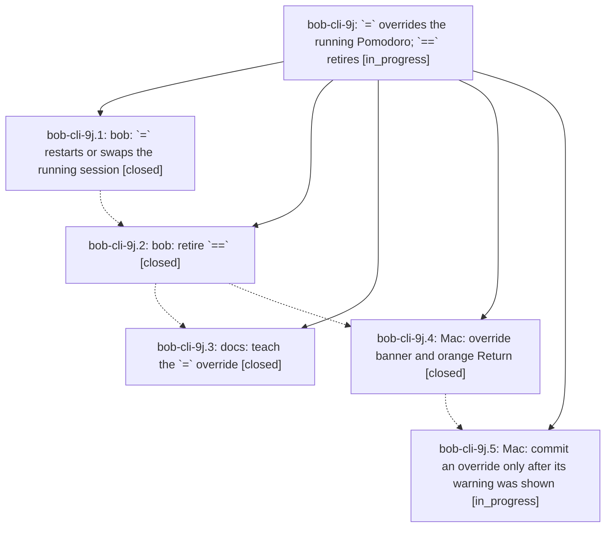

# Bead: bob-cli-9j — \`=\` overrides the running Pomodoro; \`==\` retires

[Bead Pages](../README.md) / bob-cli-9j

**Status:** ◐ in_progress · **Type:** ▸ plan · **Tier:** epic
**Owner:** `bryanbugyi34@gmail.com` · **Created by:** [bbugyi200.apollo.91](https://github.com/bobs-org/bob-cli--agents/blob/main/sessions/bbugyi200.apollo.91.md) · **Assignee:** `bob-cli-9j.land`
**Created:** 2026-10-18 16:26:20 EDT
**Plan:** [202610/eq\_overrides\_running\_pomodoro.md](https://github.com/bobs-org/bob-cli--plans/blob/main/202610/eq_overrides_running_pomodoro.md)

<!-- sase:links:start -->

## Links

| Relation | Artifact | Why |
| --- | --- | --- |
| implemented-by | [plan:202610/eq_overrides_running_pomodoro.md][1] | derived from the plan's `bead_id:` frontmatter field |

[1]: https://github.com/bobs-org/bob-cli--plans/blob/main/202610/eq_overrides_running_pomodoro.md

<!-- sase:links:end -->

## Description

A whole-item `=` start restarts or swaps the running Pomodoro by itself, `==` becomes a retired teaching error, and Bob Mac Capture shows a clear, unmissable override warning and never commits an override whose warning was not on screen.

## Phases

| Bead | Title | Status | Size | Created | Agents | Commits |
|---|---|---|---|---|---:|---:|
| [bob-cli-9j.1](bob-cli-9j.1.md) | bob: \`=\` restarts or swaps the running session | ✓ closed | medium | 2026-10-18 | 1 | 1 |
| [bob-cli-9j.2](bob-cli-9j.2.md) | bob: retire \`==\` | ✓ closed | medium | 2026-10-18 | 1 | 1 |
| [bob-cli-9j.3](bob-cli-9j.3.md) | docs: teach the \`=\` override | ✓ closed | medium | 2026-10-18 | 1 | 0 |
| [bob-cli-9j.4](bob-cli-9j.4.md) | Mac: override banner and orange Return | ✓ closed | medium | 2026-10-18 | 1 | 1 |
| [bob-cli-9j.5](bob-cli-9j.5.md) | Mac: commit an override only after its warning was shown | ◐ in_progress | small | 2026-10-18 | 1 | 0 |

## Lineage

## Agents

| Agent | Bead | Commits |
|---|---|---:|
| [bbugyi200.apollo.bob-cli-9j.1](https://github.com/bobs-org/bob-cli--agents/blob/main/agents/bbugyi200.apollo.bob-cli-9j.1/README.md) | [bob-cli-9j.1](bob-cli-9j.1.md) | 1 |
| [bbugyi200.apollo.bob-cli-9j.2](https://github.com/bobs-org/bob-cli--agents/blob/main/sessions/bbugyi200.apollo.bob-cli-9j.2.md) | [bob-cli-9j.2](bob-cli-9j.2.md) | 1 |
| [bbugyi200.apollo.bob-cli-9j.3](https://github.com/bobs-org/bob-cli--agents/blob/main/agents/bbugyi200.apollo.bob-cli-9j.3/README.md) | [bob-cli-9j.3](bob-cli-9j.3.md) | 0 |
| [bbugyi200.apollo.bob-cli-9j.4](https://github.com/bobs-org/bob-cli--agents/blob/main/agents/bbugyi200.apollo.bob-cli-9j.4/README.md) | [bob-cli-9j.4](bob-cli-9j.4.md) | 1 |
| [bbugyi200.apollo.bob-cli-9j.5](https://github.com/bobs-org/bob-cli--agents/blob/main/agents/bbugyi200.apollo.bob-cli-9j.5/README.md) | [bob-cli-9j.5](bob-cli-9j.5.md) | 0 |
| [bbugyi200.apollo.bob-cli-9j.land](https://github.com/bobs-org/bob-cli--agents/blob/main/agents/bbugyi200.apollo.bob-cli-9j.land/README.md) | [bob-cli-9j](README.md) | 0 |

## Commits

| Repo | Commit | Subject | Bead | Committed |
|---|---|---|---|---|
| bob-cli | [`5ec1390`](https://github.com/bobs-org/bob-cli/commit/5ec1390ee52ea1bddb1194e0ba3a29565efac77a) | feat(capture): let \`=\` restart or swap the running Pomodoro | [bob-cli-9j.1](bob-cli-9j.1.md) | 2026-10-18 17:07:14 EDT |
| bob-cli | [`b9788c4`](https://github.com/bobs-org/bob-cli/commit/b9788c45cc163aef693dda6ea7bc540c5849f73b) | fix(capture): retire double-equals Pomodoro syntax | [bob-cli-9j.2](bob-cli-9j.2.md) | 2026-10-18 18:28:24 EDT |
| bob-mac-capture | [`bob-mac-capture@4c391eb`](https://github.com/bobs-org/bob-mac-capture/commit/4c391eb3263e4a407459b4acffca439a91bab9d2) | feat(capture): show orange override banner when \`=\` restarts or swaps | [bob-cli-9j.4](bob-cli-9j.4.md) | 2026-10-18 19:08:57 EDT |
