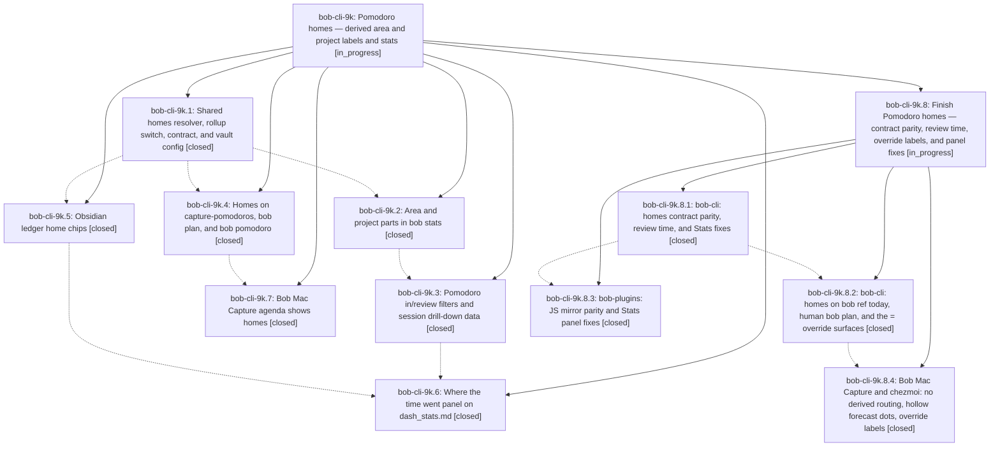

# Bead: bob-cli-9k — Pomodoro homes — derived area and project labels and stats

[Bead Pages](../README.md) / bob-cli-9k

**Status:** ◐ in_progress · **Type:** ▸ plan · **Tier:** epic
**Owner:** `bryanbugyi34@gmail.com` · **Created by:** [bbugyi200.athena.research.4t.linker.w0](https://github.com/bobs-org/bob-cli--agents/blob/main/sessions/bbugyi200.athena.research.4t.linker.w0.md) · **Assignee:** `bob-cli-9k.land`
**Created:** 2026-10-18 16:35:49 EDT
**Plan:** [202610/pomodoro\_homes.md](https://github.com/bobs-org/bob-cli--plans/blob/main/202610/pomodoro_homes.md)

<!-- sase:links:start -->

## Links

| Relation | Artifact | Why |
| --- | --- | --- |
| implemented-by | [plan:202610/pomodoro_homes.md][1] | derived from the plan's `bead_id:` frontmatter field |
| related | [bead:bob-cli-9n][2] | Source epic: Pomodoro homes resolver, R9 homes object, and the live-surface pattern this task extends |

_Plus 4 automatic references — see [Referenced By](#referenced-by)._

[1]: https://github.com/bobs-org/bob-cli--plans/blob/main/202610/pomodoro_homes.md
[2]: https://github.com/bobs-org/bob-cli--beads/blob/main/pages/bob-cli-9n/README.md

<!-- sase:links:end -->

## Description

Every Pomodoro is labeled, on every surface, by the areas and projects of the tasks it links. The labels are derived at read time from Task Links and never written to the vault. `bob stats` and `dash_stats.md` aggregate time and task throughput by area and project. `rollup: subprojects` on `sase.md` reports every sase sub-project as `sase`. Authored names keep working exactly as they do today, but naming a session becomes optional.

## Notes

[2026-10-19T00:16:22Z · bob-cli-9k.land] LAND FOLLOW-UP TRIAGE (bob-cli-9k.land): (1) 9k.2 #2 scan_hooks.rs rustfmt: declined, already fixed (196af9b reformatted tests/cli/highlights/scan_hooks.rs; landing just check on 1933d54 passes fmt, clippy gate, and 4998 tests). (2) 9k.5 #1 / 9k.6 #1 six clean-base bob-plugins failures: already corroborated by 9k.6 on existing bob-cli-6v (unblocked glyph x4), bob-cli-6w (Keep counts once), bob-cli-7i (forward/reverse project conversion); the landing reran the full suite on bob-plugins fdc4528 (3098/3104, same six) and on a 60148ab export (same six), so no new task. (3) 9k.5 #1 stage ranker 16 ms timing miss: duplicate of bob-cli-3w, recorded +1. (4) 9k.7 #1 RefsLibraryTests/RefsNewestTests Mac test compile failure: duplicate of bob-cli-9m (filed by bob-cli-9j.land), recorded +1 with CI run 39171275522 on e5cd4e1 (Lint+Build green, Test red), so no new task; the 9k.7 macOS-only XCTests have not run on CI until 9m lands. (5) Discovered: pre-existing unnamed-session placeholders outside the plan's surfaces (x close preview, capture-complete pomodoro_name candidates, successor entry_name, Mac pickers, plugin pickers): no duplicate or causal active epic, created feature bob-cli-9n (large, ready), linked to 9k and 9j. (6) Declined: consolidating stats' two parent-chain walkers (task in: vs pomodoro pre_rollup_chain) since they agree today and docs/stats.md already promises equal rules; Reading Board using --bob-area-* tokens (optional polish, no requirement); 'unnamed' wording in close/sync error messages (low value). Remaining epic-caused gaps (R5 split remainder, rust_only vector over-marking, JS mirror parity, review_time vs GTD review row, closed zero-minute state, theme re-split without in:, catalog pruning, projects list alignment, R10 CLI caveat, review hue, stale allow(unused), bob ref today homes, human bob plan chip, 9j override-surface integration, Stats panel chart-pin refresh and view fixes, Mac Refs Today routing/toast and hollow dot, chezmoi tmux sample) go to a child epic plan.

[2026-10-19T01:57:10Z · bob-cli-9k.8.land] LANDING BLOCKER from child bob-cli-9k.8 review: the child is not yet complete. Confirmed runtime Obsidian metadata-cache API misuse (12/18 failures with a strict getCache(path) double), Reading view re-parsing its inserted chip as authored name, single-list parent mirror mismatch, incomplete Mac restart/completion override labeling, and non-generated fixtures. Child landing tale will finish these and own normal closeout of 9k.8, then reread all descendants/notes/plans and post-child drift before normal closeout of 9k. No force-close is appropriate. Original follow-up triage remains valid; Mac CI run 39186590898 Build and Lint pass and pre-existing Test compiler failure corroborates bob-cli-9m.

[2026-10-19T02:52:24Z · bob-cli-9k.8.land--1] FINAL RECHECK (2026-10-18). Re-read all parent phases 9k.1-9k.7 and all four children of 9k.8 with notes; every phase is closed, but child epic 9k.8 remains in progress. Fetched origin for bob-cli, bob-plugins, and bob-mac-capture; there are no incoming commits. The latest monitored bob-cli just check passed (bjdsewr7tskk, exit 0), just install completed, and live plus pinned 4-week review_time is 1732m, equal to worked's @review:GTD project parts through Oct 17. Plugin source build:check and npm run validate pass; vectors are byte-identical, changed fragments are 849/331 lines, npm test is 3110/3116 with only the six exact clean-base failures already tracked by bob-cli-6v, 6w, and 7i; sync copied 2 files and dry-run copied 0. Mac just portable-check now passes 1389/1389 after updating stale expectations for the generated real wire fixture. The required isolated live Obsidian check is still blocked by the recorded 1.14.4 Loading screen/DevTools timeout with plugins disabled (artifacts file:explicit:0f1409dbf3236065be038cb1 and file:explicit:d590262a37f7c98de4bfc541); keep 9k.8 and this parent open and do not mark either plan done. Existing proposal dispositions remain: scan_hooks formatting was fixed in 196af9b; the six plugin failures map to 6v/6w/7i; the stage-ranker timing flake maps to 3w; the pre-existing Mac XCTest compile issue maps to 9m; other placeholder surfaces map to 9n; declined stats-walker consolidation, Reading Board token polish, and unnamed wording remain low-priority/non-required. No new task was warranted. Both epic-symbol lists are empty. plan links validate reports 64 unrelated legacy errors, 0 warnings, and no finding for these plans; just symvision has no recipe. Mac-only typecheck-tests and macOS CI remain unverified because the prior Mac SSH attempt timed out and the tracked compile issue is still open.

## Phases

| Bead | Title | Status | Size | Created | Agents | Commits |
|---|---|---|---|---|---:|---:|
| [bob-cli-9k.1](bob-cli-9k.1.md) | Shared homes resolver, rollup switch, contract, and vault config | ✓ closed | medium | 2026-10-18 | 1 | 1 |
| [bob-cli-9k.2](bob-cli-9k.2.md) | Area and project parts in bob stats | ✓ closed | medium | 2026-10-18 | 1 | 1 |
| [bob-cli-9k.3](bob-cli-9k.3.md) | Pomodoro in/review filters and session drill-down data | ✓ closed | medium | 2026-10-18 | 1 | 1 |
| [bob-cli-9k.4](bob-cli-9k.4.md) | Homes on capture-pomodoros, bob plan, and bob pomodoro | ✓ closed | medium | 2026-10-18 | 1 | 2 |
| [bob-cli-9k.5](bob-cli-9k.5.md) | Obsidian ledger home chips | ✓ closed | medium | 2026-10-18 | 1 | 1 |
| [bob-cli-9k.6](bob-cli-9k.6.md) | Where the time went panel on dash\_stats.md | ✓ closed | medium | 2026-10-18 | 1 | 2 |
| [bob-cli-9k.7](bob-cli-9k.7.md) | Bob Mac Capture agenda shows homes | ✓ closed | small | 2026-10-18 | 1 | 1 |

## Lineage

## Agents

| Agent | Bead | Commits |
|---|---|---:|
| [bbugyi200.athena.bob-cli-9k.1](https://github.com/bobs-org/bob-cli--agents/blob/main/sessions/bbugyi200.athena.bob-cli-9k.1.md) | [bob-cli-9k.1](bob-cli-9k.1.md) | 1 |
| [bbugyi200.athena.bob-cli-9k.2](https://github.com/bobs-org/bob-cli--agents/blob/main/agents/bbugyi200.athena.bob-cli-9k.2/README.md) | [bob-cli-9k.2](bob-cli-9k.2.md) | 1 |
| [bbugyi200.athena.bob-cli-9k.3](https://github.com/bobs-org/bob-cli--agents/blob/main/sessions/bbugyi200.athena.bob-cli-9k.3.md) | [bob-cli-9k.3](bob-cli-9k.3.md) | 1 |
| [bbugyi200.athena.bob-cli-9k.4](https://github.com/bobs-org/bob-cli--agents/blob/main/agents/bbugyi200.athena.bob-cli-9k.4/README.md) | [bob-cli-9k.4](bob-cli-9k.4.md) | 2 |
| [bbugyi200.athena.bob-cli-9k.5](https://github.com/bobs-org/bob-cli--agents/blob/main/agents/bbugyi200.athena.bob-cli-9k.5/README.md) | [bob-cli-9k.5](bob-cli-9k.5.md) | 1 |
| [bbugyi200.athena.bob-cli-9k.6](https://github.com/bobs-org/bob-cli--agents/blob/main/agents/bbugyi200.athena.bob-cli-9k.6/README.md) | [bob-cli-9k.6](bob-cli-9k.6.md) | 2 |
| [bbugyi200.athena.bob-cli-9k.7](https://github.com/bobs-org/bob-cli--agents/blob/main/agents/bbugyi200.athena.bob-cli-9k.7/README.md) | [bob-cli-9k.7](bob-cli-9k.7.md) | 1 |
| [bbugyi200.athena.bob-cli-9k.8.1](https://github.com/bobs-org/bob-cli--agents/blob/main/sessions/bbugyi200.athena.bob-cli-9k.8.1.md) | [bob-cli-9k.8.1](bob-cli-9k.8.1.md) | 1 |
| [bbugyi200.athena.bob-cli-9k.8.2](https://github.com/bobs-org/bob-cli--agents/blob/main/agents/bbugyi200.athena.bob-cli-9k.8.2/README.md) | [bob-cli-9k.8.2](bob-cli-9k.8.2.md) | 1 |
| [bbugyi200.athena.bob-cli-9k.8.3](https://github.com/bobs-org/bob-cli--agents/blob/main/agents/bbugyi200.athena.bob-cli-9k.8.3/README.md) | [bob-cli-9k.8.3](bob-cli-9k.8.3.md) | 1 |
| [bbugyi200.athena.bob-cli-9k.8.4](https://github.com/bobs-org/bob-cli--agents/blob/main/agents/bbugyi200.athena.bob-cli-9k.8.4/README.md) | [bob-cli-9k.8.4](bob-cli-9k.8.4.md) | 2 |
| [bbugyi200.athena.bob-cli-9k.8.land](https://github.com/bobs-org/bob-cli--agents/blob/main/sessions/bbugyi200.athena.bob-cli-9k.8.land.md) | [bob-cli-9k.8](bob-cli-9k.8.md) | 3 |
| [bbugyi200.athena.bob-cli-9k.land](https://github.com/bobs-org/bob-cli--agents/blob/main/sessions/bbugyi200.athena.bob-cli-9k.land.md) | [bob-cli-9k](README.md) | 0 |

## Commits

| Repo | Commit | Subject | Bead | Committed |
|---|---|---|---|---|
| bob-cli | [`9ec332c`](https://github.com/bobs-org/bob-cli/commit/9ec332c81def3014a559e088124ef93e3bb15ae7) | feat(homes): add shared Pomodoro home resolver and rollup contract | [bob-cli-9k.1](bob-cli-9k.1.md) | 2026-10-18 17:23:52 EDT |
| bob-plugins | [`bob-plugins@0ffb3e0`](https://github.com/bobs-org/bob-plugins/commit/0ffb3e075d48d63796391e3e89dde831f0dc7bc0) | feat(bob-ledger-tools): add pomodoro home chips | [bob-cli-9k.5](bob-cli-9k.5.md) | 2026-10-18 17:51:32 EDT |
| bob-cli | [`196af9b`](https://github.com/bobs-org/bob-cli/commit/196af9b38d9bac93e7055c599a7640e0f9eac95a) | feat(pomodoro-homes): expose derived homes on live CLI surfaces | [bob-cli-9k.4](bob-cli-9k.4.md) | 2026-10-18 17:52:36 EDT |
| chezmoi | [`chezmoi@6259f0b`](https://github.com/bbugyi200/dotfiles/commit/6259f0bfd261e255bb92acf61d196829c3c72fcf) | feat(hammerspoon): show derived home labels for unnamed pomodoros | [bob-cli-9k.4](bob-cli-9k.4.md) | 2026-10-18 17:53:35 EDT |
| bob-mac-capture | [`bob-mac-capture@e5cd4e1`](https://github.com/bobs-org/bob-mac-capture/commit/e5cd4e1c3f3c12a4b83b86c409a378a67e0cd2c9) | feat(agenda): show derived Pomodoro homes on idle agenda and Refs Today | [bob-cli-9k.7](bob-cli-9k.7.md) | 2026-10-18 18:13:19 EDT |
| bob-cli | [`81103c2`](https://github.com/bobs-org/bob-cli/commit/81103c2e2b053e6107473b81f8952966e599023c) | feat(stats): add area and project parts to bob stats | [bob-cli-9k.2](bob-cli-9k.2.md) | 2026-10-18 18:29:50 EDT |
| bob-cli | [`930b349`](https://github.com/bobs-org/bob-cli/commit/930b3495c01e1bd151ce9bdab36bcf4ad9d0dda5) | feat(stats): add pomodoro in/review filters and session drill-down | [bob-cli-9k.3](bob-cli-9k.3.md) | 2026-10-18 19:17:42 EDT |
| bob-cli | [`1933d54`](https://github.com/bobs-org/bob-cli/commit/1933d544e224e92e05ca8a94b60c9e8e08538cdb) | docs(stats): document area and project attribution | [bob-cli-9k.6](bob-cli-9k.6.md) | 2026-10-18 19:45:02 EDT |
| bob-plugins | [`bob-plugins@fdc4528`](https://github.com/bobs-org/bob-plugins/commit/fdc4528d53170b2bfd0b20ae5b609023c373fc6f) | feat(stats): add area and project attribution panel | [bob-cli-9k.6](bob-cli-9k.6.md) | 2026-10-18 19:46:01 EDT |
| bob-cli | [`77c7741`](https://github.com/bobs-org/bob-cli/commit/77c77410e32b52010ad8f0d539f466202deb30d5) | feat(stats): complete pomodoro homes parity and stats fixes | [bob-cli-9k.8.1](bob-cli-9k.8.1.md) | 2026-10-18 20:54:36 EDT |
| bob-cli | [`c2c9f5c`](https://github.com/bobs-org/bob-cli/commit/c2c9f5c1a0f1f96659e47949d0f53a84e69dbc62) | feat(unnamed-sessions): label unnamed sessions by derived homes | [bob-cli-9k.8.2](bob-cli-9k.8.2.md) | 2026-10-18 21:22:04 EDT |
| bob-plugins | [`bob-plugins@ed72a42`](https://github.com/bobs-org/bob-plugins/commit/ed72a4201560e53221198b503c3945b9e9606e98) | feat(ledger-tools): bring pomodoro homes JS mirror to Rust parity | [bob-cli-9k.8.3](bob-cli-9k.8.3.md) | 2026-10-18 21:32:14 EDT |
| bob-mac-capture | [`bob-mac-capture@3a67176`](https://github.com/bobs-org/bob-mac-capture/commit/3a671761fe574eba68d290feb9f9b7af62207da1) | feat(capture): no derived routing in Refs Today Link, hollow forecast dots, override labels | [bob-cli-9k.8.4](bob-cli-9k.8.4.md) | 2026-10-18 21:42:38 EDT |
| chezmoi | [`chezmoi@d908496`](https://github.com/bbugyi200/dotfiles/commit/d90849608e4c4dc83286f08008cce541c4b119c2) | test(tmux): cover unnamed derived-label pomodoro status sample | [bob-cli-9k.8.4](bob-cli-9k.8.4.md) | 2026-10-18 21:43:37 EDT |
| bob-cli | [`9217a47`](https://github.com/bobs-org/bob-cli/commit/9217a475779fe0a7368f8ac99428fbca0bfbc100) | fix(pomodoro-homes): add scalar-parent vectors | [bob-cli-9k.8](bob-cli-9k.8.md) | 2026-10-18 22:53:08 EDT |
| bob-mac-capture | [`bob-mac-capture@1df3411`](https://github.com/bobs-org/bob-mac-capture/commit/1df3411f46d965ff8f05de97daceba4927d0e652) | fix(capture): align homes fixtures and tests | [bob-cli-9k.8](bob-cli-9k.8.md) | 2026-10-18 22:54:07 EDT |
| bob-plugins | [`bob-plugins@5ef8cbe`](https://github.com/bobs-org/bob-plugins/commit/5ef8cbe4eb29c9a27a72623ec1ca5c7d9f639604) | fix(ledger-tools): correct homes runtime handling | [bob-cli-9k.8](bob-cli-9k.8.md) | 2026-10-18 22:54:52 EDT |

<!-- sase:referenced-by:start -->

## Referenced By

| Relation | Artifact | Why | Uses |
| --- | --- | --- | ---: |
| read-by | [agent:bob-cli-9k.2][1] | Need epic DECISIONS, sibling phases, and overall scope for stats-parts | 1 |
| read-by | [agent:bob-cli-9k.3--1][2] | Need parent epic decisions and remaining phases | 1 |
| read-by | [agent:bob-cli-9k.4][3] | Need parent epic decisions and remaining phases | 1 |
| read-by | [agent:bob-cli-9k.8.land--1][4] | Need parent epic scope and prior notes for the closeout update | 3 |

[1]: https://github.com/bobs-org/bob-cli--agents/blob/main/agents/bbugyi200.athena.bob-cli-9k.2/README.md
[2]: https://github.com/bobs-org/bob-cli--agents/blob/main/sessions/bbugyi200.athena.bob-cli-9k.3.md
[3]: https://github.com/bobs-org/bob-cli--agents/blob/main/agents/bbugyi200.athena.bob-cli-9k.4/README.md
[4]: https://github.com/bobs-org/bob-cli--agents/blob/main/sessions/bbugyi200.athena.bob-cli-9k.8.land.md

<!-- sase:referenced-by:end -->
