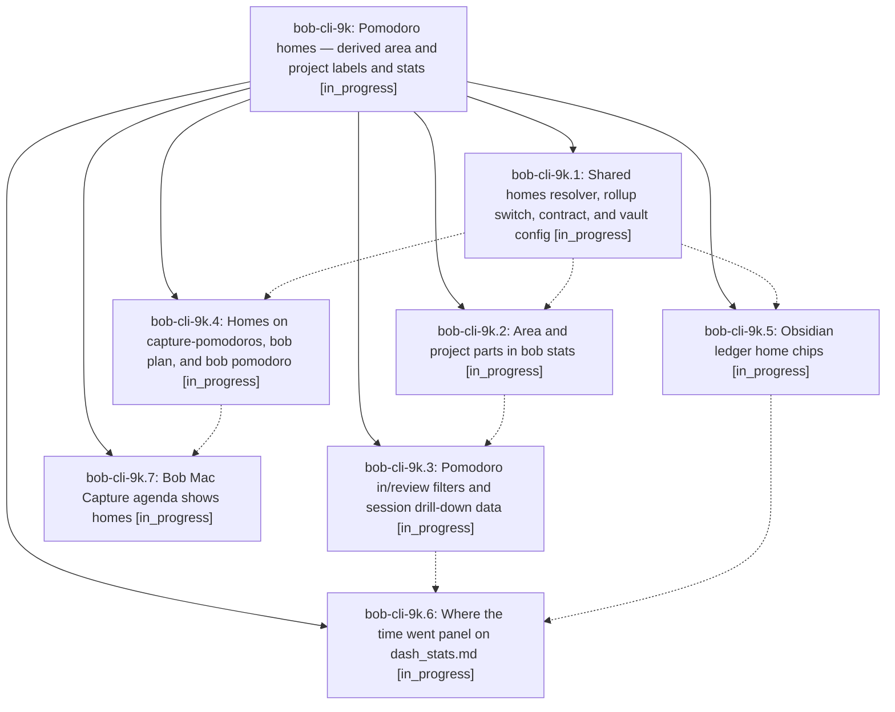

# Bead: bob-cli-9k — Pomodoro homes — derived area and project labels and stats

[Bead Pages](../README.md) / bob-cli-9k

**Status:** ◐ in_progress · **Type:** ▸ plan · **Tier:** epic
**Owner:** `bryanbugyi34@gmail.com` · **Created by:** [bbugyi200.athena.research.4t.linker.w0](https://github.com/bobs-org/bob-cli--agents/blob/main/sessions/bbugyi200.athena.research.4t.linker.w0.md) · **Assignee:** `bob-cli-9k.land`
**Created:** 2026-10-18 16:35:49 EDT
**Plan:** [202610/pomodoro\_homes.md](https://github.com/bobs-org/bob-cli--plans/blob/main/202610/pomodoro_homes.md)

<!-- sase:links:start -->

## Links

| Relation | Artifact | Why |
| --- | --- | --- |
| implemented-by | [plan:202610/pomodoro_homes.md][1] | derived from the plan's `bead_id:` frontmatter field |

[1]: https://github.com/bobs-org/bob-cli--plans/blob/main/202610/pomodoro_homes.md

<!-- sase:links:end -->

## Description

Every Pomodoro is labeled, on every surface, by the areas and projects of the tasks it links. The labels are derived at read time from Task Links and never written to the vault. `bob stats` and `dash_stats.md` aggregate time and task throughput by area and project. `rollup: subprojects` on `sase.md` reports every sase sub-project as `sase`. Authored names keep working exactly as they do today, but naming a session becomes optional.

## Phases

| Bead | Title | Status | Size | Created | Agents | Commits |
|---|---|---|---|---|---:|---:|
| [bob-cli-9k.1](bob-cli-9k.1.md) | Shared homes resolver, rollup switch, contract, and vault config | ◐ in_progress | medium | 2026-10-18 | 1 | 0 |
| [bob-cli-9k.2](bob-cli-9k.2.md) | Area and project parts in bob stats | ◐ in_progress | medium | 2026-10-18 | 1 | 0 |
| [bob-cli-9k.3](bob-cli-9k.3.md) | Pomodoro in/review filters and session drill-down data | ◐ in_progress | medium | 2026-10-18 | 1 | 0 |
| [bob-cli-9k.4](bob-cli-9k.4.md) | Homes on capture-pomodoros, bob plan, and bob pomodoro | ◐ in_progress | medium | 2026-10-18 | 1 | 0 |
| [bob-cli-9k.5](bob-cli-9k.5.md) | Obsidian ledger home chips | ◐ in_progress | medium | 2026-10-18 | 1 | 0 |
| [bob-cli-9k.6](bob-cli-9k.6.md) | Where the time went panel on dash\_stats.md | ◐ in_progress | medium | 2026-10-18 | 1 | 0 |
| [bob-cli-9k.7](bob-cli-9k.7.md) | Bob Mac Capture agenda shows homes | ◐ in_progress | small | 2026-10-18 | 1 | 0 |

## Lineage

## Agents

| Agent | Bead | Commits |
|---|---|---:|
| [bbugyi200.athena.bob-cli-9k.1](https://github.com/bobs-org/bob-cli--agents/blob/main/agents/bbugyi200.athena.bob-cli-9k.1/README.md) | [bob-cli-9k.1](bob-cli-9k.1.md) | 0 |
| [bbugyi200.athena.bob-cli-9k.2](https://github.com/bobs-org/bob-cli--agents/blob/main/agents/bbugyi200.athena.bob-cli-9k.2/README.md) | [bob-cli-9k.2](bob-cli-9k.2.md) | 0 |
| [bbugyi200.athena.bob-cli-9k.3](https://github.com/bobs-org/bob-cli--agents/blob/main/agents/bbugyi200.athena.bob-cli-9k.3/README.md) | [bob-cli-9k.3](bob-cli-9k.3.md) | 0 |
| [bbugyi200.athena.bob-cli-9k.4](https://github.com/bobs-org/bob-cli--agents/blob/main/agents/bbugyi200.athena.bob-cli-9k.4/README.md) | [bob-cli-9k.4](bob-cli-9k.4.md) | 0 |
| [bbugyi200.athena.bob-cli-9k.5](https://github.com/bobs-org/bob-cli--agents/blob/main/agents/bbugyi200.athena.bob-cli-9k.5/README.md) | [bob-cli-9k.5](bob-cli-9k.5.md) | 0 |
| [bbugyi200.athena.bob-cli-9k.6](https://github.com/bobs-org/bob-cli--agents/blob/main/agents/bbugyi200.athena.bob-cli-9k.6/README.md) | [bob-cli-9k.6](bob-cli-9k.6.md) | 0 |
| [bbugyi200.athena.bob-cli-9k.7](https://github.com/bobs-org/bob-cli--agents/blob/main/agents/bbugyi200.athena.bob-cli-9k.7/README.md) | [bob-cli-9k.7](bob-cli-9k.7.md) | 0 |
| [bbugyi200.athena.bob-cli-9k.land](https://github.com/bobs-org/bob-cli--agents/blob/main/agents/bbugyi200.athena.bob-cli-9k.land/README.md) | [bob-cli-9k](README.md) | 0 |
