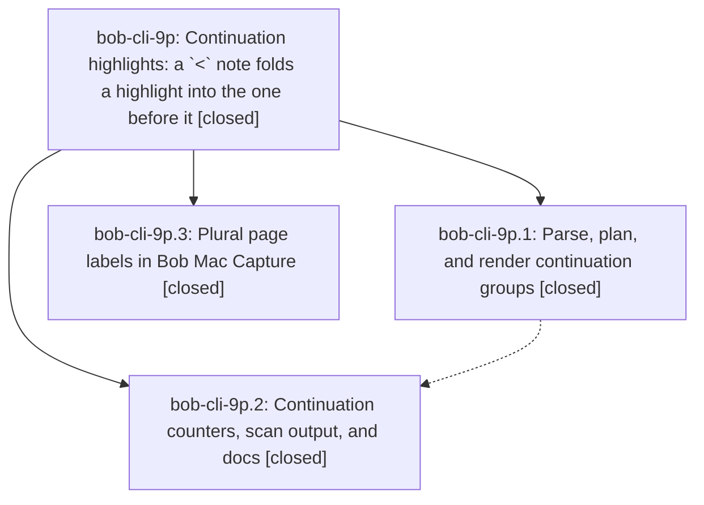

# Bead: bob-cli-9p — Continuation highlights: a \`\<\` note folds a highlight into the one before it

[Bead Pages](../README.md) / bob-cli-9p

**Status:** ✓ closed · **Resolution:** done · **Type:** ▸ plan · **Tier:** epic
**Owner:** `bryanbugyi34@gmail.com` · **Created by:** [bbugyi200.athena.research.4u.linker.w0](https://github.com/bobs-org/bob-cli--agents/blob/main/sessions/bbugyi200.athena.research.4u.linker.w0.md) · **Assignee:** `bob-cli-9p.land`
**Created:** 2026-10-19 07:59:12 EDT · **Closed:** 2026-10-19 09:22:37 EDT
**Plan:** [202610/highlight\_continuations.md](https://github.com/bobs-org/bob-cli--plans/blob/main/202610/highlight_continuations.md)

<!-- sase:links:start -->

## Links

| Relation | Artifact | Why |
| --- | --- | --- |
| implemented-by | [plan:202610/highlight_continuations.md][1] | derived from the plan's `bead_id:` frontmatter field |

[1]: https://github.com/bobs-org/bob-cli--plans/blob/main/202610/highlight_continuations.md

<!-- sase:links:end -->

## Description

A Highlights note that starts with `<` makes `bob ref` render that highlight and its notes as one quote with the highlight before it, across pages or within a paragraph. Block identity, tasks, and published anchors stay stable. A marker that cannot merge stays visible and is counted.

## Notes

[2026-10-19T13:12:16Z · bob-cli-9p.land] LANDING REVIEW: Read the epic and every note on phases bob-cli-9p.1, bob-cli-9p.2, and bob-cli-9p.3; audited the approved plan and research report; reviewed bob-cli commits 3924abc8 and 0bed62a1 plus linked bob-mac-capture commit 1968cc3. The phase-3 note saying its changes were uncommitted is superseded by 1968cc3 on origin/master. Verified source paths for marker grammar, grouping, seams, raw head/follower IDs, redirect stubs, per-piece task identity with group bookmark, counters on v1/v2 sync and scan/ingest JSON, and docs. Existing pre-feature test expectation changes are limited to signature/struct updates. DECISIONS decision_record=no honored: epic commits touch no memory. Fetched primary origin and opened/refreshed linked bob-mac-capture: no non-epic commits landed since epic creation 2026-10-19T11:59:12Z; tips are 0bed62a1 and 1968cc3. Remaining epic work: (1) group_page_label emits pp. 11–12 for p. inputs, but current Mac displayPageLabel changes it to Page pp. 11–12 and the picker then shows p. pp. 11–12; reproduced by running the exact source getter and shortPageLabel in Swift. (2) seam_between compares next == prev + 1 without checked arithmetic: exact-source Rust probe with Some(u32::MAX) then Some(0) panics in debug and returns Join under -O. These are epic-caused and will be fixed by a small remaining-work tale with final closeout in that same coder turn. No full verification gate was run by this lander; the tale must run just check and the linked portable-check before closing. epic-symbols currently reports no entries. JSON parent_id is null and ancestors is empty.

[2026-10-19T13:12:19Z · bob-cli-9p.land] FOLLOW-UP TRIAGE BEFORE TALE: All three child beads have exactly one completion note and no PROPOSED FOLLOW-UP entries; the epic had no prior notes. No genuinely distinct issue unrelated to this epic was found, so no sase_new_task invocation, duplicate corroboration, or new task is warranted. The two landing findings are remaining epic work, not deferred tasks. The declined decision-record branch remains declined under the human-reviewed DECISIONS; no memory follow-up is proposed. Existing extraction damage and ordinal-hash churn named by the design remain explicitly out of scope (bob-cli-85 and bob-cli-9o), with no independent new evidence from this review. No proposals were otherwise declined.

[2026-10-19T13:22:37Z · bob-cli-9p.land] Reviewed all three phase notes and commits, honored decision_record=no, and checked post-start and post-review integration drift. Fixed short plural labels through Mac display/copy and checked page-index adjacency; verified producer/consumer regression coverage and passing just check plus linked portable-check. No proposed or unrelated follow-ups required task filing; epic-symbols is clear.

## Phases

| Bead | Title | Status | Size | Created | Agents | Commits |
|---|---|---|---|---|---:|---:|
| [bob-cli-9p.1](bob-cli-9p.1.md) | Parse, plan, and render continuation groups | ✓ closed | medium | 2026-10-19 | 1 | 1 |
| [bob-cli-9p.2](bob-cli-9p.2.md) | Continuation counters, scan output, and docs | ✓ closed | small | 2026-10-19 | 1 | 1 |
| [bob-cli-9p.3](bob-cli-9p.3.md) | Plural page labels in Bob Mac Capture | ✓ closed | xsmall | 2026-10-19 | 1 | 1 |

## Lineage

## Agents

| Agent | Bead | Commits |
|---|---|---:|
| [bbugyi200.athena.bob-cli-9p.1](https://github.com/bobs-org/bob-cli--agents/blob/main/agents/bbugyi200.athena.bob-cli-9p.1/README.md) | [bob-cli-9p.1](bob-cli-9p.1.md) | 1 |
| [bbugyi200.athena.bob-cli-9p.2](https://github.com/bobs-org/bob-cli--agents/blob/main/sessions/bbugyi200.athena.bob-cli-9p.2.md) | [bob-cli-9p.2](bob-cli-9p.2.md) | 1 |
| [bbugyi200.athena.bob-cli-9p.3](https://github.com/bobs-org/bob-cli--agents/blob/main/agents/bbugyi200.athena.bob-cli-9p.3/README.md) | [bob-cli-9p.3](bob-cli-9p.3.md) | 1 |
| [bbugyi200.athena.bob-cli-9p.land](https://github.com/bobs-org/bob-cli--agents/blob/main/sessions/bbugyi200.athena.bob-cli-9p.land.md) | [bob-cli-9p](README.md) | 1 |

## Commits

| Repo | Commit | Subject | Bead | Committed |
|---|---|---|---|---|
| bob-mac-capture | [`bob-mac-capture@1968cc3`](https://github.com/bobs-org/bob-mac-capture/commit/1968cc36aa244455e2fadecb208966ee31fd91ab) | feat(refs): shorten plural page labels to pp. form | [bob-cli-9p.3](bob-cli-9p.3.md) | 2026-10-19 08:06:43 EDT |
| bob-cli | [`3924abc`](https://github.com/bobs-org/bob-cli/commit/3924abc88db68f64353544440dda57687c719782) | feat(highlights): fold continuation highlights at render time | [bob-cli-9p.1](bob-cli-9p.1.md) | 2026-10-19 08:37:12 EDT |
| bob-cli | [`0bed62a`](https://github.com/bobs-org/bob-cli/commit/0bed62a142a24be36795d88d9db1d559cf4a04b7) | feat(highlights): report continuation counts in scan output and docs | [bob-cli-9p.2](bob-cli-9p.2.md) | 2026-10-19 09:00:15 EDT |
| bob-cli | [`1097ae9`](https://github.com/bobs-org/bob-cli/commit/1097ae90654c7d2d60c43ac0fab62d15d5266309) | fix(highlights): use checked page adjacency with overflow regression coverage | [bob-cli-9p](README.md) | 2026-10-19 09:23:59 EDT |
