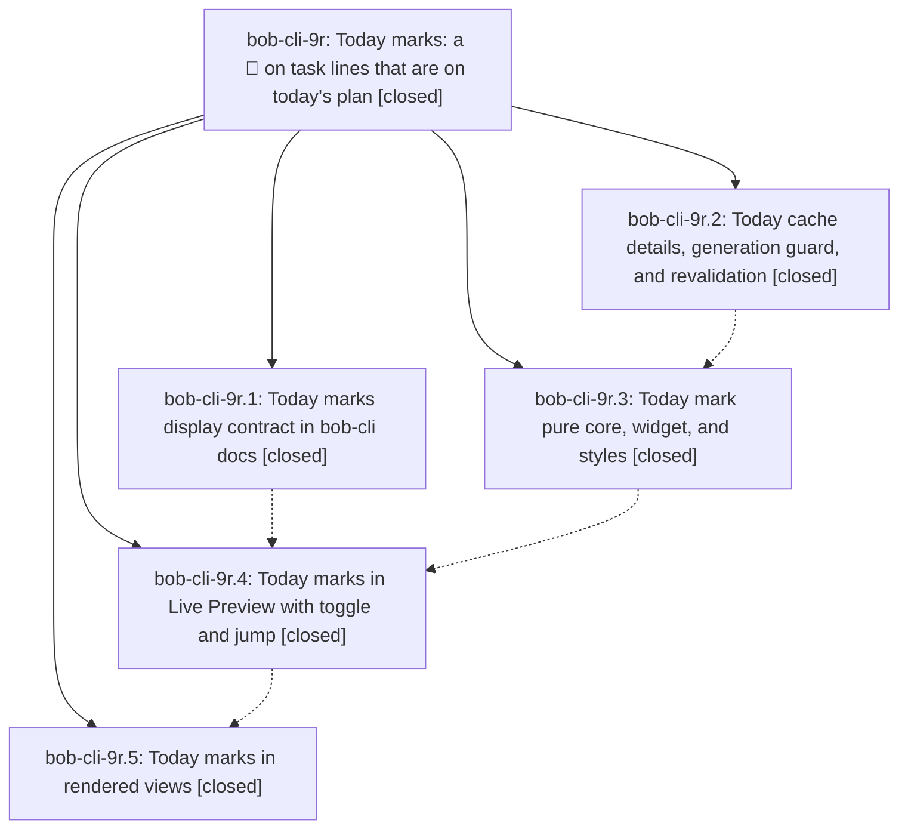

# Bead: bob-cli-9r — Today marks: a 🍅 on task lines that are on today's plan

[Bead Pages](../README.md) / bob-cli-9r

**Status:** ✓ closed · **Resolution:** done · **Type:** ▸ plan · **Tier:** epic
**Owner:** `bryanbugyi34@gmail.com` · **Created by:** [bbugyi200.athena.11r](https://github.com/bobs-org/bob-cli--agents/blob/main/sessions/bbugyi200.athena.11r.md) · **Assignee:** `bob-cli-9r.land`
**Created:** 2026-10-19 09:47:17 EDT · **Closed:** 2026-10-19 11:55:24 EDT
**Plan:** [202610/today\_marks.md](https://github.com/bobs-org/bob-cli--plans/blob/main/202610/today_marks.md)

<!-- sase:links:start -->

## Links

| Relation | Artifact | Why |
| --- | --- | --- |
| implemented-by | [plan:202610/today_marks.md][1] | derived from the plan's `bead_id:` frontmatter field |
| related | [bead:bob-cli-9t][2] | Epic whose phases proposed this decision record |

_Plus 2 automatic references — see [Referenced By](#referenced-by)._

[1]: https://github.com/bobs-org/bob-cli--plans/blob/main/202610/today_marks.md
[2]: https://github.com/bobs-org/bob-cli--beads/blob/main/pages/bob-cli-9t/README.md

<!-- sase:links:end -->

## Description

Every open #task line whose task is on today's plan (it has a dedicated Task Link under one of today's open Pomodoros) shows a display-only 🍅 Today mark right after its identity glyph. The mark appears in Live Preview, and in rendered views wherever the line's identity is exact. Its tooltip names the Pomodoro and whether it is running or queued. Mod+click and a keyboard command jump to the Task Link, and a session toggle hides every mark. The mark is truthful or neutral: it never guesses, never goes stale, and is never written.

## Notes

[2026-10-19T15:33:39Z · bob-cli-9r.land] LAND TRIAGE (bob-cli-9r.land): (1) PROPOSED FOLLOW-UP decisions:today-mark-shows-ledger-today (9r.1–9r.5 note 1) -> created memory task bob-cli-9t (small, ready; auto-decision no, not a human rejection; no memory edited). (2) PROPOSED FOLLOW-UP pre-existing npm test failures (9r.2–9r.5 note 2) -> duplicates, corroborated with +1 on bob-cli-6v (4 unblocked-glyph tests), bob-cli-6w (Keep counts once), bob-cli-7i (forward conversion Depends-On); reproduced at bob-plugins 035296a: 3168 tests, 6 fail, all six those. Declined (not epic defects, no follow-up filed): priority-mark replace hiding the mark on '#task [field:: v] Title' (0 such lines among 3842 vault task lines); callout data-line offset (unverified, covered by Bryan's live-verification checklist); reading stamps not rechecked for later duplicate ids (spec design limit, sweep has no source); 220 scheduleLiveWidgetRefresh also scheduling a marks refresh (harmless, coalesced); setupTodayMarks ordering vs setupUnblockedGlyph (no effect); reading marks never play the entrance pop and jump silently returns while cache is not ready (spec silent); popout registerDomEvent listeners held to unload (minor); withMissingConfig async env restore in test-ledger-tools-today.cjs (pre-existing helper, no observed failure). Remaining epic defects are planned as a lander tale.

[2026-10-19T15:55:24Z · bob-cli-9r.land] Landed. Verified phases 9r.1-9r.5 against plan:202610/today_marks.md and docs/today-marks.md (TM table matches); bob-cli 1b158e66 + bob-plugins ee9d7e6/66a9597/e4c71bc/035296a. Landing fixes in bob-ledger-tools 1.59.1: reduced-motion beats .is-entering, tooltips never contain '::', LP builder todayIdsForPath gate + id prefilter + WeakMap duplicate memo + todayMarksNow clock, 16 ms refresh and daily-leaf skip, keyboard command open-status/daily gates, reading: no double jump from .cm-editor marks, mid-body #task at body start, inline-code neutral (TM21), mark key refresh, one duplicate scan per render, 280/281 fallback mapping; revalidation layout gate and clock-step throttle; missing TM14/17/18/20/23, rebuild-trigger, and home-label tests. [Today suites 33/33 + 41/41 + 20/20 pass; npm test 3197 tests with only bob-cli-6v x4, bob-cli-6w, bob-cli-7i failing; build:check/validate clean; fragments <=1000 (276 at 994); vault synced to 1.59.1]. Integration: only bob-cli 8c10a820 (capture status-group headings) landed since the epic started; it does not touch Today marks; bob-plugins fcde586 (navigation Tab marks, no Today changes) landed after 035296a. Follow-ups: memory task bob-cli-9t created; bob-cli-6v/6w/7i corroborated; declined items recorded in the LAND TRIAGE note.

## Phases

| Bead | Title | Status | Size | Created | Agents | Commits |
|---|---|---|---|---|---:|---:|
| [bob-cli-9r.1](bob-cli-9r.1.md) | Today marks display contract in bob-cli docs | ✓ closed | small | 2026-10-19 | 1 | 1 |
| [bob-cli-9r.2](bob-cli-9r.2.md) | Today cache details, generation guard, and revalidation | ✓ closed | medium | 2026-10-19 | 1 | 1 |
| [bob-cli-9r.3](bob-cli-9r.3.md) | Today mark pure core, widget, and styles | ✓ closed | medium | 2026-10-19 | 1 | 1 |
| [bob-cli-9r.4](bob-cli-9r.4.md) | Today marks in Live Preview with toggle and jump | ✓ closed | medium | 2026-10-19 | 1 | 1 |
| [bob-cli-9r.5](bob-cli-9r.5.md) | Today marks in rendered views | ✓ closed | medium | 2026-10-19 | 1 | 1 |

## Lineage

## Agents

| Agent | Bead | Commits |
|---|---|---:|
| [bbugyi200.athena.bob-cli-9r.1](https://github.com/bobs-org/bob-cli--agents/blob/main/agents/bbugyi200.athena.bob-cli-9r.1/README.md) | [bob-cli-9r.1](bob-cli-9r.1.md) | 1 |
| [bbugyi200.athena.bob-cli-9r.2](https://github.com/bobs-org/bob-cli--agents/blob/main/agents/bbugyi200.athena.bob-cli-9r.2/README.md) | [bob-cli-9r.2](bob-cli-9r.2.md) | 1 |
| [bbugyi200.athena.bob-cli-9r.3](https://github.com/bobs-org/bob-cli--agents/blob/main/agents/bbugyi200.athena.bob-cli-9r.3/README.md) | [bob-cli-9r.3](bob-cli-9r.3.md) | 1 |
| [bbugyi200.athena.bob-cli-9r.4](https://github.com/bobs-org/bob-cli--agents/blob/main/agents/bbugyi200.athena.bob-cli-9r.4/README.md) | [bob-cli-9r.4](bob-cli-9r.4.md) | 1 |
| [bbugyi200.athena.bob-cli-9r.5](https://github.com/bobs-org/bob-cli--agents/blob/main/agents/bbugyi200.athena.bob-cli-9r.5/README.md) | [bob-cli-9r.5](bob-cli-9r.5.md) | 1 |
| [bbugyi200.athena.bob-cli-9r.land](https://github.com/bobs-org/bob-cli--agents/blob/main/sessions/bbugyi200.athena.bob-cli-9r.land.md) | [bob-cli-9r](README.md) | 1 |

## Commits

| Repo | Commit | Subject | Bead | Committed |
|---|---|---|---|---|
| bob-cli | [`1b158e6`](https://github.com/bobs-org/bob-cli/commit/1b158e662364485fbc591aa8def3cceeb8951ea7) | docs(today-marks): document the display contract | [bob-cli-9r.1](bob-cli-9r.1.md) | 2026-10-19 09:54:40 EDT |
| bob-plugins | [`bob-plugins@ee9d7e6`](https://github.com/bobs-org/bob-plugins/commit/ee9d7e6b4a7eecd744f47a0269bdcb443efbf161) | feat(ledger-tools): cache Today Pomodoro details with a generation guard | [bob-cli-9r.2](bob-cli-9r.2.md) | 2026-10-19 10:06:22 EDT |
| bob-plugins | [`bob-plugins@66a9597`](https://github.com/bobs-org/bob-plugins/commit/66a95978033fc0837943ad2cdec5255b91588493) | feat(ledger-tools): add today-marks fragment with element, widget and styles | [bob-cli-9r.3](bob-cli-9r.3.md) | 2026-10-19 10:19:36 EDT |
| bob-plugins | [`bob-plugins@e4c71bc`](https://github.com/bobs-org/bob-plugins/commit/e4c71bc4a548bbe1e10261b3aa489100bae87283) | feat(ledger-tools): add Today marks to Live Preview | [bob-cli-9r.4](bob-cli-9r.4.md) | 2026-10-19 10:46:08 EDT |
| bob-plugins | [`bob-plugins@035296a`](https://github.com/bobs-org/bob-plugins/commit/035296a26ae8826766857e2bec7c005d55a8e5c0) | feat(ledger-tools): show Today marks in rendered views | [bob-cli-9r.5](bob-cli-9r.5.md) | 2026-10-19 11:09:30 EDT |
| bob-plugins | [`bob-plugins@ef1a63c`](https://github.com/bobs-org/bob-plugins/commit/ef1a63c23a6c4f9861db37ad33d1c546899b5c83) | fix(ledger-tools): land Today marks review fixes in 1.59.1 | [bob-cli-9r](README.md) | 2026-10-19 11:57:30 EDT |

<!-- sase:referenced-by:start -->

## Referenced By

| Relation | Artifact | Why | Uses |
| --- | --- | --- | ---: |
| read-by | [agent:bob-cli-9r.2][1] | Need parent epic context and sibling phases | 1 |
| read-by | [agent:bob-cli-9r.5][2] | Need epic DECISIONS and overall design | 1 |

[1]: https://github.com/bobs-org/bob-cli--agents/blob/main/agents/bbugyi200.athena.bob-cli-9r.2/README.md
[2]: https://github.com/bobs-org/bob-cli--agents/blob/main/agents/bbugyi200.athena.bob-cli-9r.5/README.md

<!-- sase:referenced-by:end -->
