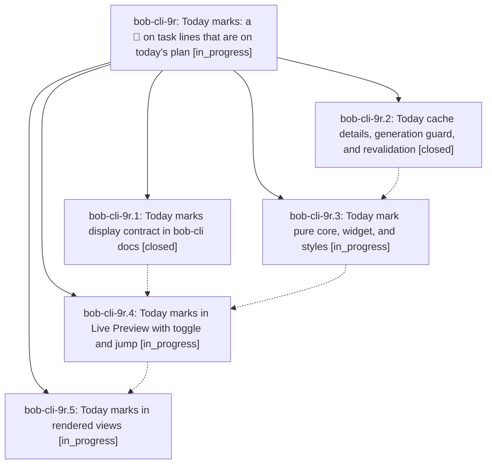

# Bead: bob-cli-9r — Today marks: a 🍅 on task lines that are on today's plan

[Bead Pages](../README.md) / bob-cli-9r

**Status:** ◐ in_progress · **Type:** ▸ plan · **Tier:** epic
**Owner:** `bryanbugyi34@gmail.com` · **Created by:** [bbugyi200.athena.11r](https://github.com/bobs-org/bob-cli--agents/blob/main/sessions/bbugyi200.athena.11r.md) · **Assignee:** `bob-cli-9r.land`
**Created:** 2026-10-19 09:47:17 EDT
**Plan:** [202610/today\_marks.md](https://github.com/bobs-org/bob-cli--plans/blob/main/202610/today_marks.md)

## Description

Every open #task line whose task is on today's plan (it has a dedicated Task Link under one of today's open Pomodoros) shows a display-only 🍅 Today mark right after its identity glyph. The mark appears in Live Preview, and in rendered views wherever the line's identity is exact. Its tooltip names the Pomodoro and whether it is running or queued. Mod+click and a keyboard command jump to the Task Link, and a session toggle hides every mark. The mark is truthful or neutral: it never guesses, never goes stale, and is never written.

## Phases

| Bead | Title | Status | Size | Created | Agents | Commits |
|---|---|---|---|---|---:|---:|
| [bob-cli-9r.1](bob-cli-9r.1.md) | Today marks display contract in bob-cli docs | ✓ closed | small | 2026-10-19 | 1 | 0 |
| [bob-cli-9r.2](bob-cli-9r.2.md) | Today cache details, generation guard, and revalidation | ✓ closed | medium | 2026-10-19 | 1 | 1 |
| [bob-cli-9r.3](bob-cli-9r.3.md) | Today mark pure core, widget, and styles | ◐ in_progress | medium | 2026-10-19 | 1 | 0 |
| [bob-cli-9r.4](bob-cli-9r.4.md) | Today marks in Live Preview with toggle and jump | ◐ in_progress | medium | 2026-10-19 | 1 | 0 |
| [bob-cli-9r.5](bob-cli-9r.5.md) | Today marks in rendered views | ◐ in_progress | medium | 2026-10-19 | 1 | 0 |

## Lineage

## Agents

| Agent | Bead | Commits |
|---|---|---:|
| [bbugyi200.athena.bob-cli-9r.1](https://github.com/bobs-org/bob-cli--agents/blob/main/agents/bbugyi200.athena.bob-cli-9r.1/README.md) | [bob-cli-9r.1](bob-cli-9r.1.md) | 0 |
| [bbugyi200.athena.bob-cli-9r.2](https://github.com/bobs-org/bob-cli--agents/blob/main/agents/bbugyi200.athena.bob-cli-9r.2/README.md) | [bob-cli-9r.2](bob-cli-9r.2.md) | 1 |
| [bbugyi200.athena.bob-cli-9r.3](https://github.com/bobs-org/bob-cli--agents/blob/main/agents/bbugyi200.athena.bob-cli-9r.3/README.md) | [bob-cli-9r.3](bob-cli-9r.3.md) | 0 |
| [bbugyi200.athena.bob-cli-9r.4](https://github.com/bobs-org/bob-cli--agents/blob/main/agents/bbugyi200.athena.bob-cli-9r.4/README.md) | [bob-cli-9r.4](bob-cli-9r.4.md) | 0 |
| [bbugyi200.athena.bob-cli-9r.5](https://github.com/bobs-org/bob-cli--agents/blob/main/agents/bbugyi200.athena.bob-cli-9r.5/README.md) | [bob-cli-9r.5](bob-cli-9r.5.md) | 0 |
| [bbugyi200.athena.bob-cli-9r.land](https://github.com/bobs-org/bob-cli--agents/blob/main/agents/bbugyi200.athena.bob-cli-9r.land/README.md) | [bob-cli-9r](README.md) | 0 |

## Commits

| Repo | Commit | Subject | Bead | Committed |
|---|---|---|---|---|
| bob-plugins | [`bob-plugins@ee9d7e6`](https://github.com/bobs-org/bob-plugins/commit/ee9d7e6b4a7eecd744f47a0269bdcb443efbf161) | feat(ledger-tools): cache Today Pomodoro details with a generation guard | [bob-cli-9r.2](bob-cli-9r.2.md) | 2026-10-19 10:06:22 EDT |
