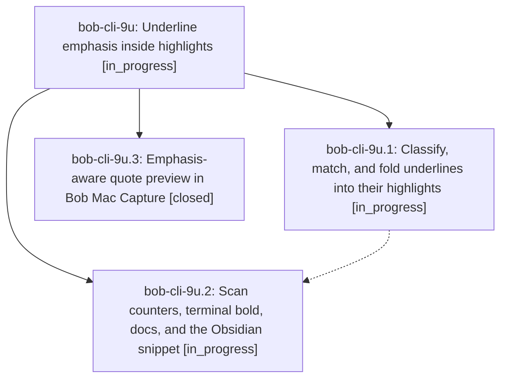

# Bead: bob-cli-9u — Underline emphasis inside highlights

[Bead Pages](../README.md) / bob-cli-9u

**Status:** ◐ in_progress · **Type:** ▸ plan · **Tier:** epic
**Owner:** `bryanbugyi34@gmail.com` · **Created by:** [bbugyi200.athena.research.4z.linker.w0](https://github.com/bobs-org/bob-cli--agents/blob/main/sessions/bbugyi200.athena.research.4z.linker.w0.md) · **Assignee:** `bob-cli-9u.land`
**Created:** 2026-10-19 11:48:18 EDT
**Plan:** [202610/underline\_emphasis.md](https://github.com/bobs-org/bob-cli--plans/blob/main/202610/underline_emphasis.md)

## Description

An underline drawn inside a highlight renders as bold emphasis inside that highlight's quote in Obsidian, bob ref show, and the Bob Mac Capture preview. Its comment, tasks, and image notes join the highlight, anchors stay valid, and nothing is written to the PDF or the sidecar.

## Phases

| Bead | Title | Status | Size | Created | Agents | Commits |
|---|---|---|---|---|---:|---:|
| [bob-cli-9u.1](bob-cli-9u.1.md) | Classify, match, and fold underlines into their highlights | ◐ in_progress | medium | 2026-10-19 | 1 | 0 |
| [bob-cli-9u.2](bob-cli-9u.2.md) | Scan counters, terminal bold, docs, and the Obsidian snippet | ◐ in_progress | small | 2026-10-19 | 1 | 0 |
| [bob-cli-9u.3](bob-cli-9u.3.md) | Emphasis-aware quote preview in Bob Mac Capture | ✓ closed | small | 2026-10-19 | 1 | 1 |

## Lineage

## Agents

| Agent | Bead | Commits |
|---|---|---:|
| [bbugyi200.athena.bob-cli-9u.1](https://github.com/bobs-org/bob-cli--agents/blob/main/agents/bbugyi200.athena.bob-cli-9u.1/README.md) | [bob-cli-9u.1](bob-cli-9u.1.md) | 0 |
| [bbugyi200.athena.bob-cli-9u.2](https://github.com/bobs-org/bob-cli--agents/blob/main/agents/bbugyi200.athena.bob-cli-9u.2/README.md) | [bob-cli-9u.2](bob-cli-9u.2.md) | 0 |
| [bbugyi200.athena.bob-cli-9u.3](https://github.com/bobs-org/bob-cli--agents/blob/main/agents/bbugyi200.athena.bob-cli-9u.3/README.md) | [bob-cli-9u.3](bob-cli-9u.3.md) | 1 |
| [bbugyi200.athena.bob-cli-9u.land](https://github.com/bobs-org/bob-cli--agents/blob/main/agents/bbugyi200.athena.bob-cli-9u.land/README.md) | [bob-cli-9u](README.md) | 0 |

## Commits

| Repo | Commit | Subject | Bead | Committed |
|---|---|---|---|---|
| bob-mac-capture | [`bob-mac-capture@f5c5a5b`](https://github.com/bobs-org/bob-mac-capture/commit/f5c5a5bcf1362faac0089d6c439123ceb19e8d69) | feat(refs): emphasis-aware quote preview in inspector and Copy picker | [bob-cli-9u.3](bob-cli-9u.3.md) | 2026-10-19 11:59:35 EDT |
