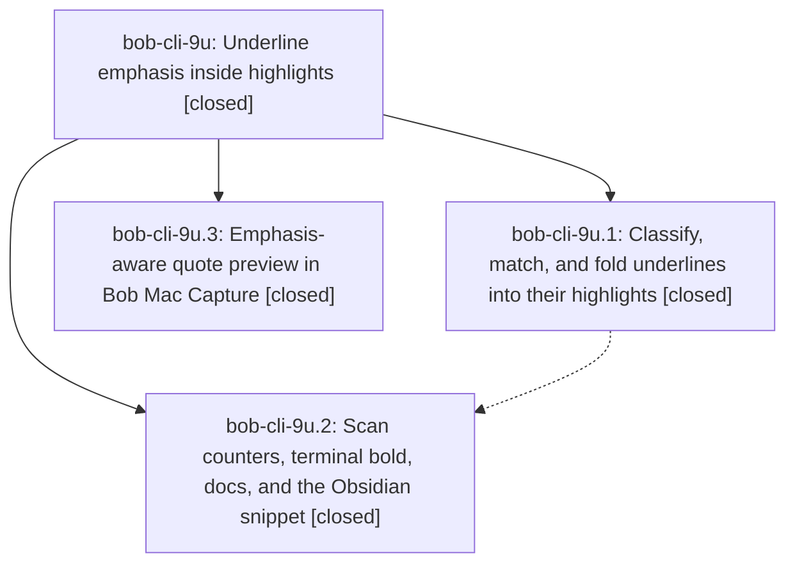

# Bead: bob-cli-9u — Underline emphasis inside highlights

[Bead Pages](../README.md) / bob-cli-9u

**Status:** ✓ closed · **Resolution:** done · **Type:** ▸ plan · **Tier:** epic
**Owner:** `bryanbugyi34@gmail.com` · **Created by:** [bbugyi200.athena.research.4z.linker.w0](https://github.com/bobs-org/bob-cli--agents/blob/main/sessions/bbugyi200.athena.research.4z.linker.w0.md) · **Assignee:** `bob-cli-9u.land`
**Created:** 2026-10-19 11:48:18 EDT · **Closed:** 2026-10-19 13:36:00 EDT
**Plan:** [202610/underline\_emphasis.md](https://github.com/bobs-org/bob-cli--plans/blob/main/202610/underline_emphasis.md)

<!-- sase:links:start -->

## Links

| Relation | Artifact | Why |
| --- | --- | --- |
| implemented-by | [plan:202610/underline_emphasis.md][1] | derived from the plan's `bead_id:` frontmatter field |

[1]: https://github.com/bobs-org/bob-cli--plans/blob/main/202610/underline_emphasis.md

<!-- sase:links:end -->

## Description

An underline drawn inside a highlight renders as bold emphasis inside that highlight's quote in Obsidian, bob ref show, and the Bob Mac Capture preview. Its comment, tasks, and image notes join the highlight, anchors stay valid, and nothing is written to the PDF or the sidecar.

## Notes

[2026-10-19T17:01:42Z · bob-cli-9u.land] LANDING AUDIT: Read the epic and every note on bob-cli-9u.1, .2, and .3 plus plan:202610/underline_emphasis.md. Reviewed Rust commits a2638aa9/1dc6fe06 and Mac commit f5c5a5b against current source. The fold-first continuation plan, task identity/link separation, link-aware emphasis stubs, counters, standalone reasons, ANSI styling, documentation CSS, and shared Mac presentation helpers are present. Existing non-underline regression expectations were unchanged apart from the new call argument. Main master and remote both remain 1dc6fe06, with no non-epic commits since creation or the first epic commit. Mac master and remote are c424756; reviewed later 5fe90ea (NEW section) and c424756 (portable images/panel models), which preserve excerpt, attributed picker, and full plain accessibility quote paths. No additional integration edit identified. Source commits honor quiet_quote_text=no and decision_record=no, with no memory changes. Prior phase notes report just check passes, scratch idempotence/no new tombstones, enabled vault snippet, 1404 portable Swift tests, and Mac scratch typecheck PASS; this audit has not rerun those full gates or inspected live snippet state. No epic-symbol entries; no parent_bead is shown. Landing is blocked by the two reproduced epic defects in the next note; a single repair tale will finish verification and closeout.

[2026-10-19T17:01:59Z · bob-cli-9u.land] REMAINING EPIC WORK / FOLLOW-UP TRIAGE: There are zero PROPOSED FOLLOW-UP entries across bob-cli-9u.1, .2, and .3, and no distinct unrelated discovery to file. No proposal was declined; no task beads were created. The following failures are caused by this epic and stay here. (1) In underline.rs, matching_occurrences with single_word=true accepts exactly one whole-word proves in It approves and proves the change., but emphasis_ranges rechecks raw key uniqueness with find_unique_key, sees both substring matches, returns [], and the renderer absorbs the underline without any bold run. Reproduced by compiling the current pure matching/render functions in an isolated Rust harness. (2) In show.rs, quote_lines at width 80 on two stars + 72 a characters + two stars + space plain after hard-splits the closing delimiter between lines; styler_quote_lines leaves literal stars and styles plain after as bold. Same harness reproduced exact ANSI output. Add actual renderer/terminal regression tests and repair both, then run just check (never check-full). Also correct the new docs snapping example: single-word didn’ cannot pass the documented apostrophe-aware boundary guard; use the approved multi-word what didn’ example. Existing ordinal churn bob-cli-9o and extraction damage bob-cli-85 remain the original explicit exclusions, not new follow-ups. The tale must close bob-cli-9u, check symbols, and mark plan:202610/underline_emphasis.md done in its own turn after passing verification, without waiting for its own commit or CI.

[2026-10-19T17:36:00Z · bob-cli-9u.land] Reviewed all three closed phases and notes (.1 fold-render a2638aa9, .2 visibility-docs 1dc6fe06, .3 mac-preview f5c5a5b). Zero PROPOSED FOLLOW-UP entries; no unrelated tasks warranted; bob-cli-9o ordinal churn and bob-cli-85 extraction damage remain the original exclusions.

Repaired both reproduced rendering defects while preserving quiet_quote_text=no, decision_record=no, render-only folding, original block/task identities, the single-word boundary guard, explicit continuation precedence, and plain/NO_COLOR output. (1) plan_underlines now carries the accepted host_key_start into emphasis_ranges, so a whole-word proves inside "It approves and proves the change." renders as **proves** and still counts as merged. (2) quote_lines tracks source char indices and consumes paired ** across wrap splits; bold closes at line end and reopens only when the span continues. Docs snapping example is now multi-word what didn’ → **what didn’t**.

Post-audit integration: bob-cli HEAD 1dc6fe06 plus this tale's five-file repair; Mac master/origin still c424756 with no Swift change. epic-symbols bob-cli-9u was empty. justfile has no symvision recipe.

just check passed (fmt, clippy, cargo test; preexisting clippy warnings only). Targeted underline/show regressions cover the two defects, reverse sidecar/text order, RepeatedInHost/NoHost standalone, and continuation-group host windows.

Rollout (read-only live vault, writing on scratch only): per-PDF ref sync --dry-run of the seven notes totals underlines_merged 1+5+1+5+3+3+1 = 19 and 0 standalone; Gas Town highlights_count 10; gastown_readme 12; note_action none / writes none. Live notes were already folded versus the 2026-10-19 unfolded baseline (Mac/scheduled scan or prior deploy); one preexisting Merged emphasis stub remains at gastown_readme ^h-476bb727cc72; 20 preexisting Removed highlight tombstones, no new ones. Scratch writing scan then a second scan were idempotent on highlight bodies/stubs/tombstones (first pass only dropped missing audio: frontmatter because .mp3 files were not copied). Vault snippet ref-highlights.css has only the two full-ink strong selectors; appearance.json has ref-highlights enabled.

## Phases

| Bead | Title | Status | Size | Created | Agents | Commits |
|---|---|---|---|---|---:|---:|
| [bob-cli-9u.1](bob-cli-9u.1.md) | Classify, match, and fold underlines into their highlights | ✓ closed | medium | 2026-10-19 | 1 | 1 |
| [bob-cli-9u.2](bob-cli-9u.2.md) | Scan counters, terminal bold, docs, and the Obsidian snippet | ✓ closed | small | 2026-10-19 | 1 | 1 |
| [bob-cli-9u.3](bob-cli-9u.3.md) | Emphasis-aware quote preview in Bob Mac Capture | ✓ closed | small | 2026-10-19 | 1 | 1 |

## Lineage

## Agents

| Agent | Bead | Commits |
|---|---|---:|
| [bbugyi200.athena.bob-cli-9u.1](https://github.com/bobs-org/bob-cli--agents/blob/main/agents/bbugyi200.athena.bob-cli-9u.1/README.md) | [bob-cli-9u.1](bob-cli-9u.1.md) | 1 |
| [bbugyi200.athena.bob-cli-9u.2](https://github.com/bobs-org/bob-cli--agents/blob/main/sessions/bbugyi200.athena.bob-cli-9u.2.md) | [bob-cli-9u.2](bob-cli-9u.2.md) | 1 |
| [bbugyi200.athena.bob-cli-9u.3](https://github.com/bobs-org/bob-cli--agents/blob/main/agents/bbugyi200.athena.bob-cli-9u.3/README.md) | [bob-cli-9u.3](bob-cli-9u.3.md) | 1 |
| [bbugyi200.athena.bob-cli-9u.land](https://github.com/bobs-org/bob-cli--agents/blob/main/sessions/bbugyi200.athena.bob-cli-9u.land.md) | [bob-cli-9u](README.md) | 2 |

## Commits

| Repo | Commit | Subject | Bead | Committed |
|---|---|---|---|---|
| bob-mac-capture | [`bob-mac-capture@f5c5a5b`](https://github.com/bobs-org/bob-mac-capture/commit/f5c5a5bcf1362faac0089d6c439123ceb19e8d69) | feat(refs): emphasis-aware quote preview in inspector and Copy picker | [bob-cli-9u.3](bob-cli-9u.3.md) | 2026-10-19 11:59:35 EDT |
| bob-cli | [`a2638aa`](https://github.com/bobs-org/bob-cli/commit/a2638aa92e4da62e6733af86fcc01708df7da1ef) | feat(highlights): fold underlines into highlight quotes | [bob-cli-9u.1](bob-cli-9u.1.md) | 2026-10-19 12:25:38 EDT |
| bob-cli | [`1dc6fe0`](https://github.com/bobs-org/bob-cli/commit/1dc6fe0606948c8741bf0dcd217a51155a1d6726) | feat(ref): report and render underline emphasis | [bob-cli-9u.2](bob-cli-9u.2.md) | 2026-10-19 12:50:11 EDT |
| bob-cli | [`435e9c1`](https://github.com/bobs-org/bob-cli/commit/435e9c1473d55e52c3de40e56c1f6c5e7f389499) | fix(ref): preserve underline host occurrence and wrap pairing | [bob-cli-9u](README.md) | 2026-10-19 13:37:46 EDT |
| bob-cli--plans | [`bob-cli--plans@2eae442`](https://github.com/bobs-org/bob-cli--plans/commit/2eae442e3b033e3d94e765ebe568040e8501cb7f) | docs(plans): mark underline emphasis epic done | [bob-cli-9u](README.md) | 2026-10-19 13:38:32 EDT |
