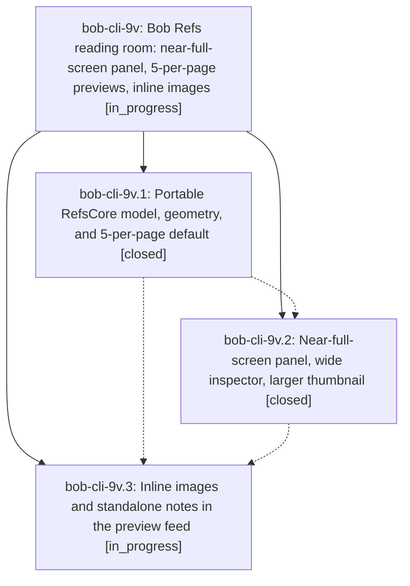

# Bead: bob-cli-9v — Bob Refs reading room: near-full-screen panel, 5-per-page previews, inline images

[Bead Pages](../README.md) / bob-cli-9v

**Status:** ◐ in_progress · **Type:** ▸ plan · **Tier:** epic
**Owner:** `bryanbugyi34@gmail.com` · **Created by:** [bbugyi200.athena.11v.w0](https://github.com/bobs-org/bob-cli--agents/blob/main/sessions/bbugyi200.athena.11v.w0.md) · **Assignee:** `bob-cli-9v.land`
**Created:** 2026-10-19 12:32:44 EDT
**Plan:** [202610/refs\_reading\_room.md](https://github.com/bobs-org/bob-cli--plans/blob/main/202610/refs_reading_room.md)

<!-- sase:links:start -->

## Links

| Relation | Artifact | Why |
| --- | --- | --- |
| implemented-by | [plan:202610/refs_reading_room.md][1] | derived from the plan's `bead_id:` frontmatter field |

[1]: https://github.com/bobs-org/bob-cli--plans/blob/main/202610/refs_reading_room.md

<!-- sase:links:end -->

## Description

The Bob Refs panel in Bob Mac Capture opens nearly full screen (1344 × 798 pt on Bryan's 1440 × 870 pt MacBook), its preview column shows 5 annotations per page and reveals 5 more on each Ctrl+D, papers, articles, and docs show a larger 150 × 194 pt first-page thumbnail beside the facts, and image highlights and image notes render inline with stable layout, so Ctrl+D paging never jumps.

## Phases

| Bead | Title | Status | Size | Created | Agents | Commits |
|---|---|---|---|---|---:|---:|
| [bob-cli-9v.1](bob-cli-9v.1.md) | Portable RefsCore model, geometry, and 5-per-page default | ✓ closed | medium | 2026-10-19 | 1 | 1 |
| [bob-cli-9v.2](bob-cli-9v.2.md) | Near-full-screen panel, wide inspector, larger thumbnail | ✓ closed | medium | 2026-10-19 | 1 | 1 |
| [bob-cli-9v.3](bob-cli-9v.3.md) | Inline images and standalone notes in the preview feed | ◐ in_progress | medium | 2026-10-19 | 1 | 0 |

## Lineage

## Agents

| Agent | Bead | Commits |
|---|---|---:|
| [bbugyi200.athena.bob-cli-9v.1](https://github.com/bobs-org/bob-cli--agents/blob/main/agents/bbugyi200.athena.bob-cli-9v.1/README.md) | [bob-cli-9v.1](bob-cli-9v.1.md) | 1 |
| [bbugyi200.athena.bob-cli-9v.2](https://github.com/bobs-org/bob-cli--agents/blob/main/sessions/bbugyi200.athena.bob-cli-9v.2.md) | [bob-cli-9v.2](bob-cli-9v.2.md) | 1 |
| [bbugyi200.athena.bob-cli-9v.3](https://github.com/bobs-org/bob-cli--agents/blob/main/agents/bbugyi200.athena.bob-cli-9v.3/README.md) | [bob-cli-9v.3](bob-cli-9v.3.md) | 0 |
| [bbugyi200.athena.bob-cli-9v.land](https://github.com/bobs-org/bob-cli--agents/blob/main/agents/bbugyi200.athena.bob-cli-9v.land/README.md) | [bob-cli-9v](README.md) | 0 |

## Commits

| Repo | Commit | Subject | Bead | Committed |
|---|---|---|---|---|
| bob-mac-capture | [`bob-mac-capture@c424756`](https://github.com/bobs-org/bob-mac-capture/commit/c4247566fb4e8c5f796ff3e8ef109b3d2760b982) | feat(refs): add portable image and panel models | [bob-cli-9v.1](bob-cli-9v.1.md) | 2026-10-19 12:55:03 EDT |
| bob-mac-capture | [`bob-mac-capture@1d7242a`](https://github.com/bobs-org/bob-mac-capture/commit/1d7242a7295d3d0e792e69994b992ec795d029da) | feat(refs): near-full-screen panel, wide inspector, larger thumbnails | [bob-cli-9v.2](bob-cli-9v.2.md) | 2026-10-19 13:57:37 EDT |
