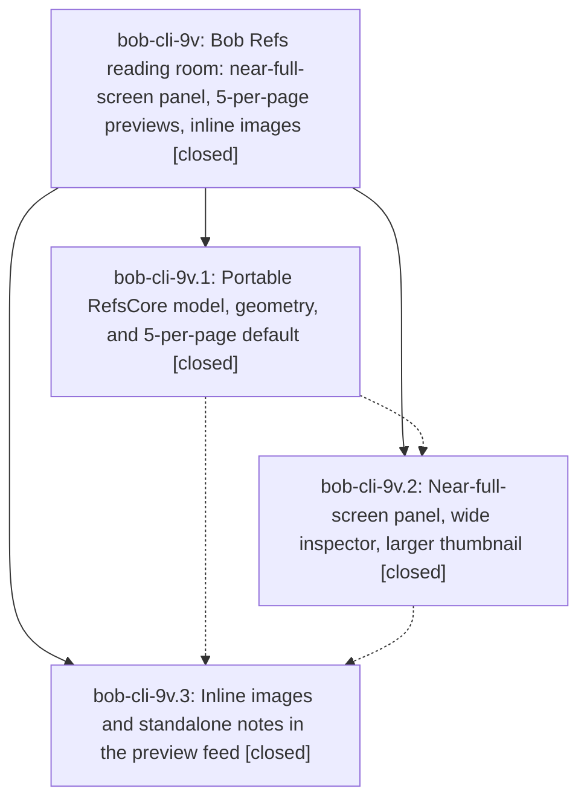

# Bead: bob-cli-9v — Bob Refs reading room: near-full-screen panel, 5-per-page previews, inline images

[Bead Pages](../README.md) / bob-cli-9v

**Status:** ✓ closed · **Resolution:** done · **Type:** ▸ plan · **Tier:** epic
**Owner:** `bryanbugyi34@gmail.com` · **Created by:** [bbugyi200.athena.11v.w0](https://github.com/bobs-org/bob-cli--agents/blob/main/sessions/bbugyi200.athena.11v.w0.md) · **Assignee:** `bob-cli-9v.land`
**Created:** 2026-10-19 12:32:44 EDT · **Closed:** 2026-10-19 15:38:01 EDT
**Plan:** [202610/refs\_reading\_room.md](https://github.com/bobs-org/bob-cli--plans/blob/main/202610/refs_reading_room.md)

<!-- sase:links:start -->

## Links

| Relation | Artifact | Why |
| --- | --- | --- |
| implemented-by | [plan:202610/refs_reading_room.md][1] | derived from the plan's `bead_id:` frontmatter field |
| related | file:explicit:172ae9fb0f75b6f6bb453599 | attached via sase artifact create --bead |

[1]: https://github.com/bobs-org/bob-cli--plans/blob/main/202610/refs_reading_room.md

<!-- sase:links:end -->

## Description

The Bob Refs panel in Bob Mac Capture opens nearly full screen (1344 × 798 pt on Bryan's 1440 × 870 pt MacBook), its preview column shows 5 annotations per page and reveals 5 more on each Ctrl+D, papers, articles, and docs show a larger 150 × 194 pt first-page thumbnail beside the facts, and image highlights and image notes render inline with stable layout, so Ctrl+D paging never jumps.

## Notes

[2026-10-19T18:56:19Z · bob-cli-9v.land] LAND AUDIT / FOLLOW-UP TRIAGE: Read the epic and all notes on phases 9v.1, 9v.2, 9v.3; none contains PROPOSED FOLLOW-UP. Selected standalone_notes=include is implemented. Reviewed Mac commits c424756, 1d7242a, 73d1106 and their actual geometry, feed, loader, views, paging, cache, tests, and README. CI obligations in all three child close notes are not satisfied: runs 39289627052 and 39298547579 expose a five-item fixture still expecting 3..<5; phase 2 also fails the hidden-note count in renderWideHighlightsUnified; run 39304814575 compiles then traps in the new image fixture helper before most Refs suites/fixtures run. Mac standalone reproduction identifies the default three-channel bitmap fill; RGBA succeeds. These stay epic work, not follow-up tasks. The pre-existing capture timeout nodes and retry-count failures match pre-epic 5fe90ea run 39283648975: corroborated bob-cli-4k and bob-cli-9s with file:explicit:172ae9fb0f75b6f6bb453599. Also corroborated bob-cli-8j for its intrinsics-discard failure on that baseline; latest run did not reach it. Searched relevant task types, swept recent task beads, and inspected all active-epic scopes; no distinct unrelated task or new causal epic issue. No proposals declined beyond not filing duplicate tasks. No epic-symbol entries; no parent link. A medium repair tale will finish this landing in its final step.

[2026-10-19T18:56:22Z · bob-cli-9v.land] LAND AUDIT / INTEGRATION: Mac origin/master is 73d1106; its only commits since c424756 (first 9v commit) are this epic phases 2 and 3, with no PR/base divergence. bob-cli changes since the epic began are 1dc6fe06/435e9c14 (underline emphasis) and 67a26ea8 (vault-sync conflict repair). The inspector still uses RefsQuoteExcerpt -> RefsQuoteText and RefsQuoteEmphasis for labels/tooltips; Copy projections remain unchanged. The producer keeps the same annotation/image JSON contract, so no extra integration edit is needed. Vault sync changes have no reading-room consumer. Reviewed all phase-2 1344-point browse/chat/paper/highlight/noted/revealed/Copy PNGs in both appearances from run 39298547579: geometry/hero/readable column are present, but live NSViewRepresentable disclosure/reveal anchors leak yellow unsupported-render markers into static previews. Phase-3 image PNGs are absent because its helper crashes. Remaining code gaps: image store strongly retains an unbounded path|maxPixel dictionary outside the 128MB provider cache, metadata failures still count as hidden available images and are omitted from VoiceOver unavailable counts, and decode failure has no terminal UI state. Hosted image test does not establish bitmap completion across its before/after measurements. These and stale paging fixtures are the bounded repair tale scope.

[2026-10-19T18:58:41Z · bob-cli-9v.land] LANDING HANDOFF: The remaining-work tale sase_plan_refs_reading_room_closeout.md passed tier-aware validation after the --explain/edit/revalidate loop (tier tale, size medium, zero warnings). It plans only the confirmed image fixture crash, missed five-item reveal/hidden-note assertions, bounded and current image caching, availability-aware disclosure/VoiceOver and terminal decode failure, and effective static/hosted verification. It requires portable-check, Mac scratch compile and direct runtime/render verification, just check, drift recheck, then normal 9v close, available symvision, and status: done in plan:202610/refs_reading_room.md in the coder turn, without waiting for its own commit/push/CI. No parent_bead; no --epic-symbol entries at audit. The three unrelated duplicate outcomes remain 4k/9s/8j corroboration; no new tasks and no child follow-up proposals. Epic and plan remain open until those repairs finish. No just check-full was run.

[2026-10-19T19:38:01Z · bob-cli-9v.land] Landing complete for bob-cli-9v. Phase commits in bob-mac-capture: c424756 (9v.1), 1d7242a (9v.2), 73d1106 (9v.3). Preserved standalone_notes=include, geometry, 5-item paging, compact/wide typography, read-only vault presentation, Copy projections, and underline-aware quotes.

Drift recheck at closeout: Mac origin/master still 73d1106 with no non-epic commits after c424756; bob-cli origin/master still 435e9c14 (underline repair) plus 67a26ea8 vault-sync, neither changing image JSON. Inspector still uses RefsQuoteExcerpt/RefsQuoteText/RefsQuoteEmphasis. No parent_bead. No --epic-symbol entries. just symvision unavailable in both justfiles.

Repairs: RGBA makeTestImage (four-sample); reveal fixture 8 items expecting 5..<8; wide disclosure note clause matches hidden entries; RefsDecodedImageBudget LRU with file-version keys, generation-tagged in-flight loads, and reset dropping stale results; feed availability via Set(images.keys) for hiddenImageCount and VoiceOver; late decode-failure overlay in the reserved frame; previewMode omits disclosure/reveal AppKit anchors; hosted reveal uses a hold/release provider gate; installForPreviews clears revealed paging so sequential image-width fixtures can reveal.

Verification: just portable-check on linked bob-mac-capture (1432 tests, 0 failures); host-repo just check green (never just check-full); Mac scratch Scripts/bundle.sh BUNDLE_EXIT:0 and just typecheck-tests PASS on all four targets (XCTest stub, did not execute tests); scratch ImageRenderer probe CLOSEOUT_PROBE_OK for RGBA, budget/store, mixed availability, raster PNG, and 880/1344 light+dark highlights/images/revealed PNGs with no unsupported-view yellow+red markers. Hosted XCTest did not run on the Mac (CLT only). This tale's own commit/push/CI were not waited on.

Follow-up dispositions unchanged: bob-cli-4k, bob-cli-9s, and bob-cli-8j remain corroborated (file:explicit:172ae9fb0f75b6f6bb453599); no child PROPOSED FOLLOW-UP; no new tasks.

## Phases

| Bead | Title | Status | Size | Created | Agents | Commits |
|---|---|---|---|---|---:|---:|
| [bob-cli-9v.1](bob-cli-9v.1.md) | Portable RefsCore model, geometry, and 5-per-page default | ✓ closed | medium | 2026-10-19 | 1 | 1 |
| [bob-cli-9v.2](bob-cli-9v.2.md) | Near-full-screen panel, wide inspector, larger thumbnail | ✓ closed | medium | 2026-10-19 | 1 | 1 |
| [bob-cli-9v.3](bob-cli-9v.3.md) | Inline images and standalone notes in the preview feed | ✓ closed | medium | 2026-10-19 | 1 | 1 |

## Lineage

## Agents

| Agent | Bead | Commits |
|---|---|---:|
| [bbugyi200.athena.bob-cli-9v.1](https://github.com/bobs-org/bob-cli--agents/blob/main/agents/bbugyi200.athena.bob-cli-9v.1/README.md) | [bob-cli-9v.1](bob-cli-9v.1.md) | 1 |
| [bbugyi200.athena.bob-cli-9v.2](https://github.com/bobs-org/bob-cli--agents/blob/main/sessions/bbugyi200.athena.bob-cli-9v.2.md) | [bob-cli-9v.2](bob-cli-9v.2.md) | 1 |
| [bbugyi200.athena.bob-cli-9v.3](https://github.com/bobs-org/bob-cli--agents/blob/main/agents/bbugyi200.athena.bob-cli-9v.3/README.md) | [bob-cli-9v.3](bob-cli-9v.3.md) | 1 |
| [bbugyi200.athena.bob-cli-9v.land](https://github.com/bobs-org/bob-cli--agents/blob/main/sessions/bbugyi200.athena.bob-cli-9v.land.md) | [bob-cli-9v](README.md) | 2 |

## Commits

| Repo | Commit | Subject | Bead | Committed |
|---|---|---|---|---|
| bob-mac-capture | [`bob-mac-capture@c424756`](https://github.com/bobs-org/bob-mac-capture/commit/c4247566fb4e8c5f796ff3e8ef109b3d2760b982) | feat(refs): add portable image and panel models | [bob-cli-9v.1](bob-cli-9v.1.md) | 2026-10-19 12:55:03 EDT |
| bob-mac-capture | [`bob-mac-capture@1d7242a`](https://github.com/bobs-org/bob-mac-capture/commit/1d7242a7295d3d0e792e69994b992ec795d029da) | feat(refs): near-full-screen panel, wide inspector, larger thumbnails | [bob-cli-9v.2](bob-cli-9v.2.md) | 2026-10-19 13:57:37 EDT |
| bob-mac-capture | [`bob-mac-capture@73d1106`](https://github.com/bobs-org/bob-mac-capture/commit/73d110625d60f5d2a5460a834098e5c7acdfa03d) | feat(refs): inline inspector images and standalone notes | [bob-cli-9v.3](bob-cli-9v.3.md) | 2026-10-19 14:42:40 EDT |
| bob-mac-capture | [`bob-mac-capture@bd52675`](https://github.com/bobs-org/bob-mac-capture/commit/bd52675f6866002c88191df0986ec894a8bb5961) | fix(refs): bound inspector image cache and finish reading-room landing | [bob-cli-9v](README.md) | 2026-10-19 15:40:50 EDT |
| bob-cli--plans | [`bob-cli--plans@9600429`](https://github.com/bobs-org/bob-cli--plans/commit/9600429a5086a36879ae5d545e7cff4fd1d16c90) | docs(plan): mark refs reading room epic done | [bob-cli-9v](README.md) | 2026-10-19 15:41:36 EDT |
