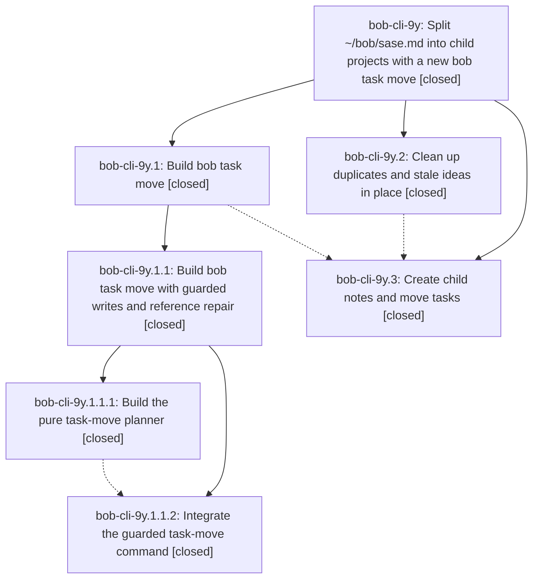

# Bead: bob-cli-9y — Split ~/bob/sase.md into child projects with a new bob task move

[Bead Pages](../README.md) / bob-cli-9y

**Status:** ✓ closed · **Resolution:** done · **Type:** ▸ plan · **Tier:** epic
**Owner:** `bryanbugyi34@gmail.com` · **Created by:** [bbugyi200.athena.124](https://github.com/bobs-org/bob-cli--agents/blob/main/sessions/bbugyi200.athena.124.md) · **Assignee:** `bob-cli-9y.land`
**Created:** 2026-10-19 16:26:36 EDT · **Closed:** 2026-10-19 19:59:09 EDT
**Plan:** [202610/sase\_hub\_split.md](https://github.com/bobs-org/bob-cli--plans/blob/main/202610/sase_hub_split.md)

<!-- sase:links:start -->

## Links

| Relation | Artifact | Why |
| --- | --- | --- |
| implemented-by | [plan:202610/sase_hub_split.md][1] | derived from the plan's `bead_id:` frontmatter field |
| related | file:explicit:83bb12c52d1fa66d04dad56f | attached via sase artifact create --bead |
| related | file:explicit:910e89f700855fe1c71b0870 | attached via sase artifact create --bead |

[1]: https://github.com/bobs-org/bob-cli--plans/blob/main/202610/sase_hub_split.md

<!-- sase:links:end -->

## Description

The ~/bob/sase.md hub is migrated to the research report's recommended split. Duplicates are merged, stale ideas are removed, and routed tasks live in their child notes with every id, dependency, Task Link, and backlink intact. The moves use a tested `bob task move` command that preserves freshness and keeps the vault synced.

## Notes

[2026-10-19T23:55:09Z · bob-cli-9y.land] LANDING AUDIT (before final verification): Reviewed bob-cli-9y and every note on all descendants: 9y.1, 9y.2, 9y.3, 9y.1.1, 9y.1.1.1 and 9y.1.1.2. All descendants are closed. Read plan:202610/sase_hub_split.md, plan:202610/task_move.md and plan:202610/task_move_landing_repairs.md; the latter two show done with valid metadata. Reviewed the actual planner/adapter/shared archive-helper implementations, CLI dispatch/completion, documentation, tests, and epic commits bfca3419, 8b0f3782 and 24f43958. Confirmed the nested landing repairs replaced the temporary test gate and addressed the documented selector, note resolution, intake, identity-map, Markdown-context, scan retry and secondary error-reporting gaps. Live writes remain guarded, destination first/source last, scoped-committed, sync-sandwiched, with no freshness stamping or implicit reconciliation.

Opened the external source research via sase_repo. Preserved audited source snapshots file:explicit:910e89f700855fe1c71b0870 (main report) and file:explicit:83bb12c52d1fa66d04dad56f (Appendix A); read both through sase artifact read. Reconstructed routing from the authoritative report plus approved plan overrides. Compared all 228 original task titles/statuses with live bob query results: 165 moved to exactly the intended 29 destinations, 14 canceled in sase, 3 demoted to plain Future Work bullets in sase_better_installs, 46 retained in sase. All 165 moved titles occur exactly once among 503 open vault tasks. A 5,999-note outgoing-link query found no old sase links for the 49 anchored moved tasks or the moved Future Work anchors; open dependency projections likewise have no old moved-task tokens. The done/mac_inbox_done pyarch backlink points to sase_toobig_symvision. Checked merged details, canceled-task survivor links, CHECK/DECIDE additions, routed Future Work contents and corrected ids, the two new mac_inbox tasks, and all three required new Depends-On links.

All final DECISIONS honored: later_notes=hub leaves 10 community, 9 research and 11 waits/queues tasks unmarked in the hub; move_in_flight=yes preserves the five moved Next/Pending lanes; installs_backlog=yes demotes Docker/Windows/multi-user; personal_homes=routed gives dev 5, job_2026 1, mac_inbox 2; widen_plans_prj=yes gives the exact criterion Improve sase plans and epics! with #hide/prj retained. Five new notes have parent sase, type project, status wip, correct criteria and hub-roster entries. Hub now has 49 open including prj and two post-snapshot reading refs. Codex/Claude reset tasks remain separate in dev and scheduled 2026-10-20, expiring 2026-10-22. Report-only satisfied dependency, sase_v19 link and coverage bookmark remain unchanged; existing CHECK/DECIDE tasks and the three historical deleted-anchor backlinks reported by 9y.2 are intentional retained work, not unfinished migration scope.

Read-only live verification: bob task reconcile --dry-run -f json reports ok, no changes, no unresolved references or dependency warnings, no dropped/internal dependencies; bob ready -a reports 0 crowded notes at cap 5. Latest vault-sync status has local=remote aebe85aacb4acc7ebb6d1151545912713bc74c9c, no errors or conflicts.

INTEGRATION: Reviewed non-epic commits since bfca3419 on current/base master: c7df845f MIT license, f0f6e0c5 docs foundation, b0f38175 docs mounts, 88fcca64 published-URL/link checks. Fast-forwarded this checkout to 88fcca64. Docs contract registry and generated nav already include task-move; mount and URL verification consume the same page without an overlapping task-move implementation. No additional integration changes needed. No source or live vault edits made during this landing.

FOLLOW-UP TRIAGE: Every child note was reviewed; there are zero PROPOSED FOLLOW-UP entries. No genuinely distinct out-of-scope discovery to file, corroborate or decline. Nested lander already corroborated its ETXTBSY flake on bob-cli-5l; no new occurrence observed here. Existing vault CHECK/DECIDE items are intentionally preserved original user tasks. No new task beads needed.

READINESS: sase bead epic-symbols bob-cli-9y reports no entries; this checkout has no just symvision recipe. Remaining work is a fresh just check, normal epic close with this verification plus the actual test outcome, mark plan:202610/sase_hub_split.md status done, reread the parent link (none in current metadata), and final declaration. sase tool run check is unavailable (unknown named tool); use the ad-hoc tool runner for just check. Do not run check-full. No force close.

[2026-10-19T23:59:09Z · bob-cli-9y.land] Verified every descendant and every child note, approved plans and DECISIONS, actual task-move source/tests/docs, and epic commits bfca3419, 8b0f3782, 24f43958. All child phases and nested epic are closed; nested task_move and repair-tale plans are done. Detailed evidence is in the preceding LANDING AUDIT note.

Independently matched all 228 snapshot tasks against the live vault and authoritative routing plus plan corrections: 165 moves to 29 destinations, 14 canceled hub tasks, 3 installs tasks demoted to plain Future Work, 46 retained original tasks. Every moved title occurs exactly once among open tasks. Five new project notes and hub roster are correct; the hub has 49 open including prj and two later refs. Verified carried merge details, canceled survivor links, CHECK/DECIDE notes, Future Work routing/ids, required pi/hermes/memory-deck Depends-On links, personal routing and separate Oct-20 reset reminders. All five reviewer decisions were honored. Intentional deferred/check/report-only work remains as authorized.

Live bob task reconcile --dry-run -f json is clean with no unresolved references, dependency warnings or pending changes; no old moved-task/Future Work source backlinks were found, including the repaired archived pyarch link. bob ready -a reports zero crowded notes at cap 5; vault sync is clean at aebe85aacb4acc7ebb6d1151545912713bc74c9c with no conflicts.

Integrated newer master through 88fcca64, reviewing c7df845f, f0f6e0c5, b0f38175 and 88fcca64. These license/docs foundation/mount/URL changes already incorporate task-move through the contract registry and navigation; no duplicated/conflicting implementation or additional integration change was needed. uv run --project tools/docs bob-docs gen --check passed.

Fresh just check passed on the integrated tree (ToolRun 021c57a3ee5de51a4c088956ff05421e, exit 0, 209.924s): fmt, clippy, 3081 library tests (1 ignored), 1860 CLI tests and every remaining test binary/doctest. check-full was not run. No source or live vault edits were required by this landing.

Follow-up triage: zero PROPOSED FOLLOW-UP entries across all descendants and no independent out-of-scope findings; no tasks created, duplicates corroborated, or proposals declined in this landing. The nested lander's previously corroborated ETXTBSY flake remains tracked as bob-cli-5l; this fresh gate did not reproduce it. All previously noted epic gaps are addressed. Immediately before close, sase bead epic-symbols bob-cli-9y reported no entries. just symvision is unavailable in this repository. Closed normally without force.

## Phases

| Bead | Title | Status | Size | Created | Agents | Commits |
|---|---|---|---|---|---:|---:|
| [bob-cli-9y.1](bob-cli-9y.1.md) | Build bob task move | ✓ closed | large | 2026-10-19 | 1 | 0 |
| [bob-cli-9y.2](bob-cli-9y.2.md) | Clean up duplicates and stale ideas in place | ✓ closed | medium | 2026-10-19 | 1 | 0 |
| [bob-cli-9y.3](bob-cli-9y.3.md) | Create child notes and move tasks | ✓ closed | medium | 2026-10-19 | 1 | 0 |

## Lineage

## Agents

| Agent | Bead | Commits |
|---|---|---:|
| [bbugyi200.athena.bob-cli-9y.1](https://github.com/bobs-org/bob-cli--agents/blob/main/sessions/bbugyi200.athena.bob-cli-9y.1.md) | [bob-cli-9y.1](bob-cli-9y.1.md) | 0 |
| [bbugyi200.athena.bob-cli-9y.1.1.1](https://github.com/bobs-org/bob-cli--agents/blob/main/agents/bbugyi200.athena.bob-cli-9y.1.1.1/README.md) | [bob-cli-9y.1.1.1](bob-cli-9y.1.1.1.md) | 1 |
| [bbugyi200.athena.bob-cli-9y.1.1.2](https://github.com/bobs-org/bob-cli--agents/blob/main/sessions/bbugyi200.athena.bob-cli-9y.1.1.2.md) | [bob-cli-9y.1.1.2](bob-cli-9y.1.1.2.md) | 1 |
| [bbugyi200.athena.bob-cli-9y.1.1.land](https://github.com/bobs-org/bob-cli--agents/blob/main/sessions/bbugyi200.athena.bob-cli-9y.1.1.land.md) | [bob-cli-9y.1.1](bob-cli-9y.1.1.md) | 2 |
| [bbugyi200.athena.bob-cli-9y.2](https://github.com/bobs-org/bob-cli--agents/blob/main/agents/bbugyi200.athena.bob-cli-9y.2/README.md) | [bob-cli-9y.2](bob-cli-9y.2.md) | 0 |
| [bbugyi200.athena.bob-cli-9y.3](https://github.com/bobs-org/bob-cli--agents/blob/main/agents/bbugyi200.athena.bob-cli-9y.3/README.md) | [bob-cli-9y.3](bob-cli-9y.3.md) | 0 |
| [bbugyi200.athena.bob-cli-9y.land](https://github.com/bobs-org/bob-cli--agents/blob/main/agents/bbugyi200.athena.bob-cli-9y.land/README.md) | [bob-cli-9y](README.md) | 1 |

## Commits

| Repo | Commit | Subject | Bead | Committed |
|---|---|---|---|---|
| bob-cli | [`bfca341`](https://github.com/bobs-org/bob-cli/commit/bfca3419c3f5c4caa9a609c6e4f64a2dc6a86111) | feat(task-move): add snapshot-only task-move planner | [bob-cli-9y.1.1.1](bob-cli-9y.1.1.1.md) | 2026-10-19 17:10:56 EDT |
| bob-cli | [`8b0f378`](https://github.com/bobs-org/bob-cli/commit/8b0f3782b0eeb994adce908f78876ea943cd9bdc) | feat(task-move): expose guarded task move command | [bob-cli-9y.1.1.2](bob-cli-9y.1.1.2.md) | 2026-10-19 18:17:11 EDT |
| bob-cli | [`24f4395`](https://github.com/bobs-org/bob-cli/commit/24f43958e8b9ba5d05b5210298a8ac8ad2bf26f5) | fix(task-move): repair landing gaps for selectors, identities, and sync | [bob-cli-9y.1.1](bob-cli-9y.1.1.md) | 2026-10-19 19:26:33 EDT |
| bob-cli--plans | [`bob-cli--plans@c6e71a5`](https://github.com/bobs-org/bob-cli--plans/commit/c6e71a525e55759f4f54892698942e91c76d8ce4) | docs(task-move): mark guarded task-move epic plan done | [bob-cli-9y.1.1](bob-cli-9y.1.1.md) | 2026-10-19 19:27:42 EDT |
| bob-cli--plans | [`bob-cli--plans@77a7764`](https://github.com/bobs-org/bob-cli--plans/commit/77a7764501d24fa39b5a1c592b5835a91054a0cc) | docs(plans): mark verified hub-split epic bob-cli-9y done | [bob-cli-9y](README.md) | 2026-10-19 19:59:46 EDT |
