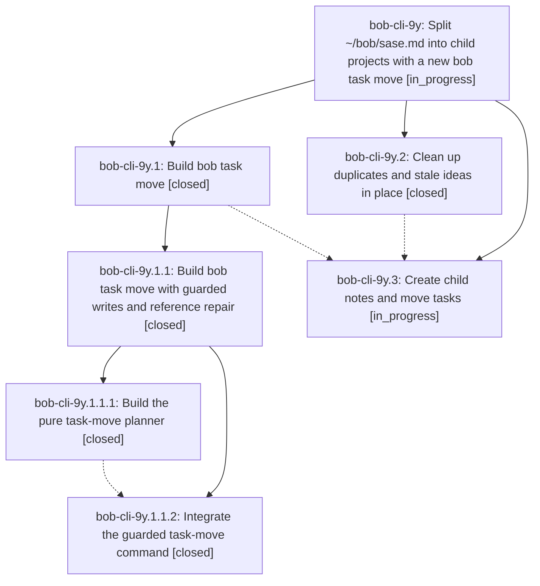

# Bead: bob-cli-9y — Split ~/bob/sase.md into child projects with a new bob task move

[Bead Pages](../README.md) / bob-cli-9y

**Status:** ◐ in_progress · **Type:** ▸ plan · **Tier:** epic
**Owner:** `bryanbugyi34@gmail.com` · **Created by:** [bbugyi200.athena.124](https://github.com/bobs-org/bob-cli--agents/blob/main/sessions/bbugyi200.athena.124.md) · **Assignee:** `bob-cli-9y.land`
**Created:** 2026-10-19 16:26:36 EDT
**Plan:** [202610/sase\_hub\_split.md](https://github.com/bobs-org/bob-cli--plans/blob/main/202610/sase_hub_split.md)

<!-- sase:links:start -->

## Links

| Relation | Artifact | Why |
| --- | --- | --- |
| implemented-by | [plan:202610/sase_hub_split.md][1] | derived from the plan's `bead_id:` frontmatter field |

[1]: https://github.com/bobs-org/bob-cli--plans/blob/main/202610/sase_hub_split.md

<!-- sase:links:end -->

## Description

The ~/bob/sase.md hub is migrated to the research report's recommended split. Duplicates are merged, stale ideas are removed, and routed tasks live in their child notes with every id, dependency, Task Link, and backlink intact. The moves use a tested `bob task move` command that preserves freshness and keeps the vault synced.

## Phases

| Bead | Title | Status | Size | Created | Agents | Commits |
|---|---|---|---|---|---:|---:|
| [bob-cli-9y.1](bob-cli-9y.1.md) | Build bob task move | ✓ closed | large | 2026-10-19 | 1 | 0 |
| [bob-cli-9y.2](bob-cli-9y.2.md) | Clean up duplicates and stale ideas in place | ✓ closed | medium | 2026-10-19 | 1 | 0 |
| [bob-cli-9y.3](bob-cli-9y.3.md) | Create child notes and move tasks | ◐ in_progress | medium | 2026-10-19 | 1 | 0 |

## Lineage

## Agents

| Agent | Bead | Commits |
|---|---|---:|
| [bbugyi200.athena.bob-cli-9y.1](https://github.com/bobs-org/bob-cli--agents/blob/main/sessions/bbugyi200.athena.bob-cli-9y.1.md) | [bob-cli-9y.1](bob-cli-9y.1.md) | 0 |
| [bbugyi200.athena.bob-cli-9y.1.1.1](https://github.com/bobs-org/bob-cli--agents/blob/main/agents/bbugyi200.athena.bob-cli-9y.1.1.1/README.md) | [bob-cli-9y.1.1.1](bob-cli-9y.1.1.1.md) | 1 |
| [bbugyi200.athena.bob-cli-9y.1.1.2](https://github.com/bobs-org/bob-cli--agents/blob/main/sessions/bbugyi200.athena.bob-cli-9y.1.1.2.md) | [bob-cli-9y.1.1.2](bob-cli-9y.1.1.2.md) | 1 |
| [bbugyi200.athena.bob-cli-9y.1.1.land](https://github.com/bobs-org/bob-cli--agents/blob/main/sessions/bbugyi200.athena.bob-cli-9y.1.1.land.md) | [bob-cli-9y.1.1](bob-cli-9y.1.1.md) | 1 |
| [bbugyi200.athena.bob-cli-9y.2](https://github.com/bobs-org/bob-cli--agents/blob/main/agents/bbugyi200.athena.bob-cli-9y.2/README.md) | [bob-cli-9y.2](bob-cli-9y.2.md) | 0 |
| [bbugyi200.athena.bob-cli-9y.3](https://github.com/bobs-org/bob-cli--agents/blob/main/agents/bbugyi200.athena.bob-cli-9y.3/README.md) | [bob-cli-9y.3](bob-cli-9y.3.md) | 0 |
| [bbugyi200.athena.bob-cli-9y.land](https://github.com/bobs-org/bob-cli--agents/blob/main/agents/bbugyi200.athena.bob-cli-9y.land/README.md) | [bob-cli-9y](README.md) | 0 |

## Commits

| Repo | Commit | Subject | Bead | Committed |
|---|---|---|---|---|
| bob-cli | [`bfca341`](https://github.com/bobs-org/bob-cli/commit/bfca3419c3f5c4caa9a609c6e4f64a2dc6a86111) | feat(task-move): add snapshot-only task-move planner | [bob-cli-9y.1.1.1](bob-cli-9y.1.1.1.md) | 2026-10-19 17:10:56 EDT |
| bob-cli | [`8b0f378`](https://github.com/bobs-org/bob-cli/commit/8b0f3782b0eeb994adce908f78876ea943cd9bdc) | feat(task-move): expose guarded task move command | [bob-cli-9y.1.1.2](bob-cli-9y.1.1.2.md) | 2026-10-19 18:17:11 EDT |
| bob-cli | [`24f4395`](https://github.com/bobs-org/bob-cli/commit/24f43958e8b9ba5d05b5210298a8ac8ad2bf26f5) | fix(task-move): repair landing gaps for selectors, identities, and sync | [bob-cli-9y.1.1](bob-cli-9y.1.1.md) | 2026-10-19 19:26:33 EDT |
