# Bead: bob-cli-a0 — Bob public docs site on GitHub Pages

[Bead Pages](../README.md) / bob-cli-a0

**Status:** ◐ in_progress · **Type:** ▸ plan · **Tier:** epic
**Owner:** `bryanbugyi34@gmail.com` · **Created by:** [bbugyi200.apollo.95](https://github.com/bobs-org/bob-cli--agents/blob/main/sessions/bbugyi200.apollo.95.md) · **Assignee:** `bob-cli-a0.land`
**Created:** 2026-10-19 18:55:41 EDT
**Plan:** [202610/bob\_public\_docs\_site.md](https://github.com/bobs-org/bob-cli--plans/blob/main/202610/bob_public_docs_site.md)

<!-- sase:links:start -->

## Links

| Relation | Artifact | Why |
| --- | --- | --- |
| implemented-by | [plan:202610/bob_public_docs_site.md][1] | derived from the plan's `bead_id:` frontmatter field |

[1]: https://github.com/bobs-org/bob-cli--plans/blob/main/202610/bob_public_docs_site.md

<!-- sase:links:end -->

## Description

https://bobs-org.github.io/ serves one beautiful, Diátaxis-organized documentation site for the whole Bob system (bob-cli, bob-plugins, bob-mac-capture). It is built with Zensical from in-repo Markdown, publishes itself hourly behind gates that never replace a good site with a broken one, and keeps every existing docs/<stem>.md contract at /<stem>/.

## Notes

[2026-10-20T00:57:49Z · bob-cli-a0.2.1.land] DISCOVERED ISSUE: (from bob-cli-a0.2.1.land; proposed by phase bob-cli-a0.2.1.1 note #1) docs/highlights-create.md:117 now ends 'see the PDFKit and text-layer research.' as plain text. Foundation commit f0f6e0c5 removed its private link target research:202610/area_project_note_reading_pdfs/area_project_note_reading_pdfs.md, which is unpublishable and failed the strict public link gate. The page builds and passes docs-check, but the sentence points readers at nothing. Remediation needs Bryan's choice: cite a public source, summarize the finding inline, or drop the 'see' clause. A candidate public target is the decisions record proposed by ready task bob-cli-8p (annotated-pdfs-render-on-xelatex), once it is accepted and the outer epic publishes develop/decisions.md. No task bead was filed, because this epic owns the published-docs follow-through.

[2026-10-20T01:38:34Z · bob-cli-a0.2.1.7.land] DISCOVERED ISSUE: corroboration from bob-cli-a0.2.1.7.land of bob-cli-a0.2.1.1 note #1. On master d5c98a2a, docs/highlights-create.md:117 still says see the PDFKit and text-layer research without a public target. just docs-check passes (168 tests), so this is publication follow-through already owned by your note #1, not a toolchain gate failure. Rechecked all-status task searches, the one-week task sweep, and active epics through /sase_new_task. No semantic duplicate: bob-cli-85 concerns PDF rendering defects; bob-cli-8p concerns recording the decision and is related but does not repair this public citation. No new task or memory edit; retain the outer epic ownership.

## Phases

| Bead | Title | Status | Size | Created | Agents | Commits |
|---|---|---|---|---|---:|---:|
| [bob-cli-a0.1](bob-cli-a0.1.md) | Licenses and stale public claims | ✓ closed | small | 2026-10-19 | 1 | 2 |
| [bob-cli-a0.10](bob-cli-a0.10.md) | Obsidian plugin reference in bob-plugins | ◐ in_progress | large | 2026-10-19 | 1 | 0 |
| [bob-cli-a0.11](bob-cli-a0.11.md) | Mac Capture reference in bob-mac-capture | ◐ in_progress | large | 2026-10-19 | 1 | 0 |
| [bob-cli-a0.12](bob-cli-a0.12.md) | bob-cli README becomes a front door | ◐ in_progress | medium | 2026-10-19 | 1 | 0 |
| [bob-cli-a0.13](bob-cli-a0.13.md) | llms.txt, reader tests, final sweep, and handoff | ◐ in_progress | medium | 2026-10-19 | 1 | 0 |
| [bob-cli-a0.2](bob-cli-a0.2.md) | Docs toolchain, contracts in place, and gates | ✓ closed | large | 2026-10-19 | 1 | 0 |
| [bob-cli-a0.3](bob-cli-a0.3.md) | Bob visual identity and homepage | ✓ closed | large | 2026-10-19 | 1 | 1 |
| [bob-cli-a0.4](bob-cli-a0.4.md) | Generated CLI reference, glossary, and decisions | ✓ closed | medium | 2026-10-19 | 1 | 1 |
| [bob-cli-a0.5](bob-cli-a0.5.md) | Deploy repo, hourly gated publish, and launch | ◐ in_progress | large | 2026-10-19 | 1 | 0 |
| [bob-cli-a0.6](bob-cli-a0.6.md) | Demo vault, tested tutorial, and the Learn path | ◐ in_progress | large | 2026-10-19 | 1 | 0 |
| [bob-cli-a0.7](bob-cli-a0.7.md) | Hand-written product reference | ✓ closed | large | 2026-10-19 | 1 | 0 |
| [bob-cli-a0.8](bob-cli-a0.8.md) | Goal-titled guides and component tags | ◐ in_progress | large | 2026-10-19 | 1 | 0 |
| [bob-cli-a0.9](bob-cli-a0.9.md) | Concept pages | ◐ in_progress | large | 2026-10-19 | 1 | 0 |

## Lineage

```mermaid
flowchart TD
    n0["bob-cli-a0: Bob public docs site on GitHub Pages [in_progress]"]
    n1["bob-cli-a0.1: Licenses and stale public claims [closed]"]
    n2["bob-cli-a0.10: Obsidian plugin reference in bob-plugins [in_progress]"]
    n3["bob-cli-a0.10.1: Publish the generated Obsidian plugin reference [in_progress]"]
    n4["bob-cli-a0.10.1.1: Support source-owned mounted documentation hubs [closed]"]
    n5["bob-cli-a0.10.1.2: Generate plugin facts and registered commands [closed]"]
    n6["bob-cli-a0.10.1.3: Write the seven plugin reference pages [closed]"]
    n7["bob-cli-a0.10.1.4: Preserve README topics and create the plugin front door [closed]"]
    n8["bob-cli-a0.10.1.5: Mount the plugin reference and verify its complete workflow [closed]"]
    n9["bob-cli-a0.11: Mac Capture reference in bob-mac-capture [in_progress]"]
    n10["bob-cli-a0.12: bob-cli README becomes a front door [in_progress]"]
    n11["bob-cli-a0.13: llms.txt, reader tests, final sweep, and handoff [in_progress]"]
    n12["bob-cli-a0.2: Docs toolchain, contracts in place, and gates [closed]"]
    n13["bob-cli-a0.2.1: Complete the Bob documentation toolchain and contract site [closed]"]
    n14["bob-cli-a0.2.1.1: Build the docs package and contract site foundation [closed]"]
    n15["bob-cli-a0.2.1.2: Assemble mounted sources with verified provenance [closed]"]
    n16["bob-cli-a0.2.1.3: Enforce Bob's documentation contract [closed]"]
    n17["bob-cli-a0.2.1.4: Protect published URLs and verify built links [closed]"]
    n18["bob-cli-a0.2.1.5: Document authoring and add the approved memory note [closed]"]
    n19["bob-cli-a0.2.1.6: Wire search and prove the complete docs gate [closed]"]
    n20["bob-cli-a0.2.1.7: Finish the Bob docs toolchain landing fixes [closed]"]
    n21["bob-cli-a0.2.1.7.1: Make mount assembly and serve safe and complete [closed]"]
    n22["bob-cli-a0.2.1.7.2: Lint the assembled site, not the authored approximation [closed]"]
    n23["bob-cli-a0.2.1.7.3: Check fragments offline, widen mention scans, and finish templates [closed]"]
    n24["bob-cli-a0.3: Bob visual identity and homepage [closed]"]
    n25["bob-cli-a0.4: Generated CLI reference, glossary, and decisions [closed]"]
    n26["bob-cli-a0.5: Deploy repo, hourly gated publish, and launch [in_progress]"]
    n27["bob-cli-a0.5.1: Launch Bob documentation with gated hourly GitHub Pages publishing [in_progress]"]
    n28["bob-cli-a0.5.1.1: Publication source selection and manifest contracts [closed]"]
    n29["bob-cli-a0.5.1.2: Gated reusable publication and recovery [closed]"]
    n30["bob-cli-a0.5.1.3: Deploy repository templates and operator commands [closed]"]
    n31["bob-cli-a0.5.1.4: Weekly fallback build and external link checks [in_progress]"]
    n32["bob-cli-a0.5.1.5: Bootstrap the public host and prove publication safety [in_progress]"]
    n33["bob-cli-a0.6: Demo vault, tested tutorial, and the Learn path [in_progress]"]
    n34["bob-cli-a0.6.1: Complete the Bob Learn path [in_progress]"]
    n35["bob-cli-a0.6.1.1: Synthetic demo vault and executable first-day tutorial [closed]"]
    n36["bob-cli-a0.6.1.2: Learn continuations, system concept, and compatibility [closed]"]
    n37["bob-cli-a0.6.1.3: Deterministic CLI media and Learn visual verification [in_progress]"]
    n38["bob-cli-a0.7: Hand-written product reference [closed]"]
    n39["bob-cli-a0.7.1: Bob hand-written product reference [closed]"]
    n40["bob-cli-a0.7.1.1: Capture syntax and vault format reference [closed]"]
    n41["bob-cli-a0.7.1.2: Configuration reference and environment drift guard [closed]"]
    n42["bob-cli-a0.7.1.3: JSON output catalog and reference integration [closed]"]
    n43["bob-cli-a0.8: Goal-titled guides and component tags [in_progress]"]
    n44["bob-cli-a0.9: Concept pages [in_progress]"]
    n0 --> n1
    n0 --> n2
    n2 --> n3
    n3 --> n4
    n3 --> n5
    n3 --> n6
    n3 --> n7
    n3 --> n8
    n0 --> n9
    n0 --> n10
    n0 --> n11
    n0 --> n12
    n12 --> n13
    n13 --> n14
    n13 --> n15
    n13 --> n16
    n13 --> n17
    n13 --> n18
    n13 --> n19
    n13 --> n20
    n20 --> n21
    n20 --> n22
    n20 --> n23
    n0 --> n24
    n0 --> n25
    n0 --> n26
    n26 --> n27
    n27 --> n28
    n27 --> n29
    n27 --> n30
    n27 --> n31
    n27 --> n32
    n0 --> n33
    n33 --> n34
    n34 --> n35
    n34 --> n36
    n34 --> n37
    n0 --> n38
    n38 --> n39
    n39 --> n40
    n39 --> n41
    n39 --> n42
    n0 --> n43
    n0 --> n44
    n1 -.-> n26
    n2 -.-> n11
    n4 -.-> n8
    n5 -.-> n6
    n6 -.-> n7
    n7 -.-> n8
    n9 -.-> n11
    n10 -.-> n11
    n12 -.-> n24
    n12 -.-> n25
    n12 -.-> n26
    n14 -.-> n15
    n15 -.-> n16
    n15 -.-> n17
    n16 -.-> n18
    n16 -.-> n19
    n17 -.-> n19
    n18 -.-> n19
    n21 -.-> n22
    n24 -.-> n2
    n24 -.-> n26
    n24 -.-> n33
    n24 -.-> n38
    n25 -.-> n2
    n25 -.-> n26
    n25 -.-> n33
    n25 -.-> n38
    n26 -.-> n11
    n28 -.-> n29
    n29 -.-> n30
    n30 -.-> n31
    n31 -.-> n32
    n33 -.-> n10
    n33 -.-> n43
    n33 -.-> n44
    n35 -.-> n36
    n36 -.-> n37
    n38 -.-> n10
    n38 -.-> n43
    n40 -.-> n42
    n41 -.-> n42
    n43 -.-> n9
    n43 -.-> n10
    n44 -.-> n10
```

## Agents

| Agent | Bead | Commits |
|---|---|---:|
| [bbugyi200.apollo.bob-cli-a0.1](https://github.com/bobs-org/bob-cli--agents/blob/main/agents/bbugyi200.apollo.bob-cli-a0.1/README.md) | [bob-cli-a0.1](bob-cli-a0.1.md) | 2 |
| [bbugyi200.apollo.bob-cli-a0.10](https://github.com/bobs-org/bob-cli--agents/blob/main/sessions/bbugyi200.apollo.bob-cli-a0.10.md) | [bob-cli-a0.10](bob-cli-a0.10.md) | 0 |
| [bbugyi200.apollo.bob-cli-a0.10.1.1](https://github.com/bobs-org/bob-cli--agents/blob/main/agents/bbugyi200.apollo.bob-cli-a0.10.1.1/README.md) | [bob-cli-a0.10.1.1](bob-cli-a0.10.1.1.md) | 1 |
| [bbugyi200.apollo.bob-cli-a0.10.1.2](https://github.com/bobs-org/bob-cli--agents/blob/main/agents/bbugyi200.apollo.bob-cli-a0.10.1.2/README.md) | [bob-cli-a0.10.1.2](bob-cli-a0.10.1.2.md) | 1 |
| [bbugyi200.apollo.bob-cli-a0.10.1.3](https://github.com/bobs-org/bob-cli--agents/blob/main/agents/bbugyi200.apollo.bob-cli-a0.10.1.3/README.md) | [bob-cli-a0.10.1.3](bob-cli-a0.10.1.3.md) | 1 |
| [bbugyi200.apollo.bob-cli-a0.10.1.4](https://github.com/bobs-org/bob-cli--agents/blob/main/agents/bbugyi200.apollo.bob-cli-a0.10.1.4/README.md) | [bob-cli-a0.10.1.4](bob-cli-a0.10.1.4.md) | 1 |
| [bbugyi200.apollo.bob-cli-a0.10.1.5](https://github.com/bobs-org/bob-cli--agents/blob/main/agents/bbugyi200.apollo.bob-cli-a0.10.1.5/README.md) | [bob-cli-a0.10.1.5](bob-cli-a0.10.1.5.md) | 2 |
| [bbugyi200.apollo.bob-cli-a0.10.1.land](https://github.com/bobs-org/bob-cli--agents/blob/main/agents/bbugyi200.apollo.bob-cli-a0.10.1.land/README.md) | [bob-cli-a0.10.1](bob-cli-a0.10.1.md) | 0 |
| [bbugyi200.apollo.bob-cli-a0.11](https://github.com/bobs-org/bob-cli--agents/blob/main/agents/bbugyi200.apollo.bob-cli-a0.11/README.md) | [bob-cli-a0.11](bob-cli-a0.11.md) | 0 |
| [bbugyi200.apollo.bob-cli-a0.12](https://github.com/bobs-org/bob-cli--agents/blob/main/agents/bbugyi200.apollo.bob-cli-a0.12/README.md) | [bob-cli-a0.12](bob-cli-a0.12.md) | 0 |
| [bbugyi200.apollo.bob-cli-a0.13](https://github.com/bobs-org/bob-cli--agents/blob/main/agents/bbugyi200.apollo.bob-cli-a0.13/README.md) | [bob-cli-a0.13](bob-cli-a0.13.md) | 0 |
| [bbugyi200.apollo.bob-cli-a0.2](https://github.com/bobs-org/bob-cli--agents/blob/main/sessions/bbugyi200.apollo.bob-cli-a0.2.md) | [bob-cli-a0.2](bob-cli-a0.2.md) | 0 |
| [bbugyi200.apollo.bob-cli-a0.2.1.1](https://github.com/bobs-org/bob-cli--agents/blob/main/agents/bbugyi200.apollo.bob-cli-a0.2.1.1/README.md) | [bob-cli-a0.2.1.1](bob-cli-a0.2.1.1.md) | 1 |
| [bbugyi200.apollo.bob-cli-a0.2.1.2](https://github.com/bobs-org/bob-cli--agents/blob/main/agents/bbugyi200.apollo.bob-cli-a0.2.1.2/README.md) | [bob-cli-a0.2.1.2](bob-cli-a0.2.1.2.md) | 1 |
| [bbugyi200.apollo.bob-cli-a0.2.1.3](https://github.com/bobs-org/bob-cli--agents/blob/main/agents/bbugyi200.apollo.bob-cli-a0.2.1.3/README.md) | [bob-cli-a0.2.1.3](bob-cli-a0.2.1.3.md) | 1 |
| [bbugyi200.apollo.bob-cli-a0.2.1.4](https://github.com/bobs-org/bob-cli--agents/blob/main/agents/bbugyi200.apollo.bob-cli-a0.2.1.4/README.md) | [bob-cli-a0.2.1.4](bob-cli-a0.2.1.4.md) | 1 |
| [bbugyi200.apollo.bob-cli-a0.2.1.5](https://github.com/bobs-org/bob-cli--agents/blob/main/agents/bbugyi200.apollo.bob-cli-a0.2.1.5/README.md) | [bob-cli-a0.2.1.5](bob-cli-a0.2.1.5.md) | 1 |
| [bbugyi200.apollo.bob-cli-a0.2.1.6](https://github.com/bobs-org/bob-cli--agents/blob/main/agents/bbugyi200.apollo.bob-cli-a0.2.1.6/README.md) | [bob-cli-a0.2.1.6](bob-cli-a0.2.1.6.md) | 1 |
| [bbugyi200.apollo.bob-cli-a0.2.1.7.1](https://github.com/bobs-org/bob-cli--agents/blob/main/agents/bbugyi200.apollo.bob-cli-a0.2.1.7.1/README.md) | [bob-cli-a0.2.1.7.1](bob-cli-a0.2.1.7.1.md) | 1 |
| [bbugyi200.apollo.bob-cli-a0.2.1.7.2](https://github.com/bobs-org/bob-cli--agents/blob/main/agents/bbugyi200.apollo.bob-cli-a0.2.1.7.2/README.md) | [bob-cli-a0.2.1.7.2](bob-cli-a0.2.1.7.2.md) | 1 |
| [bbugyi200.apollo.bob-cli-a0.2.1.7.3](https://github.com/bobs-org/bob-cli--agents/blob/main/agents/bbugyi200.apollo.bob-cli-a0.2.1.7.3/README.md) | [bob-cli-a0.2.1.7.3](bob-cli-a0.2.1.7.3.md) | 1 |
| [bbugyi200.apollo.bob-cli-a0.2.1.7.land](https://github.com/bobs-org/bob-cli--agents/blob/main/sessions/bbugyi200.apollo.bob-cli-a0.2.1.7.land.md) | [bob-cli-a0.2.1.7](bob-cli-a0.2.1.7.md) | 2 |
| [bbugyi200.apollo.bob-cli-a0.2.1.land](https://github.com/bobs-org/bob-cli--agents/blob/main/sessions/bbugyi200.apollo.bob-cli-a0.2.1.land.md) | [bob-cli-a0.2.1](bob-cli-a0.2.1.md) | 0 |
| [bbugyi200.apollo.bob-cli-a0.3](https://github.com/bobs-org/bob-cli--agents/blob/main/sessions/bbugyi200.apollo.bob-cli-a0.3.md) | [bob-cli-a0.3](bob-cli-a0.3.md) | 1 |
| [bbugyi200.apollo.bob-cli-a0.4](https://github.com/bobs-org/bob-cli--agents/blob/main/agents/bbugyi200.apollo.bob-cli-a0.4/README.md) | [bob-cli-a0.4](bob-cli-a0.4.md) | 1 |
| [bbugyi200.apollo.bob-cli-a0.5](https://github.com/bobs-org/bob-cli--agents/blob/main/sessions/bbugyi200.apollo.bob-cli-a0.5.md) | [bob-cli-a0.5](bob-cli-a0.5.md) | 0 |
| [bbugyi200.apollo.bob-cli-a0.5.1.1](https://github.com/bobs-org/bob-cli--agents/blob/main/agents/bbugyi200.apollo.bob-cli-a0.5.1.1/README.md) | [bob-cli-a0.5.1.1](bob-cli-a0.5.1.1.md) | 1 |
| [bbugyi200.apollo.bob-cli-a0.5.1.2](https://github.com/bobs-org/bob-cli--agents/blob/main/agents/bbugyi200.apollo.bob-cli-a0.5.1.2/README.md) | [bob-cli-a0.5.1.2](bob-cli-a0.5.1.2.md) | 1 |
| [bbugyi200.apollo.bob-cli-a0.5.1.3](https://github.com/bobs-org/bob-cli--agents/blob/main/agents/bbugyi200.apollo.bob-cli-a0.5.1.3/README.md) | [bob-cli-a0.5.1.3](bob-cli-a0.5.1.3.md) | 1 |
| [bbugyi200.apollo.bob-cli-a0.5.1.4](https://github.com/bobs-org/bob-cli--agents/blob/main/agents/bbugyi200.apollo.bob-cli-a0.5.1.4/README.md) | [bob-cli-a0.5.1.4](bob-cli-a0.5.1.4.md) | 0 |
| [bbugyi200.apollo.bob-cli-a0.5.1.5](https://github.com/bobs-org/bob-cli--agents/blob/main/agents/bbugyi200.apollo.bob-cli-a0.5.1.5/README.md) | [bob-cli-a0.5.1.5](bob-cli-a0.5.1.5.md) | 0 |
| [bbugyi200.apollo.bob-cli-a0.5.1.land](https://github.com/bobs-org/bob-cli--agents/blob/main/agents/bbugyi200.apollo.bob-cli-a0.5.1.land/README.md) | [bob-cli-a0.5.1](bob-cli-a0.5.1.md) | 0 |
| [bbugyi200.apollo.bob-cli-a0.6](https://github.com/bobs-org/bob-cli--agents/blob/main/sessions/bbugyi200.apollo.bob-cli-a0.6.md) | [bob-cli-a0.6](bob-cli-a0.6.md) | 0 |
| [bbugyi200.apollo.bob-cli-a0.6.1.1](https://github.com/bobs-org/bob-cli--agents/blob/main/sessions/bbugyi200.apollo.bob-cli-a0.6.1.1.md) | [bob-cli-a0.6.1.1](bob-cli-a0.6.1.1.md) | 1 |
| [bbugyi200.apollo.bob-cli-a0.6.1.2](https://github.com/bobs-org/bob-cli--agents/blob/main/agents/bbugyi200.apollo.bob-cli-a0.6.1.2/README.md) | [bob-cli-a0.6.1.2](bob-cli-a0.6.1.2.md) | 1 |
| [bbugyi200.apollo.bob-cli-a0.6.1.3](https://github.com/bobs-org/bob-cli--agents/blob/main/agents/bbugyi200.apollo.bob-cli-a0.6.1.3/README.md) | [bob-cli-a0.6.1.3](bob-cli-a0.6.1.3.md) | 0 |
| [bbugyi200.apollo.bob-cli-a0.6.1.land](https://github.com/bobs-org/bob-cli--agents/blob/main/agents/bbugyi200.apollo.bob-cli-a0.6.1.land/README.md) | [bob-cli-a0.6.1](bob-cli-a0.6.1.md) | 0 |
| [bbugyi200.apollo.bob-cli-a0.7](https://github.com/bobs-org/bob-cli--agents/blob/main/sessions/bbugyi200.apollo.bob-cli-a0.7.md) | [bob-cli-a0.7](bob-cli-a0.7.md) | 0 |
| [bbugyi200.apollo.bob-cli-a0.7.1.1](https://github.com/bobs-org/bob-cli--agents/blob/main/agents/bbugyi200.apollo.bob-cli-a0.7.1.1/README.md) | [bob-cli-a0.7.1.1](bob-cli-a0.7.1.1.md) | 1 |
| [bbugyi200.apollo.bob-cli-a0.7.1.2](https://github.com/bobs-org/bob-cli--agents/blob/main/sessions/bbugyi200.apollo.bob-cli-a0.7.1.2.md) | [bob-cli-a0.7.1.2](bob-cli-a0.7.1.2.md) | 1 |
| [bbugyi200.apollo.bob-cli-a0.7.1.3](https://github.com/bobs-org/bob-cli--agents/blob/main/agents/bbugyi200.apollo.bob-cli-a0.7.1.3/README.md) | [bob-cli-a0.7.1.3](bob-cli-a0.7.1.3.md) | 1 |
| [bbugyi200.apollo.bob-cli-a0.7.1.land](https://github.com/bobs-org/bob-cli--agents/blob/main/sessions/bbugyi200.apollo.bob-cli-a0.7.1.land.md) | [bob-cli-a0.7.1](bob-cli-a0.7.1.md) | 1 |
| [bbugyi200.apollo.bob-cli-a0.8](https://github.com/bobs-org/bob-cli--agents/blob/main/agents/bbugyi200.apollo.bob-cli-a0.8/README.md) | [bob-cli-a0.8](bob-cli-a0.8.md) | 0 |
| [bbugyi200.apollo.bob-cli-a0.9](https://github.com/bobs-org/bob-cli--agents/blob/main/agents/bbugyi200.apollo.bob-cli-a0.9/README.md) | [bob-cli-a0.9](bob-cli-a0.9.md) | 0 |
| [bbugyi200.apollo.bob-cli-a0.land](https://github.com/bobs-org/bob-cli--agents/blob/main/agents/bbugyi200.apollo.bob-cli-a0.land/README.md) | [bob-cli-a0](README.md) | 0 |

## Commits

| Repo | Commit | Subject | Bead | Committed |
|---|---|---|---|---|
| bob-cli | [`c7df845`](https://github.com/bobs-org/bob-cli/commit/c7df845f34b8301434ebb616516da0578dd80073) | docs(license): adopt MIT license for public docs site | [bob-cli-a0.1](bob-cli-a0.1.md) | 2026-10-19 19:02:17 EDT |
| bob-plugins | [`bob-plugins@bd6ff0a`](https://github.com/bobs-org/bob-plugins/commit/bd6ff0aeb9f05e87980138d1fa460e3ce5a57579) | docs(readme): correct stale public claims for seven-plugin public monorepo | [bob-cli-a0.1](bob-cli-a0.1.md) | 2026-10-19 19:03:51 EDT |
| bob-cli | [`f0f6e0c`](https://github.com/bobs-org/bob-cli/commit/f0f6e0c533571e73adff866a0283ab2b3b7459d1) | feat(docs): build locked docs package and contract site foundation | [bob-cli-a0.2.1.1](bob-cli-a0.2.1.1.md) | 2026-10-19 19:20:48 EDT |
| bob-cli | [`b0f3817`](https://github.com/bobs-org/bob-cli/commit/b0f38175748f6f6965adc52017f1793a949214bf) | feat(docs): implement mounts with production sources verification | [bob-cli-a0.2.1.2](bob-cli-a0.2.1.2.md) | 2026-10-19 19:37:09 EDT |
| bob-cli | [`88fcca6`](https://github.com/bobs-org/bob-cli/commit/88fcca648a7c43064513a31cbdde09718da1134e) | feat(docs): protect published URLs and verify built links (bob-cli-a0.2.1.4) | [bob-cli-a0.2.1.4](bob-cli-a0.2.1.4.md) | 2026-10-19 19:49:21 EDT |
| bob-cli | [`e37cd4a`](https://github.com/bobs-org/bob-cli/commit/e37cd4a5c849e3922b830cf5fbe36926bb6ffddd) | feat(docs): add bob-docs lint for the documentation contract | [bob-cli-a0.2.1.3](bob-cli-a0.2.1.3.md) | 2026-10-19 20:12:29 EDT |
| bob-cli | [`23f6b93`](https://github.com/bobs-org/bob-cli/commit/23f6b93c14277732fb9fa30e362add975d2a0045) | docs(authoring): add Bob documentation guidance and templates | [bob-cli-a0.2.1.5](bob-cli-a0.2.1.5.md) | 2026-10-19 20:21:26 EDT |
| bob-cli | [`cb42d65`](https://github.com/bobs-org/bob-cli/commit/cb42d654f9760641dbd1fce07c12c18567ae8f09) | feat(docs): wire complete documentation gate | [bob-cli-a0.2.1.6](bob-cli-a0.2.1.6.md) | 2026-10-19 20:38:11 EDT |
| bob-cli | [`2c50df5`](https://github.com/bobs-org/bob-cli/commit/2c50df5594a392e36b999be0968a0d14cce70d10) | feat(docs): make mount assembly and serve safe and complete | [bob-cli-a0.2.1.7.1](bob-cli-a0.2.1.7.1.md) | 2026-10-19 21:14:58 EDT |
| bob-cli | [`5cbfea1`](https://github.com/bobs-org/bob-cli/commit/5cbfea1f38d605e840f8dad69551b9b9e71ac52d) | fix(docs): check fragments offline and finish authoring templates | [bob-cli-a0.2.1.7.3](bob-cli-a0.2.1.7.3.md) | 2026-10-19 21:25:17 EDT |
| bob-cli | [`d5c98a2`](https://github.com/bobs-org/bob-cli/commit/d5c98a2a15e71f5ce814c98c7b10d8a19c6d3813) | fix(docs): lint the assembled documentation site | [bob-cli-a0.2.1.7.2](bob-cli-a0.2.1.7.2.md) | 2026-10-19 21:29:14 EDT |
| bob-cli | [`701dd78`](https://github.com/bobs-org/bob-cli/commit/701dd78302657dc41d807331b809977608802738) | fix(docs): validate mount sources, ignores, cache, and live mirroring | [bob-cli-a0.2.1.7](bob-cli-a0.2.1.7.md) | 2026-10-19 22:19:54 EDT |
| bob-cli--plans | [`bob-cli--plans@94ca506`](https://github.com/bobs-org/bob-cli--plans/commit/94ca506b06b9263878c4691426b67f53e76c542b) | chore(plans): mark docs toolchain landing plans done | [bob-cli-a0.2.1.7](bob-cli-a0.2.1.7.md) | 2026-10-19 22:20:46 EDT |
| bob-cli | [`95db823`](https://github.com/bobs-org/bob-cli/commit/95db82308f2f04c876323aa2122035a93a120e34) | feat(docs): add golden CLI reference, glossary, and decisions pages | [bob-cli-a0.4](bob-cli-a0.4.md) | 2026-10-19 22:57:01 EDT |
| bob-cli | [`f8ef162`](https://github.com/bobs-org/bob-cli/commit/f8ef1628621b8be6c8188eeb0e8ea0046bd007d9) | feat(docs): complete Bob visual identity and homepage | [bob-cli-a0.3](bob-cli-a0.3.md) | 2026-10-19 23:04:00 EDT |
| bob-plugins | [`bob-plugins@be09382`](https://github.com/bobs-org/bob-plugins/commit/be093823dbcfe55346bbe0762b125593d420cbf1) | feat(docs): generate Obsidian plugin inventory and command references | [bob-cli-a0.10.1.2](bob-cli-a0.10.1.2.md) | 2026-10-19 23:30:56 EDT |
| bob-cli | [`5d3ad7d`](https://github.com/bobs-org/bob-cli/commit/5d3ad7d0adcb32a128839eafe2f3dde10421ab00) | feat(docs): document configuration and guard environment drift | [bob-cli-a0.7.1.2](bob-cli-a0.7.1.2.md) | 2026-10-19 23:34:00 EDT |
| bob-cli | [`f367829`](https://github.com/bobs-org/bob-cli/commit/f3678291e724cc5f967145620732e0d72ec63374) | feat(docs): support source-owned mounted documentation hubs | [bob-cli-a0.10.1.1](bob-cli-a0.10.1.1.md) | 2026-10-19 23:35:35 EDT |
| bob-cli | [`6f6841b`](https://github.com/bobs-org/bob-cli/commit/6f6841b523440c60b71c458adf851b08cd549c81) | docs(reference): add capture syntax and vault format pages | [bob-cli-a0.7.1.1](bob-cli-a0.7.1.1.md) | 2026-10-19 23:38:11 EDT |
| bob-plugins | [`bob-plugins@7e74901`](https://github.com/bobs-org/bob-plugins/commit/7e749018b39a96d9d1a8972a74144cc27034fe48) | docs(plugins): write the seven plugin reference pages | [bob-cli-a0.10.1.3](bob-cli-a0.10.1.3.md) | 2026-10-19 23:43:26 EDT |
| bob-cli | [`d18b45d`](https://github.com/bobs-org/bob-cli/commit/d18b45de847928e326b73bba2b7846a154d521e9) | feat(docs): add publication source planner | [bob-cli-a0.5.1.1](bob-cli-a0.5.1.1.md) | 2026-10-19 23:46:59 EDT |
| bob-cli | [`7751f50`](https://github.com/bobs-org/bob-cli/commit/7751f505fe373fefd0788edbe229a6efd89b3bb0) | feat(docs): add executable Bob first-day tutorial | [bob-cli-a0.6.1.1](bob-cli-a0.6.1.1.md) | 2026-10-19 23:48:14 EDT |
| bob-cli | [`f30389c`](https://github.com/bobs-org/bob-cli/commit/f30389c75fcef77b47574fe9719312563db3e7a0) | docs(reference): add JSON output catalog and reference integration | [bob-cli-a0.7.1.3](bob-cli-a0.7.1.3.md) | 2026-10-19 23:50:08 EDT |
| bob-plugins | [`bob-plugins@fdf834d`](https://github.com/bobs-org/bob-plugins/commit/fdf834d4d8125c7269c2115d39ebfdb81d713982) | docs(plugins): add README front door and guides | [bob-cli-a0.10.1.4](bob-cli-a0.10.1.4.md) | 2026-10-20 00:04:57 EDT |
| bob-cli | [`9ea12d2`](https://github.com/bobs-org/bob-cli/commit/9ea12d2d90c332d801a96cad4a9c88c009fb3afe) | feat(docs): add reusable docs-publish workflow with record, verify, drill | [bob-cli-a0.5.1.2](bob-cli-a0.5.1.2.md) | 2026-10-20 00:08:06 EDT |
| bob-cli | [`48f3ef2`](https://github.com/bobs-org/bob-cli/commit/48f3ef22c984d8da558cd278d44beb61fc89a8d5) | docs(reader-path): add Get started, Concepts, and compatibility pages | [bob-cli-a0.6.1.2](bob-cli-a0.6.1.2.md) | 2026-10-20 00:08:44 EDT |
| bob-cli | [`cf7a9e9`](https://github.com/bobs-org/bob-cli/commit/cf7a9e98497c65a98969022616431aefb19c1ee8) | docs(reference): finish product reference landing repairs | [bob-cli-a0.7.1](bob-cli-a0.7.1.md) | 2026-10-20 00:31:48 EDT |
| bob-cli | [`d5c318a`](https://github.com/bobs-org/bob-cli/commit/d5c318a97e103042b6067a1bf63d142e46c4ac7e) | feat(docs): add host templates and operator publish commands | [bob-cli-a0.5.1.3](bob-cli-a0.5.1.3.md) | 2026-10-20 00:33:27 EDT |
| bob-cli | [`b1f98d9`](https://github.com/bobs-org/bob-cli/commit/b1f98d9908d943f5eacd74837d3f52a8388b9d61) | feat(docs): mount the Obsidian plugin reference into the Bob site | [bob-cli-a0.10.1.5](bob-cli-a0.10.1.5.md) | 2026-10-20 00:52:16 EDT |
| bob-plugins | [`bob-plugins@2af765d`](https://github.com/bobs-org/bob-plugins/commit/2af765dda968d9332e7a4b51c07be8b1ff106c46) | docs: add sibling docs-check wrapper and cross-mount site URLs | [bob-cli-a0.10.1.5](bob-cli-a0.10.1.5.md) | 2026-10-20 00:53:38 EDT |
