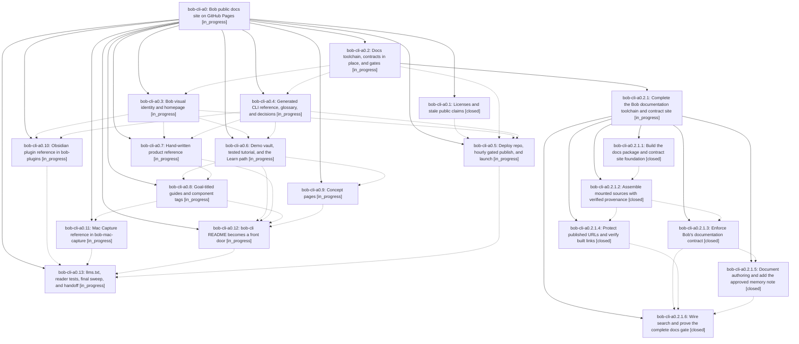

# Bead: bob-cli-a0 — Bob public docs site on GitHub Pages

[Bead Pages](../README.md) / bob-cli-a0

**Status:** ◐ in_progress · **Type:** ▸ plan · **Tier:** epic
**Owner:** `bryanbugyi34@gmail.com` · **Created by:** [bbugyi200.apollo.95](https://github.com/bobs-org/bob-cli--agents/blob/main/sessions/bbugyi200.apollo.95.md) · **Assignee:** `bob-cli-a0.land`
**Created:** 2026-10-19 18:55:41 EDT
**Plan:** [202610/bob\_public\_docs\_site.md](https://github.com/bobs-org/bob-cli--plans/blob/main/202610/bob_public_docs_site.md)

<!-- sase:links:start -->

## Links

| Relation | Artifact | Why |
| --- | --- | --- |
| implemented-by | [plan:202610/bob_public_docs_site.md][1] | derived from the plan's `bead_id:` frontmatter field |

[1]: https://github.com/bobs-org/bob-cli--plans/blob/main/202610/bob_public_docs_site.md

<!-- sase:links:end -->

## Description

https://bobs-org.github.io/ serves one beautiful, Diátaxis-organized documentation site for the whole Bob system (bob-cli, bob-plugins, bob-mac-capture). It is built with Zensical from in-repo Markdown, publishes itself hourly behind gates that never replace a good site with a broken one, and keeps every existing docs/<stem>.md contract at /<stem>/.

## Phases

| Bead | Title | Status | Size | Created | Agents | Commits |
|---|---|---|---|---|---:|---:|
| [bob-cli-a0.1](bob-cli-a0.1.md) | Licenses and stale public claims | ✓ closed | small | 2026-10-19 | 1 | 1 |
| [bob-cli-a0.10](bob-cli-a0.10.md) | Obsidian plugin reference in bob-plugins | ◐ in_progress | large | 2026-10-19 | 1 | 0 |
| [bob-cli-a0.11](bob-cli-a0.11.md) | Mac Capture reference in bob-mac-capture | ◐ in_progress | large | 2026-10-19 | 1 | 0 |
| [bob-cli-a0.12](bob-cli-a0.12.md) | bob-cli README becomes a front door | ◐ in_progress | medium | 2026-10-19 | 1 | 0 |
| [bob-cli-a0.13](bob-cli-a0.13.md) | llms.txt, reader tests, final sweep, and handoff | ◐ in_progress | medium | 2026-10-19 | 1 | 0 |
| [bob-cli-a0.2](bob-cli-a0.2.md) | Docs toolchain, contracts in place, and gates | ◐ in_progress | large | 2026-10-19 | 1 | 0 |
| [bob-cli-a0.3](bob-cli-a0.3.md) | Bob visual identity and homepage | ◐ in_progress | large | 2026-10-19 | 1 | 0 |
| [bob-cli-a0.4](bob-cli-a0.4.md) | Generated CLI reference, glossary, and decisions | ◐ in_progress | medium | 2026-10-19 | 1 | 0 |
| [bob-cli-a0.5](bob-cli-a0.5.md) | Deploy repo, hourly gated publish, and launch | ◐ in_progress | large | 2026-10-19 | 1 | 0 |
| [bob-cli-a0.6](bob-cli-a0.6.md) | Demo vault, tested tutorial, and the Learn path | ◐ in_progress | large | 2026-10-19 | 1 | 0 |
| [bob-cli-a0.7](bob-cli-a0.7.md) | Hand-written product reference | ◐ in_progress | large | 2026-10-19 | 1 | 0 |
| [bob-cli-a0.8](bob-cli-a0.8.md) | Goal-titled guides and component tags | ◐ in_progress | large | 2026-10-19 | 1 | 0 |
| [bob-cli-a0.9](bob-cli-a0.9.md) | Concept pages | ◐ in_progress | large | 2026-10-19 | 1 | 0 |

## Lineage

## Agents

| Agent | Bead | Commits |
|---|---|---:|
| [bbugyi200.apollo.bob-cli-a0.1](https://github.com/bobs-org/bob-cli--agents/blob/main/agents/bbugyi200.apollo.bob-cli-a0.1/README.md) | [bob-cli-a0.1](bob-cli-a0.1.md) | 1 |
| [bbugyi200.apollo.bob-cli-a0.10](https://github.com/bobs-org/bob-cli--agents/blob/main/agents/bbugyi200.apollo.bob-cli-a0.10/README.md) | [bob-cli-a0.10](bob-cli-a0.10.md) | 0 |
| [bbugyi200.apollo.bob-cli-a0.11](https://github.com/bobs-org/bob-cli--agents/blob/main/agents/bbugyi200.apollo.bob-cli-a0.11/README.md) | [bob-cli-a0.11](bob-cli-a0.11.md) | 0 |
| [bbugyi200.apollo.bob-cli-a0.12](https://github.com/bobs-org/bob-cli--agents/blob/main/agents/bbugyi200.apollo.bob-cli-a0.12/README.md) | [bob-cli-a0.12](bob-cli-a0.12.md) | 0 |
| [bbugyi200.apollo.bob-cli-a0.13](https://github.com/bobs-org/bob-cli--agents/blob/main/agents/bbugyi200.apollo.bob-cli-a0.13/README.md) | [bob-cli-a0.13](bob-cli-a0.13.md) | 0 |
| [bbugyi200.apollo.bob-cli-a0.2](https://github.com/bobs-org/bob-cli--agents/blob/main/sessions/bbugyi200.apollo.bob-cli-a0.2.md) | [bob-cli-a0.2](bob-cli-a0.2.md) | 0 |
| [bbugyi200.apollo.bob-cli-a0.2.1.1](https://github.com/bobs-org/bob-cli--agents/blob/main/agents/bbugyi200.apollo.bob-cli-a0.2.1.1/README.md) | [bob-cli-a0.2.1.1](bob-cli-a0.2.1.1.md) | 1 |
| [bbugyi200.apollo.bob-cli-a0.2.1.2](https://github.com/bobs-org/bob-cli--agents/blob/main/agents/bbugyi200.apollo.bob-cli-a0.2.1.2/README.md) | [bob-cli-a0.2.1.2](bob-cli-a0.2.1.2.md) | 1 |
| [bbugyi200.apollo.bob-cli-a0.2.1.3](https://github.com/bobs-org/bob-cli--agents/blob/main/agents/bbugyi200.apollo.bob-cli-a0.2.1.3/README.md) | [bob-cli-a0.2.1.3](bob-cli-a0.2.1.3.md) | 1 |
| [bbugyi200.apollo.bob-cli-a0.2.1.4](https://github.com/bobs-org/bob-cli--agents/blob/main/agents/bbugyi200.apollo.bob-cli-a0.2.1.4/README.md) | [bob-cli-a0.2.1.4](bob-cli-a0.2.1.4.md) | 1 |
| [bbugyi200.apollo.bob-cli-a0.2.1.5](https://github.com/bobs-org/bob-cli--agents/blob/main/agents/bbugyi200.apollo.bob-cli-a0.2.1.5/README.md) | [bob-cli-a0.2.1.5](bob-cli-a0.2.1.5.md) | 1 |
| [bbugyi200.apollo.bob-cli-a0.2.1.6](https://github.com/bobs-org/bob-cli--agents/blob/main/agents/bbugyi200.apollo.bob-cli-a0.2.1.6/README.md) | [bob-cli-a0.2.1.6](bob-cli-a0.2.1.6.md) | 1 |
| [bbugyi200.apollo.bob-cli-a0.2.1.land](https://github.com/bobs-org/bob-cli--agents/blob/main/agents/bbugyi200.apollo.bob-cli-a0.2.1.land/README.md) | [bob-cli-a0.2.1](bob-cli-a0.2.1.md) | 0 |
| [bbugyi200.apollo.bob-cli-a0.3](https://github.com/bobs-org/bob-cli--agents/blob/main/agents/bbugyi200.apollo.bob-cli-a0.3/README.md) | [bob-cli-a0.3](bob-cli-a0.3.md) | 0 |
| [bbugyi200.apollo.bob-cli-a0.4](https://github.com/bobs-org/bob-cli--agents/blob/main/agents/bbugyi200.apollo.bob-cli-a0.4/README.md) | [bob-cli-a0.4](bob-cli-a0.4.md) | 0 |
| [bbugyi200.apollo.bob-cli-a0.5](https://github.com/bobs-org/bob-cli--agents/blob/main/agents/bbugyi200.apollo.bob-cli-a0.5/README.md) | [bob-cli-a0.5](bob-cli-a0.5.md) | 0 |
| [bbugyi200.apollo.bob-cli-a0.6](https://github.com/bobs-org/bob-cli--agents/blob/main/agents/bbugyi200.apollo.bob-cli-a0.6/README.md) | [bob-cli-a0.6](bob-cli-a0.6.md) | 0 |
| [bbugyi200.apollo.bob-cli-a0.7](https://github.com/bobs-org/bob-cli--agents/blob/main/agents/bbugyi200.apollo.bob-cli-a0.7/README.md) | [bob-cli-a0.7](bob-cli-a0.7.md) | 0 |
| [bbugyi200.apollo.bob-cli-a0.8](https://github.com/bobs-org/bob-cli--agents/blob/main/agents/bbugyi200.apollo.bob-cli-a0.8/README.md) | [bob-cli-a0.8](bob-cli-a0.8.md) | 0 |
| [bbugyi200.apollo.bob-cli-a0.9](https://github.com/bobs-org/bob-cli--agents/blob/main/agents/bbugyi200.apollo.bob-cli-a0.9/README.md) | [bob-cli-a0.9](bob-cli-a0.9.md) | 0 |
| [bbugyi200.apollo.bob-cli-a0.land](https://github.com/bobs-org/bob-cli--agents/blob/main/agents/bbugyi200.apollo.bob-cli-a0.land/README.md) | [bob-cli-a0](README.md) | 0 |

## Commits

| Repo | Commit | Subject | Bead | Committed |
|---|---|---|---|---|
| bob-cli | [`c7df845`](https://github.com/bobs-org/bob-cli/commit/c7df845f34b8301434ebb616516da0578dd80073) | docs(license): adopt MIT license for public docs site | [bob-cli-a0.1](bob-cli-a0.1.md) | 2026-10-19 19:02:17 EDT |
| bob-cli | [`f0f6e0c`](https://github.com/bobs-org/bob-cli/commit/f0f6e0c533571e73adff866a0283ab2b3b7459d1) | feat(docs): build locked docs package and contract site foundation | [bob-cli-a0.2.1.1](bob-cli-a0.2.1.1.md) | 2026-10-19 19:20:48 EDT |
| bob-cli | [`b0f3817`](https://github.com/bobs-org/bob-cli/commit/b0f38175748f6f6965adc52017f1793a949214bf) | feat(docs): implement mounts with production sources verification | [bob-cli-a0.2.1.2](bob-cli-a0.2.1.2.md) | 2026-10-19 19:37:09 EDT |
| bob-cli | [`88fcca6`](https://github.com/bobs-org/bob-cli/commit/88fcca648a7c43064513a31cbdde09718da1134e) | feat(docs): protect published URLs and verify built links (bob-cli-a0.2.1.4) | [bob-cli-a0.2.1.4](bob-cli-a0.2.1.4.md) | 2026-10-19 19:49:21 EDT |
| bob-cli | [`e37cd4a`](https://github.com/bobs-org/bob-cli/commit/e37cd4a5c849e3922b830cf5fbe36926bb6ffddd) | feat(docs): add bob-docs lint for the documentation contract | [bob-cli-a0.2.1.3](bob-cli-a0.2.1.3.md) | 2026-10-19 20:12:29 EDT |
| bob-cli | [`23f6b93`](https://github.com/bobs-org/bob-cli/commit/23f6b93c14277732fb9fa30e362add975d2a0045) | docs(authoring): add Bob documentation guidance and templates | [bob-cli-a0.2.1.5](bob-cli-a0.2.1.5.md) | 2026-10-19 20:21:26 EDT |
| bob-cli | [`cb42d65`](https://github.com/bobs-org/bob-cli/commit/cb42d654f9760641dbd1fce07c12c18567ae8f09) | feat(docs): wire complete documentation gate | [bob-cli-a0.2.1.6](bob-cli-a0.2.1.6.md) | 2026-10-19 20:38:11 EDT |
