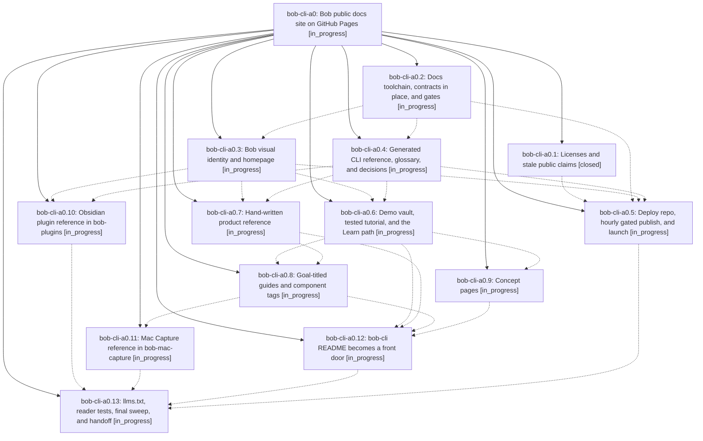

# Bead: bob-cli-a0 — Bob public docs site on GitHub Pages

[Bead Pages](../README.md) / bob-cli-a0

**Status:** ◐ in_progress · **Type:** ▸ plan · **Tier:** epic
**Owner:** `bryanbugyi34@gmail.com` · **Created by:** [bbugyi200.apollo.95](https://github.com/bobs-org/bob-cli--agents/blob/main/sessions/bbugyi200.apollo.95.md) · **Assignee:** `bob-cli-a0.land`
**Created:** 2026-10-19 18:55:41 EDT
**Plan:** [202610/bob\_public\_docs\_site.md](https://github.com/bobs-org/bob-cli--plans/blob/main/202610/bob_public_docs_site.md)

## Description

https://bobs-org.github.io/ serves one beautiful, Diátaxis-organized documentation site for the whole Bob system (bob-cli, bob-plugins, bob-mac-capture). It is built with Zensical from in-repo Markdown, publishes itself hourly behind gates that never replace a good site with a broken one, and keeps every existing docs/<stem>.md contract at /<stem>/.

## Phases

| Bead | Title | Status | Size | Created | Agents | Commits |
|---|---|---|---|---|---:|---:|
| [bob-cli-a0.1](bob-cli-a0.1.md) | Licenses and stale public claims | ✓ closed | small | 2026-10-19 | 1 | 2 |
| [bob-cli-a0.10](bob-cli-a0.10.md) | Obsidian plugin reference in bob-plugins | ◐ in_progress | large | 2026-10-19 | 1 | 0 |
| [bob-cli-a0.11](bob-cli-a0.11.md) | Mac Capture reference in bob-mac-capture | ◐ in_progress | large | 2026-10-19 | 1 | 0 |
| [bob-cli-a0.12](bob-cli-a0.12.md) | bob-cli README becomes a front door | ◐ in_progress | medium | 2026-10-19 | 1 | 0 |
| [bob-cli-a0.13](bob-cli-a0.13.md) | llms.txt, reader tests, final sweep, and handoff | ◐ in_progress | medium | 2026-10-19 | 1 | 0 |
| [bob-cli-a0.2](bob-cli-a0.2.md) | Docs toolchain, contracts in place, and gates | ◐ in_progress | large | 2026-10-19 | 1 | 0 |
| [bob-cli-a0.3](bob-cli-a0.3.md) | Bob visual identity and homepage | ◐ in_progress | large | 2026-10-19 | 1 | 0 |
| [bob-cli-a0.4](bob-cli-a0.4.md) | Generated CLI reference, glossary, and decisions | ◐ in_progress | medium | 2026-10-19 | 1 | 0 |
| [bob-cli-a0.5](bob-cli-a0.5.md) | Deploy repo, hourly gated publish, and launch | ◐ in_progress | large | 2026-10-19 | 1 | 0 |
| [bob-cli-a0.6](bob-cli-a0.6.md) | Demo vault, tested tutorial, and the Learn path | ◐ in_progress | large | 2026-10-19 | 1 | 0 |
| [bob-cli-a0.7](bob-cli-a0.7.md) | Hand-written product reference | ◐ in_progress | large | 2026-10-19 | 1 | 0 |
| [bob-cli-a0.8](bob-cli-a0.8.md) | Goal-titled guides and component tags | ◐ in_progress | large | 2026-10-19 | 1 | 0 |
| [bob-cli-a0.9](bob-cli-a0.9.md) | Concept pages | ◐ in_progress | large | 2026-10-19 | 1 | 0 |

## Lineage

## Agents

| Agent | Bead | Commits |
|---|---|---:|
| [bbugyi200.apollo.bob-cli-a0.1](https://github.com/bobs-org/bob-cli--agents/blob/main/agents/bbugyi200.apollo.bob-cli-a0.1/README.md) | [bob-cli-a0.1](bob-cli-a0.1.md) | 2 |
| [bbugyi200.apollo.bob-cli-a0.10](https://github.com/bobs-org/bob-cli--agents/blob/main/agents/bbugyi200.apollo.bob-cli-a0.10/README.md) | [bob-cli-a0.10](bob-cli-a0.10.md) | 0 |
| [bbugyi200.apollo.bob-cli-a0.11](https://github.com/bobs-org/bob-cli--agents/blob/main/agents/bbugyi200.apollo.bob-cli-a0.11/README.md) | [bob-cli-a0.11](bob-cli-a0.11.md) | 0 |
| [bbugyi200.apollo.bob-cli-a0.12](https://github.com/bobs-org/bob-cli--agents/blob/main/agents/bbugyi200.apollo.bob-cli-a0.12/README.md) | [bob-cli-a0.12](bob-cli-a0.12.md) | 0 |
| [bbugyi200.apollo.bob-cli-a0.13](https://github.com/bobs-org/bob-cli--agents/blob/main/agents/bbugyi200.apollo.bob-cli-a0.13/README.md) | [bob-cli-a0.13](bob-cli-a0.13.md) | 0 |
| [bbugyi200.apollo.bob-cli-a0.2](https://github.com/bobs-org/bob-cli--agents/blob/main/agents/bbugyi200.apollo.bob-cli-a0.2/README.md) | [bob-cli-a0.2](bob-cli-a0.2.md) | 0 |
| [bbugyi200.apollo.bob-cli-a0.3](https://github.com/bobs-org/bob-cli--agents/blob/main/agents/bbugyi200.apollo.bob-cli-a0.3/README.md) | [bob-cli-a0.3](bob-cli-a0.3.md) | 0 |
| [bbugyi200.apollo.bob-cli-a0.4](https://github.com/bobs-org/bob-cli--agents/blob/main/agents/bbugyi200.apollo.bob-cli-a0.4/README.md) | [bob-cli-a0.4](bob-cli-a0.4.md) | 0 |
| [bbugyi200.apollo.bob-cli-a0.5](https://github.com/bobs-org/bob-cli--agents/blob/main/agents/bbugyi200.apollo.bob-cli-a0.5/README.md) | [bob-cli-a0.5](bob-cli-a0.5.md) | 0 |
| [bbugyi200.apollo.bob-cli-a0.6](https://github.com/bobs-org/bob-cli--agents/blob/main/agents/bbugyi200.apollo.bob-cli-a0.6/README.md) | [bob-cli-a0.6](bob-cli-a0.6.md) | 0 |
| [bbugyi200.apollo.bob-cli-a0.7](https://github.com/bobs-org/bob-cli--agents/blob/main/agents/bbugyi200.apollo.bob-cli-a0.7/README.md) | [bob-cli-a0.7](bob-cli-a0.7.md) | 0 |
| [bbugyi200.apollo.bob-cli-a0.8](https://github.com/bobs-org/bob-cli--agents/blob/main/agents/bbugyi200.apollo.bob-cli-a0.8/README.md) | [bob-cli-a0.8](bob-cli-a0.8.md) | 0 |
| [bbugyi200.apollo.bob-cli-a0.9](https://github.com/bobs-org/bob-cli--agents/blob/main/agents/bbugyi200.apollo.bob-cli-a0.9/README.md) | [bob-cli-a0.9](bob-cli-a0.9.md) | 0 |
| [bbugyi200.apollo.bob-cli-a0.land](https://github.com/bobs-org/bob-cli--agents/blob/main/agents/bbugyi200.apollo.bob-cli-a0.land/README.md) | [bob-cli-a0](README.md) | 0 |

## Commits

| Repo | Commit | Subject | Bead | Committed |
|---|---|---|---|---|
| bob-cli | [`c7df845`](https://github.com/bobs-org/bob-cli/commit/c7df845f34b8301434ebb616516da0578dd80073) | docs(license): adopt MIT license for public docs site | [bob-cli-a0.1](bob-cli-a0.1.md) | 2026-10-19 19:02:17 EDT |
| bob-mac-capture | [`bob-mac-capture@065908f`](https://github.com/bobs-org/bob-mac-capture/commit/065908f89c1646dcbf77dad90e4de0f4cbdb4607) | docs(license): adopt MIT license | [bob-cli-a0.1](bob-cli-a0.1.md) | 2026-10-19 19:03:17 EDT |
