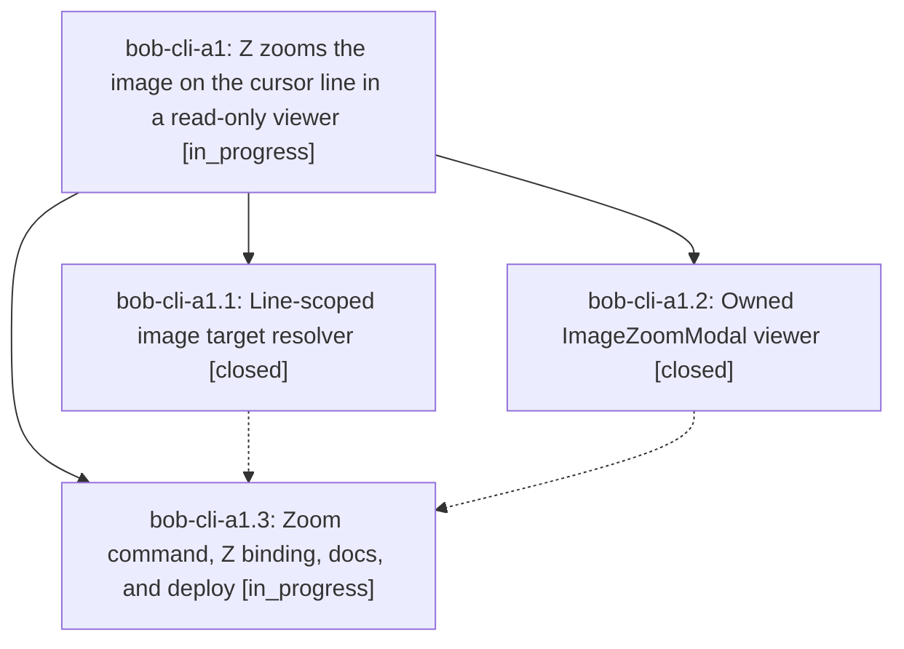

# Bead: bob-cli-a1 — Z zooms the image on the cursor line in a read-only viewer

[Bead Pages](../README.md) / bob-cli-a1

**Status:** ◐ in_progress · **Type:** ▸ plan · **Tier:** epic
**Owner:** `bryanbugyi34@gmail.com` · **Created by:** [bbugyi200.apollo.research.26.linker.w0](https://github.com/bobs-org/bob-cli--agents/blob/main/sessions/bbugyi200.apollo.research.26.linker.w0.md) · **Assignee:** `bob-cli-a1.land`
**Created:** 2026-10-20 09:07:41 EDT
**Plan:** [202610/z\_image\_zoom.md](https://github.com/bobs-org/bob-cli--plans/blob/main/202610/z_image_zoom.md)

<!-- sase:links:start -->

## Links

| Relation | Artifact | Why |
| --- | --- | --- |
| implemented-by | [plan:202610/z_image_zoom.md][1] | derived from the plan's `bead_id:` frontmatter field |

_Plus 1 automatic references — see [Referenced By](#referenced-by)._

[1]: https://github.com/bobs-org/bob-cli--plans/blob/main/202610/z_image_zoom.md

<!-- sase:links:end -->

## Description

In Obsidian's Vim normal mode, pressing Z on a line holding an image embed, a plain image wikilink, or a Markdown image opens that image fitted to the window in a small bob-owned viewer with keyboard and mouse zoom and pan. Esc, q, Ctrl+[ or Z return to the same note, cursor, scroll, and normal mode, and no part of the gesture ever writes the vault. Obsidian's native click and Zoom-button lightbox keep working unchanged.

## Phases

| Bead | Title | Status | Size | Created | Agents | Commits |
|---|---|---|---|---|---:|---:|
| [bob-cli-a1.1](bob-cli-a1.1.md) | Line-scoped image target resolver | ✓ closed | medium | 2026-10-20 | 1 | 1 |
| [bob-cli-a1.2](bob-cli-a1.2.md) | Owned ImageZoomModal viewer | ✓ closed | medium | 2026-10-20 | 1 | 1 |
| [bob-cli-a1.3](bob-cli-a1.3.md) | Zoom command, Z binding, docs, and deploy | ◐ in_progress | medium | 2026-10-20 | 1 | 0 |

## Lineage

## Agents

| Agent | Bead | Commits |
|---|---|---:|
| [bbugyi200.apollo.bob-cli-a1.1](https://github.com/bobs-org/bob-cli--agents/blob/main/agents/bbugyi200.apollo.bob-cli-a1.1/README.md) | [bob-cli-a1.1](bob-cli-a1.1.md) | 1 |
| [bbugyi200.apollo.bob-cli-a1.2](https://github.com/bobs-org/bob-cli--agents/blob/main/agents/bbugyi200.apollo.bob-cli-a1.2/README.md) | [bob-cli-a1.2](bob-cli-a1.2.md) | 1 |
| [bbugyi200.apollo.bob-cli-a1.3](https://github.com/bobs-org/bob-cli--agents/blob/main/agents/bbugyi200.apollo.bob-cli-a1.3/README.md) | [bob-cli-a1.3](bob-cli-a1.3.md) | 0 |
| [bbugyi200.apollo.bob-cli-a1.land](https://github.com/bobs-org/bob-cli--agents/blob/main/agents/bbugyi200.apollo.bob-cli-a1.land/README.md) | [bob-cli-a1](README.md) | 0 |

## Commits

| Repo | Commit | Subject | Bead | Committed |
|---|---|---|---|---|
| bob-plugins | [`bob-plugins@7c6d037`](https://github.com/bobs-org/bob-plugins/commit/7c6d03799c2e206f95a77fe704d9f18061fa9899) | feat(navigation-hotkeys): add line-scoped image target resolver for Z zoom | [bob-cli-a1.1](bob-cli-a1.1.md) | 2026-10-20 09:20:39 EDT |
| bob-plugins | [`bob-plugins@5e21b03`](https://github.com/bobs-org/bob-plugins/commit/5e21b03cb5152b3407da61e44111e0568cb3405e) | feat(navigation-hotkeys): add owned ImageZoomModal viewer for Z zoom | [bob-cli-a1.2](bob-cli-a1.2.md) | 2026-10-20 09:29:09 EDT |

<!-- sase:referenced-by:start -->

## Referenced By

| Relation | Artifact | Why | Uses |
| --- | --- | --- | ---: |
| read-by | [agent:bob-cli-a1.1][1] | Need epic scope | 1 |

[1]: https://github.com/bobs-org/bob-cli--agents/blob/main/agents/bbugyi200.apollo.bob-cli-a1.1/README.md

<!-- sase:referenced-by:end -->
