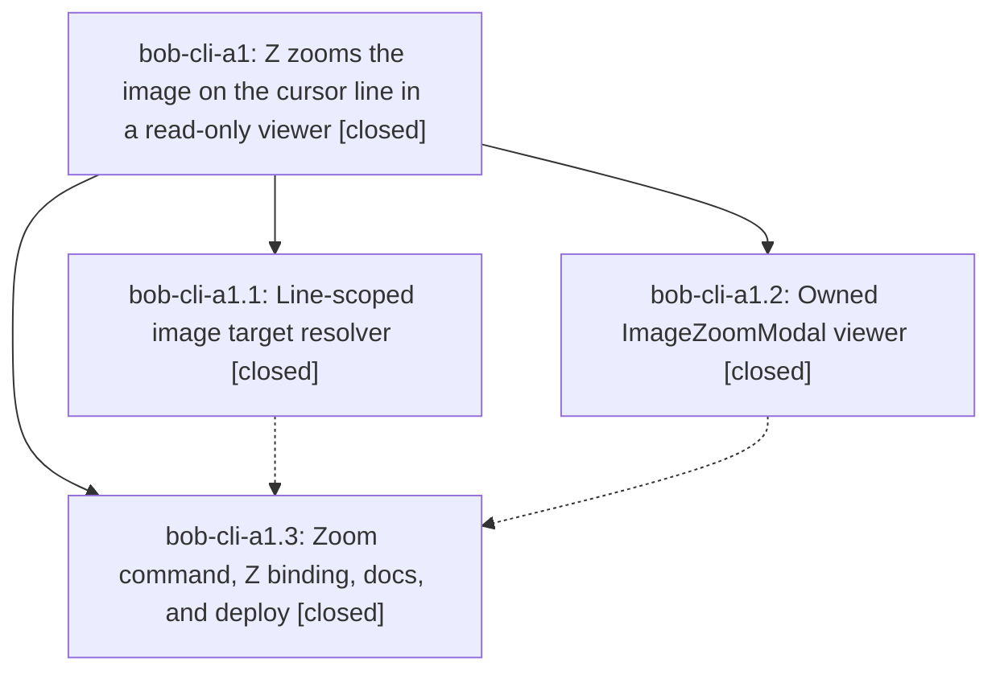

# Bead: bob-cli-a1 — Z zooms the image on the cursor line in a read-only viewer

[Bead Pages](../README.md) / bob-cli-a1

**Status:** ✓ closed · **Resolution:** done · **Type:** ▸ plan · **Tier:** epic
**Owner:** `bryanbugyi34@gmail.com` · **Created by:** [bbugyi200.apollo.research.26.linker.w0](https://github.com/bobs-org/bob-cli--agents/blob/main/sessions/bbugyi200.apollo.research.26.linker.w0.md) · **Assignee:** `bob-cli-a1.land`
**Created:** 2026-10-20 09:07:41 EDT · **Closed:** 2026-10-20 10:26:13 EDT
**Plan:** [202610/z\_image\_zoom.md](https://github.com/bobs-org/bob-cli--plans/blob/main/202610/z_image_zoom.md)

<!-- sase:links:start -->

## Links

| Relation | Artifact | Why |
| --- | --- | --- |
| implemented-by | [plan:202610/z_image_zoom.md][1] | derived from the plan's `bead_id:` frontmatter field |

_Plus 1 automatic references — see [Referenced By](#referenced-by)._

[1]: https://github.com/bobs-org/bob-cli--plans/blob/main/202610/z_image_zoom.md

<!-- sase:links:end -->

## Description

In Obsidian's Vim normal mode, pressing Z on a line holding an image embed, a plain image wikilink, or a Markdown image opens that image fitted to the window in a small bob-owned viewer with keyboard and mouse zoom and pan. Esc, q, Ctrl+[ or Z return to the same note, cursor, scroll, and normal mode, and no part of the gesture ever writes the vault. Obsidian's native click and Zoom-button lightbox keep working unchanged.

## Notes

[2026-10-20T14:03:30Z · bob-cli-a1.land] LAND FOLLOW-UP TRIAGE (2026-10-20): Reviewed all nine notes across a1.1, a1.2 and a1.3; the epic originally had no notes. Their note #1 entries are one skipped memory proposal, created as small ready memory task bob-cli-a3 after same-type/all-type duplicate searches, last-week sweep and active-epic review. Automatic image_zoom_record=no had no human review, so the memory skill requires preserving the proposal; no memory was edited. Their note #2 entries report four distinct pre-existing issues: added independent +1 evidence to bob-cli-6v (four unblocked-glyph failures), bob-cli-6w (Keep notice), bob-cli-7i (reverse-conversion BLOCKS link), and bob-cli-3w (stage-ranker timing flake, proposed by .1/.2 only). Full npm test at clean bob-plugins 049f466: 3278/3285 pass, exactly those seven failures; evidence file:explicit:c8d89bc75d79562000f004b3. No duplicate tasks filed, no proposals declined. Historical origin evidence and unchanged failing source/tests exclude a causal link to this epic or other currently active epics. Research gallery/count/native-delegation ideas were not phase proposals and remain out of scope per the accepted plan. The resolver defects found by this lander remain epic work and will be repaired by the closeout tale, not filed as follow-ups.

[2026-10-20T14:06:21Z · bob-cli-a1.land] LAND AUDIT BEFORE REPAIR TALE: Read all children and notes, plan:202610/z_image_zoom.md and its accepted research; reviewed bob-plugins commits 7c6d037, 5e21b03, 049f466 plus current 679 resolver, 207 modal, 490 lifecycle, mixin/export/fragment registration, CSS, tests and docs. The 67 image-zoom tests pass; validate passes all 7 plugins; docs:check passes (431 documentation tests, 4 optional-dependency skips); git diff --check passes. Full npm suite has only the seven already-triaged failures; the unchanged isolated ranker passes 23/23. No memory changed, honoring image_zoom_record=no. Source review and harness probes expose remaining epic work in 679: encoded remote src is changed, escaped Markdown parentheses fail resolution, vault percent escapes are decoded twice, extensionless wiki embeds incorrectly receive the Markdown-image exception, and URL display titles leave reserved escapes encoded. Repros: file:explicit:494ab4dc0d1aa3c9db0ea86f. Docs also overstate when a non-image cursor link gets a notice. These are planned in a single medium tale whose final step lands this epic. Integration: no unrelated bob-plugins commits since first epic commit; bob-cli 0e9f915a (triple-at capture rewrite) and ae9629ec (task-relation docs) have no image-zoom consumers/conflicts. Vault commit 10e8c4f4 adds only the exact expected vimrc block; current vault checkout is clean, equals origin/master and has exactly one Z mapping. Scoped plugin sync dry-run is up to date (3 unchanged). No epic-symbol entries; no Symvision recipe is available. bob-cli-a1 has no parent. Mac UI smoke remains explicitly human verification, not a claimed pass. Prior LAND FOLLOW-UP TRIAGE note records all proposals and must be carried into eventual closeout.

[2026-10-20T14:26:13Z · bob-cli-a1.land] CLOSEOUT 202610/image_zoom_resolver_closeout: repaired all five resolver defects in 679-plugin-image-zoom.js (remote src preserved exactly, escaped parens unescaped once, vault %2520 decodes once to literal %20 file, extensionless only for Markdown image embeds, URL titles via component decode with malformed/hostname fallbacks) plus docs/image-zoom.md notice clarification. Tests: 71/71 image-zoom pass (17 target incl 4 new regression, viewer+command); full npm 3282/3289 with only the seven triaged clean-base failures (4 unblocked-glyph 6v, Keep 6w, BLOCKS reverse 7i, 16ms ranker flake 3w); validate 7/7, docs:check 431 pass 4 skipped, git diff --check clean; bob-cli just check 1858 pass 4 pre-existing completion failures on clean tree. Deploy: bob plugins sync dry-run then real, now up to date; vault has exactly one Z mapping to zoom-image-on-line. Follow-up: skipped image_zoom_record owned by bob-cli-a3; CI evidence added to 6v/6w/7i/3w; no duplicates/declines; research gallery ideas remain out of scope. No epic symbols; no symvision recipe; no parent.

## Phases

| Bead | Title | Status | Size | Created | Agents | Commits |
|---|---|---|---|---|---:|---:|
| [bob-cli-a1.1](bob-cli-a1.1.md) | Line-scoped image target resolver | ✓ closed | medium | 2026-10-20 | 1 | 1 |
| [bob-cli-a1.2](bob-cli-a1.2.md) | Owned ImageZoomModal viewer | ✓ closed | medium | 2026-10-20 | 1 | 1 |
| [bob-cli-a1.3](bob-cli-a1.3.md) | Zoom command, Z binding, docs, and deploy | ✓ closed | medium | 2026-10-20 | 1 | 1 |

## Lineage

## Agents

| Agent | Bead | Commits |
|---|---|---:|
| [bbugyi200.apollo.bob-cli-a1.1](https://github.com/bobs-org/bob-cli--agents/blob/main/agents/bbugyi200.apollo.bob-cli-a1.1/README.md) | [bob-cli-a1.1](bob-cli-a1.1.md) | 1 |
| [bbugyi200.apollo.bob-cli-a1.2](https://github.com/bobs-org/bob-cli--agents/blob/main/agents/bbugyi200.apollo.bob-cli-a1.2/README.md) | [bob-cli-a1.2](bob-cli-a1.2.md) | 1 |
| [bbugyi200.apollo.bob-cli-a1.3](https://github.com/bobs-org/bob-cli--agents/blob/main/agents/bbugyi200.apollo.bob-cli-a1.3/README.md) | [bob-cli-a1.3](bob-cli-a1.3.md) | 1 |
| [bbugyi200.apollo.bob-cli-a1.land](https://github.com/bobs-org/bob-cli--agents/blob/main/sessions/bbugyi200.apollo.bob-cli-a1.land.md) | [bob-cli-a1](README.md) | 2 |

## Commits

| Repo | Commit | Subject | Bead | Committed |
|---|---|---|---|---|
| bob-plugins | [`bob-plugins@7c6d037`](https://github.com/bobs-org/bob-plugins/commit/7c6d03799c2e206f95a77fe704d9f18061fa9899) | feat(navigation-hotkeys): add line-scoped image target resolver for Z zoom | [bob-cli-a1.1](bob-cli-a1.1.md) | 2026-10-20 09:20:39 EDT |
| bob-plugins | [`bob-plugins@5e21b03`](https://github.com/bobs-org/bob-plugins/commit/5e21b03cb5152b3407da61e44111e0568cb3405e) | feat(navigation-hotkeys): add owned ImageZoomModal viewer for Z zoom | [bob-cli-a1.2](bob-cli-a1.2.md) | 2026-10-20 09:29:09 EDT |
| bob-plugins | [`bob-plugins@049f466`](https://github.com/bobs-org/bob-plugins/commit/049f4663d777a764cacbd69ae66a9503b8b7832f) | feat(bob-navigation-hotkeys): add read-only image zoom command | [bob-cli-a1.3](bob-cli-a1.3.md) | 2026-10-20 09:49:11 EDT |
| bob-plugins | [`bob-plugins@de66c7a`](https://github.com/bobs-org/bob-plugins/commit/de66c7aae06fc73a3407efdcc547abda35056391) | fix(nav-hotkeys): repair image-zoom resolver decoding, titles, and extensionless rule | [bob-cli-a1](README.md) | 2026-10-20 10:28:02 EDT |
| bob-cli--plans | [`bob-cli--plans@e00b446`](https://github.com/bobs-org/bob-cli--plans/commit/e00b4461c056597c75d0983fcd64477759d59b85) | chore(plans): mark z\_image\_zoom done after resolver closeout | [bob-cli-a1](README.md) | 2026-10-20 10:28:49 EDT |

<!-- sase:referenced-by:start -->

## Referenced By

| Relation | Artifact | Why | Uses |
| --- | --- | --- | ---: |
| read-by | [agent:bob-cli-a1.1][1] | Need epic scope | 1 |

[1]: https://github.com/bobs-org/bob-cli--agents/blob/main/agents/bbugyi200.apollo.bob-cli-a1.1/README.md

<!-- sase:referenced-by:end -->
