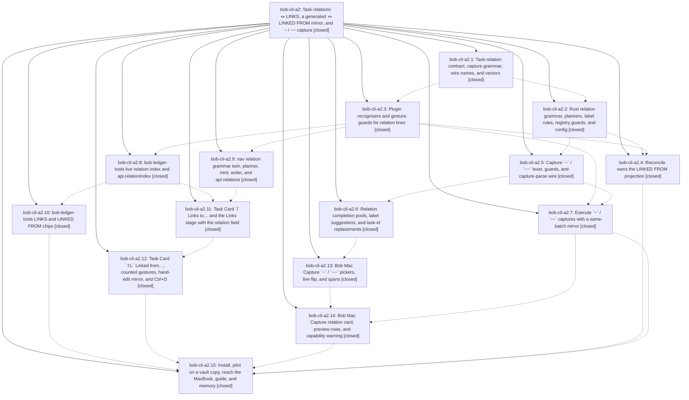

# Bead: bob-cli-a2 — Task relations: 🪢 LINKS, a generated 🪢 LINKED FROM mirror, and ~ / ~~ capture

[Bead Pages](../README.md) / bob-cli-a2

**Status:** ✓ closed · **Resolution:** done · **Type:** ▸ plan · **Tier:** epic
**Owner:** `bryanbugyi34@gmail.com` · **Created by:** [bbugyi200.athena.research.53.linker.w0](https://github.com/bobs-org/bob-cli--agents/blob/main/sessions/bbugyi200.athena.research.53.linker.w0.md) · **Assignee:** `bob-cli-a2.land`
**Created:** 2026-10-20 09:08:21 EDT · **Closed:** 2026-10-20 14:16:59 EDT
**Plan:** [202610/task\_relations.md](https://github.com/bobs-org/bob-cli--plans/blob/main/202610/task_relations.md)

<!-- sase:links:start -->

## Links

| Relation | Artifact | Why |
| --- | --- | --- |
| implemented-by | [plan:202610/task_relations.md][1] | derived from the plan's `bead_id:` frontmatter field |
| related | [bead:bob-cli-a5][2] | follow-up to the a2.8 relation index: coalesce its per-event publishes |
| related | [bead:bob-cli-a6][3] | startup smoke check would have caught the a2.8 relation-index OOM before rollout |
| related | file:explicit:decdc28e609c23a140df59b5 | attached via sase artifact create --bead |
| related | file:explicit:ec5a23c2ae683a0b47c1c3dc | attached via sase artifact create --bead |

_Plus 3 automatic references — see [Referenced By](#referenced-by)._

[1]: https://github.com/bobs-org/bob-cli--plans/blob/main/202610/task_relations.md
[2]: https://github.com/bobs-org/bob-cli--beads/blob/main/pages/bob-cli-a5/README.md
[3]: https://github.com/bobs-org/bob-cli--beads/blob/main/pages/bob-cli-a6/README.md

<!-- sase:links:end -->

## Description

Bryan can relate any task to any other task with an optional label, from Bob Mac Capture (`~` / `~~`) and from the Obsidian Task Card (`l` / `⇧L`). The relation is authored once on the source's `🪢 **LINKS:**` line, and a generated `🪢 **LINKED FROM:**` line on the target always converges to it. Live chips render both ends correctly, and relations never block, promote, consume, schedule, stamp, or route anything.

## Notes

[2026-10-20T17:24:49Z · 12j] DISCOVERED ISSUE: (1) docs/guides/link-related-tasks.md (added in eefdeb47, a2.15) shows unquoted multi-word labels that do not parse as relations: 'Investigate retry handling ~service:retry-loop|follow-up of' becomes literal task text (bob capture-parse shows no relations), and '@bob+retry-investigation ~service:retry-loop|related to' parses as mode sub_bullet with body 'to'. The trailing word breaks the trailing modifier run; the fix is |"follow-up of" / |"related to" (verified to parse and dry-run correctly). (2) bob capture-parse --help (src/native/capture_parse.rs:366) still says bob capture 'currently refuses any item with relations with a temporary unsupported error', stale since 8755ffc8 shipped execution. Both are small doc/help text fixes. Evidence: research:202610/task_relation_labels.md (file:explicit:97edf8961a30f468cbd66aa0).

[2026-10-20T17:54:37Z · bob-cli-a2.land] LAND TRIAGE (bob-cli-a2.land) of every PROPOSED FOLLOW-UP: (1) github-callouts / MkDocs Material docs-test failures (a2.1 #1, a2.6 #1, a2.8 #1, a2.11 #1, a2.12 #1, a2.13 #1, a2.14 #1, a2.15 #4): reproduced on eefdeb47; root cause is test_templates.py shelling out to a global PATH mkdocs; the tests came from the active docs epic, so recorded as a DISCOVERED ISSUE on bob-cli-a0 rather than a task. (2) ETXTBSY fake-curl flake (a2.2 #1, a2.15 #5): +1 on existing bob-cli-5l. (3) six clean-base bob-plugins npm failures (a2.3 #1, a2.8 #1, a2.9 #2, a2.10 #1, a2.11 #2, a2.12 #1): reproduced on b61f214, +1 on existing bob-cli-6v (4 unblocked-glyph), bob-cli-6w (Keep counts), bob-cli-7i (forward/reverse conversion). Land-agent discovery: stage-ranker 16 ms perf assertion flaked once under full npm test load (21.04 ms; 3/3 isolated passes): +1 on existing bob-cli-3w. (4) a2.1 #2 glossary skipped: declined, already done by b88a70e6 and eefdeb47 (Task Relation strand, Task Link sentence, generated docs/reference/glossary.md). (5) a2.14 #2 macOS typecheck: caused by this epic and folded into the remaining-work tale (a2.14's commit must be recovered first, see below). (6) a2.15 #3 deliberate non-goals (Task Card cancel-as-duplicate/merged/superseded, opt-in adoption of Merged into/See/RELATED bullets, make-this-a-prerequisite conversion, label near-duplicate lint plus relabel, configurable inverse phrases, read-only bob relations report): declined as tasks. The approved plan's 'Deliberately not doing' section is their durable record (label lint carries its own reopen trigger: more than about 30 distinct labels after a month), and the live vault has zero relation edges so far (a2.4/a2.15 dry runs), so there is no usage evidence to size or rank them; filing six feature beads now would be the wish list the feature type forbids. (7) Already filed by 12h for the a2.8 relation-index OOM (fixed in bob-plugins b61f214): bob-cli-a5 (coalesce publishes) and bob-cli-a6 (Obsidian startup smoke check); kept as linked tasks. REMAINING EPIC WORK found by land verification: (a) bob-cli-a2.14's bob-mac-capture commit e128340 (relation card, preview rows, capability warning, LX fixtures, CaptureRelationPanelTests, protocol/preview docs) was a raw git commit in the workspace's linked checkout; it was never pushed and was destroyed when the linked checkout was re-cloned, so origin/master lacks it. It is reconstructable from the a2.14 muse session's 60 edit patches plus its recorded fixture commands; a scratch replay reproduced e128340's exact stat (19 files, +1640/-21) and just portable-check passed 1472 tests. (b) Epic note #1 doc fixes: docs/guides/link-related-tasks.md lines 24 and 37 need quoted labels, and capture-parse --help (src/native/capture_parse.rs:366, generated docs/reference/cli/capture-parse.md) still says bob capture refuses relations.

[2026-10-20T18:16:59Z · bob-cli-a2.land] Land recovery complete. All 15 phases re-verified against their commits (bob-cli ae9629ec, 6d1f0a9c, b88a70e6, 1e1d9826, a02f9b33, fa9669dd, 8755ffc8, eefdeb47; bob-plugins 524bf72, 1497854, 8d33457, 03bb94b, 3ba8bf9 with a2.11 stage folded in; relation-index OOM fix b61f214; bob-mac-capture bb7127a). Decisions honored: builtin inverse phrases, LINKED FROM x, glossary memory edits only, no decisions strand. Post-epic drift needed no integration changes: @@ template start 0e9f915a and Mac templates ad85b85 expand to plain capture text upstream of relation parsing, and image zoom is a separate keymap.

a2.14 restore: applied recovered diff file:explicit:decdc28e609c23a140df59b5 onto bob-mac-capture 7a41234 (19 files). Fixed one arg-order error in restored CaptureRelationPanelTests (pickerSourceIsRelation must precede pickerVisible). Checks: just portable-check 1472 tests passed; Mac typecheck-tests PASS via scratch rsync (bundle.sh --identity -, just typecheck-tests); swift test --filter could not run because the Mac has only Command Line Tools with no XCTest (pre-existing env limitation per AGENTS.md, CI covers it); just docs-test passed. Mac was reachable over SSH; scratch dir removed. Changes left uncommitted in the linked checkout for the finalizer.

Doc/help fixes in bob-cli: docs/guides/link-related-tasks.md lines 24 and 37 now quote multi-word labels (|"follow-up of", |"related to"); verified with bob capture-parse -f json -- each reports one relations[] entry with the full label, and the line-37 draft parses as mode task_dependency. src/native/capture_parse.rs stale "currently refuses any item with relations with a temporary unsupported error" replaced with accurate staged-batch-writer/LINKS/LINKED FROM/inertness sentence; just docs-gen regenerated docs/reference/cli/capture-parse.md; rg "temporary unsupported" over docs+src finds nothing.

just check: pass. just docs-check: 437 passed, 2 skipped, only the 2 known clean-tree Material failures (test_templates_in_material, test_component_chips_in_material, recorded on bob-cli-a0). just symvision has no recipe in this tree; sase bead epic-symbols reports no --epic-symbol entries.

Triage outcomes from the epic LAND TRIAGE note: Material docs-test issue recorded on bob-cli-a0; +1 on bob-cli-5l, 6v, 6w, 7i, 3w; glossary proposal declined as already done; six deliberate non-goals declined with reasons; bob-cli-a5/a6 kept for the relation-index OOM follow-up.

## Phases

| Bead | Title | Status | Size | Created | Agents | Commits |
|---|---|---|---|---|---:|---:|
| [bob-cli-a2.1](bob-cli-a2.1.md) | Task-relation contract, capture grammar, wire names, and vectors | ✓ closed | medium | 2026-10-20 | 1 | 1 |
| [bob-cli-a2.10](bob-cli-a2.10.md) | bob-ledger-tools LINKS and LINKED FROM chips | ✓ closed | medium | 2026-10-20 | 1 | 1 |
| [bob-cli-a2.11](bob-cli-a2.11.md) | Task Card \`l\` Links to… and the Links stage with the relation field | ✓ closed | medium | 2026-10-20 | 1 | 0 |
| [bob-cli-a2.12](bob-cli-a2.12.md) | Task Card \`⇧L\` Linked from…, counted gestures, hand-edit mirror, and Ctrl+D | ✓ closed | medium | 2026-10-20 | 1 | 1 |
| [bob-cli-a2.13](bob-cli-a2.13.md) | Bob Mac Capture \`~\` / \`~~\` pickers, live flip, and spans | ✓ closed | medium | 2026-10-20 | 1 | 1 |
| [bob-cli-a2.14](bob-cli-a2.14.md) | Bob Mac Capture relation card, preview rows, and capability warning | ✓ closed | medium | 2026-10-20 | 1 | 0 |
| [bob-cli-a2.15](bob-cli-a2.15.md) | Install, pilot on a vault copy, reach the MacBook, guide, and memory | ✓ closed | medium | 2026-10-20 | 1 | 1 |
| [bob-cli-a2.2](bob-cli-a2.2.md) | Rust relation grammar, planners, label rules, registry guards, and config | ✓ closed | medium | 2026-10-20 | 1 | 1 |
| [bob-cli-a2.3](bob-cli-a2.3.md) | Plugin recognisers and gesture guards for relation lines | ✓ closed | medium | 2026-10-20 | 1 | 2 |
| [bob-cli-a2.4](bob-cli-a2.4.md) | Reconcile owns the LINKED FROM projection | ✓ closed | medium | 2026-10-20 | 1 | 1 |
| [bob-cli-a2.5](bob-cli-a2.5.md) | Capture \`~\` / \`~~\` lexer, guards, and capture-parse wire | ✓ closed | medium | 2026-10-20 | 1 | 1 |
| [bob-cli-a2.6](bob-cli-a2.6.md) | Relation completion pools, label suggestions, and task-id replacements | ✓ closed | medium | 2026-10-20 | 1 | 1 |
| [bob-cli-a2.7](bob-cli-a2.7.md) | Execute \`~\` / \`~~\` captures with a same-batch mirror | ✓ closed | medium | 2026-10-20 | 1 | 1 |
| [bob-cli-a2.8](bob-cli-a2.8.md) | bob-ledger-tools live relation index and api.relationIndex | ✓ closed | medium | 2026-10-20 | 1 | 1 |
| [bob-cli-a2.9](bob-cli-a2.9.md) | nav relation grammar twin, planner, mint, writer, and api.relations | ✓ closed | medium | 2026-10-20 | 1 | 1 |

## Lineage

## Agents

| Agent | Bead | Commits |
|---|---|---:|
| [bbugyi200.athena.bob-cli-a2.1](https://github.com/bobs-org/bob-cli--agents/blob/main/agents/bbugyi200.athena.bob-cli-a2.1/README.md) | [bob-cli-a2.1](bob-cli-a2.1.md) | 1 |
| [bbugyi200.athena.bob-cli-a2.10](https://github.com/bobs-org/bob-cli--agents/blob/main/agents/bbugyi200.athena.bob-cli-a2.10/README.md) | [bob-cli-a2.10](bob-cli-a2.10.md) | 1 |
| [bbugyi200.athena.bob-cli-a2.11](https://github.com/bobs-org/bob-cli--agents/blob/main/agents/bbugyi200.athena.bob-cli-a2.11/README.md) | [bob-cli-a2.11](bob-cli-a2.11.md) | 0 |
| [bbugyi200.athena.bob-cli-a2.12](https://github.com/bobs-org/bob-cli--agents/blob/main/agents/bbugyi200.athena.bob-cli-a2.12/README.md) | [bob-cli-a2.12](bob-cli-a2.12.md) | 1 |
| [bbugyi200.athena.bob-cli-a2.13](https://github.com/bobs-org/bob-cli--agents/blob/main/agents/bbugyi200.athena.bob-cli-a2.13/README.md) | [bob-cli-a2.13](bob-cli-a2.13.md) | 1 |
| [bbugyi200.athena.bob-cli-a2.14](https://github.com/bobs-org/bob-cli--agents/blob/main/agents/bbugyi200.athena.bob-cli-a2.14/README.md) | [bob-cli-a2.14](bob-cli-a2.14.md) | 0 |
| [bbugyi200.athena.bob-cli-a2.15](https://github.com/bobs-org/bob-cli--agents/blob/main/agents/bbugyi200.athena.bob-cli-a2.15/README.md) | [bob-cli-a2.15](bob-cli-a2.15.md) | 1 |
| [bbugyi200.athena.bob-cli-a2.2](https://github.com/bobs-org/bob-cli--agents/blob/main/agents/bbugyi200.athena.bob-cli-a2.2/README.md) | [bob-cli-a2.2](bob-cli-a2.2.md) | 1 |
| [bbugyi200.athena.bob-cli-a2.3](https://github.com/bobs-org/bob-cli--agents/blob/main/sessions/bbugyi200.athena.bob-cli-a2.3.md) | [bob-cli-a2.3](bob-cli-a2.3.md) | 2 |
| [bbugyi200.athena.bob-cli-a2.4](https://github.com/bobs-org/bob-cli--agents/blob/main/agents/bbugyi200.athena.bob-cli-a2.4/README.md) | [bob-cli-a2.4](bob-cli-a2.4.md) | 1 |
| [bbugyi200.athena.bob-cli-a2.5](https://github.com/bobs-org/bob-cli--agents/blob/main/agents/bbugyi200.athena.bob-cli-a2.5/README.md) | [bob-cli-a2.5](bob-cli-a2.5.md) | 1 |
| [bbugyi200.athena.bob-cli-a2.6](https://github.com/bobs-org/bob-cli--agents/blob/main/agents/bbugyi200.athena.bob-cli-a2.6/README.md) | [bob-cli-a2.6](bob-cli-a2.6.md) | 1 |
| [bbugyi200.athena.bob-cli-a2.7](https://github.com/bobs-org/bob-cli--agents/blob/main/agents/bbugyi200.athena.bob-cli-a2.7/README.md) | [bob-cli-a2.7](bob-cli-a2.7.md) | 1 |
| [bbugyi200.athena.bob-cli-a2.8](https://github.com/bobs-org/bob-cli--agents/blob/main/sessions/bbugyi200.athena.bob-cli-a2.8.md) | [bob-cli-a2.8](bob-cli-a2.8.md) | 1 |
| [bbugyi200.athena.bob-cli-a2.9](https://github.com/bobs-org/bob-cli--agents/blob/main/agents/bbugyi200.athena.bob-cli-a2.9/README.md) | [bob-cli-a2.9](bob-cli-a2.9.md) | 1 |
| [bbugyi200.athena.bob-cli-a2.land](https://github.com/bobs-org/bob-cli--agents/blob/main/sessions/bbugyi200.athena.bob-cli-a2.land.md) | [bob-cli-a2](README.md) | 3 |

## Commits

| Repo | Commit | Subject | Bead | Committed |
|---|---|---|---|---|
| bob-cli | [`ae9629e`](https://github.com/bobs-org/bob-cli/commit/ae9629ecd69c9227c314cb9d0e6c5d65a892efd9) | docs(task-relations): add task-relations contract page and wire relation lines | [bob-cli-a2.1](bob-cli-a2.1.md) | 2026-10-20 09:23:41 EDT |
| bob-cli | [`6d1f0a9`](https://github.com/bobs-org/bob-cli/commit/6d1f0a9c110ab8cf3a3a5d3751f15692b8485252) | feat(task-relations): add parsers, planners, and managed-link guards | [bob-cli-a2.2](bob-cli-a2.2.md) | 2026-10-20 09:59:55 EDT |
| bob-cli | [`b88a70e`](https://github.com/bobs-org/bob-cli/commit/b88a70e6dcbe80bd129bf83651d343736a254d33) | feat(glossary): add task relation terminology | [bob-cli-a2.3](bob-cli-a2.3.md) | 2026-10-20 10:02:57 EDT |
| bob-plugins | [`bob-plugins@524bf72`](https://github.com/bobs-org/bob-plugins/commit/524bf72cdea5db90db62ca08898e00332fa3514b) | feat(plugins): guard task relation lines | [bob-cli-a2.3](bob-cli-a2.3.md) | 2026-10-20 10:18:06 EDT |
| bob-cli | [`1e1d982`](https://github.com/bobs-org/bob-cli/commit/1e1d982693423d59946fad75d383f01028571451) | feat(capture): add ~ / ~~ lexer, guards, and capture-parse wire | [bob-cli-a2.5](bob-cli-a2.5.md) | 2026-10-20 10:37:53 EDT |
| bob-plugins | [`bob-plugins@1497854`](https://github.com/bobs-org/bob-plugins/commit/1497854c7d20ed503eae4231ff9d50ec679cee97) | feat(bob-navigation-hotkeys): add relation planner, writer, and api.relations v0 | [bob-cli-a2.9](bob-cli-a2.9.md) | 2026-10-20 10:44:47 EDT |
| bob-cli | [`a02f9b3`](https://github.com/bobs-org/bob-cli/commit/a02f9b33b3636298706fdc06865e5b7c500899b7) | feat(task-status-hooks): project LINKED FROM lines from authored LINKS | [bob-cli-a2.4](bob-cli-a2.4.md) | 2026-10-20 10:50:54 EDT |
| bob-plugins | [`bob-plugins@8d33457`](https://github.com/bobs-org/bob-plugins/commit/8d334570f89eec68978464a3126f4ff911621f19) | feat(ledger-tools): add live task relation index | [bob-cli-a2.8](bob-cli-a2.8.md) | 2026-10-20 11:10:12 EDT |
| bob-plugins | [`bob-plugins@03bb94b`](https://github.com/bobs-org/bob-plugins/commit/03bb94b4b6a394a395588b6e92e8795514432af7) | feat(ledger-tools): render live LINKS and LINKED FROM chips | [bob-cli-a2.10](bob-cli-a2.10.md) | 2026-10-20 11:25:38 EDT |
| bob-cli | [`fa9669d`](https://github.com/bobs-org/bob-cli/commit/fa9669dd2a09caf4077ebdf9ef8bc7c39cc95a33) | feat(capture): implement task relation completion | [bob-cli-a2.6](bob-cli-a2.6.md) | 2026-10-20 11:26:44 EDT |
| bob-cli | [`8755ffc`](https://github.com/bobs-org/bob-cli/commit/8755ffc86d1d972a01dd46a54323b40f1b988576) | feat(capture): execute ~ / ~~ relations with a same-batch mirror | [bob-cli-a2.7](bob-cli-a2.7.md) | 2026-10-20 11:30:11 EDT |
| bob-plugins | [`bob-plugins@3ba8bf9`](https://github.com/bobs-org/bob-plugins/commit/3ba8bf9a5c10db5eba871d186bf9818132e31414) | feat(navigation): add linked-from relation stage | [bob-cli-a2.12](bob-cli-a2.12.md) | 2026-10-20 12:13:16 EDT |
| bob-mac-capture | [`bob-mac-capture@bb7127a`](https://github.com/bobs-org/bob-mac-capture/commit/bb7127a20cc01cdac5674ff5184be50c8b39335e) | feat(capture): add ~ and ~~ relation pickers with live flip | [bob-cli-a2.13](bob-cli-a2.13.md) | 2026-10-20 12:17:56 EDT |
| bob-cli | [`eefdeb4`](https://github.com/bobs-org/bob-cli/commit/eefdeb4717c003aeb23e09c9288f66fa36ee6203) | docs(relations): document relation usage and rollout | [bob-cli-a2.15](bob-cli-a2.15.md) | 2026-10-20 13:17:35 EDT |
| bob-cli | [`4907f00`](https://github.com/bobs-org/bob-cli/commit/4907f00ddd02635fe4f6698efcae21eb17b8554a) | docs(capture): quote multi-word relation labels and fix capture-parse help | [bob-cli-a2](README.md) | 2026-10-20 14:18:59 EDT |
| bob-mac-capture | [`bob-mac-capture@a85b1f8`](https://github.com/bobs-org/bob-mac-capture/commit/a85b1f8684615bb69c85ac4e8dfa0e7d04cadd9f) | feat(capture): add ~ relation card, preview rows, and capability warning | [bob-cli-a2](README.md) | 2026-10-20 14:20:09 EDT |
| bob-cli--plans | [`bob-cli--plans@3f32cb9`](https://github.com/bobs-org/bob-cli--plans/commit/3f32cb969f9dcdfa0714bdff59070215a3c7a612) | docs(plans): mark task\_relations epic plan done | [bob-cli-a2](README.md) | 2026-10-20 14:20:56 EDT |

<!-- sase:referenced-by:start -->

## Referenced By

| Relation | Artifact | Why | Uses |
| --- | --- | --- | ---: |
| read-by | [agent:12j][1] | User asked how to create a task relation with description text; epic bead is the context | 1 |
| read-by | [agent:bob-cli-a2.10][2] | Need epic context and sibling phase status | 1 |
| read-by | [agent:bob-cli-a2.5][3] | parent epic scope and decisions | 1 |

[1]: https://github.com/bobs-org/bob-cli--agents/blob/main/agents/bbugyi200.athena.12j/README.md
[2]: https://github.com/bobs-org/bob-cli--agents/blob/main/agents/bbugyi200.athena.bob-cli-a2.10/README.md
[3]: https://github.com/bobs-org/bob-cli--agents/blob/main/agents/bbugyi200.athena.bob-cli-a2.5/README.md

<!-- sase:referenced-by:end -->
