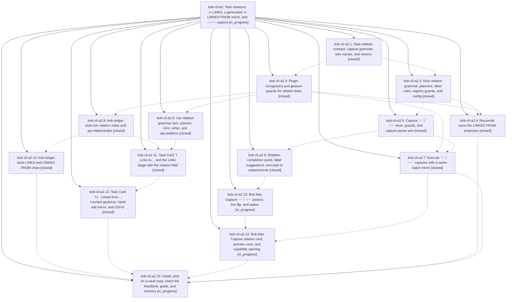

# Bead: bob-cli-a2 — Task relations: 🪢 LINKS, a generated 🪢 LINKED FROM mirror, and ~ / ~~ capture

[Bead Pages](../README.md) / bob-cli-a2

**Status:** ◐ in_progress · **Type:** ▸ plan · **Tier:** epic
**Owner:** `bryanbugyi34@gmail.com` · **Created by:** [bbugyi200.athena.research.53.linker.w0](https://github.com/bobs-org/bob-cli--agents/blob/main/sessions/bbugyi200.athena.research.53.linker.w0.md) · **Assignee:** `bob-cli-a2.land`
**Created:** 2026-10-20 09:08:21 EDT
**Plan:** [202610/task\_relations.md](https://github.com/bobs-org/bob-cli--plans/blob/main/202610/task_relations.md)

<!-- sase:links:start -->

## Links

| Relation | Artifact | Why |
| --- | --- | --- |
| implemented-by | [plan:202610/task_relations.md][1] | derived from the plan's `bead_id:` frontmatter field |

_Plus 2 automatic references — see [Referenced By](#referenced-by)._

[1]: https://github.com/bobs-org/bob-cli--plans/blob/main/202610/task_relations.md

<!-- sase:links:end -->

## Description

Bryan can relate any task to any other task with an optional label, from Bob Mac Capture (`~` / `~~`) and from the Obsidian Task Card (`l` / `⇧L`). The relation is authored once on the source's `🪢 **LINKS:**` line, and a generated `🪢 **LINKED FROM:**` line on the target always converges to it. Live chips render both ends correctly, and relations never block, promote, consume, schedule, stamp, or route anything.

## Phases

| Bead | Title | Status | Size | Created | Agents | Commits |
|---|---|---|---|---|---:|---:|
| [bob-cli-a2.1](bob-cli-a2.1.md) | Task-relation contract, capture grammar, wire names, and vectors | ✓ closed | medium | 2026-10-20 | 1 | 1 |
| [bob-cli-a2.10](bob-cli-a2.10.md) | bob-ledger-tools LINKS and LINKED FROM chips | ✓ closed | medium | 2026-10-20 | 1 | 1 |
| [bob-cli-a2.11](bob-cli-a2.11.md) | Task Card \`l\` Links to… and the Links stage with the relation field | ✓ closed | medium | 2026-10-20 | 1 | 0 |
| [bob-cli-a2.12](bob-cli-a2.12.md) | Task Card \`⇧L\` Linked from…, counted gestures, hand-edit mirror, and Ctrl+D | ✓ closed | medium | 2026-10-20 | 1 | 1 |
| [bob-cli-a2.13](bob-cli-a2.13.md) | Bob Mac Capture \`~\` / \`~~\` pickers, live flip, and spans | ◐ in_progress | medium | 2026-10-20 | 1 | 0 |
| [bob-cli-a2.14](bob-cli-a2.14.md) | Bob Mac Capture relation card, preview rows, and capability warning | ◐ in_progress | medium | 2026-10-20 | 1 | 0 |
| [bob-cli-a2.15](bob-cli-a2.15.md) | Install, pilot on a vault copy, reach the MacBook, guide, and memory | ◐ in_progress | medium | 2026-10-20 | 1 | 0 |
| [bob-cli-a2.2](bob-cli-a2.2.md) | Rust relation grammar, planners, label rules, registry guards, and config | ✓ closed | medium | 2026-10-20 | 1 | 1 |
| [bob-cli-a2.3](bob-cli-a2.3.md) | Plugin recognisers and gesture guards for relation lines | ✓ closed | medium | 2026-10-20 | 1 | 2 |
| [bob-cli-a2.4](bob-cli-a2.4.md) | Reconcile owns the LINKED FROM projection | ✓ closed | medium | 2026-10-20 | 1 | 1 |
| [bob-cli-a2.5](bob-cli-a2.5.md) | Capture \`~\` / \`~~\` lexer, guards, and capture-parse wire | ✓ closed | medium | 2026-10-20 | 1 | 1 |
| [bob-cli-a2.6](bob-cli-a2.6.md) | Relation completion pools, label suggestions, and task-id replacements | ✓ closed | medium | 2026-10-20 | 1 | 1 |
| [bob-cli-a2.7](bob-cli-a2.7.md) | Execute \`~\` / \`~~\` captures with a same-batch mirror | ✓ closed | medium | 2026-10-20 | 1 | 1 |
| [bob-cli-a2.8](bob-cli-a2.8.md) | bob-ledger-tools live relation index and api.relationIndex | ✓ closed | medium | 2026-10-20 | 1 | 1 |
| [bob-cli-a2.9](bob-cli-a2.9.md) | nav relation grammar twin, planner, mint, writer, and api.relations | ✓ closed | medium | 2026-10-20 | 1 | 1 |

## Lineage

## Agents

| Agent | Bead | Commits |
|---|---|---:|
| [bbugyi200.athena.bob-cli-a2.1](https://github.com/bobs-org/bob-cli--agents/blob/main/agents/bbugyi200.athena.bob-cli-a2.1/README.md) | [bob-cli-a2.1](bob-cli-a2.1.md) | 1 |
| [bbugyi200.athena.bob-cli-a2.10](https://github.com/bobs-org/bob-cli--agents/blob/main/agents/bbugyi200.athena.bob-cli-a2.10/README.md) | [bob-cli-a2.10](bob-cli-a2.10.md) | 1 |
| [bbugyi200.athena.bob-cli-a2.11](https://github.com/bobs-org/bob-cli--agents/blob/main/agents/bbugyi200.athena.bob-cli-a2.11/README.md) | [bob-cli-a2.11](bob-cli-a2.11.md) | 0 |
| [bbugyi200.athena.bob-cli-a2.12](https://github.com/bobs-org/bob-cli--agents/blob/main/agents/bbugyi200.athena.bob-cli-a2.12/README.md) | [bob-cli-a2.12](bob-cli-a2.12.md) | 1 |
| [bbugyi200.athena.bob-cli-a2.13](https://github.com/bobs-org/bob-cli--agents/blob/main/agents/bbugyi200.athena.bob-cli-a2.13/README.md) | [bob-cli-a2.13](bob-cli-a2.13.md) | 0 |
| [bbugyi200.athena.bob-cli-a2.14](https://github.com/bobs-org/bob-cli--agents/blob/main/agents/bbugyi200.athena.bob-cli-a2.14/README.md) | [bob-cli-a2.14](bob-cli-a2.14.md) | 0 |
| [bbugyi200.athena.bob-cli-a2.15](https://github.com/bobs-org/bob-cli--agents/blob/main/agents/bbugyi200.athena.bob-cli-a2.15/README.md) | [bob-cli-a2.15](bob-cli-a2.15.md) | 0 |
| [bbugyi200.athena.bob-cli-a2.2](https://github.com/bobs-org/bob-cli--agents/blob/main/agents/bbugyi200.athena.bob-cli-a2.2/README.md) | [bob-cli-a2.2](bob-cli-a2.2.md) | 1 |
| [bbugyi200.athena.bob-cli-a2.3](https://github.com/bobs-org/bob-cli--agents/blob/main/sessions/bbugyi200.athena.bob-cli-a2.3.md) | [bob-cli-a2.3](bob-cli-a2.3.md) | 2 |
| [bbugyi200.athena.bob-cli-a2.4](https://github.com/bobs-org/bob-cli--agents/blob/main/agents/bbugyi200.athena.bob-cli-a2.4/README.md) | [bob-cli-a2.4](bob-cli-a2.4.md) | 1 |
| [bbugyi200.athena.bob-cli-a2.5](https://github.com/bobs-org/bob-cli--agents/blob/main/agents/bbugyi200.athena.bob-cli-a2.5/README.md) | [bob-cli-a2.5](bob-cli-a2.5.md) | 1 |
| [bbugyi200.athena.bob-cli-a2.6](https://github.com/bobs-org/bob-cli--agents/blob/main/agents/bbugyi200.athena.bob-cli-a2.6/README.md) | [bob-cli-a2.6](bob-cli-a2.6.md) | 1 |
| [bbugyi200.athena.bob-cli-a2.7](https://github.com/bobs-org/bob-cli--agents/blob/main/agents/bbugyi200.athena.bob-cli-a2.7/README.md) | [bob-cli-a2.7](bob-cli-a2.7.md) | 1 |
| [bbugyi200.athena.bob-cli-a2.8](https://github.com/bobs-org/bob-cli--agents/blob/main/sessions/bbugyi200.athena.bob-cli-a2.8.md) | [bob-cli-a2.8](bob-cli-a2.8.md) | 1 |
| [bbugyi200.athena.bob-cli-a2.9](https://github.com/bobs-org/bob-cli--agents/blob/main/agents/bbugyi200.athena.bob-cli-a2.9/README.md) | [bob-cli-a2.9](bob-cli-a2.9.md) | 1 |
| [bbugyi200.athena.bob-cli-a2.land](https://github.com/bobs-org/bob-cli--agents/blob/main/agents/bbugyi200.athena.bob-cli-a2.land/README.md) | [bob-cli-a2](README.md) | 0 |

## Commits

| Repo | Commit | Subject | Bead | Committed |
|---|---|---|---|---|
| bob-cli | [`ae9629e`](https://github.com/bobs-org/bob-cli/commit/ae9629ecd69c9227c314cb9d0e6c5d65a892efd9) | docs(task-relations): add task-relations contract page and wire relation lines | [bob-cli-a2.1](bob-cli-a2.1.md) | 2026-10-20 09:23:41 EDT |
| bob-cli | [`6d1f0a9`](https://github.com/bobs-org/bob-cli/commit/6d1f0a9c110ab8cf3a3a5d3751f15692b8485252) | feat(task-relations): add parsers, planners, and managed-link guards | [bob-cli-a2.2](bob-cli-a2.2.md) | 2026-10-20 09:59:55 EDT |
| bob-cli | [`b88a70e`](https://github.com/bobs-org/bob-cli/commit/b88a70e6dcbe80bd129bf83651d343736a254d33) | feat(glossary): add task relation terminology | [bob-cli-a2.3](bob-cli-a2.3.md) | 2026-10-20 10:02:57 EDT |
| bob-plugins | [`bob-plugins@524bf72`](https://github.com/bobs-org/bob-plugins/commit/524bf72cdea5db90db62ca08898e00332fa3514b) | feat(plugins): guard task relation lines | [bob-cli-a2.3](bob-cli-a2.3.md) | 2026-10-20 10:18:06 EDT |
| bob-cli | [`1e1d982`](https://github.com/bobs-org/bob-cli/commit/1e1d982693423d59946fad75d383f01028571451) | feat(capture): add ~ / ~~ lexer, guards, and capture-parse wire | [bob-cli-a2.5](bob-cli-a2.5.md) | 2026-10-20 10:37:53 EDT |
| bob-plugins | [`bob-plugins@1497854`](https://github.com/bobs-org/bob-plugins/commit/1497854c7d20ed503eae4231ff9d50ec679cee97) | feat(bob-navigation-hotkeys): add relation planner, writer, and api.relations v0 | [bob-cli-a2.9](bob-cli-a2.9.md) | 2026-10-20 10:44:47 EDT |
| bob-cli | [`a02f9b3`](https://github.com/bobs-org/bob-cli/commit/a02f9b33b3636298706fdc06865e5b7c500899b7) | feat(task-status-hooks): project LINKED FROM lines from authored LINKS | [bob-cli-a2.4](bob-cli-a2.4.md) | 2026-10-20 10:50:54 EDT |
| bob-plugins | [`bob-plugins@8d33457`](https://github.com/bobs-org/bob-plugins/commit/8d334570f89eec68978464a3126f4ff911621f19) | feat(ledger-tools): add live task relation index | [bob-cli-a2.8](bob-cli-a2.8.md) | 2026-10-20 11:10:12 EDT |
| bob-plugins | [`bob-plugins@03bb94b`](https://github.com/bobs-org/bob-plugins/commit/03bb94b4b6a394a395588b6e92e8795514432af7) | feat(ledger-tools): render live LINKS and LINKED FROM chips | [bob-cli-a2.10](bob-cli-a2.10.md) | 2026-10-20 11:25:38 EDT |
| bob-cli | [`fa9669d`](https://github.com/bobs-org/bob-cli/commit/fa9669dd2a09caf4077ebdf9ef8bc7c39cc95a33) | feat(capture): implement task relation completion | [bob-cli-a2.6](bob-cli-a2.6.md) | 2026-10-20 11:26:44 EDT |
| bob-cli | [`8755ffc`](https://github.com/bobs-org/bob-cli/commit/8755ffc86d1d972a01dd46a54323b40f1b988576) | feat(capture): execute ~ / ~~ relations with a same-batch mirror | [bob-cli-a2.7](bob-cli-a2.7.md) | 2026-10-20 11:30:11 EDT |
| bob-plugins | [`bob-plugins@3ba8bf9`](https://github.com/bobs-org/bob-plugins/commit/3ba8bf9a5c10db5eba871d186bf9818132e31414) | feat(navigation): add linked-from relation stage | [bob-cli-a2.12](bob-cli-a2.12.md) | 2026-10-20 12:13:16 EDT |

<!-- sase:referenced-by:start -->

## Referenced By

| Relation | Artifact | Why | Uses |
| --- | --- | --- | ---: |
| read-by | [agent:bob-cli-a2.10][1] | Need epic context and sibling phase status | 1 |
| read-by | [agent:bob-cli-a2.5][2] | parent epic scope and decisions | 1 |

[1]: https://github.com/bobs-org/bob-cli--agents/blob/main/agents/bbugyi200.athena.bob-cli-a2.10/README.md
[2]: https://github.com/bobs-org/bob-cli--agents/blob/main/agents/bbugyi200.athena.bob-cli-a2.5/README.md

<!-- sase:referenced-by:end -->
