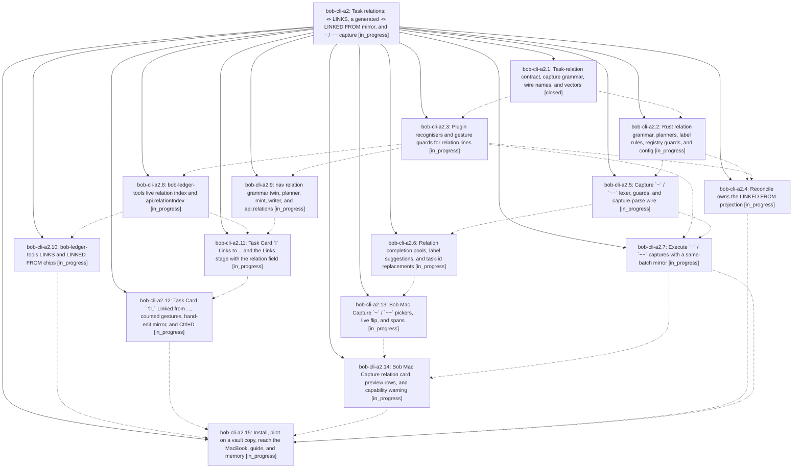

# Bead: bob-cli-a2 — Task relations: 🪢 LINKS, a generated 🪢 LINKED FROM mirror, and ~ / ~~ capture

[Bead Pages](../README.md) / bob-cli-a2

**Status:** ◐ in_progress · **Type:** ▸ plan · **Tier:** epic
**Owner:** `bryanbugyi34@gmail.com` · **Created by:** [bbugyi200.athena.research.53.linker.w0](https://github.com/bobs-org/bob-cli--agents/blob/main/sessions/bbugyi200.athena.research.53.linker.w0.md) · **Assignee:** `bob-cli-a2.land`
**Created:** 2026-10-20 09:08:21 EDT
**Plan:** [202610/task\_relations.md](https://github.com/bobs-org/bob-cli--plans/blob/main/202610/task_relations.md)

## Description

Bryan can relate any task to any other task with an optional label, from Bob Mac Capture (`~` / `~~`) and from the Obsidian Task Card (`l` / `⇧L`). The relation is authored once on the source's `🪢 **LINKS:**` line, and a generated `🪢 **LINKED FROM:**` line on the target always converges to it. Live chips render both ends correctly, and relations never block, promote, consume, schedule, stamp, or route anything.

## Phases

| Bead | Title | Status | Size | Created | Agents | Commits |
|---|---|---|---|---|---:|---:|
| [bob-cli-a2.1](bob-cli-a2.1.md) | Task-relation contract, capture grammar, wire names, and vectors | ✓ closed | medium | 2026-10-20 | 1 | 1 |
| [bob-cli-a2.10](bob-cli-a2.10.md) | bob-ledger-tools LINKS and LINKED FROM chips | ◐ in_progress | medium | 2026-10-20 | 1 | 0 |
| [bob-cli-a2.11](bob-cli-a2.11.md) | Task Card \`l\` Links to… and the Links stage with the relation field | ◐ in_progress | medium | 2026-10-20 | 1 | 0 |
| [bob-cli-a2.12](bob-cli-a2.12.md) | Task Card \`⇧L\` Linked from…, counted gestures, hand-edit mirror, and Ctrl+D | ◐ in_progress | medium | 2026-10-20 | 1 | 0 |
| [bob-cli-a2.13](bob-cli-a2.13.md) | Bob Mac Capture \`~\` / \`~~\` pickers, live flip, and spans | ◐ in_progress | medium | 2026-10-20 | 1 | 0 |
| [bob-cli-a2.14](bob-cli-a2.14.md) | Bob Mac Capture relation card, preview rows, and capability warning | ◐ in_progress | medium | 2026-10-20 | 1 | 0 |
| [bob-cli-a2.15](bob-cli-a2.15.md) | Install, pilot on a vault copy, reach the MacBook, guide, and memory | ◐ in_progress | medium | 2026-10-20 | 1 | 0 |
| [bob-cli-a2.2](bob-cli-a2.2.md) | Rust relation grammar, planners, label rules, registry guards, and config | ◐ in_progress | medium | 2026-10-20 | 1 | 0 |
| [bob-cli-a2.3](bob-cli-a2.3.md) | Plugin recognisers and gesture guards for relation lines | ◐ in_progress | medium | 2026-10-20 | 1 | 0 |
| [bob-cli-a2.4](bob-cli-a2.4.md) | Reconcile owns the LINKED FROM projection | ◐ in_progress | medium | 2026-10-20 | 1 | 0 |
| [bob-cli-a2.5](bob-cli-a2.5.md) | Capture \`~\` / \`~~\` lexer, guards, and capture-parse wire | ◐ in_progress | medium | 2026-10-20 | 1 | 0 |
| [bob-cli-a2.6](bob-cli-a2.6.md) | Relation completion pools, label suggestions, and task-id replacements | ◐ in_progress | medium | 2026-10-20 | 1 | 0 |
| [bob-cli-a2.7](bob-cli-a2.7.md) | Execute \`~\` / \`~~\` captures with a same-batch mirror | ◐ in_progress | medium | 2026-10-20 | 1 | 0 |
| [bob-cli-a2.8](bob-cli-a2.8.md) | bob-ledger-tools live relation index and api.relationIndex | ◐ in_progress | medium | 2026-10-20 | 1 | 0 |
| [bob-cli-a2.9](bob-cli-a2.9.md) | nav relation grammar twin, planner, mint, writer, and api.relations | ◐ in_progress | medium | 2026-10-20 | 1 | 0 |

## Lineage

## Agents

| Agent | Bead | Commits |
|---|---|---:|
| [bbugyi200.athena.bob-cli-a2.1](https://github.com/bobs-org/bob-cli--agents/blob/main/agents/bbugyi200.athena.bob-cli-a2.1/README.md) | [bob-cli-a2.1](bob-cli-a2.1.md) | 1 |
| [bbugyi200.athena.bob-cli-a2.10](https://github.com/bobs-org/bob-cli--agents/blob/main/agents/bbugyi200.athena.bob-cli-a2.10/README.md) | [bob-cli-a2.10](bob-cli-a2.10.md) | 0 |
| [bbugyi200.athena.bob-cli-a2.11](https://github.com/bobs-org/bob-cli--agents/blob/main/agents/bbugyi200.athena.bob-cli-a2.11/README.md) | [bob-cli-a2.11](bob-cli-a2.11.md) | 0 |
| [bbugyi200.athena.bob-cli-a2.12](https://github.com/bobs-org/bob-cli--agents/blob/main/agents/bbugyi200.athena.bob-cli-a2.12/README.md) | [bob-cli-a2.12](bob-cli-a2.12.md) | 0 |
| [bbugyi200.athena.bob-cli-a2.13](https://github.com/bobs-org/bob-cli--agents/blob/main/agents/bbugyi200.athena.bob-cli-a2.13/README.md) | [bob-cli-a2.13](bob-cli-a2.13.md) | 0 |
| [bbugyi200.athena.bob-cli-a2.14](https://github.com/bobs-org/bob-cli--agents/blob/main/agents/bbugyi200.athena.bob-cli-a2.14/README.md) | [bob-cli-a2.14](bob-cli-a2.14.md) | 0 |
| [bbugyi200.athena.bob-cli-a2.15](https://github.com/bobs-org/bob-cli--agents/blob/main/agents/bbugyi200.athena.bob-cli-a2.15/README.md) | [bob-cli-a2.15](bob-cli-a2.15.md) | 0 |
| [bbugyi200.athena.bob-cli-a2.2](https://github.com/bobs-org/bob-cli--agents/blob/main/agents/bbugyi200.athena.bob-cli-a2.2/README.md) | [bob-cli-a2.2](bob-cli-a2.2.md) | 0 |
| [bbugyi200.athena.bob-cli-a2.3](https://github.com/bobs-org/bob-cli--agents/blob/main/agents/bbugyi200.athena.bob-cli-a2.3/README.md) | [bob-cli-a2.3](bob-cli-a2.3.md) | 0 |
| [bbugyi200.athena.bob-cli-a2.4](https://github.com/bobs-org/bob-cli--agents/blob/main/agents/bbugyi200.athena.bob-cli-a2.4/README.md) | [bob-cli-a2.4](bob-cli-a2.4.md) | 0 |
| [bbugyi200.athena.bob-cli-a2.5](https://github.com/bobs-org/bob-cli--agents/blob/main/agents/bbugyi200.athena.bob-cli-a2.5/README.md) | [bob-cli-a2.5](bob-cli-a2.5.md) | 0 |
| [bbugyi200.athena.bob-cli-a2.6](https://github.com/bobs-org/bob-cli--agents/blob/main/agents/bbugyi200.athena.bob-cli-a2.6/README.md) | [bob-cli-a2.6](bob-cli-a2.6.md) | 0 |
| [bbugyi200.athena.bob-cli-a2.7](https://github.com/bobs-org/bob-cli--agents/blob/main/agents/bbugyi200.athena.bob-cli-a2.7/README.md) | [bob-cli-a2.7](bob-cli-a2.7.md) | 0 |
| [bbugyi200.athena.bob-cli-a2.8](https://github.com/bobs-org/bob-cli--agents/blob/main/agents/bbugyi200.athena.bob-cli-a2.8/README.md) | [bob-cli-a2.8](bob-cli-a2.8.md) | 0 |
| [bbugyi200.athena.bob-cli-a2.9](https://github.com/bobs-org/bob-cli--agents/blob/main/agents/bbugyi200.athena.bob-cli-a2.9/README.md) | [bob-cli-a2.9](bob-cli-a2.9.md) | 0 |
| [bbugyi200.athena.bob-cli-a2.land](https://github.com/bobs-org/bob-cli--agents/blob/main/agents/bbugyi200.athena.bob-cli-a2.land/README.md) | [bob-cli-a2](README.md) | 0 |

## Commits

| Repo | Commit | Subject | Bead | Committed |
|---|---|---|---|---|
| bob-cli | [`ae9629e`](https://github.com/bobs-org/bob-cli/commit/ae9629ecd69c9227c314cb9d0e6c5d65a892efd9) | docs(task-relations): add task-relations contract page and wire relation lines | [bob-cli-a2.1](bob-cli-a2.1.md) | 2026-10-20 09:23:41 EDT |
