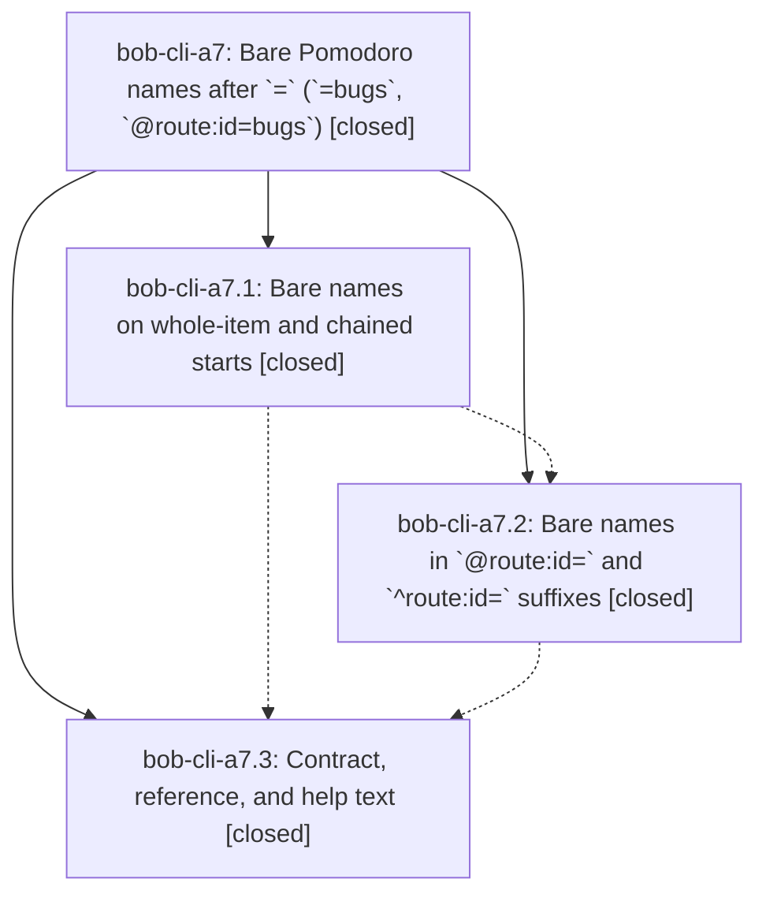

# Bead: bob-cli-a7 — Bare Pomodoro names after \`=\` (\`=bugs\`, \`@route:id=bugs\`)

[Bead Pages](../README.md) / bob-cli-a7

**Status:** ✓ closed · **Resolution:** done · **Type:** ▸ plan · **Tier:** epic
**Owner:** `bryanbugyi34@gmail.com` · **Created by:** `bbugyi200.apollo.9p` · **Assignee:** `bob-cli-a7.land`
**Created:** 2026-10-20 15:12:11 EDT · **Closed:** 2026-10-20 18:08:49 EDT
**Plan:** [202610/bare\_pomodoro\_names.md](https://github.com/bobs-org/bob-cli--plans/blob/main/202610/bare_pomodoro_names.md)

<!-- sase:links:start -->

## Links

| Relation | Artifact | Why |
| --- | --- | --- |
| implemented-by | [plan:202610/bare_pomodoro_names.md][1] | derived from the plan's `bead_id:` frontmatter field |
| related | [bead:bob-cli-a9][2] | Explicit Mac agenda hint follow-up from a7.3 note #1 |

_Plus 2 automatic references — see [Referenced By](#referenced-by)._

[1]: https://github.com/bobs-org/bob-cli--plans/blob/main/202610/bare_pomodoro_names.md
[2]: https://github.com/bobs-org/bob-cli--beads/blob/main/pages/bob-cli-a9/README.md

<!-- sase:links:end -->

## Description

`=bugs` starts the BUGS Pomodoro exactly like `=#bugs`, and `@route:id=bugs` links and starts exactly like `@route:id#bugs=`, across execution, capture-parse, live-editor spans, completion, and docs; every existing spelling keeps its current meaning.

## Notes

[2026-10-20T21:34:24Z · bob-cli-a7.land] FOLLOW-UP TRIAGE: Reviewed every child note; a7.1 #1 and a7.2 #1 are completion reports, a7.3 #3 is the docs completion report. a7.3 #1 (Mac short-spelling hints) became ready medium feature bob-cli-a9 after /sase_new_task all-status searches, one-week sweep, source verification, and active-epic review; the approved plan explicitly defers it, and existing =# hints remain valid. a7.3 #2 (Material template failures) was independently reproduced on a0ac8451: exactly 2 failed, 3 passed in tools/docs/tests/test_templates.py; corroboration added to active docs epic bob-cli-a0, which already owns this defect in note #7. No duplicate task or declined proposal. The related bob-cli-9n tracks derived unnamed labels and is not a semantic duplicate.

[2026-10-20T21:36:52Z · bob-cli-a7.land] LAND AUDIT / REMAINING WORK: Reviewed original approved plan, all three child scopes and every note, and actual source plus commits 18c16f3d, c300239c, a0ac8451. Core standalone alias, chains, bare-name eligibility/fallback, terminal hints and docs are implemented; links must honor final link_suffix=shared. Fresh cargo build on a0ac8451 confirmed c300239c gaps: both link sigils with suffix =3#bugs@2 silently use timing 2; =bugs@ suffix silently starts default 25m rather than incomplete; caret link cursor bytes 4/10 return null instead of active_task whenever a suffix name is present; name-once diagnostics suggest invalid =2fa or close =x2 for #2fa/#x2; empty-name link states drop typed timing spans (legacy at-link ending #=3 also loses its partial spec). Capture dry-runs reproduced both invalid timing forms succeeding; completion and capture-parse reproduce the other cases. These remain epic work. Fetched origin/master equals a0ac8451; only non-epic drift since first epic commit/start is a5253b58 dashboard cap-lint docs, with no capture overlap. epic-symbols is empty and no symvision recipe exists. No parent_bead. Follow-up triage is complete in note #1. Validated medium tale sase_plan_bare_pomodoro_landing.md fixes only these remaining defects, runs just check, and ends with this epic close, symbol check, and original plan status update in the same coding turn; it never waits for its own commit/push/CI. No just check-full was run; final just check belongs after the repair.

[2026-10-20T22:08:49Z · bob-cli-a7.land] Landing tale done. Phase commits 18c16f3d (standalone), c300239c (links), a0ac8451 (docs) plus this repair; all three phase beads closed done with completion reports. Decision link_suffix=shared: links accept same name/timing start grammar as standalone except drop lists refused. Repaired shared suffix validation in tokens.rs (timing-twice incl dangling second timing, dangling incomplete, drop/name-once/overflow precedence; name-once now uses start_name_spelling and preserves ^/@! sigil so #2fa/#x2 stay starts), incomplete link editor in editor_classify/editor_parse/tokens caret (disjoint sorted spans for name/= /timing/placeholders both sigils plus legacy @!; empty names keep valid timing and partial spec; dangling reports incomplete pomodoro_start_timing with no spec and @ placeholder), and caret completion Complete filter (link part ActiveTask [1,13) plus suffix name, timing non-completable). Diagnostics: duplicate timing refused like =3#bugs@2 both sigils; dangling refused execution; name-once suggests =#2fa/=#x2 executable; empty #=3/#@3 keep timing+spec. Regression: grammar shared-timing test, editor incomplete spans test, caret completion preservation test, CLI no-write test for duplicate/dangling incl batch with earlier valid item (byte-identical notes). just check exit 0. Drift: origin/master 4f6e4753 docs-only public-site edit-link gate, no capture overlap; prior a5253b58 cap-count docs also no overlap. Symbols: epic-symbols empty, no symvision recipe in justfile. Follow-ups preserved from note #1: bob-cli-a9 medium feature for Mac short-spelling start_token (deferred per design), bob-cli-a0 owns material github-callouts template failures (2 failed 3 passed, environmental).

## Phases

| Bead | Title | Status | Size | Created | Agents | Commits |
|---|---|---|---|---|---:|---:|
| [bob-cli-a7.1](bob-cli-a7.1.md) | Bare names on whole-item and chained starts | ✓ closed | medium | 2026-10-20 | 1 | 1 |
| [bob-cli-a7.2](bob-cli-a7.2.md) | Bare names in \`@route:id=\` and \`^route:id=\` suffixes | ✓ closed | medium | 2026-10-20 | 1 | 1 |
| [bob-cli-a7.3](bob-cli-a7.3.md) | Contract, reference, and help text | ✓ closed | medium | 2026-10-20 | 1 | 1 |

## Lineage

## Agents

| Agent | Bead | Commits |
|---|---|---:|
| [bbugyi200.athena.bob-cli-a7.1](https://github.com/bobs-org/bob-cli--agents/blob/main/agents/bbugyi200.athena.bob-cli-a7.1/README.md) | [bob-cli-a7.1](bob-cli-a7.1.md) | 1 |
| [bbugyi200.athena.bob-cli-a7.2](https://github.com/bobs-org/bob-cli--agents/blob/main/sessions/bbugyi200.athena.bob-cli-a7.2.md) | [bob-cli-a7.2](bob-cli-a7.2.md) | 1 |
| [bbugyi200.athena.bob-cli-a7.3](https://github.com/bobs-org/bob-cli--agents/blob/main/agents/bbugyi200.athena.bob-cli-a7.3/README.md) | [bob-cli-a7.3](bob-cli-a7.3.md) | 1 |
| [bbugyi200.athena.bob-cli-a7.land](https://github.com/bobs-org/bob-cli--agents/blob/main/sessions/bbugyi200.athena.bob-cli-a7.land.md) | [bob-cli-a7](README.md) | 1 |

## Commits

| Repo | Commit | Subject | Bead | Committed |
|---|---|---|---|---|
| bob-cli | [`18c16f3`](https://github.com/bobs-org/bob-cli/commit/18c16f3dae2b64fdc2bbabdd71ee83c68da381af) | feat(capture): lex =name as the named pomodoro start | [bob-cli-a7.1](bob-cli-a7.1.md) | 2026-10-20 16:09:05 EDT |
| bob-cli | [`c300239`](https://github.com/bobs-org/bob-cli/commit/c300239ca3101aeac774664a64dee8f433ea4f00) | feat(capture): support bare Pomodoro names in links | [bob-cli-a7.2](bob-cli-a7.2.md) | 2026-10-20 16:58:30 EDT |
| bob-cli | [`a0ac845`](https://github.com/bobs-org/bob-cli/commit/a0ac8451643ba867ce105627a8e346734ade961f) | docs(capture): teach =name primary start-token spelling | [bob-cli-a7.3](bob-cli-a7.3.md) | 2026-10-20 17:22:17 EDT |
| bob-cli | [`7a7c1bc`](https://github.com/bobs-org/bob-cli/commit/7a7c1bca60135fbf3c78696b3dd296f481f3c3b7) | feat(capture): finish bare Pomodoro link suffix validation and landing | [bob-cli-a7](README.md) | 2026-10-20 18:10:05 EDT |

<!-- sase:referenced-by:start -->

## Referenced By

| Relation | Artifact | Why | Uses |
| --- | --- | --- | ---: |
| read-by | [agent:bob-cli-a7.1][1] | Need epic plan and sibling phases | 1 |
| read-by | [agent:bob-cli-a7.3][2] | Need epic DECISIONS and scope for phase a7.3 | 1 |

[1]: https://github.com/bobs-org/bob-cli--agents/blob/main/agents/bbugyi200.athena.bob-cli-a7.1/README.md
[2]: https://github.com/bobs-org/bob-cli--agents/blob/main/agents/bbugyi200.athena.bob-cli-a7.3/README.md

<!-- sase:referenced-by:end -->
