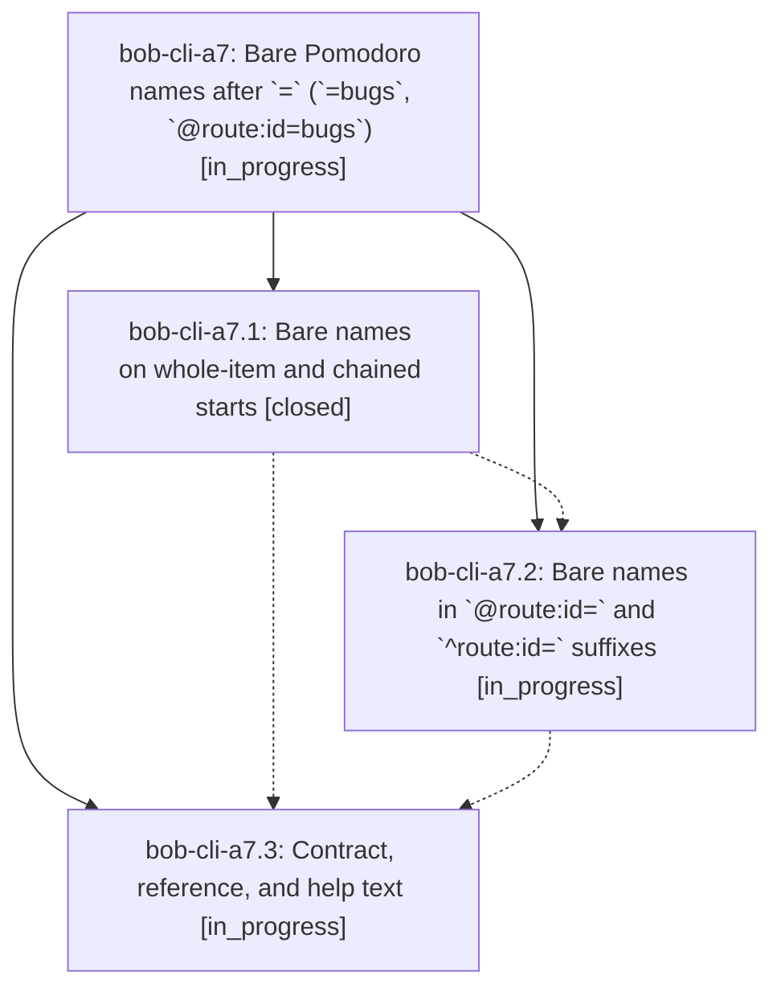

# Bead: bob-cli-a7 — Bare Pomodoro names after \`=\` (\`=bugs\`, \`@route:id=bugs\`)

[Bead Pages](../README.md) / bob-cli-a7

**Status:** ◐ in_progress · **Type:** ▸ plan · **Tier:** epic
**Owner:** `bryanbugyi34@gmail.com` · **Created by:** `bbugyi200.apollo.9p` · **Assignee:** `bob-cli-a7.land`
**Created:** 2026-10-20 15:12:11 EDT
**Plan:** [202610/bare\_pomodoro\_names.md](https://github.com/bobs-org/bob-cli--plans/blob/main/202610/bare_pomodoro_names.md)

<!-- sase:links:start -->

## Links

| Relation | Artifact | Why |
| --- | --- | --- |
| implemented-by | [plan:202610/bare_pomodoro_names.md][1] | derived from the plan's `bead_id:` frontmatter field |

[1]: https://github.com/bobs-org/bob-cli--plans/blob/main/202610/bare_pomodoro_names.md

<!-- sase:links:end -->

## Description

`=bugs` starts the BUGS Pomodoro exactly like `=#bugs`, and `@route:id=bugs` links and starts exactly like `@route:id#bugs=`, across execution, capture-parse, live-editor spans, completion, and docs; every existing spelling keeps its current meaning.

## Phases

| Bead | Title | Status | Size | Created | Agents | Commits |
|---|---|---|---|---|---:|---:|
| [bob-cli-a7.1](bob-cli-a7.1.md) | Bare names on whole-item and chained starts | ✓ closed | medium | 2026-10-20 | 1 | 1 |
| [bob-cli-a7.2](bob-cli-a7.2.md) | Bare names in \`@route:id=\` and \`^route:id=\` suffixes | ◐ in_progress | medium | 2026-10-20 | 1 | 0 |
| [bob-cli-a7.3](bob-cli-a7.3.md) | Contract, reference, and help text | ◐ in_progress | medium | 2026-10-20 | 1 | 0 |

## Lineage

## Agents

| Agent | Bead | Commits |
|---|---|---:|
| [bbugyi200.athena.bob-cli-a7.1](https://github.com/bobs-org/bob-cli--agents/blob/main/agents/bbugyi200.athena.bob-cli-a7.1/README.md) | [bob-cli-a7.1](bob-cli-a7.1.md) | 1 |
| [bbugyi200.athena.bob-cli-a7.2](https://github.com/bobs-org/bob-cli--agents/blob/main/agents/bbugyi200.athena.bob-cli-a7.2/README.md) | [bob-cli-a7.2](bob-cli-a7.2.md) | 0 |
| [bbugyi200.athena.bob-cli-a7.3](https://github.com/bobs-org/bob-cli--agents/blob/main/agents/bbugyi200.athena.bob-cli-a7.3/README.md) | [bob-cli-a7.3](bob-cli-a7.3.md) | 0 |
| [bbugyi200.athena.bob-cli-a7.land](https://github.com/bobs-org/bob-cli--agents/blob/main/agents/bbugyi200.athena.bob-cli-a7.land/README.md) | [bob-cli-a7](README.md) | 0 |

## Commits

| Repo | Commit | Subject | Bead | Committed |
|---|---|---|---|---|
| bob-cli | [`18c16f3`](https://github.com/bobs-org/bob-cli/commit/18c16f3dae2b64fdc2bbabdd71ee83c68da381af) | feat(capture): lex =name as the named pomodoro start | [bob-cli-a7.1](bob-cli-a7.1.md) | 2026-10-20 16:09:05 EDT |
