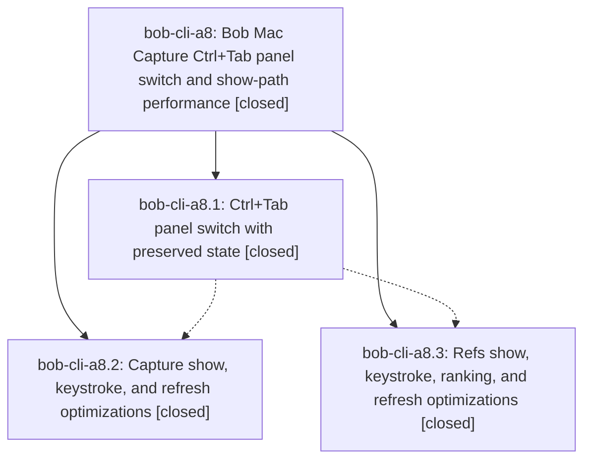

# Bead: bob-cli-a8 — Bob Mac Capture Ctrl+Tab panel switch and show-path performance

[Bead Pages](../README.md) / bob-cli-a8

**Status:** ✓ closed · **Resolution:** done · **Type:** ▸ plan · **Tier:** epic
**Owner:** `bryanbugyi34@gmail.com` · **Created by:** `bbugyi200.apollo.9q` · **Assignee:** `bob-cli-a8.land`
**Created:** 2026-10-20 15:55:13 EDT · **Closed:** 2026-10-20 19:27:30 EDT
**Plan:** [202610/mac\_capture\_panel\_switch\_and\_perf.md](https://github.com/bobs-org/bob-cli--plans/blob/main/202610/mac_capture_panel_switch_and_perf.md)

<!-- sase:links:start -->

## Links

| Relation | Artifact | Why |
| --- | --- | --- |
| implemented-by | [plan:202610/mac_capture_panel_switch_and_perf.md][1] | derived from the plan's `bead_id:` frontmatter field |
| related | file:explicit:6e8d6331b082d9387b7f142e | attached via sase artifact create --bead |
| related | file:explicit:78b480232df324bc6ff25313 | attached via sase artifact create --bead |

[1]: https://github.com/bobs-org/bob-cli--plans/blob/main/202610/mac_capture_panel_switch_and_perf.md

<!-- sase:links:end -->

## Description

Ctrl+Tab (and Ctrl+Shift+Tab) in either Bob Mac Capture panel switches to the other panel. Capture keeps its draft and caret, and Refs keeps its remembered view. Showing, switching, and typing in both panels do less redundant main-thread work and spawn fewer bob processes, with no change to what bob decides.

## Notes

[2026-10-20T23:08:36Z · bob-cli-a8.land] LAND AUDIT / FOLLOW-UP TRIAGE: Read this epic (originally no notes), all three phase scopes and all four child notes, plan:202610/mac_capture_panel_switch_and_perf.md, and implementation commits e99cec6 (a8.1), 554c69e (a8.3), 1d5735a (a8.2). Verified selected branches open_surfaces=switch, arrival_reset=keep, show_refresh_window=coalesce, the thin-client boundary, and unchanged per-show idle-agenda refresh. Sole PROPOSED FOLLOW-UP, a8.1 note 1 (two Material tests failing for github-callouts), declined as no longer reproducible: current bob-cli 787d62cb passes both reported tests via uv run --project tools/docs --group material pytest -q tools/docs/tests/test_templates.py -k test_templates_in_material\ or\ test_component_chips_in_material (2 passed, 3 deselected). a8.3 note 1 already reported the later docs-check pass. Other discovered baseline failures were compared between Mac CI runs 39499997621 at pre-epic 785508c, 39505351980 at e99cec6, and 39511067813 at 1d5735a: filed distinct ready ci tasks bob-cli-ad (third-@ completion test, large), bob-cli-ae (grown-list fixture uses the old first row, small), bob-cli-af (duplicate visibility callback on hide, small), bob-cli-ag (Tabs preselection test, large). Searched all statuses, swept the last week, read plausible existing 7h/8e/8j and active 8b; these are distinct nodes/root causes, not duplicate corroborations or caused by an active epic. Related links preserve adjacent tracker context. Evidence: file:explicit:78b480232df324bc6ff25313. No other child follow-ups. Do not create duplicate tasks in the landing tale.

[2026-10-20T23:08:40Z · bob-cli-a8.land] REMAINING LANDING WORK / INTEGRATION: Current Mac CI adds RefsPanelModelTests.testOpenRefreshesTodayWithoutRefreshingSnapshot failure: the existing test waits for a second Today process one second after the first, contrary to this epic five-second coalescing contract. Repair that expectation with injected time and positive outside-window/unthrottled-trigger checks; do not remove the throttle. Original plan also explicitly requires a hosted NSTextView caret round trip (only a model-level test was added), an injectable targets clock with reason-aware refresh coverage (AppDelegate still calls Date directly; tests exercise only the stateless window predicate), and before/after ranking measurements (not reported in phase notes). These remain epic work in a single medium tale whose final step closes this epic and marks its linked plan done. Reviewed non-epic Mac drift since creation: 785508c Highlights Command-T entry is already wired through the shared coordinator and a9a5c9b underlining changes preserve raw annotation data/equality in inspector content; no production integration change found necessary. bob-cli drift includes short Pomodoro syntax, docs publication, ref-show underline rendering, and the initial capture-related query engine; all preserve the existing process contracts used here, with unrelated short-token presentation already tracked by a9 and similar-task app work still in ab. Recheck newer drift in the tale. Current Mac CI compiled and executed the combined tree, but Mac SSH timed out; newly authored AppKit changes will still need best-effort scratch bundle/typecheck. epic-symbols has no entries. No parent link. No just check-full run; final verification follows repairs.

[2026-10-20T23:11:11Z · bob-cli-a8.land] LANDING HANDOFF: Authored remaining-work tale sase_plan_mac_capture_switch_perf_closeout.md (medium). Completed the tier-aware validate --explain, edit, and revalidate loop; final validation passes with 0 warnings. The tale repairs the stale Refs show test, finishes targets clock/reason and hosted caret coverage, records before/after measurements, runs final verification, and performs this epic normal close/symbol audit/plan status update in the same coding turn without waiting for its own commit or CI. Triage was completed in the prior note. Fresh fetches of both bob-cli and bob-mac-capture master found no commits beyond reviewed 787d62cb and 1d5735a. No parent link. Keep this epic and its original plan open until the tale completes.

[2026-10-20T23:27:15Z · bob-cli-a8.land] Closeout repairs landed in linked bob-mac-capture (uncommitted, part of this turn): deterministic refreshForOpen clock coverage replacing the stale two-immediate-opens test; CaptureTargetsRefreshGate with reason-aware tests wired through AppDelegate.refreshTargetsWhenPossible; hosted Capture round-trip caret test via real coordinator paths. Ranking (10k synth, fixed --now/--tz, debug builds, 1 warmup+5 runs): browse baseline 1148ms vs repaired 1136ms, search 1255ms vs 1274ms (noise), outputs byte-equal. Drift: no commits since 1d5735a (mac) or 787d62cb (bob-cli); 785508c/a9a5c9b need no further integration. Evidence: file:explicit:6e8d6331b082d9387b7f142e. Limits: Mac SSH timed out, so macOS AppKit targets/hosted tests/bundle/typecheck and Mac signpost timings are unverified; portable-check 1489/0, just check pass, docs-check 447/1 skipped. Baseline ad/ae/af/ag stand on prior evidence; a8.1 Material proposal stays declined.

[2026-10-20T23:27:30Z · bob-cli-a8.land] Verified all three phases, their notes, and e99cec6/554c69e/1d5735a against the switch/keep/coalesce decisions; completed the refresh-clock and hosted-caret coverage and performance evidence recorded in the final landing note. Reviewed and integrated post-epic drift. The a8.1 Material-test proposal is no longer reproducible; independent baseline Mac failures are tracked by ad/ae/af/ag. Final verification results and Mac availability limits are recorded above. No epic-symbol exemptions remain.

## Phases

| Bead | Title | Status | Size | Created | Agents | Commits |
|---|---|---|---|---|---:|---:|
| [bob-cli-a8.1](bob-cli-a8.1.md) | Ctrl+Tab panel switch with preserved state | ✓ closed | medium | 2026-10-20 | 1 | 1 |
| [bob-cli-a8.2](bob-cli-a8.2.md) | Capture show, keystroke, and refresh optimizations | ✓ closed | medium | 2026-10-20 | 1 | 1 |
| [bob-cli-a8.3](bob-cli-a8.3.md) | Refs show, keystroke, ranking, and refresh optimizations | ✓ closed | medium | 2026-10-20 | 1 | 1 |

## Lineage

## Agents

| Agent | Bead | Commits |
|---|---|---:|
| [bbugyi200.athena.bob-cli-a8.1](https://github.com/bobs-org/bob-cli--agents/blob/main/agents/bbugyi200.athena.bob-cli-a8.1/README.md) | [bob-cli-a8.1](bob-cli-a8.1.md) | 1 |
| [bbugyi200.athena.bob-cli-a8.2](https://github.com/bobs-org/bob-cli--agents/blob/main/agents/bbugyi200.athena.bob-cli-a8.2/README.md) | [bob-cli-a8.2](bob-cli-a8.2.md) | 1 |
| [bbugyi200.athena.bob-cli-a8.3](https://github.com/bobs-org/bob-cli--agents/blob/main/sessions/bbugyi200.athena.bob-cli-a8.3.md) | [bob-cli-a8.3](bob-cli-a8.3.md) | 1 |
| [bbugyi200.athena.bob-cli-a8.land](https://github.com/bobs-org/bob-cli--agents/blob/main/sessions/bbugyi200.athena.bob-cli-a8.land.md) | [bob-cli-a8](README.md) | 2 |

## Commits

| Repo | Commit | Subject | Bead | Committed |
|---|---|---|---|---|
| bob-mac-capture | [`bob-mac-capture@e99cec6`](https://github.com/bobs-org/bob-mac-capture/commit/e99cec6f7d35e78d07bad679b607aea54b3e6bd9) | feat(capture): add Ctrl+Tab panel switch with preserved state | [bob-cli-a8.1](bob-cli-a8.1.md) | 2026-10-20 18:04:17 EDT |
| bob-mac-capture | [`bob-mac-capture@554c69e`](https://github.com/bobs-org/bob-mac-capture/commit/554c69eee19b5be1d0a7ce687dac04b40227d0f3) | perf(refs): optimize ranking and refresh paths | [bob-cli-a8.3](bob-cli-a8.3.md) | 2026-10-20 18:35:32 EDT |
| bob-mac-capture | [`bob-mac-capture@1d5735a`](https://github.com/bobs-org/bob-mac-capture/commit/1d5735a67444ceb8a41ca3d81b9dfc7fa3634339) | perf(capture): coalesce show refresh and skip no-op publishes | [bob-cli-a8.2](bob-cli-a8.2.md) | 2026-10-20 18:51:08 EDT |
| bob-mac-capture | [`bob-mac-capture@b47f28b`](https://github.com/bobs-org/bob-mac-capture/commit/b47f28bfddeefa1347471ada0c116b1423b04c8b) | test(mac-capture): close out panel-switch verification with clock-driven refresh coverage | [bob-cli-a8](README.md) | 2026-10-20 19:28:50 EDT |
| bob-cli--plans | [`bob-cli--plans@edd5be9`](https://github.com/bobs-org/bob-cli--plans/commit/edd5be99dfd5c8e9ea6148423872ac74349e393c) | docs(plans): mark mac\_capture\_panel\_switch\_and\_perf done | [bob-cli-a8](README.md) | 2026-10-20 19:30:04 EDT |
