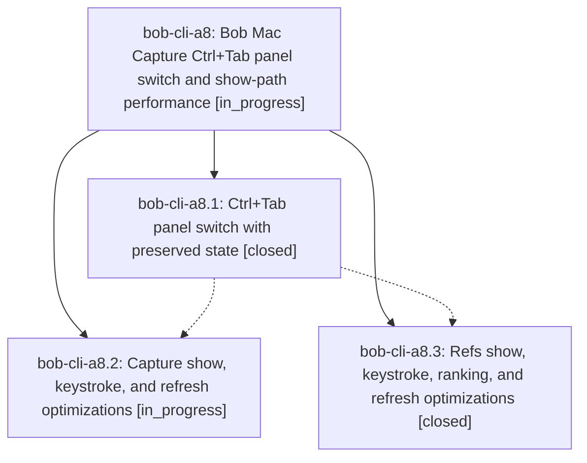

# Bead: bob-cli-a8 — Bob Mac Capture Ctrl+Tab panel switch and show-path performance

[Bead Pages](../README.md) / bob-cli-a8

**Status:** ◐ in_progress · **Type:** ▸ plan · **Tier:** epic
**Owner:** `bryanbugyi34@gmail.com` · **Created by:** `bbugyi200.apollo.9q` · **Assignee:** `bob-cli-a8.land`
**Created:** 2026-10-20 15:55:13 EDT
**Plan:** [202610/mac\_capture\_panel\_switch\_and\_perf.md](https://github.com/bobs-org/bob-cli--plans/blob/main/202610/mac_capture_panel_switch_and_perf.md)

<!-- sase:links:start -->

## Links

| Relation | Artifact | Why |
| --- | --- | --- |
| implemented-by | [plan:202610/mac_capture_panel_switch_and_perf.md][1] | derived from the plan's `bead_id:` frontmatter field |

[1]: https://github.com/bobs-org/bob-cli--plans/blob/main/202610/mac_capture_panel_switch_and_perf.md

<!-- sase:links:end -->

## Description

Ctrl+Tab (and Ctrl+Shift+Tab) in either Bob Mac Capture panel switches to the other panel. Capture keeps its draft and caret, and Refs keeps its remembered view. Showing, switching, and typing in both panels do less redundant main-thread work and spawn fewer bob processes, with no change to what bob decides.

## Phases

| Bead | Title | Status | Size | Created | Agents | Commits |
|---|---|---|---|---|---:|---:|
| [bob-cli-a8.1](bob-cli-a8.1.md) | Ctrl+Tab panel switch with preserved state | ✓ closed | medium | 2026-10-20 | 1 | 1 |
| [bob-cli-a8.2](bob-cli-a8.2.md) | Capture show, keystroke, and refresh optimizations | ◐ in_progress | medium | 2026-10-20 | 1 | 0 |
| [bob-cli-a8.3](bob-cli-a8.3.md) | Refs show, keystroke, ranking, and refresh optimizations | ✓ closed | medium | 2026-10-20 | 1 | 1 |

## Lineage

## Agents

| Agent | Bead | Commits |
|---|---|---:|
| [bbugyi200.athena.bob-cli-a8.1](https://github.com/bobs-org/bob-cli--agents/blob/main/agents/bbugyi200.athena.bob-cli-a8.1/README.md) | [bob-cli-a8.1](bob-cli-a8.1.md) | 1 |
| [bbugyi200.athena.bob-cli-a8.2](https://github.com/bobs-org/bob-cli--agents/blob/main/agents/bbugyi200.athena.bob-cli-a8.2/README.md) | [bob-cli-a8.2](bob-cli-a8.2.md) | 0 |
| [bbugyi200.athena.bob-cli-a8.3](https://github.com/bobs-org/bob-cli--agents/blob/main/sessions/bbugyi200.athena.bob-cli-a8.3.md) | [bob-cli-a8.3](bob-cli-a8.3.md) | 1 |
| [bbugyi200.athena.bob-cli-a8.land](https://github.com/bobs-org/bob-cli--agents/blob/main/agents/bbugyi200.athena.bob-cli-a8.land/README.md) | [bob-cli-a8](README.md) | 0 |

## Commits

| Repo | Commit | Subject | Bead | Committed |
|---|---|---|---|---|
| bob-mac-capture | [`bob-mac-capture@e99cec6`](https://github.com/bobs-org/bob-mac-capture/commit/e99cec6f7d35e78d07bad679b607aea54b3e6bd9) | feat(capture): add Ctrl+Tab panel switch with preserved state | [bob-cli-a8.1](bob-cli-a8.1.md) | 2026-10-20 18:04:17 EDT |
| bob-mac-capture | [`bob-mac-capture@554c69e`](https://github.com/bobs-org/bob-mac-capture/commit/554c69eee19b5be1d0a7ce687dac04b40227d0f3) | perf(refs): optimize ranking and refresh paths | [bob-cli-a8.3](bob-cli-a8.3.md) | 2026-10-20 18:35:32 EDT |
