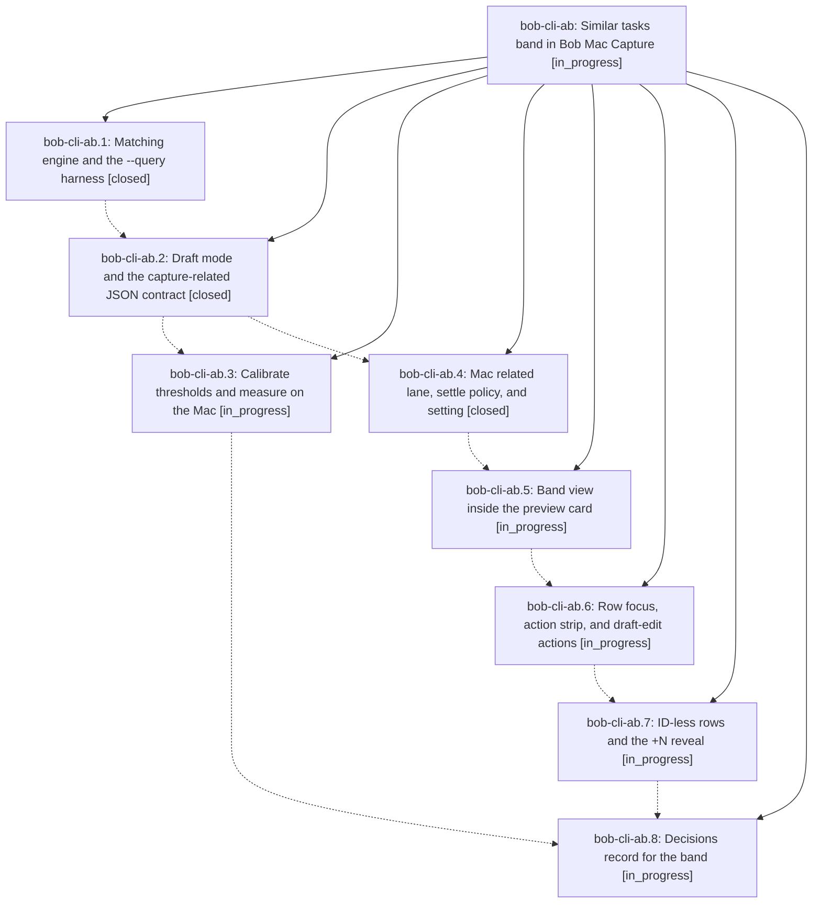

# Bead: bob-cli-ab — Similar tasks band in Bob Mac Capture

[Bead Pages](../README.md) / bob-cli-ab

**Status:** ◐ in_progress · **Type:** ▸ plan · **Tier:** epic
**Owner:** `bryanbugyi34@gmail.com` · **Created by:** [bbugyi200.apollo.research.27.linker.w0](https://github.com/bobs-org/bob-cli--agents/blob/main/sessions/bbugyi200.apollo.research.27.linker.w0.md) · **Assignee:** `bob-cli-ab.land`
**Created:** 2026-10-20 17:44:12 EDT
**Plan:** [202610/capture\_similar\_tasks\_band.md](https://github.com/bobs-org/bob-cli--plans/blob/main/202610/capture_similar_tasks_band.md)

<!-- sase:links:start -->

## Links

| Relation | Artifact | Why |
| --- | --- | --- |
| implemented-by | [plan:202610/capture_similar_tasks_band.md][1] | derived from the plan's `bead_id:` frontmatter field |

_Plus 1 automatic references — see [Referenced By](#referenced-by)._

[1]: https://github.com/bobs-org/bob-cli--plans/blob/main/202610/capture_similar_tasks_band.md

<!-- sase:links:end -->

## Description

When a capture draft will create new tasks, Bob Mac Capture quietly shows the few existing tasks each one may duplicate. The rows appear after typing settles, at the foot of the new task's own preview card, and take zero pixels otherwise. One keyboard-driven draft edit can fold, relate, or link a match, and typing, the live preview, and Return stay exactly as fast as today.

## Phases

| Bead | Title | Status | Size | Created | Agents | Commits |
|---|---|---|---|---|---:|---:|
| [bob-cli-ab.1](bob-cli-ab.1.md) | Matching engine and the --query harness | ✓ closed | medium | 2026-10-20 | 1 | 1 |
| [bob-cli-ab.2](bob-cli-ab.2.md) | Draft mode and the capture-related JSON contract | ✓ closed | medium | 2026-10-20 | 1 | 1 |
| [bob-cli-ab.3](bob-cli-ab.3.md) | Calibrate thresholds and measure on the Mac | ◐ in_progress | medium | 2026-10-20 | 1 | 0 |
| [bob-cli-ab.4](bob-cli-ab.4.md) | Mac related lane, settle policy, and setting | ✓ closed | medium | 2026-10-20 | 1 | 1 |
| [bob-cli-ab.5](bob-cli-ab.5.md) | Band view inside the preview card | ◐ in_progress | medium | 2026-10-20 | 1 | 0 |
| [bob-cli-ab.6](bob-cli-ab.6.md) | Row focus, action strip, and draft-edit actions | ◐ in_progress | medium | 2026-10-20 | 1 | 0 |
| [bob-cli-ab.7](bob-cli-ab.7.md) | ID-less rows and the +N reveal | ◐ in_progress | small | 2026-10-20 | 1 | 0 |
| [bob-cli-ab.8](bob-cli-ab.8.md) | Decisions record for the band | ◐ in_progress | small | 2026-10-20 | 1 | 0 |

## Lineage

## Agents

| Agent | Bead | Commits |
|---|---|---:|
| [bbugyi200.apollo.bob-cli-ab.1](https://github.com/bobs-org/bob-cli--agents/blob/main/agents/bbugyi200.apollo.bob-cli-ab.1/README.md) | [bob-cli-ab.1](bob-cli-ab.1.md) | 1 |
| [bbugyi200.apollo.bob-cli-ab.2](https://github.com/bobs-org/bob-cli--agents/blob/main/sessions/bbugyi200.apollo.bob-cli-ab.2.md) | [bob-cli-ab.2](bob-cli-ab.2.md) | 1 |
| [bbugyi200.apollo.bob-cli-ab.3](https://github.com/bobs-org/bob-cli--agents/blob/main/sessions/bbugyi200.apollo.bob-cli-ab.3.md) | [bob-cli-ab.3](bob-cli-ab.3.md) | 0 |
| [bbugyi200.apollo.bob-cli-ab.4](https://github.com/bobs-org/bob-cli--agents/blob/main/sessions/bbugyi200.apollo.bob-cli-ab.4.md) | [bob-cli-ab.4](bob-cli-ab.4.md) | 1 |
| [bbugyi200.apollo.bob-cli-ab.5](https://github.com/bobs-org/bob-cli--agents/blob/main/agents/bbugyi200.apollo.bob-cli-ab.5/README.md) | [bob-cli-ab.5](bob-cli-ab.5.md) | 0 |
| [bbugyi200.apollo.bob-cli-ab.6](https://github.com/bobs-org/bob-cli--agents/blob/main/agents/bbugyi200.apollo.bob-cli-ab.6/README.md) | [bob-cli-ab.6](bob-cli-ab.6.md) | 0 |
| [bbugyi200.apollo.bob-cli-ab.7](https://github.com/bobs-org/bob-cli--agents/blob/main/agents/bbugyi200.apollo.bob-cli-ab.7/README.md) | [bob-cli-ab.7](bob-cli-ab.7.md) | 0 |
| [bbugyi200.apollo.bob-cli-ab.8](https://github.com/bobs-org/bob-cli--agents/blob/main/agents/bbugyi200.apollo.bob-cli-ab.8/README.md) | [bob-cli-ab.8](bob-cli-ab.8.md) | 0 |
| [bbugyi200.apollo.bob-cli-ab.land](https://github.com/bobs-org/bob-cli--agents/blob/main/agents/bbugyi200.apollo.bob-cli-ab.land/README.md) | [bob-cli-ab](README.md) | 0 |

## Commits

| Repo | Commit | Subject | Bead | Committed |
|---|---|---|---|---|
| bob-cli | [`787d62c`](https://github.com/bobs-org/bob-cli/commit/787d62cbad07597023f0f005ad9285ec3cc84529) | feat(capture-related): add matching engine and --query harness | [bob-cli-ab.1](bob-cli-ab.1.md) | 2026-10-20 18:52:23 EDT |
| bob-cli | [`062fc3d`](https://github.com/bobs-org/bob-cli/commit/062fc3da24646166a752f264bd3acec0dd75b4c1) | feat(capture-related): add draft JSON contract | [bob-cli-ab.2](bob-cli-ab.2.md) | 2026-10-20 20:18:13 EDT |
| bob-mac-capture | [`bob-mac-capture@7a03751`](https://github.com/bobs-org/bob-mac-capture/commit/7a03751a447a95cde4a02657216f8b942196ad89) | feat(capture): add settled similar-task lane | [bob-cli-ab.4](bob-cli-ab.4.md) | 2026-10-20 20:45:09 EDT |

<!-- sase:referenced-by:start -->

## Referenced By

| Relation | Artifact | Why | Uses |
| --- | --- | --- | ---: |
| read-by | [agent:bob-cli-ab.1][1] | Need parent epic DECISIONS, notes, and full plan context | 1 |

[1]: https://github.com/bobs-org/bob-cli--agents/blob/main/agents/bbugyi200.apollo.bob-cli-ab.1/README.md

<!-- sase:referenced-by:end -->
