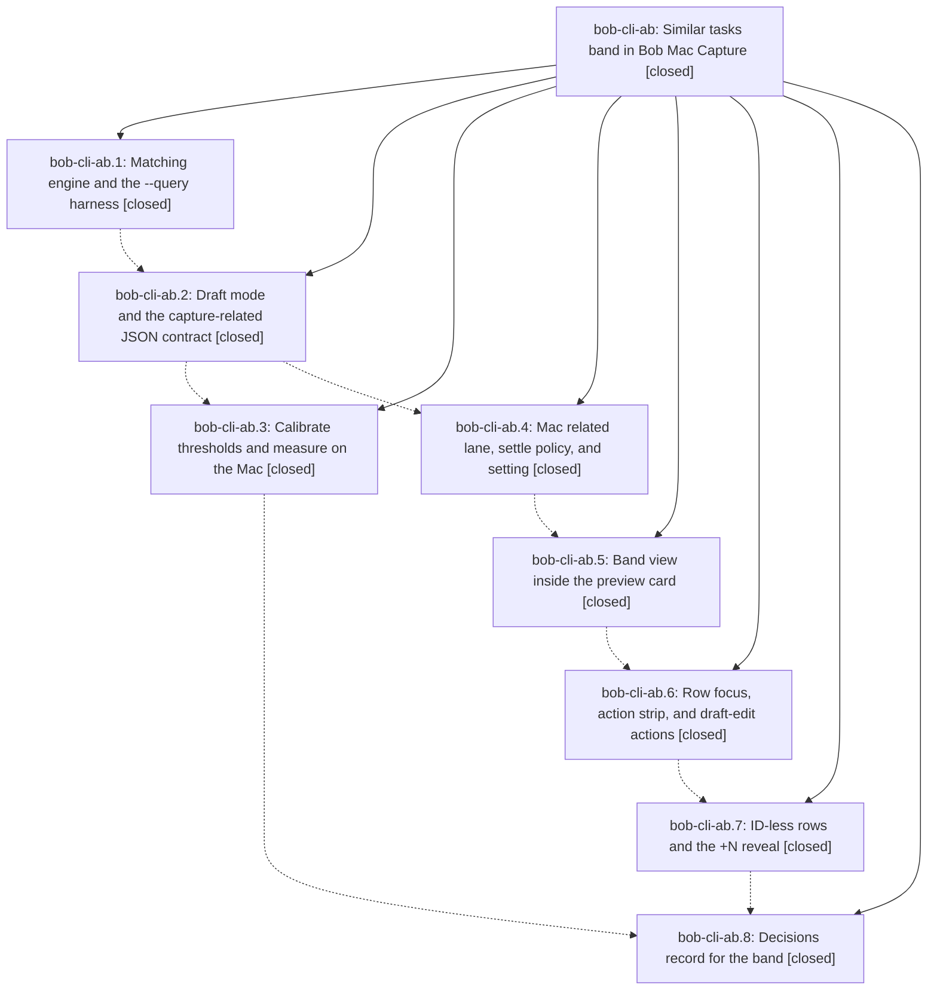

# Bead: bob-cli-ab — Similar tasks band in Bob Mac Capture

[Bead Pages](../README.md) / bob-cli-ab

**Status:** ✓ closed · **Resolution:** done · **Type:** ▸ plan · **Tier:** epic
**Owner:** `bryanbugyi34@gmail.com` · **Created by:** [bbugyi200.apollo.research.27.linker.w0](https://github.com/bobs-org/bob-cli--agents/blob/main/sessions/bbugyi200.apollo.research.27.linker.w0.md) · **Assignee:** `bob-cli-ab.land`
**Created:** 2026-10-20 17:44:12 EDT · **Closed:** 2026-10-21 14:48:53 EDT
**Plan:** [202610/capture\_similar\_tasks\_band.md](https://github.com/bobs-org/bob-cli--plans/blob/main/202610/capture_similar_tasks_band.md)

<!-- sase:links:start -->

## Links

| Relation | Artifact | Why |
| --- | --- | --- |
| implemented-by | [plan:202610/capture_similar_tasks_band.md][1] | derived from the plan's `bead_id:` frontmatter field |

_Plus 3 automatic references — see [Referenced By](#referenced-by)._

[1]: https://github.com/bobs-org/bob-cli--plans/blob/main/202610/capture_similar_tasks_band.md

<!-- sase:links:end -->

## Description

When a capture draft will create new tasks, Bob Mac Capture quietly shows the few existing tasks each one may duplicate. The rows appear after typing settles, at the foot of the new task's own preview card, and take zero pixels otherwise. One keyboard-driven draft edit can fold, relate, or link a match, and typing, the live preview, and Return stay exactly as fast as today.

## Notes

[2026-10-21T18:11:38Z · bob-cli-ab.land] LANDING TRIAGE (bob-cli-ab.land): PROPOSED FOLLOW-UP outcomes. (1) bob-cli-ab.3 #1 and #4 Mac release timing: declined, resolved inside .3 (Mac arm64 calibrated release p95 43.494 ms <= 50 ms, notes #6/#12; no index-escalation bead needed). (2) bob-cli-ab.3 #2 and #4 collect Bryan labels: declined, superseded by Bryan's explicit delegation (gate bb385582) and the reviewed 80-pair labels that set the bars in 453dc4a7. (3) bob-cli-ab.3 #10 same_title discard default / closed_duplicate bar re-check: declined as a task, already recorded by bob-cli-ab.8 in decisions:similar-tasks-are-a-settled-heads-up (rejected 'closed bar above 0.82', Reopens-when closed-pair evidence accumulates); conditional, no actionable work today. (4) bob-cli-ab.3 #11 abbreviation-aware matching: declined as a task, conditional on future label misses and recorded in the same decision's rejected alternatives and Reopens-when. (5) bob-cli-ab.5 #1 Mac scratch typecheck: declined, resolved by macOS 26 CI (Build compiled all targets; 63 Similar/Related XCTests pass in run 39617467830); the remaining-work tale still typechecks its own Swift changes on the Mac. Discovered, not epic-caused: bob-mac-capture macOS CI Test step was already red before this epic (b47f28b run 39515287077); ad/ae/af/ag already track four of the failures, and the untracked CapturePanelSwitchHostedTests caret failure was filed as bob-cli-ao via /sase_new_task.

[2026-10-21T18:20:02Z · bob-cli-ab.land] LANDING AUDIT (bob-cli-ab.land): Verified phases .1-.8 against the plan and commits (bob-cli 787d62cb/062fc3da/453dc4a7/906ffe98; bob-mac-capture 7a03751/59068d3/01cc470/3653661; research sidecar cb46d5a calibration evidence). Remaining epic work found: (1) 453dc4a7 dropped the -e/--exclude option, its completion entry, CLI test, help-order update, CLI reference regen, scripts/dev/capture_related_calibrate_test and check-scripts wiring, while tests.rs already calls the 5-arg query_related_in, so master's test build fails (CI red on 453dc4a7 and 906ffe98, E0061 x3). The restore patch was recovered from the calibrating agent's scratch tree and verified on a scratch worktree of 906ffe98 (applies, compiles, 14 unit + related CLI + help + sampler test PASS). (2) mac_lane gaps: the settle fire-time gate lacks the plan's panel-visible and modal-owner checks, retained-draft show does not fire immediately, publish/empty signposts missing, and model tests for preview-lane-untouched / Return-never-waits / no-spawn-while-hidden / stale-never-paints are missing. Integration review: bob-cli bcc201fe/8bcc3e2b relation labels need no capture-related change (linked uses parsed relations); bob-mac-capture bf40f48/d73d943 relation-label card is covered by the new relationLabelPrompt gate; release/CI/toolchain/highlights/stats/date-mark commits do not touch capture-related. epic-symbols: none. No parent_bead. Remaining work proposed as a medium tale whose final step closes this epic.

[2026-10-21T18:48:53Z · bob-cli-ab.land] Phases .1-.8 verified against the epic plan and their commits: bob-cli 787d62cb, 062fc3da, 453dc4a7, 906ffe98; bob-mac-capture 7a03751, 59068d3, 01cc470, 3653661.

Gap 1 (bob-cli --exclude calibration): restored the dropped -e/--exclude NOTE:LINE option, ExcludedTask parsing, 5-arg query_related_in, completion entry, calibration_excludes_self CLI test, help-order update, scripts/dev/capture_related_calibrate_test plus just check-scripts wiring, and regenerated docs/reference/cli/capture-related.md plus docs/develop/decisions.md via just docs-gen. Master test build compiles again. Verification: just check PASS, just check-scripts PASS (calibrate-test PASS), just docs-check PASS (447 passed), cargo test --lib capture_related 14 passed, cargo test --test cli related 10 passed including calibration_excludes_self, capture-related --query with -e works and --exclude with draft exits 2.

Gap 2 (bob-mac-capture mac_lane): added similarTasksMayRequest fire-time gate (visible panel, setting on, no picker/ID/Pomodoro/relation/pull-in/stash/template owner), gate enforced after settle with held-rows kept and pending cleared, immediate path requires panelVisible+setting, retained-draft prepareForPresentation fires immediately (exactly one capture-related despite large settle), added capture-related-publish/empty signposts with diagnostics.md and architecture.md updates, updated existing lane/action tests with prepareForPresentation, added 5 gate tests (preview-untouched, Return-never-waits <2s vs 5s delay, hidden zero-spawn plus immediate retained show, modal zero-spawn with held rows, stale-never-paints). Verification: athena just portable-check PASS (1526 tests), mac Scripts/bundle.sh PASS (Build complete), mac just typecheck-tests PASS (all 4 targets), mac docs-check PASS with fresh BOB_CLI_DIR (447 passed). New XCTests compile via typecheck; macOS CI remains test authority after commit.

Integration review: bob-cli bcc201fe/8bcc3e2b relation labels need no capture-related change (draft ~ targets resolve from parsed relations); bob-mac-capture bf40f48/d73d943 relation-label card covered by new relationLabelPrompt gate; release-train, CI, toolchain, highlights, stats, date-mark commits do not touch capture-related.

Triage: follow-up triage recorded in epic LANDING TRIAGE note: five proposals declined with reasons, and bob-cli-ao filed for the pre-existing Mac CI failure.

## Phases

| Bead | Title | Status | Size | Created | Agents | Commits |
|---|---|---|---|---|---:|---:|
| [bob-cli-ab.1](bob-cli-ab.1.md) | Matching engine and the --query harness | ✓ closed | medium | 2026-10-20 | 1 | 1 |
| [bob-cli-ab.2](bob-cli-ab.2.md) | Draft mode and the capture-related JSON contract | ✓ closed | medium | 2026-10-20 | 1 | 1 |
| [bob-cli-ab.3](bob-cli-ab.3.md) | Calibrate thresholds and measure on the Mac | ✓ closed | medium | 2026-10-20 | 1 | 0 |
| [bob-cli-ab.4](bob-cli-ab.4.md) | Mac related lane, settle policy, and setting | ✓ closed | medium | 2026-10-20 | 1 | 1 |
| [bob-cli-ab.5](bob-cli-ab.5.md) | Band view inside the preview card | ✓ closed | medium | 2026-10-20 | 1 | 1 |
| [bob-cli-ab.6](bob-cli-ab.6.md) | Row focus, action strip, and draft-edit actions | ✓ closed | medium | 2026-10-20 | 1 | 1 |
| [bob-cli-ab.7](bob-cli-ab.7.md) | ID-less rows and the +N reveal | ✓ closed | small | 2026-10-20 | 1 | 1 |
| [bob-cli-ab.8](bob-cli-ab.8.md) | Decisions record for the band | ✓ closed | small | 2026-10-20 | 1 | 1 |

## Lineage

## Agents

| Agent | Bead | Commits |
|---|---|---:|
| [bbugyi200.apollo.bob-cli-ab.1](https://github.com/bobs-org/bob-cli--agents/blob/main/agents/bbugyi200.apollo.bob-cli-ab.1/README.md) | [bob-cli-ab.1](bob-cli-ab.1.md) | 1 |
| [bbugyi200.apollo.bob-cli-ab.2](https://github.com/bobs-org/bob-cli--agents/blob/main/sessions/bbugyi200.apollo.bob-cli-ab.2.md) | [bob-cli-ab.2](bob-cli-ab.2.md) | 1 |
| [bbugyi200.apollo.bob-cli-ab.3](https://github.com/bobs-org/bob-cli--agents/blob/main/sessions/bbugyi200.apollo.bob-cli-ab.3.md) | [bob-cli-ab.3](bob-cli-ab.3.md) | 0 |
| [bbugyi200.apollo.bob-cli-ab.4](https://github.com/bobs-org/bob-cli--agents/blob/main/sessions/bbugyi200.apollo.bob-cli-ab.4.md) | [bob-cli-ab.4](bob-cli-ab.4.md) | 1 |
| [bbugyi200.apollo.bob-cli-ab.5](https://github.com/bobs-org/bob-cli--agents/blob/main/agents/bbugyi200.apollo.bob-cli-ab.5/README.md) | [bob-cli-ab.5](bob-cli-ab.5.md) | 1 |
| [bbugyi200.apollo.bob-cli-ab.6](https://github.com/bobs-org/bob-cli--agents/blob/main/agents/bbugyi200.apollo.bob-cli-ab.6/README.md) | [bob-cli-ab.6](bob-cli-ab.6.md) | 1 |
| [bbugyi200.apollo.bob-cli-ab.7](https://github.com/bobs-org/bob-cli--agents/blob/main/agents/bbugyi200.apollo.bob-cli-ab.7/README.md) | [bob-cli-ab.7](bob-cli-ab.7.md) | 1 |
| [bbugyi200.apollo.bob-cli-ab.8](https://github.com/bobs-org/bob-cli--agents/blob/main/agents/bbugyi200.apollo.bob-cli-ab.8/README.md) | [bob-cli-ab.8](bob-cli-ab.8.md) | 1 |
| [bbugyi200.apollo.bob-cli-ab.land](https://github.com/bobs-org/bob-cli--agents/blob/main/sessions/bbugyi200.apollo.bob-cli-ab.land.md) | [bob-cli-ab](README.md) | 3 |

## Commits

| Repo | Commit | Subject | Bead | Committed |
|---|---|---|---|---|
| bob-cli | [`787d62c`](https://github.com/bobs-org/bob-cli/commit/787d62cbad07597023f0f005ad9285ec3cc84529) | feat(capture-related): add matching engine and --query harness | [bob-cli-ab.1](bob-cli-ab.1.md) | 2026-10-20 18:52:23 EDT |
| bob-cli | [`062fc3d`](https://github.com/bobs-org/bob-cli/commit/062fc3da24646166a752f264bd3acec0dd75b4c1) | feat(capture-related): add draft JSON contract | [bob-cli-ab.2](bob-cli-ab.2.md) | 2026-10-20 20:18:13 EDT |
| bob-mac-capture | [`bob-mac-capture@7a03751`](https://github.com/bobs-org/bob-mac-capture/commit/7a03751a447a95cde4a02657216f8b942196ad89) | feat(capture): add settled similar-task lane | [bob-cli-ab.4](bob-cli-ab.4.md) | 2026-10-20 20:45:09 EDT |
| bob-mac-capture | [`bob-mac-capture@59068d3`](https://github.com/bobs-org/bob-mac-capture/commit/59068d31390349a8529e59b90360dc9ab55be903) | feat(capture): add similar-tasks band at the foot of preview cards | [bob-cli-ab.5](bob-cli-ab.5.md) | 2026-10-20 21:10:47 EDT |
| bob-mac-capture | [`bob-mac-capture@01cc470`](https://github.com/bobs-org/bob-mac-capture/commit/01cc470ec0d59402d13aa5d3430ff0f80e1d2b39) | feat(mac-capture): add similar-tasks focus, action strip, and draft-edit actions | [bob-cli-ab.6](bob-cli-ab.6.md) | 2026-10-20 21:35:00 EDT |
| bob-mac-capture | [`bob-mac-capture@3653661`](https://github.com/bobs-org/bob-mac-capture/commit/365366127c0c8295f604488c6850511f453c7083) | feat(mac-capture): route ID-less similar-tasks rows through Add block ID and add +N reveal | [bob-cli-ab.7](bob-cli-ab.7.md) | 2026-10-20 21:59:46 EDT |
| bob-cli | [`906ffe9`](https://github.com/bobs-org/bob-cli/commit/906ffe98fb216f1cbddf45bdd04ffee49a07e9b0) | docs(decisions): record Similar tasks band as a settled heads-up | [bob-cli-ab.8](bob-cli-ab.8.md) | 2026-10-21 13:54:44 EDT |
| bob-cli | [`a065472`](https://github.com/bobs-org/bob-cli/commit/a0654724452cbb4b14a15d1fd2413fd8f155c2f0) | feat(capture-related): restore --exclude calibration pieces and regen docs | [bob-cli-ab](README.md) | 2026-10-21 14:50:55 EDT |
| bob-mac-capture | [`bob-mac-capture@6b2d542`](https://github.com/bobs-org/bob-mac-capture/commit/6b2d542c38bfa6f8eaac30ebd4092275c70e2fab) | feat(mac-lane): finish settle gate, signposts, and gate tests | [bob-cli-ab](README.md) | 2026-10-21 14:51:39 EDT |
| bob-cli--plans | [`bob-cli--plans@7de8979`](https://github.com/bobs-org/bob-cli--plans/commit/7de89799ac06d861611b2dc0a0bff7c5a6c8c153) | docs(plan): mark capture\_similar\_tasks\_band done | [bob-cli-ab](README.md) | 2026-10-21 14:52:17 EDT |

<!-- sase:referenced-by:start -->

## Referenced By

| Relation | Artifact | Why | Uses |
| --- | --- | --- | ---: |
| read-by | [agent:bob-cli-ab.1][1] | Need parent epic DECISIONS, notes, and full plan context | 1 |
| read-by | [agent:bob-cli-ab.7][2] | Need epic context | 1 |
| read-by | [agent:bob-cli-ab.8][3] | Need parent epic context, prior phase commits and Mac measurements for decisions record | 1 |

[1]: https://github.com/bobs-org/bob-cli--agents/blob/main/agents/bbugyi200.apollo.bob-cli-ab.1/README.md
[2]: https://github.com/bobs-org/bob-cli--agents/blob/main/agents/bbugyi200.apollo.bob-cli-ab.7/README.md
[3]: https://github.com/bobs-org/bob-cli--agents/blob/main/agents/bbugyi200.apollo.bob-cli-ab.8/README.md

<!-- sase:referenced-by:end -->
