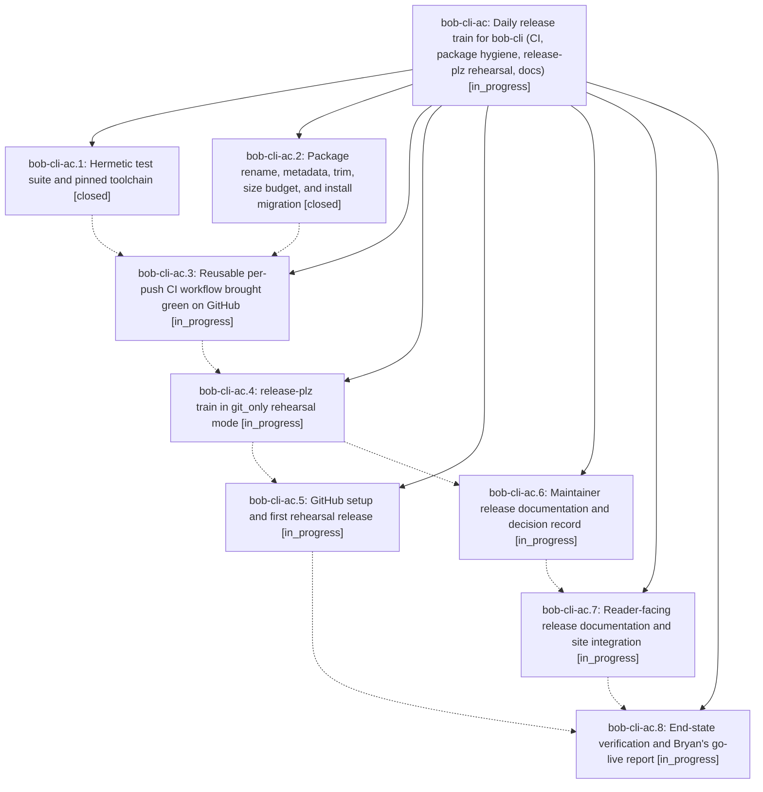

# Bead: bob-cli-ac — Daily release train for bob-cli (CI, package hygiene, release-plz rehearsal, docs)

[Bead Pages](../README.md) / bob-cli-ac

**Status:** ◐ in_progress · **Type:** ▸ plan · **Tier:** epic
**Owner:** `bryanbugyi34@gmail.com` · **Created by:** [bbugyi200.apollo.95.w1](https://github.com/bobs-org/bob-cli--agents/blob/main/sessions/bbugyi200.apollo.95.w1.md) · **Assignee:** `bob-cli-ac.land`
**Created:** 2026-10-20 18:36:53 EDT
**Plan:** [202610/crates\_io\_release\_train.md](https://github.com/bobs-org/bob-cli--plans/blob/main/202610/crates_io_release_train.md)

## Description

bob-cli has hermetic per-push CI on Linux and macOS and a renamed, trimmed package under the crates.io size cap. A scheduled release-plz train releases at most once per New York day, only after full CI passes on the exact SHA, and runs in git_only rehearsal mode (tags and GitHub Releases), ready to switch to crates.io. The process is documented on the docs site in the Diátaxis structure, and Bryan gets a report of the manual go-live steps that only he can take.

## Phases

| Bead | Title | Status | Size | Created | Agents | Commits |
|---|---|---|---|---|---:|---:|
| [bob-cli-ac.1](bob-cli-ac.1.md) | Hermetic test suite and pinned toolchain | ✓ closed | small | 2026-10-20 | 1 | 1 |
| [bob-cli-ac.2](bob-cli-ac.2.md) | Package rename, metadata, trim, size budget, and install migration | ✓ closed | medium | 2026-10-20 | 1 | 1 |
| [bob-cli-ac.3](bob-cli-ac.3.md) | Reusable per-push CI workflow brought green on GitHub | ◐ in_progress | medium | 2026-10-20 | 1 | 0 |
| [bob-cli-ac.4](bob-cli-ac.4.md) | release-plz train in git\_only rehearsal mode | ◐ in_progress | medium | 2026-10-20 | 1 | 0 |
| [bob-cli-ac.5](bob-cli-ac.5.md) | GitHub setup and first rehearsal release | ◐ in_progress | small | 2026-10-20 | 1 | 0 |
| [bob-cli-ac.6](bob-cli-ac.6.md) | Maintainer release documentation and decision record | ◐ in_progress | medium | 2026-10-20 | 1 | 0 |
| [bob-cli-ac.7](bob-cli-ac.7.md) | Reader-facing release documentation and site integration | ◐ in_progress | medium | 2026-10-20 | 1 | 0 |
| [bob-cli-ac.8](bob-cli-ac.8.md) | End-state verification and Bryan's go-live report | ◐ in_progress | small | 2026-10-20 | 1 | 0 |

## Lineage

## Agents

| Agent | Bead | Commits |
|---|---|---:|
| [bbugyi200.apollo.bob-cli-ac.1](https://github.com/bobs-org/bob-cli--agents/blob/main/agents/bbugyi200.apollo.bob-cli-ac.1/README.md) | [bob-cli-ac.1](bob-cli-ac.1.md) | 1 |
| [bbugyi200.apollo.bob-cli-ac.2](https://github.com/bobs-org/bob-cli--agents/blob/main/sessions/bbugyi200.apollo.bob-cli-ac.2.md) | [bob-cli-ac.2](bob-cli-ac.2.md) | 1 |
| [bbugyi200.apollo.bob-cli-ac.3](https://github.com/bobs-org/bob-cli--agents/blob/main/agents/bbugyi200.apollo.bob-cli-ac.3/README.md) | [bob-cli-ac.3](bob-cli-ac.3.md) | 0 |
| [bbugyi200.apollo.bob-cli-ac.4](https://github.com/bobs-org/bob-cli--agents/blob/main/agents/bbugyi200.apollo.bob-cli-ac.4/README.md) | [bob-cli-ac.4](bob-cli-ac.4.md) | 0 |
| [bbugyi200.apollo.bob-cli-ac.5](https://github.com/bobs-org/bob-cli--agents/blob/main/agents/bbugyi200.apollo.bob-cli-ac.5/README.md) | [bob-cli-ac.5](bob-cli-ac.5.md) | 0 |
| [bbugyi200.apollo.bob-cli-ac.6](https://github.com/bobs-org/bob-cli--agents/blob/main/agents/bbugyi200.apollo.bob-cli-ac.6/README.md) | [bob-cli-ac.6](bob-cli-ac.6.md) | 0 |
| [bbugyi200.apollo.bob-cli-ac.7](https://github.com/bobs-org/bob-cli--agents/blob/main/agents/bbugyi200.apollo.bob-cli-ac.7/README.md) | [bob-cli-ac.7](bob-cli-ac.7.md) | 0 |
| [bbugyi200.apollo.bob-cli-ac.8](https://github.com/bobs-org/bob-cli--agents/blob/main/agents/bbugyi200.apollo.bob-cli-ac.8/README.md) | [bob-cli-ac.8](bob-cli-ac.8.md) | 0 |
| [bbugyi200.apollo.bob-cli-ac.land](https://github.com/bobs-org/bob-cli--agents/blob/main/agents/bbugyi200.apollo.bob-cli-ac.land/README.md) | [bob-cli-ac](README.md) | 0 |

## Commits

| Repo | Commit | Subject | Bead | Committed |
|---|---|---|---|---|
| bob-cli | [`9a0fb95`](https://github.com/bobs-org/bob-cli/commit/9a0fb957a810b314d8a9ef11ca67d95632651f48) | build: pin Rust toolchain and hermeticize tests | [bob-cli-ac.1](bob-cli-ac.1.md) | 2026-10-20 19:17:21 EDT |
| bob-cli | [`eabd291`](https://github.com/bobs-org/bob-cli/commit/eabd291506814b5b8591c7dd211201b455e73ef5) | feat(package): prepare bob-obsidian 0.2.0 release package | [bob-cli-ac.2](bob-cli-ac.2.md) | 2026-10-20 19:23:49 EDT |

<!-- sase:referenced-by:start -->

## Referenced By

| Relation | Artifact | Why | Uses |
| --- | --- | --- | ---: |
| read-by | [agent:bob-cli-ac.1][1] | Need epic decisions and phase notes to implement hermetic test scope | 1 |

[1]: https://github.com/bobs-org/bob-cli--agents/blob/main/agents/bbugyi200.apollo.bob-cli-ac.1/README.md

<!-- sase:referenced-by:end -->
