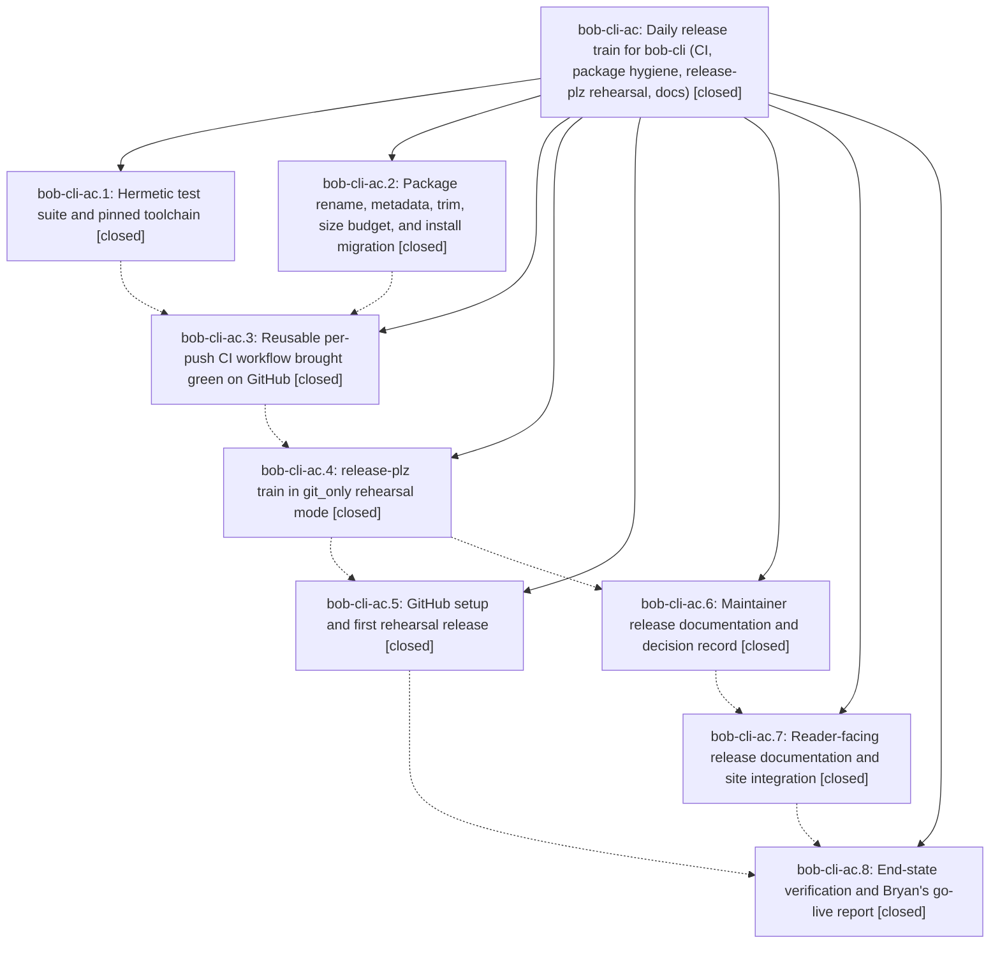

# Bead: bob-cli-ac — Daily release train for bob-cli (CI, package hygiene, release-plz rehearsal, docs)

[Bead Pages](../README.md) / bob-cli-ac

**Status:** ✓ closed · **Resolution:** done · **Type:** ▸ plan · **Tier:** epic
**Owner:** `bryanbugyi34@gmail.com` · **Created by:** [bbugyi200.apollo.95.w1](https://github.com/bobs-org/bob-cli--agents/blob/main/sessions/bbugyi200.apollo.95.w1.md) · **Assignee:** `bob-cli-ac.land`
**Created:** 2026-10-20 18:36:53 EDT · **Closed:** 2026-10-21 01:21:30 EDT
**Plan:** [202610/crates\_io\_release\_train.md](https://github.com/bobs-org/bob-cli--plans/blob/main/202610/crates_io_release_train.md)

<!-- sase:links:start -->

## Links

| Relation | Artifact | Why |
| --- | --- | --- |
| implemented-by | [plan:202610/crates_io_release_train.md][1] | derived from the plan's `bead_id:` frontmatter field |
| related | [bead:bob-cli-ah][2] | Release-train epic whose go-live procedure (publish-to-crates-io.md step 7) this task completes |
| related | [bead:bob-cli-ai][3] | Release-train epic that added just package-check and ruled the assets split out of scope |
| related | file:explicit:b9e52f0423806630d894e1d8 | attached via sase artifact create --bead |

_Plus 2 automatic references — see [Referenced By](#referenced-by)._

[1]: https://github.com/bobs-org/bob-cli--plans/blob/main/202610/crates_io_release_train.md
[2]: https://github.com/bobs-org/bob-cli--beads/blob/main/pages/bob-cli-ah/README.md
[3]: https://github.com/bobs-org/bob-cli--beads/blob/main/pages/bob-cli-ai/README.md

<!-- sase:links:end -->

## Description

bob-cli has hermetic per-push CI on Linux and macOS and a renamed, trimmed package under the crates.io size cap. A scheduled release-plz train releases at most once per New York day, only after full CI passes on the exact SHA, and runs in git_only rehearsal mode (tags and GitHub Releases), ready to switch to crates.io. The process is documented on the docs site in the Diátaxis structure, and Bryan gets a report of the manual go-live steps that only he can take.

## Notes

[2026-10-21T04:15:03Z · bob-cli-ac.8--1] Handoff report for the release-train verification phase (bob-cli-ac.8): artifact file:explicit:69aedc409000fc76103efc6e — rehearsal Release 39540723503 created tag/Release v0.2.0 but binaries jobs failed on an invalid `tag:` input; one-line `ref:` fix lands with the phase close; re-dispatch command and go-live steps are in the report.

[2026-10-21T04:34:45Z · bob-cli-ac.land] LAND TRIAGE (bob-cli-ac.land) of bob-cli-ac.8 PROPOSED FOLLOW-UPs. #1 (re-dispatch with override_reason to attach v0.2.0 binaries): declined as a task. It is epic work, because the binaries path is still broken (see the DISCOVERED ISSUE note), and it moves into the lander's remaining-work tale. #2 (post-go-live install-docs switch): filed as bob-cli-ah (feature, small), snoozed 14d until after Bryan's manual first crates.io publish. #3 (assets split): filed as bob-cli-ai (feature, large), reframed: the trigger is package-check's 8 MiB crate-size warning (crate is ~7.79 MiB), not GitHub Release archive limits. Integration: bob-cli-9z (clean-runner test failures) closed as superseded by bob-cli-ac.1 (9a0fb957). The only non-epic commit since the epic started, 062fc3da (bob-cli-ab.2 capture-related draft JSON), needs no change: CI is green on master including it, and its fixtures are excluded from the package. Linked chezmoi and bob-mac-capture checkouts contain no install command that names the bob-cli package.

[2026-10-21T04:34:51Z · bob-cli-ac.land] DISCOVERED ISSUE (bob-cli-ac.land): the release binaries path is still broken after 1257c2e8, and v0.2.0 has 0 assets. (1) taiki-e/upload-rust-binary-action v1.30.2 main.sh:169-170 bails 'when multiple binary names are specified, default archive name or $bin variable cannot be used'. release.yml passes four bins with the default archive $bin-$target, so every binaries leg fails even with the ref: fix. (2) Cargo.toml [package.metadata.binstall] pkg-url uses { bin }, but cargo-binstall's pkg-url context (binstalk-fetchers gh_crate_meta.rs Context::get_value) has no bin key, so the URL never renders. (3) The binaries job checks out the planned pre-bump SHA, while release-plz tags the bump commit, so a v0.2.1 archive would report bob 0.2.0. (4) The publish step derives tag from Cargo.toml instead of the release-plz JSON ({"releases":[...]} in run 39540723503). On a GO day with nothing to release it reports a fake release and re-runs binaries against the previous tag with gh release upload --clobber. (5) There is no recovery path to rebuild binaries for an existing tag, which v0.2.0 needs now. (6) inputs.override_reason is interpolated straight into the guard's bash run, so a reason containing backticks or $( ) is executed. Tomorrow's 08:17 UTC slot (2026-10-22) would hit 1/3/4. Today's slots skip on the same-day ceiling.

[2026-10-21T05:21:11Z · bob-cli-ac.land] Handoff report v2: file:explicit:b9e52f0423806630d894e1d8. It supersedes v1 file:explicit:69aedc409000fc76103efc6e. v0.2.0 archives are attached; do not re-dispatch with override_reason for that tag.

[2026-10-21T05:21:30Z · bob-cli-ac.land] Verified all 8 phases closed with notes addressed and DECISIONS honored. crate_name: package bob-obsidian, lib bob_cli, version 0.2.0, include trimmed (~7.79 MiB). github_apply: release environment, rulesets 25521281/25521282, RELEASES_PAUSED=false. hotfix_override: input implemented. binaries: job and binstall metadata. memory: decisions:bob-cli-releases-ride-a-daily-train. Epic commits 9a0fb957 eabd2915 1d1b8fec 104cee99 fc6ffdc3 8789c12d ea7f5f0b 1257c2e8 plus this landing fix. CI green on master. Tag/Release v0.2.0 created by train run 39540723503. Landing fixed the binaries path: literal bob-$target archive, build from the release tag, tag from release-plz JSON, pipefail, binstall pkg-url without { bin }, override_reason via env, binaries_tag retry through release-binaries.yml. Archives attached to v0.2.0 (run 39548216595); same-day SKIP verified (run 39546680591); scratch dry run green (run 39546834145). Integration: 062fc3da needed no change; bob-cli-9z closed superseded by bob-cli-ac.1; chezmoi and bob-mac-capture have no stale bob-cli install commands. Follow-ups: .8 #1 folded into this landing, #2 -> bob-cli-ah (snoozed), #3 -> bob-cli-ai. Handoff report v2: file:explicit:b9e52f0423806630d894e1d8.

## Phases

| Bead | Title | Status | Size | Created | Agents | Commits |
|---|---|---|---|---|---:|---:|
| [bob-cli-ac.1](bob-cli-ac.1.md) | Hermetic test suite and pinned toolchain | ✓ closed | small | 2026-10-20 | 1 | 1 |
| [bob-cli-ac.2](bob-cli-ac.2.md) | Package rename, metadata, trim, size budget, and install migration | ✓ closed | medium | 2026-10-20 | 1 | 1 |
| [bob-cli-ac.3](bob-cli-ac.3.md) | Reusable per-push CI workflow brought green on GitHub | ✓ closed | medium | 2026-10-20 | 1 | 1 |
| [bob-cli-ac.4](bob-cli-ac.4.md) | release-plz train in git\_only rehearsal mode | ✓ closed | medium | 2026-10-20 | 1 | 1 |
| [bob-cli-ac.5](bob-cli-ac.5.md) | GitHub setup and first rehearsal release | ✓ closed | small | 2026-10-20 | 1 | 1 |
| [bob-cli-ac.6](bob-cli-ac.6.md) | Maintainer release documentation and decision record | ✓ closed | medium | 2026-10-20 | 1 | 1 |
| [bob-cli-ac.7](bob-cli-ac.7.md) | Reader-facing release documentation and site integration | ✓ closed | medium | 2026-10-20 | 1 | 1 |
| [bob-cli-ac.8](bob-cli-ac.8.md) | End-state verification and Bryan's go-live report | ✓ closed | small | 2026-10-20 | 1 | 1 |

## Lineage

## Agents

| Agent | Bead | Commits |
|---|---|---:|
| [bbugyi200.apollo.bob-cli-ac.1](https://github.com/bobs-org/bob-cli--agents/blob/main/agents/bbugyi200.apollo.bob-cli-ac.1/README.md) | [bob-cli-ac.1](bob-cli-ac.1.md) | 1 |
| [bbugyi200.apollo.bob-cli-ac.2](https://github.com/bobs-org/bob-cli--agents/blob/main/sessions/bbugyi200.apollo.bob-cli-ac.2.md) | [bob-cli-ac.2](bob-cli-ac.2.md) | 1 |
| [bbugyi200.apollo.bob-cli-ac.3](https://github.com/bobs-org/bob-cli--agents/blob/main/sessions/bbugyi200.apollo.bob-cli-ac.3.md) | [bob-cli-ac.3](bob-cli-ac.3.md) | 1 |
| [bbugyi200.apollo.bob-cli-ac.4](https://github.com/bobs-org/bob-cli--agents/blob/main/agents/bbugyi200.apollo.bob-cli-ac.4/README.md) | [bob-cli-ac.4](bob-cli-ac.4.md) | 1 |
| [bbugyi200.apollo.bob-cli-ac.5](https://github.com/bobs-org/bob-cli--agents/blob/main/agents/bbugyi200.apollo.bob-cli-ac.5/README.md) | [bob-cli-ac.5](bob-cli-ac.5.md) | 1 |
| [bbugyi200.apollo.bob-cli-ac.6](https://github.com/bobs-org/bob-cli--agents/blob/main/agents/bbugyi200.apollo.bob-cli-ac.6/README.md) | [bob-cli-ac.6](bob-cli-ac.6.md) | 1 |
| [bbugyi200.apollo.bob-cli-ac.7](https://github.com/bobs-org/bob-cli--agents/blob/main/agents/bbugyi200.apollo.bob-cli-ac.7/README.md) | [bob-cli-ac.7](bob-cli-ac.7.md) | 1 |
| [bbugyi200.apollo.bob-cli-ac.8](https://github.com/bobs-org/bob-cli--agents/blob/main/sessions/bbugyi200.apollo.bob-cli-ac.8.md) | [bob-cli-ac.8](bob-cli-ac.8.md) | 1 |
| [bbugyi200.apollo.bob-cli-ac.land](https://github.com/bobs-org/bob-cli--agents/blob/main/sessions/bbugyi200.apollo.bob-cli-ac.land.md) | [bob-cli-ac](README.md) | 1 |

## Commits

| Repo | Commit | Subject | Bead | Committed |
|---|---|---|---|---|
| bob-cli | [`9a0fb95`](https://github.com/bobs-org/bob-cli/commit/9a0fb957a810b314d8a9ef11ca67d95632651f48) | build: pin Rust toolchain and hermeticize tests | [bob-cli-ac.1](bob-cli-ac.1.md) | 2026-10-20 19:17:21 EDT |
| bob-cli | [`eabd291`](https://github.com/bobs-org/bob-cli/commit/eabd291506814b5b8591c7dd211201b455e73ef5) | feat(package): prepare bob-obsidian 0.2.0 release package | [bob-cli-ac.2](bob-cli-ac.2.md) | 2026-10-20 19:23:49 EDT |
| bob-cli | [`1d1b8fe`](https://github.com/bobs-org/bob-cli/commit/1d1b8fec66676da163cee0180f58985f83cb99eb) | ci: add GitHub Actions workflow and fix macOS test portability | [bob-cli-ac.3](bob-cli-ac.3.md) | 2026-10-20 22:28:14 EDT |
| bob-cli | [`104cee9`](https://github.com/bobs-org/bob-cli/commit/104cee99cdbc8471e854b2c610413f5b941185d8) | feat(train): release-plz rehearsal train with daily guard | [bob-cli-ac.4](bob-cli-ac.4.md) | 2026-10-20 22:55:29 EDT |
| bob-cli | [`fc6ffdc`](https://github.com/bobs-org/bob-cli/commit/fc6ffdc3324d671833fa63000fa3287ef636a771) | docs(release): document the bob-cli release train | [bob-cli-ac.6](bob-cli-ac.6.md) | 2026-10-20 23:18:35 EDT |
| bob-cli | [`8789c12`](https://github.com/bobs-org/bob-cli/commit/8789c12dafcd189ddccb375ab0c79fe880c4aef2) | docs(release): add versions reference and tagged-install guide | [bob-cli-ac.7](bob-cli-ac.7.md) | 2026-10-20 23:42:14 EDT |
| bob-cli | [`ea7f5f0`](https://github.com/bobs-org/bob-cli/commit/ea7f5f0b7aaa371c98dd6d3ea368edb4d583d808) | fix(release): authenticate the train guard's GitHub Release lookup | [bob-cli-ac.5](bob-cli-ac.5.md) | 2026-10-20 23:43:35 EDT |
| bob-cli | [`1257c2e`](https://github.com/bobs-org/bob-cli/commit/1257c2e8d90cfaec4e8d6ad14edc457637685dac) | ci(release): upload binaries via ref instead of unsupported tag input | [bob-cli-ac.8](bob-cli-ac.8.md) | 2026-10-21 00:18:44 EDT |
| bob-cli | [`5d212ef`](https://github.com/bobs-org/bob-cli/commit/5d212ef964b862fb9675dbe76dbd9281b87bf77d) | ci(release): fix archive names and recover v0.2.0 binaries | [bob-cli-ac](README.md) | 2026-10-21 01:23:23 EDT |

<!-- sase:referenced-by:start -->

## Referenced By

| Relation | Artifact | Why | Uses |
| --- | --- | --- | ---: |
| read-by | [agent:bob-cli-ac.1][1] | Need epic decisions and phase notes to implement hermetic test scope | 1 |
| read-by | [agent:bob-cli-ac.6][2] | Identify the CI, train, and GitHub implementation phase beads whose notes ground the docs | 1 |

[1]: https://github.com/bobs-org/bob-cli--agents/blob/main/agents/bbugyi200.apollo.bob-cli-ac.1/README.md
[2]: https://github.com/bobs-org/bob-cli--agents/blob/main/agents/bbugyi200.apollo.bob-cli-ac.6/README.md

<!-- sase:referenced-by:end -->
