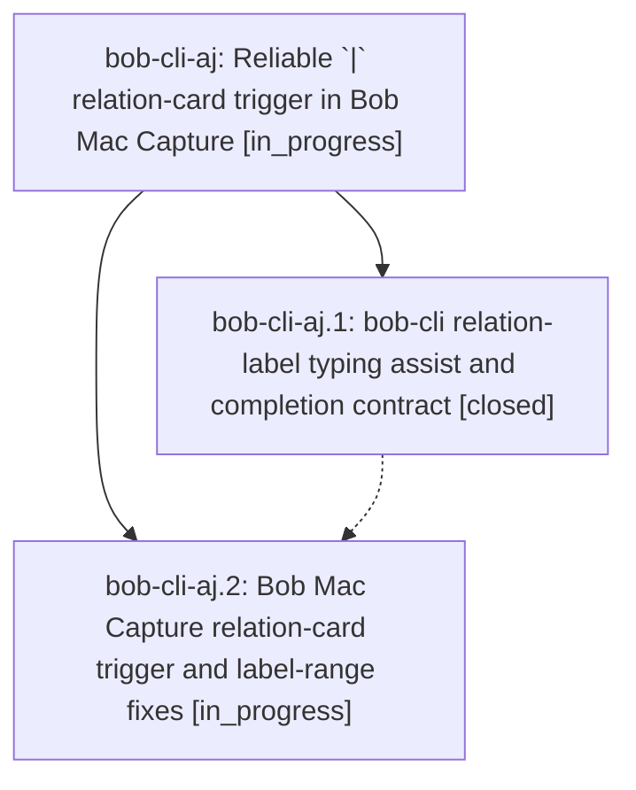

# Bead: bob-cli-aj — Reliable \`\|\` relation-card trigger in Bob Mac Capture

[Bead Pages](../README.md) / bob-cli-aj

**Status:** ◐ in_progress · **Type:** ▸ plan · **Tier:** epic
**Owner:** `bryanbugyi34@gmail.com` · **Created by:** [bbugyi200.athena.12t](https://github.com/bobs-org/bob-cli--agents/blob/main/sessions/bbugyi200.athena.12t.md) · **Assignee:** `bob-cli-aj.land`
**Created:** 2026-10-21 08:01:49 EDT
**Plan:** [202610/relation\_pipe\_card.md](https://github.com/bobs-org/bob-cli--plans/blob/main/202610/relation_pipe_card.md)

## Description

Typing `|` after a `~note:id` / `~~note:id` relation token in Bob Mac Capture always opens the relation card, with or without a space before the `|`. The card shows the correct direction, and committing a label never deletes text after the token.

## Phases

| Bead | Title | Status | Size | Created | Agents | Commits |
|---|---|---|---|---|---:|---:|
| [bob-cli-aj.1](bob-cli-aj.1.md) | bob-cli relation-label typing assist and completion contract | ✓ closed | medium | 2026-10-21 | 1 | 1 |
| [bob-cli-aj.2](bob-cli-aj.2.md) | Bob Mac Capture relation-card trigger and label-range fixes | ◐ in_progress | medium | 2026-10-21 | 1 | 0 |

## Lineage

## Agents

| Agent | Bead | Commits |
|---|---|---:|
| [bbugyi200.athena.bob-cli-aj.1](https://github.com/bobs-org/bob-cli--agents/blob/main/agents/bbugyi200.athena.bob-cli-aj.1/README.md) | [bob-cli-aj.1](bob-cli-aj.1.md) | 1 |
| [bbugyi200.athena.bob-cli-aj.2](https://github.com/bobs-org/bob-cli--agents/blob/main/agents/bbugyi200.athena.bob-cli-aj.2/README.md) | [bob-cli-aj.2](bob-cli-aj.2.md) | 0 |
| [bbugyi200.athena.bob-cli-aj.land](https://github.com/bobs-org/bob-cli--agents/blob/main/agents/bbugyi200.athena.bob-cli-aj.land/README.md) | [bob-cli-aj](README.md) | 0 |

## Commits

| Repo | Commit | Subject | Bead | Committed |
|---|---|---|---|---|
| bob-cli | [`bcc201f`](https://github.com/bobs-org/bob-cli/commit/bcc201feebc262f2b4f16569e959bd03cedecce4) | feat(capture): attach relation labels on typed pipe and expose relation in completions | [bob-cli-aj.1](bob-cli-aj.1.md) | 2026-10-21 08:28:52 EDT |
