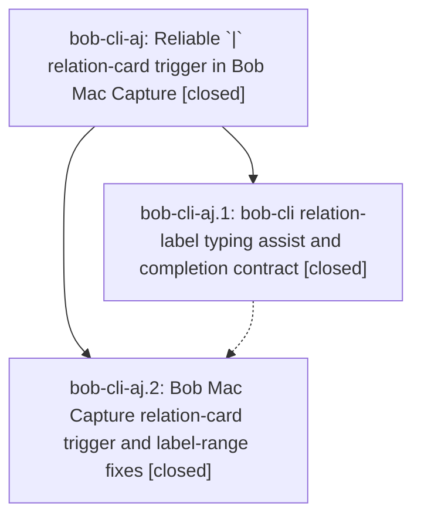

# Bead: bob-cli-aj — Reliable \`\|\` relation-card trigger in Bob Mac Capture

[Bead Pages](../README.md) / bob-cli-aj

**Status:** ✓ closed · **Resolution:** done · **Type:** ▸ plan · **Tier:** epic
**Owner:** `bryanbugyi34@gmail.com` · **Created by:** [bbugyi200.athena.12t](https://github.com/bobs-org/bob-cli--agents/blob/main/sessions/bbugyi200.athena.12t.md) · **Assignee:** `bob-cli-aj.land`
**Created:** 2026-10-21 08:01:49 EDT · **Closed:** 2026-10-21 10:28:13 EDT
**Plan:** [202610/relation\_pipe\_card.md](https://github.com/bobs-org/bob-cli--plans/blob/main/202610/relation_pipe_card.md)

<!-- sase:links:start -->

## Links

| Relation | Artifact | Why |
| --- | --- | --- |
| implemented-by | [plan:202610/relation_pipe_card.md][1] | derived from the plan's `bead_id:` frontmatter field |
| related | [bead:bob-cli-al][2] | Found during aj landing; same relation-card file, separate pre-existing suggestion race |

_Plus 1 automatic references — see [Referenced By](#referenced-by)._

[1]: https://github.com/bobs-org/bob-cli--plans/blob/main/202610/relation_pipe_card.md
[2]: https://github.com/bobs-org/bob-cli--beads/blob/main/pages/bob-cli-al/README.md

<!-- sase:links:end -->

## Description

Typing `|` after a `~note:id` / `~~note:id` relation token in Bob Mac Capture always opens the relation card, with or without a space before the `|`. The card shows the correct direction, and committing a label never deletes text after the token.

## Notes

[2026-10-21T13:12:47Z · research.29.final] DISCOVERED ISSUE: (corroboration from research.29 lead, undirected task relations research) The data-loss case this epic targets is reproducible at the Bob level. A read-only probe 'bob capture-complete -f json --cursor 49' on the leading-run draft '~sase:ref-athena-apollo-operational-log-audit|"see Fix it' (installed bob built after bcc201fe) returned context relation_label, replacement range {start:45,end:57} covering through the end of the draft, and typed candidate '|see'. Meanwhile CapturePanelModel.insertRelationLabelReplacement (bob-mac-capture bf30f9e, :6695-6702) replaces token end through draft end, and the label probe splices '|"typed' before the tail (:6740-6754). Accepting a label for '~sase:x Fix it' would therefore drop ' Fix it'. Please cover leading-run tokens and a modifier after the token ('Fix it ~a:b &c:d') in aj.2's tests. Details: research:202610/undirected_task_relations/undirected_task_relations__final.md section 8.

[2026-10-21T13:59:01Z · bob-cli-aj.land] LAND FOLLOW-UP TRIAGE: Read both children and every note; neither bob-cli-aj.1 nor bob-cli-aj.2 contains a PROPOSED FOLLOW-UP entry. Epic note #1 remains a required regression-coverage obligation: leading-run and trailing-dependency cases are absent from the Mac tests, so they stay epic work in the landing tale rather than a task. Land-discovered pre-existing stale suggestion race was independently reproduced with extracted Swift update/submit methods (authored=new; committed=|old), traced by blame to a85b1f86 from closed bob-cli-a2, and triaged with sase_new_task: no duplicate in bug/all-type searches or weekly sweeps, no active causally related epic; created small ready task bob-cli-al with artifact file:explicit:dd078a92f55551184b77dfc7 and related links. No other proposals to file or decline.

[2026-10-21T14:02:02Z · bob-cli-aj.land] LAND AUDIT / REMAINING WORK: Reviewed epic note #1, all notes on closed aj.1/aj.2, approved plan and DECISIONS, bob-cli bcc201fe and Mac bf40f48, and current implementations. The empty_label_drops_pipe=yes branch, Rust grammar-owned attach rule/additive metadata, native rewrite/completion path, exact labelRange commit, and older-Bob fallback are implemented. Fresh cargo build --bin bob passed; isolated-vault probes with that binary confirm narrow original ranges and owner for leading tokens and dependency tails. However, aj.2 omits note #1 leading-run/dependency-tail regressions and quoted-note Mac coverage. Its mid-draft typeSeparator helper reports end-of-draft instead of the actual caret; fake-bob masks that by ignoring cursor, returning relation_label at cursor 29 where real Bob returns route. Its empty-query fixtures also contain an impossible typed follow candidate and mask async suggestion settling. These acceptance gaps remain epic work; validated medium tale sase_plan_relation_pipe_card_closeout.md repairs only the helper/fixtures/regressions, runs just check plus required Mac compilation, and owns this epic closeout in the coding turn without waiting for its own commit or CI. No just check-full was run. Integration: fetched both origins; bob-cli 8a4936f4/6e34d507 touch only unrelated glyph/recurrence docs; Mac bf30f9e touches Refs Tabs reset and a separate keyboard-doc row, already incorporated by bf40f48; no newer incoming commits or feature integration conflict found. epic-symbols is empty; neither justfile has symvision. No parent_bead. Follow-up dispositions are in the preceding triage note (bob-cli-al only). Keep epic and original plan open until the tale finishes.

[2026-10-21T14:28:13Z · bob-cli-aj.land] Verified both phase implementations and all notes, final empty-label decision, truthful cursor/fixture contract and leading/quoted/dependency-tail regressions; reviewed and integrated post-start drift. Checks: bob-cli just check exit 0; Mac just portable-check exit 0 (1526 tests); Mac Scripts/bundle.sh BUNDLE_EXIT=0 (build complete); Mac just typecheck-tests TYPECHECK_EXIT=0 (PASS BobMacCaptureTests/CaptureCoreTests via stub, type-check only — CLT Mac cannot execute XCTest, no Xcode host, CI runs tests). Drift: no new commits since audit heads bob-cli 6e34d507 / mac bf40f48. No child follow-up proposals; pre-existing suggestion race is bob-cli-al. All epic-symbol entries retired (none; no symvision recipe).

## Phases

| Bead | Title | Status | Size | Created | Agents | Commits |
|---|---|---|---|---|---:|---:|
| [bob-cli-aj.1](bob-cli-aj.1.md) | bob-cli relation-label typing assist and completion contract | ✓ closed | medium | 2026-10-21 | 1 | 1 |
| [bob-cli-aj.2](bob-cli-aj.2.md) | Bob Mac Capture relation-card trigger and label-range fixes | ✓ closed | medium | 2026-10-21 | 1 | 1 |

## Lineage

## Agents

| Agent | Bead | Commits |
|---|---|---:|
| [bbugyi200.athena.bob-cli-aj.1](https://github.com/bobs-org/bob-cli--agents/blob/main/agents/bbugyi200.athena.bob-cli-aj.1/README.md) | [bob-cli-aj.1](bob-cli-aj.1.md) | 1 |
| [bbugyi200.athena.bob-cli-aj.2](https://github.com/bobs-org/bob-cli--agents/blob/main/sessions/bbugyi200.athena.bob-cli-aj.2.md) | [bob-cli-aj.2](bob-cli-aj.2.md) | 1 |
| [bbugyi200.athena.bob-cli-aj.land](https://github.com/bobs-org/bob-cli--agents/blob/main/sessions/bbugyi200.athena.bob-cli-aj.land.md) | [bob-cli-aj](README.md) | 2 |

## Commits

| Repo | Commit | Subject | Bead | Committed |
|---|---|---|---|---|
| bob-cli | [`bcc201f`](https://github.com/bobs-org/bob-cli/commit/bcc201feebc262f2b4f16569e959bd03cedecce4) | feat(capture): attach relation labels on typed pipe and expose relation in completions | [bob-cli-aj.1](bob-cli-aj.1.md) | 2026-10-21 08:28:52 EDT |
| bob-mac-capture | [`bob-mac-capture@bf40f48`](https://github.com/bobs-org/bob-mac-capture/commit/bf40f48c465378ad175fdc8817f6a95f8c0f54da) | feat(capture): open relation label cards from typed pipe | [bob-cli-aj.2](bob-cli-aj.2.md) | 2026-10-21 09:46:45 EDT |
| bob-cli | [`8bcc3e2`](https://github.com/bobs-org/bob-cli/commit/8bcc3e2b6d1512bb1b526729591a9356f8fe6737) | test(capture-complete): cover leading and dependency-tail relation-label ranges | [bob-cli-aj](README.md) | 2026-10-21 10:30:12 EDT |
| bob-mac-capture | [`bob-mac-capture@d73d943`](https://github.com/bobs-org/bob-mac-capture/commit/d73d943effd16bf81623981c4119af01c11cf0ce) | fix(capture): truthful relation-card fixtures, caret, and missing-path regressions | [bob-cli-aj](README.md) | 2026-10-21 10:30:55 EDT |

<!-- sase:referenced-by:start -->

## Referenced By

| Relation | Artifact | Why | Uses |
| --- | --- | --- | ---: |
| read-by | [agent:research.29.final][1] | Check whether the relation-card truncation bug falls in this epic's scope | 1 |

[1]: https://github.com/bobs-org/bob-cli--agents/blob/main/agents/bbugyi200.athena.research.29.final/README.md

<!-- sase:referenced-by:end -->
