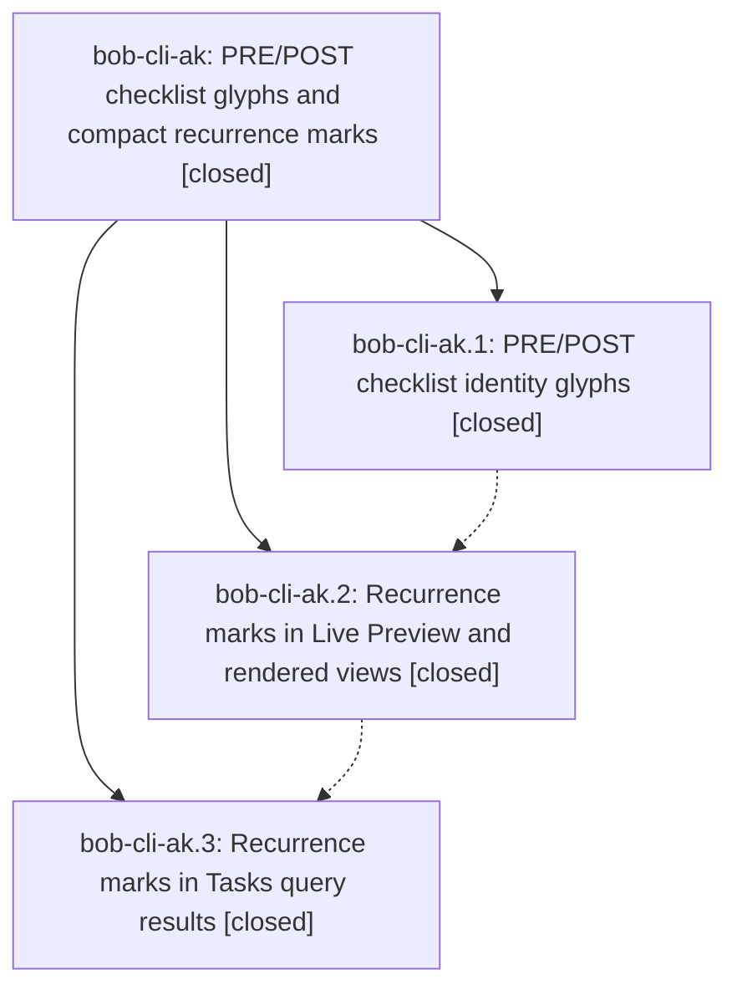

# Bead: bob-cli-ak — PRE/POST checklist glyphs and compact recurrence marks

[Bead Pages](../README.md) / bob-cli-ak

**Status:** ✓ closed · **Resolution:** done · **Type:** ▸ plan · **Tier:** epic
**Owner:** `bryanbugyi34@gmail.com` · **Created by:** [bbugyi200.apollo.research.28.linker.w0](https://github.com/bobs-org/bob-cli--agents/blob/main/sessions/bbugyi200.apollo.research.28.linker.w0.md) · **Assignee:** `bob-cli-ak.land`
**Created:** 2026-10-21 08:49:59 EDT · **Closed:** 2026-10-21 10:53:26 EDT
**Plan:** [202610/gtd\_checklist\_glyphs\_and\_recurrence\_marks.md](https://github.com/bobs-org/bob-cli--plans/blob/main/202610/gtd_checklist_glyphs_and_recurrence_marks.md)

<!-- sase:links:start -->

## Links

| Relation | Artifact | Why |
| --- | --- | --- |
| implemented-by | [plan:202610/gtd_checklist_glyphs_and_recurrence_marks.md][1] | derived from the plan's `bead_id:` frontmatter field |
| related | file:explicit:17290fc9a7bd57a9561ab5c3 | attached via sase artifact create --bead |
| related | file:explicit:ae784b01fc84d2cbb42ff449 | attached via sase artifact create --bead |
| related | file:explicit:d5d1a0b22b67564637f53139 | attached via sase artifact create --bead |

_Plus 2 automatic references — see [Referenced By](#referenced-by)._

[1]: https://github.com/bobs-org/bob-cli--plans/blob/main/202610/gtd_checklist_glyphs_and_recurrence_marks.md

<!-- sase:links:end -->

## Description

In Obsidian, a canonical `#task #gtd #pre` / `#task #gtd #post` run renders as one teal sunrise / flag identity glyph, and every readable `[repeat:: …]` rule renders as a quiet loop glyph plus a spoken cadence (`daily`, `Mondays`, `monthly · 1st`). This works in Live Preview, reading view, and Tasks query results. Nothing changes in storage, and anything uncertain keeps its honest pill.

## Notes

[2026-10-21T14:37:50Z · bob-cli-ak.land] LAND FOLLOW-UP TRIAGE: Used sase_new_task, searched task reports, swept the last week of tasks, and inspected active epic scopes. Every PROPOSED FOLLOW-UP entry was reviewed: ak.1 note 1 and ak.2 note 1 and ak.3 note 1 propose the same four unblocked-glyph cases, Keep notice failure, and reverse-project conversion defect; ak.1 note 1 and ak.3 note 1 also propose the stage-ranker flake. Independently reproduced the six deterministic failures in npm test at clean bob-plugins 3e014b9 and corroborated bob-cli-6v (+1), bob-cli-6w (+1), and bob-cli-7i (+1). The same run missed the 16ms ranker budget at 16.92ms; unchanged isolated suite passed 23/23, corroborated bob-cli-3w (+1). Evidence file:explicit:d5d1a0b22b67564637f53139. Declined new task creation for every proposal because these exact underlying failures already have active reports, with no causal link to a currently active epic. Their origins predate ak; do not expand the recurrence repair to fix them. All proposal outcomes must be carried into the eventual close note.

[2026-10-21T14:37:58Z · bob-cli-ak.land] LAND VERIFIED / INTEGRATION: Read this epic and all three children, every child note, and the linked approved plan. Reviewed bob-plugins implementation commits 328d212/f98f97e/3e014b9, source fragments, CSS and tests; reviewed CLI documentation commits 8a4936f4/6e34d507/8e81f3cc. Confirmed when_done_label=no, Today placement, unchanged dates-only API, native fallback and toggle wiring. Six focused mark/Today suites pass 169/169 (file:explicit:ae784b01fc84d2cbb42ff449). Verified b9507dc1 in audited gh:bobs-org/bob checkout is exactly the blocked.md hide recurrence rule addition and it remains present. Fetched origin/master: the only unrelated CLI commit after epic work began is 8bcc3e2b, a capture relation-label range test; reviewed and fast-forwarded it, no mark integration needed. Earlier plan-baseline drift bcc201fe is likewise capture-only; no unrelated plugin commit landed since the first epic commit. Epic has no parent and epic-symbols is empty. No just check-full was run. Final just check belongs after the repair edits.

[2026-10-21T14:38:03Z · bob-cli-ak.land] DISCOVERED ISSUE / REMAINING LANDING WORK: Three defects introduced in f98f97e remain epic work, reproduced at bob-plugins 3e014b9 while the existing recurrence suite passes 21/21 (file:explicit:17290fc9a7bd57a9561ab5c3). recurrenceMarkRenderedGuard explicitly returns false when li === root; passing the open PRE li itself to renderDateMarksIn renders one repeat mark for every day without when done, whereas a wrapper root correctly keeps the pill. recurrenceWeekdayEntry/recurrenceMonthAbbrev trust inherited dictionary properties: recurrenceMarkLabel("every constructor") returns undefineds instead of verbatim fallback. Canonical field validation collapses whitespace before enforcing the Tasks charset: [repeat:: every<TAB>day] is incorrectly accepted as every day despite the padding/charset contract. A validated small tale, sase_plan_gtd_recurrence_landing.md, repairs only these defects, extends regression vectors, rebuilds/deploys, runs just check and docs gates, then closes ak normally, checks symvision when available, and marks its original linked plan done in the same turn. The tale owns closeout and must not wait for its own commit, push or CI.

[2026-10-21T14:38:28Z · bob-cli-ak.land] LAND GATES: bob-plugins build:check passed. npm run docs:check passed all implemented gates, including 447 documentation tests with one optional-font dependency skip; its script selected its managed bob-cli cache at 8bcc3e2b. The repair tale explicitly pins BOB_CLI_DIR to the authorized current checkout for subsequent docs verification. No implementation files were changed by this audit. Repair tale validation passes with zero warnings. Epic stays open pending the three reproduced recurrence repairs and the tale-owned normal closeout.

[2026-10-21T14:53:26Z · bob-cli-ak.land] Closed after repairing recurrence root-li guards, inherited-name cadence fallback, and raw tab/NBSP rejection in rendered and Tasks rule paths. Re-read completed phases ak.1/ak.2/ak.3, all notes, approved plan, and reviewed their implementation commits 328d212/f98f97e/3e014b9 plus CLI docs commits 8a4936f4/6e34d507/8e81f3cc; newer drift was capture-only, no plugin drift, vault blocked.md line remains, no parent, and epic-symbols is empty. Kept when_done_label=no, display-only behavior, toggles, and dates-only api.dateMarks v1. Focused mark suites pass 170/170; npm build/build:check and docs:check pass (447 docs tests, one optional-font skip); just docs-gen/docs-check and just check pass. Full npm test has only the seven already-triaged baseline failures: bob-cli-6v four glyph cases, bob-cli-6w Keep notice, bob-cli-7i reverse-project conversion, bob-cli-3w ranker timing (18.73ms under full load; 23/23 isolated); independent corroboration was recorded as +1 on each, with no replacement tasks or scope expansion. Deployed bob-ledger-tools 1.63.1; vault manifest verified and dry-run reports zero copies.

## Phases

| Bead | Title | Status | Size | Created | Agents | Commits |
|---|---|---|---|---|---:|---:|
| [bob-cli-ak.1](bob-cli-ak.1.md) | PRE/POST checklist identity glyphs | ✓ closed | medium | 2026-10-21 | 1 | 2 |
| [bob-cli-ak.2](bob-cli-ak.2.md) | Recurrence marks in Live Preview and rendered views | ✓ closed | medium | 2026-10-21 | 1 | 2 |
| [bob-cli-ak.3](bob-cli-ak.3.md) | Recurrence marks in Tasks query results | ✓ closed | small | 2026-10-21 | 1 | 2 |

## Lineage

## Agents

| Agent | Bead | Commits |
|---|---|---:|
| [bbugyi200.apollo.bob-cli-ak.1](https://github.com/bobs-org/bob-cli--agents/blob/main/sessions/bbugyi200.apollo.bob-cli-ak.1.md) | [bob-cli-ak.1](bob-cli-ak.1.md) | 2 |
| [bbugyi200.apollo.bob-cli-ak.2](https://github.com/bobs-org/bob-cli--agents/blob/main/agents/bbugyi200.apollo.bob-cli-ak.2/README.md) | [bob-cli-ak.2](bob-cli-ak.2.md) | 2 |
| [bbugyi200.apollo.bob-cli-ak.3](https://github.com/bobs-org/bob-cli--agents/blob/main/sessions/bbugyi200.apollo.bob-cli-ak.3.md) | [bob-cli-ak.3](bob-cli-ak.3.md) | 2 |
| [bbugyi200.apollo.bob-cli-ak.land](https://github.com/bobs-org/bob-cli--agents/blob/main/sessions/bbugyi200.apollo.bob-cli-ak.land.md) | [bob-cli-ak](README.md) | 1 |

## Commits

| Repo | Commit | Subject | Bead | Committed |
|---|---|---|---|---|
| bob-cli | [`8a4936f`](https://github.com/bobs-org/bob-cli/commit/8a4936f4879a326034aae934c392c6e332d3c067) | docs(task-tag-marks): specify PRE and POST glyph behavior | [bob-cli-ak.1](bob-cli-ak.1.md) | 2026-10-21 09:20:29 EDT |
| bob-plugins | [`bob-plugins@328d212`](https://github.com/bobs-org/bob-plugins/commit/328d212f03acb44bd23d5a14bd592c8de7f5bdca) | feat(ledger-tools): add PRE and POST checklist glyphs | [bob-cli-ak.1](bob-cli-ak.1.md) | 2026-10-21 09:21:40 EDT |
| bob-cli | [`6e34d50`](https://github.com/bobs-org/bob-cli/commit/6e34d5076b16e718a1f750fb769cba4bdc1bc5df) | docs(date-marks): specify recurrence-mark display contract and vault repeat row | [bob-cli-ak.2](bob-cli-ak.2.md) | 2026-10-21 09:50:08 EDT |
| bob-plugins | [`bob-plugins@f98f97e`](https://github.com/bobs-org/bob-plugins/commit/f98f97eeff030dcae9f66eb9e0b582631b1f9897) | feat(ledger-tools): render recurrence marks in Live Preview and rendered views | [bob-cli-ak.2](bob-cli-ak.2.md) | 2026-10-21 09:51:11 EDT |
| bob-cli | [`8e81f3c`](https://github.com/bobs-org/bob-cli/commit/8e81f3ccd61f20cd35ac9ed569f1ba4c474dac36) | docs(date-marks): specify Tasks recurrence-mark host, guard, and RT vectors | [bob-cli-ak.3](bob-cli-ak.3.md) | 2026-10-21 10:23:14 EDT |
| bob-plugins | [`bob-plugins@3e014b9`](https://github.com/bobs-org/bob-plugins/commit/3e014b9942f3de917c671a0f5b927f32927b4d84) | feat(ledger-tools): render recurrence marks in Tasks query results | [bob-cli-ak.3](bob-cli-ak.3.md) | 2026-10-21 10:24:21 EDT |
| bob-cli | [`55470e6`](https://github.com/bobs-org/bob-cli/commit/55470e65cd25db0880253ebdffc1238c1a19959a) | docs(date-marks): clarify recurrence validation vectors | [bob-cli-ak](README.md) | 2026-10-21 10:54:58 EDT |

<!-- sase:referenced-by:start -->

## Referenced By

| Relation | Artifact | Why | Uses |
| --- | --- | --- | ---: |
| read-by | [agent:bob-cli-ak.1--1][1] | Need epic decisions and prior phase notes before closing | 1 |
| read-by | [agent:bob-cli-ak.2][2] | parent epic scope | 1 |

[1]: https://github.com/bobs-org/bob-cli--agents/blob/main/sessions/bbugyi200.apollo.bob-cli-ak.1.md
[2]: https://github.com/bobs-org/bob-cli--agents/blob/main/agents/bbugyi200.apollo.bob-cli-ak.2/README.md

<!-- sase:referenced-by:end -->
