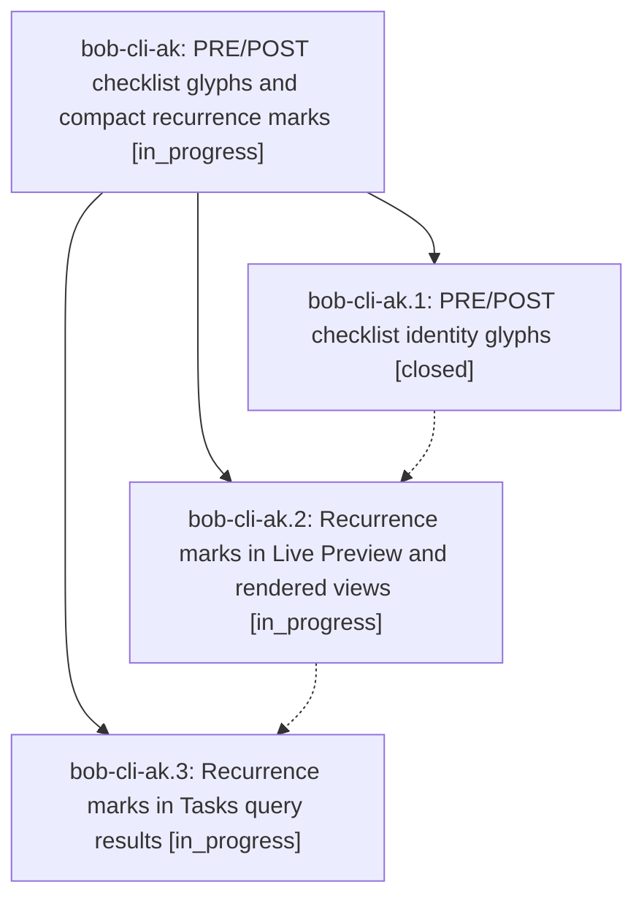

# Bead: bob-cli-ak — PRE/POST checklist glyphs and compact recurrence marks

[Bead Pages](../README.md) / bob-cli-ak

**Status:** ◐ in_progress · **Type:** ▸ plan · **Tier:** epic
**Owner:** `bryanbugyi34@gmail.com` · **Created by:** [bbugyi200.apollo.research.28.linker.w0](https://github.com/bobs-org/bob-cli--agents/blob/main/sessions/bbugyi200.apollo.research.28.linker.w0.md) · **Assignee:** `bob-cli-ak.land`
**Created:** 2026-10-21 08:49:59 EDT
**Plan:** [202610/gtd\_checklist\_glyphs\_and\_recurrence\_marks.md](https://github.com/bobs-org/bob-cli--plans/blob/main/202610/gtd_checklist_glyphs_and_recurrence_marks.md)

<!-- sase:links:start -->

## Links

| Relation | Artifact | Why |
| --- | --- | --- |
| implemented-by | [plan:202610/gtd_checklist_glyphs_and_recurrence_marks.md][1] | derived from the plan's `bead_id:` frontmatter field |

[1]: https://github.com/bobs-org/bob-cli--plans/blob/main/202610/gtd_checklist_glyphs_and_recurrence_marks.md

<!-- sase:links:end -->

## Description

In Obsidian, a canonical `#task #gtd #pre` / `#task #gtd #post` run renders as one teal sunrise / flag identity glyph, and every readable `[repeat:: …]` rule renders as a quiet loop glyph plus a spoken cadence (`daily`, `Mondays`, `monthly · 1st`). This works in Live Preview, reading view, and Tasks query results. Nothing changes in storage, and anything uncertain keeps its honest pill.

## Phases

| Bead | Title | Status | Size | Created | Agents | Commits |
|---|---|---|---|---|---:|---:|
| [bob-cli-ak.1](bob-cli-ak.1.md) | PRE/POST checklist identity glyphs | ✓ closed | medium | 2026-10-21 | 1 | 1 |
| [bob-cli-ak.2](bob-cli-ak.2.md) | Recurrence marks in Live Preview and rendered views | ◐ in_progress | medium | 2026-10-21 | 1 | 0 |
| [bob-cli-ak.3](bob-cli-ak.3.md) | Recurrence marks in Tasks query results | ◐ in_progress | small | 2026-10-21 | 1 | 0 |

## Lineage

## Agents

| Agent | Bead | Commits |
|---|---|---:|
| [bbugyi200.apollo.bob-cli-ak.1](https://github.com/bobs-org/bob-cli--agents/blob/main/sessions/bbugyi200.apollo.bob-cli-ak.1.md) | [bob-cli-ak.1](bob-cli-ak.1.md) | 1 |
| [bbugyi200.apollo.bob-cli-ak.2](https://github.com/bobs-org/bob-cli--agents/blob/main/agents/bbugyi200.apollo.bob-cli-ak.2/README.md) | [bob-cli-ak.2](bob-cli-ak.2.md) | 0 |
| [bbugyi200.apollo.bob-cli-ak.3](https://github.com/bobs-org/bob-cli--agents/blob/main/agents/bbugyi200.apollo.bob-cli-ak.3/README.md) | [bob-cli-ak.3](bob-cli-ak.3.md) | 0 |
| [bbugyi200.apollo.bob-cli-ak.land](https://github.com/bobs-org/bob-cli--agents/blob/main/agents/bbugyi200.apollo.bob-cli-ak.land/README.md) | [bob-cli-ak](README.md) | 0 |

## Commits

| Repo | Commit | Subject | Bead | Committed |
|---|---|---|---|---|
| bob-cli | [`8a4936f`](https://github.com/bobs-org/bob-cli/commit/8a4936f4879a326034aae934c392c6e332d3c067) | docs(task-tag-marks): specify PRE and POST glyph behavior | [bob-cli-ak.1](bob-cli-ak.1.md) | 2026-10-21 09:20:29 EDT |
