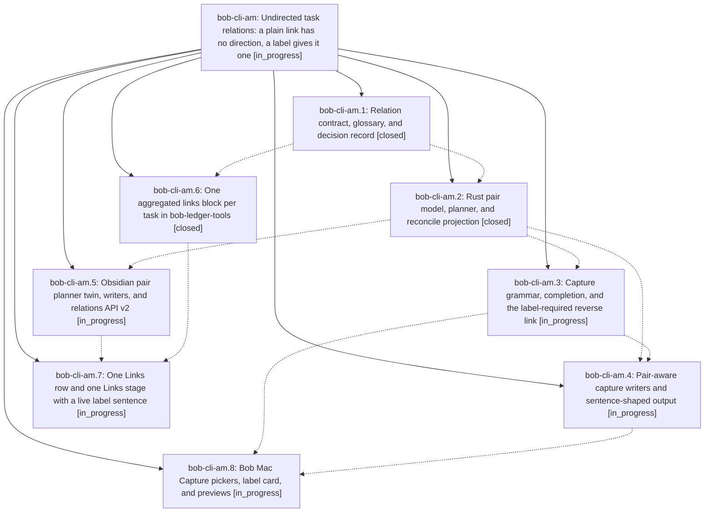

# Bead: bob-cli-am — Undirected task relations: a plain link has no direction, a label gives it one

[Bead Pages](../README.md) / bob-cli-am

**Status:** ◐ in_progress · **Type:** ▸ plan · **Tier:** epic
**Owner:** `bryanbugyi34@gmail.com` · **Created by:** [bbugyi200.apollo.research.29.linker.w0](https://github.com/bobs-org/bob-cli--agents/blob/main/sessions/bbugyi200.apollo.research.29.linker.w0.md) · **Assignee:** `bob-cli-am.land`
**Created:** 2026-10-21 10:08:37 EDT
**Plan:** [202610/undirected\_task\_relations.md](https://github.com/bobs-org/bob-cli--plans/blob/main/202610/undirected_task_relations.md)

<!-- sase:links:start -->

## Links

| Relation | Artifact | Why |
| --- | --- | --- |
| implemented-by | [plan:202610/undirected_task_relations.md][1] | derived from the plan's `bead_id:` frontmatter field |

_Plus 1 automatic references — see [Referenced By](#referenced-by)._

[1]: https://github.com/bobs-org/bob-cli--plans/blob/main/202610/undirected_task_relations.md

<!-- sase:links:end -->

## Description

An unlabelled task relation is one undirected link, shown everywhere as `🪢 links` with no arrow. A labelled relation is a directed statement read from its source. A bare `~~` asks for a label. Every writer, reader, and client (bob-cli, bob-plugins, Bob Mac Capture) applies the same pair rules on the unchanged LINKS / LINKED FROM storage, so a plain re-add never erases a label and a pair is never listed twice.

## Phases

| Bead | Title | Status | Size | Created | Agents | Commits |
|---|---|---|---|---|---:|---:|
| [bob-cli-am.1](bob-cli-am.1.md) | Relation contract, glossary, and decision record | ✓ closed | medium | 2026-10-21 | 1 | 1 |
| [bob-cli-am.2](bob-cli-am.2.md) | Rust pair model, planner, and reconcile projection | ✓ closed | medium | 2026-10-21 | 1 | 1 |
| [bob-cli-am.3](bob-cli-am.3.md) | Capture grammar, completion, and the label-required reverse link | ◐ in_progress | medium | 2026-10-21 | 1 | 0 |
| [bob-cli-am.4](bob-cli-am.4.md) | Pair-aware capture writers and sentence-shaped output | ◐ in_progress | medium | 2026-10-21 | 1 | 0 |
| [bob-cli-am.5](bob-cli-am.5.md) | Obsidian pair planner twin, writers, and relations API v2 | ◐ in_progress | medium | 2026-10-21 | 1 | 0 |
| [bob-cli-am.6](bob-cli-am.6.md) | One aggregated links block per task in bob-ledger-tools | ✓ closed | medium | 2026-10-21 | 1 | 0 |
| [bob-cli-am.7](bob-cli-am.7.md) | One Links row and one Links stage with a live label sentence | ◐ in_progress | medium | 2026-10-21 | 1 | 0 |
| [bob-cli-am.8](bob-cli-am.8.md) | Bob Mac Capture pickers, label card, and previews | ◐ in_progress | medium | 2026-10-21 | 1 | 0 |

## Lineage

## Agents

| Agent | Bead | Commits |
|---|---|---:|
| [bbugyi200.apollo.bob-cli-am.1](https://github.com/bobs-org/bob-cli--agents/blob/main/sessions/bbugyi200.apollo.bob-cli-am.1.md) | [bob-cli-am.1](bob-cli-am.1.md) | 1 |
| [bbugyi200.apollo.bob-cli-am.2](https://github.com/bobs-org/bob-cli--agents/blob/main/agents/bbugyi200.apollo.bob-cli-am.2/README.md) | [bob-cli-am.2](bob-cli-am.2.md) | 1 |
| [bbugyi200.apollo.bob-cli-am.3](https://github.com/bobs-org/bob-cli--agents/blob/main/agents/bbugyi200.apollo.bob-cli-am.3/README.md) | [bob-cli-am.3](bob-cli-am.3.md) | 0 |
| [bbugyi200.apollo.bob-cli-am.4](https://github.com/bobs-org/bob-cli--agents/blob/main/agents/bbugyi200.apollo.bob-cli-am.4/README.md) | [bob-cli-am.4](bob-cli-am.4.md) | 0 |
| [bbugyi200.apollo.bob-cli-am.5](https://github.com/bobs-org/bob-cli--agents/blob/main/agents/bbugyi200.apollo.bob-cli-am.5/README.md) | [bob-cli-am.5](bob-cli-am.5.md) | 0 |
| [bbugyi200.apollo.bob-cli-am.6](https://github.com/bobs-org/bob-cli--agents/blob/main/agents/bbugyi200.apollo.bob-cli-am.6/README.md) | [bob-cli-am.6](bob-cli-am.6.md) | 0 |
| [bbugyi200.apollo.bob-cli-am.7](https://github.com/bobs-org/bob-cli--agents/blob/main/agents/bbugyi200.apollo.bob-cli-am.7/README.md) | [bob-cli-am.7](bob-cli-am.7.md) | 0 |
| [bbugyi200.apollo.bob-cli-am.8](https://github.com/bobs-org/bob-cli--agents/blob/main/agents/bbugyi200.apollo.bob-cli-am.8/README.md) | [bob-cli-am.8](bob-cli-am.8.md) | 0 |
| [bbugyi200.apollo.bob-cli-am.land](https://github.com/bobs-org/bob-cli--agents/blob/main/agents/bbugyi200.apollo.bob-cli-am.land/README.md) | [bob-cli-am](README.md) | 0 |

## Commits

| Repo | Commit | Subject | Bead | Committed |
|---|---|---|---|---|
| bob-cli | [`39e1d48`](https://github.com/bobs-org/bob-cli/commit/39e1d48aa312ce14cc6016abebb83be48a525034) | docs(relations): define pair contract and glossary | [bob-cli-am.1](bob-cli-am.1.md) | 2026-10-21 10:55:36 EDT |
| bob-cli | [`dec8f87`](https://github.com/bobs-org/bob-cli/commit/dec8f8798debaf4ee3c3213559bfed6230abc0ca) | feat(relations): add pair planner, projection, and redundant warnings | [bob-cli-am.2](bob-cli-am.2.md) | 2026-10-21 11:35:25 EDT |

<!-- sase:referenced-by:start -->

## Referenced By

| Relation | Artifact | Why | Uses |
| --- | --- | --- | ---: |
| read-by | [agent:bob-cli-am.6][1] | Need epic scope and design | 2 |

[1]: https://github.com/bobs-org/bob-cli--agents/blob/main/agents/bbugyi200.apollo.bob-cli-am.6/README.md

<!-- sase:referenced-by:end -->
