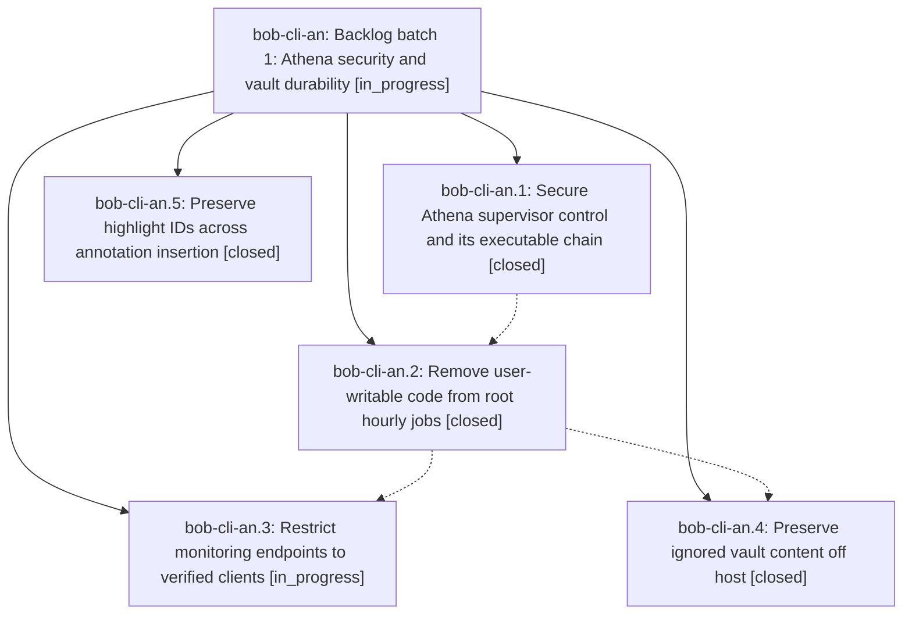

# Bead: bob-cli-an — Backlog batch 1: Athena security and vault durability

[Bead Pages](../README.md) / bob-cli-an

**Status:** ◐ in_progress · **Type:** ▸ plan · **Tier:** epic
**Owner:** `bryanbugyi34@gmail.com` · **Created by:** [bbugyi200.athena.12v](https://github.com/bobs-org/bob-cli--agents/blob/main/sessions/bbugyi200.athena.12v.md) · **Assignee:** `bob-cli-an.land`
**Created:** 2026-10-21 12:58:23 EDT
**Plan:** [202610/backlog\_security\_and\_durability.md](https://github.com/bobs-org/bob-cli--plans/blob/main/202610/backlog_security_and_durability.md)

<!-- sase:links:start -->

## Links

| Relation | Artifact | Why |
| --- | --- | --- |
| implemented-by | [plan:202610/backlog_security_and_durability.md][1] | derived from the plan's `bead_id:` frontmatter field |

_Plus 2 automatic references — see [Referenced By](#referenced-by)._

[1]: https://github.com/bobs-org/bob-cli--plans/blob/main/202610/backlog_security_and_durability.md

<!-- sase:links:end -->

## Description

Close five prioritized task beads by removing Athena privilege-boundary exposures, restricting monitoring access, preserving ignored vault content, and stabilizing annotation identities. The lander continues the backlog through further epics of at most five phases and five task beads until every project task bead is closed.

## Phases

| Bead | Title | Status | Size | Created | Agents | Commits |
|---|---|---|---|---|---:|---:|
| [bob-cli-an.1](bob-cli-an.1.md) | Secure Athena supervisor control and its executable chain | ✓ closed | medium | 2026-10-21 | 1 | 0 |
| [bob-cli-an.2](bob-cli-an.2.md) | Remove user-writable code from root hourly jobs | ✓ closed | medium | 2026-10-21 | 1 | 0 |
| [bob-cli-an.3](bob-cli-an.3.md) | Restrict monitoring endpoints to verified clients | ◐ in_progress | medium | 2026-10-21 | 1 | 0 |
| [bob-cli-an.4](bob-cli-an.4.md) | Preserve ignored vault content off host | ✓ closed | medium | 2026-10-21 | 1 | 1 |
| [bob-cli-an.5](bob-cli-an.5.md) | Preserve highlight IDs across annotation insertion | ✓ closed | medium | 2026-10-21 | 1 | 1 |

## Lineage

## Agents

| Agent | Bead | Commits |
|---|---|---:|
| [bbugyi200.athena.bob-cli-an.1](https://github.com/bobs-org/bob-cli--agents/blob/main/sessions/bbugyi200.athena.bob-cli-an.1.md) | [bob-cli-an.1](bob-cli-an.1.md) | 0 |
| [bbugyi200.athena.bob-cli-an.2](https://github.com/bobs-org/bob-cli--agents/blob/main/sessions/bbugyi200.athena.bob-cli-an.2.md) | [bob-cli-an.2](bob-cli-an.2.md) | 0 |
| [bbugyi200.athena.bob-cli-an.3](https://github.com/bobs-org/bob-cli--agents/blob/main/sessions/bbugyi200.athena.bob-cli-an.3.md) | [bob-cli-an.3](bob-cli-an.3.md) | 0 |
| [bbugyi200.athena.bob-cli-an.4](https://github.com/bobs-org/bob-cli--agents/blob/main/agents/bbugyi200.athena.bob-cli-an.4/README.md) | [bob-cli-an.4](bob-cli-an.4.md) | 1 |
| [bbugyi200.athena.bob-cli-an.5](https://github.com/bobs-org/bob-cli--agents/blob/main/agents/bbugyi200.athena.bob-cli-an.5/README.md) | [bob-cli-an.5](bob-cli-an.5.md) | 1 |
| [bbugyi200.athena.bob-cli-an.land](https://github.com/bobs-org/bob-cli--agents/blob/main/agents/bbugyi200.athena.bob-cli-an.land/README.md) | [bob-cli-an](README.md) | 0 |

## Commits

| Repo | Commit | Subject | Bead | Committed |
|---|---|---|---|---|
| bob-cli | [`51ad4f4`](https://github.com/bobs-org/bob-cli/commit/51ad4f4c77a318519b2039dc1e743ec9c737304f) | feat(highlights-ref): stabilize highlight IDs across sidecar order | [bob-cli-an.5](bob-cli-an.5.md) | 2026-10-21 13:47:57 EDT |
| bob-cli | [`019ffb5`](https://github.com/bobs-org/bob-cli/commit/019ffb5ac4ee1b122fc3a576509acf774a80cf31) | docs(vault-sync): document authored content coverage for vault git backup | [bob-cli-an.4](bob-cli-an.4.md) | 2026-10-22 06:58:44 EDT |

<!-- sase:referenced-by:start -->

## Referenced By

| Relation | Artifact | Why | Uses |
| --- | --- | --- | ---: |
| read-by | [agent:bob-cli-an.1--3][1] | Verify the parent epic remains open after closing its phase | 1 |
| read-by | [agent:bob-cli-an.5][2] | Need parent epic context and decisions | 1 |

[1]: https://github.com/bobs-org/bob-cli--agents/blob/main/sessions/bbugyi200.athena.bob-cli-an.1.md
[2]: https://github.com/bobs-org/bob-cli--agents/blob/main/agents/bbugyi200.athena.bob-cli-an.5/README.md

<!-- sase:referenced-by:end -->
