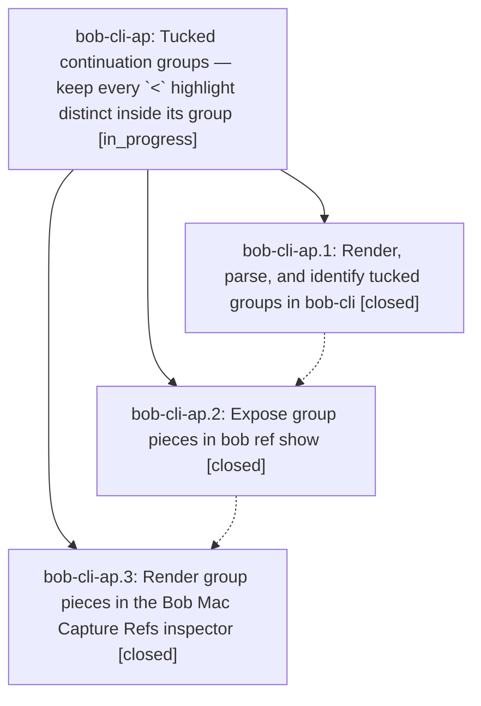

# Bead: bob-cli-ap — Tucked continuation groups — keep every \`\<\` highlight distinct inside its group

[Bead Pages](../README.md) / bob-cli-ap

**Status:** ◐ in_progress · **Type:** ▸ plan · **Tier:** epic
**Owner:** `bryanbugyi34@gmail.com` · **Created by:** [bbugyi200.athena.12y](https://github.com/bobs-org/bob-cli--agents/blob/main/sessions/bbugyi200.athena.12y.md) · **Assignee:** `bob-cli-ap.land`
**Created:** 2026-10-23 05:11:20 EDT
**Plan:** [202610/tucked\_continuation\_groups.md](https://github.com/bobs-org/bob-cli--plans/blob/main/202610/tucked_continuation_groups.md)

<!-- sase:links:start -->

## Links

| Relation | Artifact | Why |
| --- | --- | --- |
| implemented-by | [plan:202610/tucked_continuation_groups.md][1] | derived from the plan's `bead_id:` frontmatter field |

_Plus 1 automatic references — see [Referenced By](#referenced-by)._

[1]: https://github.com/bobs-org/bob-cli--plans/blob/main/202610/tucked_continuation_groups.md

<!-- sase:links:end -->

## Description

A `<` note groups a highlight with the one before it without erasing either: the group renders as one quote card under one heading and one `^h-` ID, and inside it every highlight keeps its own words, its own page, and its own images and comment, in reading order. Existing ref notes migrate on the next scan with no block-ID churn, no tombstones, and no change to any note that has no group. `bob ref show` (and, if approved, the Bob Mac Capture Refs inspector) shows the same pieces.

## Phases

| Bead | Title | Status | Size | Created | Agents | Commits |
|---|---|---|---|---|---:|---:|
| [bob-cli-ap.1](bob-cli-ap.1.md) | Render, parse, and identify tucked groups in bob-cli | ✓ closed | medium | 2026-10-23 | 1 | 1 |
| [bob-cli-ap.2](bob-cli-ap.2.md) | Expose group pieces in bob ref show | ✓ closed | small | 2026-10-23 | 1 | 1 |
| [bob-cli-ap.3](bob-cli-ap.3.md) | Render group pieces in the Bob Mac Capture Refs inspector | ✓ closed | medium | 2026-10-23 | 1 | 1 |

## Lineage

## Agents

| Agent | Bead | Commits |
|---|---|---:|
| [bbugyi200.athena.bob-cli-ap.1](https://github.com/bobs-org/bob-cli--agents/blob/main/sessions/bbugyi200.athena.bob-cli-ap.1.md) | [bob-cli-ap.1](bob-cli-ap.1.md) | 1 |
| [bbugyi200.athena.bob-cli-ap.2](https://github.com/bobs-org/bob-cli--agents/blob/main/agents/bbugyi200.athena.bob-cli-ap.2/README.md) | [bob-cli-ap.2](bob-cli-ap.2.md) | 1 |
| [bbugyi200.athena.bob-cli-ap.3](https://github.com/bobs-org/bob-cli--agents/blob/main/agents/bbugyi200.athena.bob-cli-ap.3/README.md) | [bob-cli-ap.3](bob-cli-ap.3.md) | 1 |
| [bbugyi200.athena.bob-cli-ap.land](https://github.com/bobs-org/bob-cli--agents/blob/main/agents/bbugyi200.athena.bob-cli-ap.land/README.md) | [bob-cli-ap](README.md) | 0 |

## Commits

| Repo | Commit | Subject | Bead | Committed |
|---|---|---|---|---|
| bob-cli | [`5376dc6`](https://github.com/bobs-org/bob-cli/commit/5376dc6e7bf2511f7239820fa7e4f55e93772faf) | feat(highlights-ref): render continuation pieces as tucked groups | [bob-cli-ap.1](bob-cli-ap.1.md) | 2026-10-23 06:02:53 EDT |
| bob-cli | [`f2c2453`](https://github.com/bobs-org/bob-cli/commit/f2c24531b5796878af1bff47d984bccababec6bf) | feat(ref): expose annotation group pieces with seams in show | [bob-cli-ap.2](bob-cli-ap.2.md) | 2026-10-23 06:16:21 EDT |
| bob-mac-capture | [`bob-mac-capture@da5faa8`](https://github.com/bobs-org/bob-mac-capture/commit/da5faa8c54daa19444577564f36f068a1690e01b) | feat(refs): render tucked group pieces in the Refs inspector | [bob-cli-ap.3](bob-cli-ap.3.md) | 2026-10-23 06:37:17 EDT |

<!-- sase:referenced-by:start -->

## Referenced By

| Relation | Artifact | Why | Uses |
| --- | --- | --- | ---: |
| read-by | [agent:bob-cli-ap.2][1] | Need epic context and decisions for phase ap.2 | 1 |

[1]: https://github.com/bobs-org/bob-cli--agents/blob/main/agents/bbugyi200.athena.bob-cli-ap.2/README.md

<!-- sase:referenced-by:end -->
