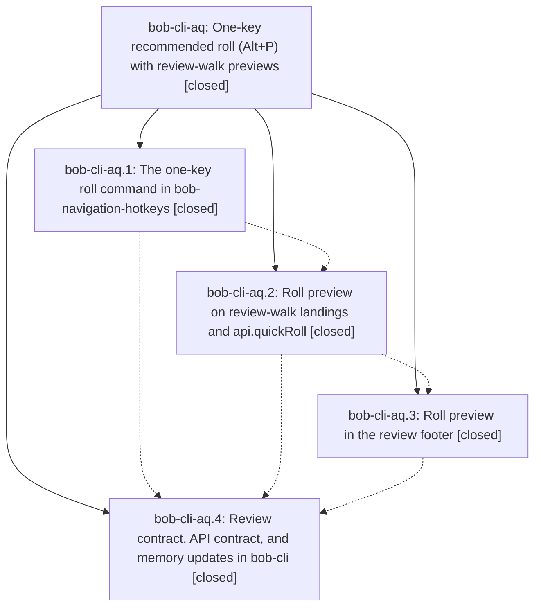

# Bead: bob-cli-aq — One-key recommended roll (Alt+P) with review-walk previews

[Bead Pages](../README.md) / bob-cli-aq

**Status:** ✓ closed · **Resolution:** done · **Type:** ▸ plan · **Tier:** epic
**Owner:** `bryanbugyi34@gmail.com` · **Created by:** [bbugyi200.athena.132](https://github.com/bobs-org/bob-cli--agents/blob/main/sessions/bbugyi200.athena.132.md) · **Assignee:** `bob-cli-aq.land`
**Created:** 2026-10-23 06:34:43 EDT · **Closed:** 2026-10-23 08:34:41 EDT
**Plan:** [202610/quick\_roll\_alt\_p.md](https://github.com/bobs-org/bob-cli--plans/blob/main/202610/quick_roll_alt_p.md)

<!-- sase:links:start -->

## Links

| Relation | Artifact | Why |
| --- | --- | --- |
| implemented-by | [plan:202610/quick_roll_alt_p.md][1] | derived from the plan's `bead_id:` frontmatter field |
| related | file:explicit:0a34f570c8df4a1a3090c7f9 | attached via sase artifact create --bead |

_Plus 2 automatic references — see [Referenced By](#referenced-by)._

[1]: https://github.com/bobs-org/bob-cli--plans/blob/main/202610/quick_roll_alt_p.md

<!-- sase:links:end -->

## Description

One keystroke on a task applies exactly what the Task Card's Ctrl+Enter recommends (same-level roll, decay, or a confirmed cancel), and every GTD review landing and the review footer say in a few words which priority that key would use and whether it decays.

## Notes

[2026-10-23T12:08:41Z · bob-cli-aq.land] FOLLOW-UP TRIAGE COMPLETE via /sase_new_task: collected every PROPOSED FOLLOW-UP entry (aq.1 #1, aq.2 #1, aq.3 #1), consolidated their six failures into three existing CI reports, and independently reproduced all six on bob-plugins 060395d (npm test: 3456/3462 pass; file:explicit:0a34f570c8df4a1a3090c7f9). Recorded +1 with proposing-bead provenance on bob-cli-6v (four clock-mixed unblocked-glyph tests), bob-cli-6w (Keep/missing-review-journal-API notice), and bob-cli-7i (reverse conversion retains BLOCKS Work_ship#^prj; aq.3 calls it forward conversion and cites am.6/a2.3, but it is the same test/root cause). Also recorded DISCOVERED ISSUE on causally owning active epic bob-cli-5w after reading 5w/5w.9 and confirming a06b403 introduced the glyph fixture. Searched CI tasks, swept last-week CI tasks, and inspected active epic scopes. Declined all duplicate task creations; no distinct outside-epic proposal remains. These outcomes must be carried into the eventual close note.

[2026-10-23T12:10:53Z · bob-cli-aq.land] LAND AUDIT: read epic scope/DECISIONS and every note on aq.1-.4, plus plan:202610/quick_roll_alt_p.md. Reviewed plugin commits 92d5809, 391277f, 060395d, actual fragments/tests/docs, and bob-cli 8da0c843. Approved Alt+P, cancel confirmation, Work summary, additive quickRoll v1/root v3, PRE/POST preview gate, and only the authorized footer glossary edit are present. Verified source-backed parity fixtures and all new suites through full npm test; build/generated inventory/manifest validation and npm docs:check pass (447 documentation tests, one optional-font skip). Remaining epic defects: (1) 350/457/styles.css hide/reveal modalEl instead of the required outer containerEl, so the surrounding modal/backdrop is not hidden; a container-aware harness repro gives containerClasses=[] while modalEl has quick-pending. (2) first cancel press reveals and correctly writes nothing but emits no notice (notices=[]), missing the approved Decayed past P4 — Alt+P again cancels it, Esc keeps it guidance. (3) 681 rollByRecommendation short-circuits on pickerOpen before canonical isStaleRegisteredPicker cleanup: a detached container with pickerOpen=true swallows Alt+P; the normal openBulletPropertyPicker replaces the same stale slot. Also restore the specified quieter alias keycap: is-alias only changes border style, no reduced opacity. These are epic work, not follow-up tasks. INTEGRATION: refreshed both origin/master refs; no unmerged drift. From epic creation and first implementation commit onward, plugins have only the three aq commits; bob-cli has aq.4 and unrelated 510c8a44 (highlight continuation migration tests/docs), whose actual diff does not conflict with roll/navigation/footer behavior. No integration code change needed. Epic-symbol audit empty; no symvision recipe in bob-cli justfile. Parent read shows no parent_bead. Keep epic open; a small tale will repair the bounded gaps and complete this landing in the coder turn, without waiting for its commit or CI.

[2026-10-23T12:34:41Z · bob-cli-aq.land--1] LAND COMPLETE. Source: approved plan plan:202610/quick_roll_landing.md and plan:202610/quick_roll_alt_p.md; plugin source checkout at 060395d with this landing repair diff, bob-cli at 8da0c843. Re-read and reviewed closed child notes aq.1 through aq.4 and their follow-up entries. Fixed all four landing gaps: pending quick-roll now hides the outer modal container; cancel confirmation gives the approved Esc/Alt+P guidance; stale picker cleanup runs before the open-picker early return; alias keycaps have reduced opacity. Honored Alt+P, second-press cancellation, and optional Work-summary reviewer decisions. Integration review found no conflict beyond unrelated bob-cli commit 510c8a44. Verification: regenerated stale plugin docs inventory; npm run validate passed 7/7, npm run docs:check passed 447 with one optional-font skip, primary just check passed (3167 unit, 1940 CLI, remaining parity suites green). Full npm test rerun yielded 3457 pass and six known failures only: four glyph fixtures on bob-cli-6v, Keep notice fixture on bob-cli-6w, conversion fixture on bob-cli-7i; independent +1 evidence was recorded. First run also had a transient timing failure that passed on rerun. bob plugins sync deployed the linked checkout; vault manifest confirms bob-navigation-hotkeys 2.52.1. Sync could not pull because the source checkout is intentionally dirty, so it deployed the reviewed local tree. Triage of aq.1 #1, aq.2 #1, aq.3 #1 completed: all six failures map to existing 6v/6w/7i with +1 evidence; duplicate task creation declined because these are the same root causes; glyph fixture causal note recorded on bob-cli-5w. Plans repo quick_roll_alt_p.md status set to done. Epic-symbol audit empty. Limits: six pre-existing plugin failures remain tracked; optional font test skipped; deployment used local checkout because git pull was blocked by its intended edits.

## Phases

| Bead | Title | Status | Size | Created | Agents | Commits |
|---|---|---|---|---|---:|---:|
| [bob-cli-aq.1](bob-cli-aq.1.md) | The one-key roll command in bob-navigation-hotkeys | ✓ closed | medium | 2026-10-23 | 1 | 1 |
| [bob-cli-aq.2](bob-cli-aq.2.md) | Roll preview on review-walk landings and api.quickRoll | ✓ closed | medium | 2026-10-23 | 1 | 1 |
| [bob-cli-aq.3](bob-cli-aq.3.md) | Roll preview in the review footer | ✓ closed | small | 2026-10-23 | 1 | 1 |
| [bob-cli-aq.4](bob-cli-aq.4.md) | Review contract, API contract, and memory updates in bob-cli | ✓ closed | small | 2026-10-23 | 1 | 1 |

## Lineage

## Agents

| Agent | Bead | Commits |
|---|---|---:|
| [bbugyi200.athena.bob-cli-aq.1](https://github.com/bobs-org/bob-cli--agents/blob/main/sessions/bbugyi200.athena.bob-cli-aq.1.md) | [bob-cli-aq.1](bob-cli-aq.1.md) | 1 |
| [bbugyi200.athena.bob-cli-aq.2](https://github.com/bobs-org/bob-cli--agents/blob/main/agents/bbugyi200.athena.bob-cli-aq.2/README.md) | [bob-cli-aq.2](bob-cli-aq.2.md) | 1 |
| [bbugyi200.athena.bob-cli-aq.3](https://github.com/bobs-org/bob-cli--agents/blob/main/agents/bbugyi200.athena.bob-cli-aq.3/README.md) | [bob-cli-aq.3](bob-cli-aq.3.md) | 1 |
| [bbugyi200.athena.bob-cli-aq.4](https://github.com/bobs-org/bob-cli--agents/blob/main/agents/bbugyi200.athena.bob-cli-aq.4/README.md) | [bob-cli-aq.4](bob-cli-aq.4.md) | 1 |
| [bbugyi200.athena.bob-cli-aq.land](https://github.com/bobs-org/bob-cli--agents/blob/main/sessions/bbugyi200.athena.bob-cli-aq.land.md) | [bob-cli-aq](README.md) | 1 |

## Commits

| Repo | Commit | Subject | Bead | Committed |
|---|---|---|---|---|
| bob-plugins | [`bob-plugins@92d5809`](https://github.com/bobs-org/bob-plugins/commit/92d5809aa0d12c1d1c00ee1ad1d1302619fe48d2) | feat(nav): add Alt+P quick roll command | [bob-cli-aq.1](bob-cli-aq.1.md) | 2026-10-23 07:14:01 EDT |
| bob-plugins | [`bob-plugins@391277f`](https://github.com/bobs-org/bob-plugins/commit/391277f74655c7bb5195790c113c6147e5b4fd8f) | feat(nav): add roll preview to review-walk landings and api.quickRoll | [bob-cli-aq.2](bob-cli-aq.2.md) | 2026-10-23 07:30:36 EDT |
| bob-plugins | [`bob-plugins@060395d`](https://github.com/bobs-org/bob-plugins/commit/060395d72fca04391411c33ad8ec2f607234f97e) | feat(ledger-tools): show Alt+P roll preview in the review footer | [bob-cli-aq.3](bob-cli-aq.3.md) | 2026-10-23 07:42:13 EDT |
| bob-cli | [`8da0c84`](https://github.com/bobs-org/bob-cli/commit/8da0c843ca52dafb88dc34c4e49b2de25ddd916f) | docs(freshness): document Alt+P review roll preview | [bob-cli-aq.4](bob-cli-aq.4.md) | 2026-10-23 07:53:14 EDT |
| bob-plugins | [`bob-plugins@ceb311b`](https://github.com/bobs-org/bob-plugins/commit/ceb311bb4d8819eb8fa74850479e3a7d1a067602) | fix(navigation): complete quick-roll landing repairs | [bob-cli-aq](README.md) | 2026-10-23 08:35:21 EDT |

<!-- sase:referenced-by:start -->

## Referenced By

| Relation | Artifact | Why | Uses |
| --- | --- | --- | ---: |
| read-by | [agent:bob-cli-aq.2][1] | parent epic scope | 1 |
| read-by | [agent:research.55.final][2] | Check overlap of in-progress Alt+P review-walk preview epic with proposed Rotten Log prompt | 1 |

[1]: https://github.com/bobs-org/bob-cli--agents/blob/main/agents/bbugyi200.athena.bob-cli-aq.2/README.md
[2]: https://github.com/bobs-org/bob-cli--agents/blob/main/agents/bbugyi200.athena.research.55.final/README.md

<!-- sase:referenced-by:end -->
