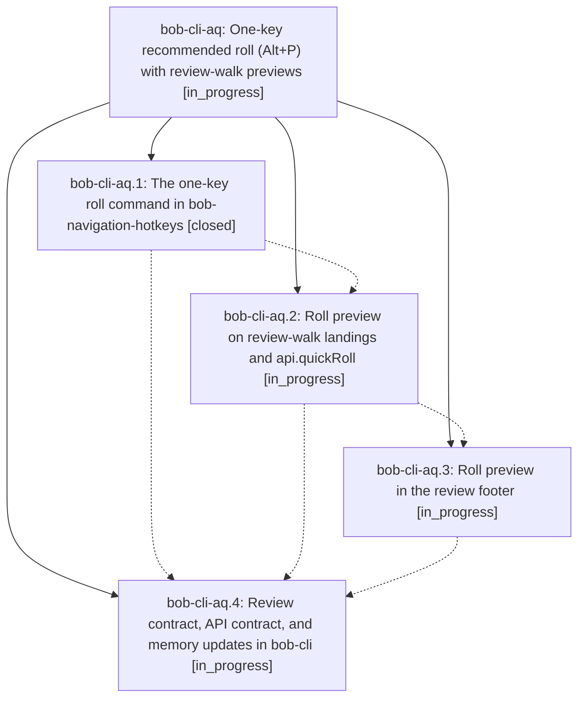

# Bead: bob-cli-aq — One-key recommended roll (Alt+P) with review-walk previews

[Bead Pages](../README.md) / bob-cli-aq

**Status:** ◐ in_progress · **Type:** ▸ plan · **Tier:** epic
**Owner:** `bryanbugyi34@gmail.com` · **Created by:** [bbugyi200.athena.132](https://github.com/bobs-org/bob-cli--agents/blob/main/sessions/bbugyi200.athena.132.md) · **Assignee:** `bob-cli-aq.land`
**Created:** 2026-10-23 06:34:43 EDT
**Plan:** [202610/quick\_roll\_alt\_p.md](https://github.com/bobs-org/bob-cli--plans/blob/main/202610/quick_roll_alt_p.md)

## Description

One keystroke on a task applies exactly what the Task Card's Ctrl+Enter recommends (same-level roll, decay, or a confirmed cancel), and every GTD review landing and the review footer say in a few words which priority that key would use and whether it decays.

## Phases

| Bead | Title | Status | Size | Created | Agents | Commits |
|---|---|---|---|---|---:|---:|
| [bob-cli-aq.1](bob-cli-aq.1.md) | The one-key roll command in bob-navigation-hotkeys | ✓ closed | medium | 2026-10-23 | 1 | 1 |
| [bob-cli-aq.2](bob-cli-aq.2.md) | Roll preview on review-walk landings and api.quickRoll | ◐ in_progress | medium | 2026-10-23 | 1 | 0 |
| [bob-cli-aq.3](bob-cli-aq.3.md) | Roll preview in the review footer | ◐ in_progress | small | 2026-10-23 | 1 | 0 |
| [bob-cli-aq.4](bob-cli-aq.4.md) | Review contract, API contract, and memory updates in bob-cli | ◐ in_progress | small | 2026-10-23 | 1 | 0 |

## Lineage

## Agents

| Agent | Bead | Commits |
|---|---|---:|
| [bbugyi200.athena.bob-cli-aq.1](https://github.com/bobs-org/bob-cli--agents/blob/main/sessions/bbugyi200.athena.bob-cli-aq.1.md) | [bob-cli-aq.1](bob-cli-aq.1.md) | 1 |
| [bbugyi200.athena.bob-cli-aq.2](https://github.com/bobs-org/bob-cli--agents/blob/main/agents/bbugyi200.athena.bob-cli-aq.2/README.md) | [bob-cli-aq.2](bob-cli-aq.2.md) | 0 |
| [bbugyi200.athena.bob-cli-aq.3](https://github.com/bobs-org/bob-cli--agents/blob/main/agents/bbugyi200.athena.bob-cli-aq.3/README.md) | [bob-cli-aq.3](bob-cli-aq.3.md) | 0 |
| [bbugyi200.athena.bob-cli-aq.4](https://github.com/bobs-org/bob-cli--agents/blob/main/agents/bbugyi200.athena.bob-cli-aq.4/README.md) | [bob-cli-aq.4](bob-cli-aq.4.md) | 0 |
| [bbugyi200.athena.bob-cli-aq.land](https://github.com/bobs-org/bob-cli--agents/blob/main/agents/bbugyi200.athena.bob-cli-aq.land/README.md) | [bob-cli-aq](README.md) | 0 |

## Commits

| Repo | Commit | Subject | Bead | Committed |
|---|---|---|---|---|
| bob-plugins | [`bob-plugins@92d5809`](https://github.com/bobs-org/bob-plugins/commit/92d5809aa0d12c1d1c00ee1ad1d1302619fe48d2) | feat(nav): add Alt+P quick roll command | [bob-cli-aq.1](bob-cli-aq.1.md) | 2026-10-23 07:14:01 EDT |

<!-- sase:referenced-by:start -->

## Referenced By

| Relation | Artifact | Why | Uses |
| --- | --- | --- | ---: |
| read-by | [agent:research.55.final][1] | Check overlap of in-progress Alt+P review-walk preview epic with proposed Rotten Log prompt | 1 |

[1]: https://github.com/bobs-org/bob-cli--agents/blob/main/agents/bbugyi200.athena.research.55.final/README.md

<!-- sase:referenced-by:end -->
