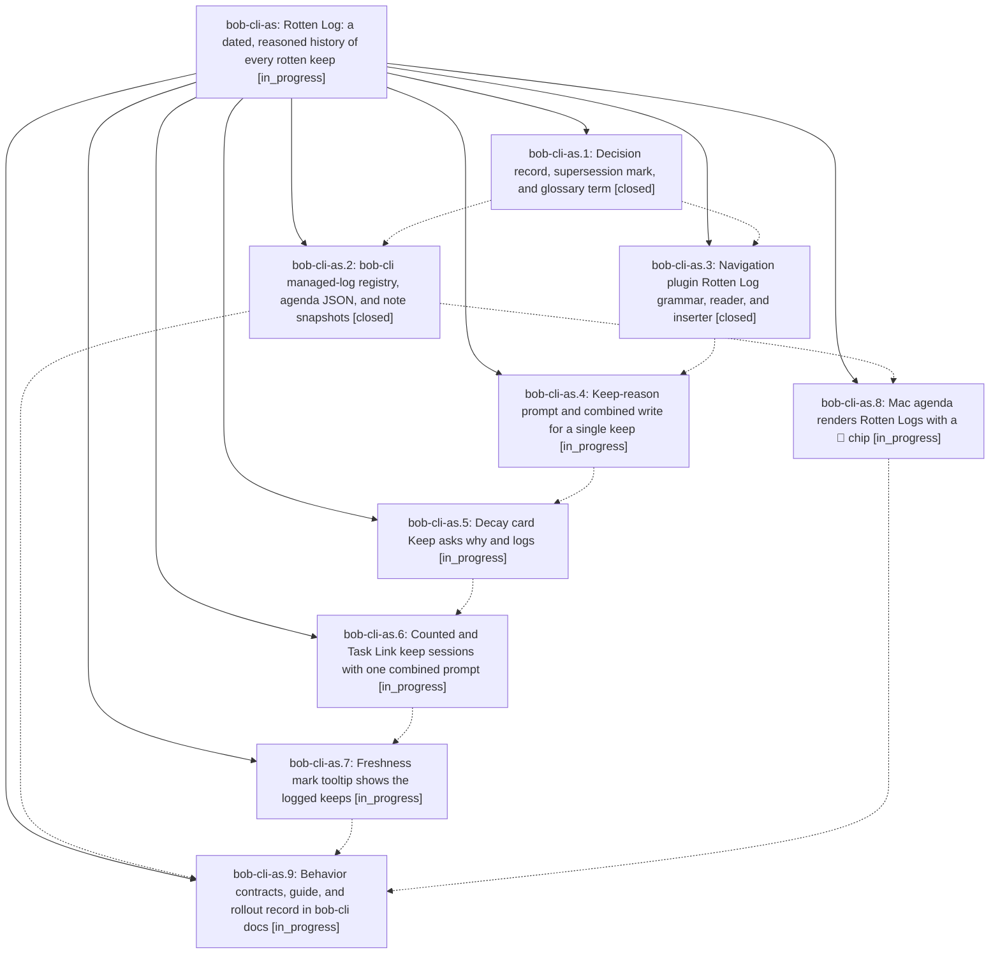

# Bead: bob-cli-as — Rotten Log: a dated, reasoned history of every rotten keep

[Bead Pages](../README.md) / bob-cli-as

**Status:** ◐ in_progress · **Type:** ▸ plan · **Tier:** epic
**Owner:** `bryanbugyi34@gmail.com` · **Created by:** [bbugyi200.athena.research.55.linker.w2](https://github.com/bobs-org/bob-cli--agents/blob/main/sessions/bbugyi200.athena.research.55.linker.w2.md) · **Assignee:** `bob-cli-as.land`
**Created:** 2026-10-23 08:24:12 EDT
**Plan:** [202610/rotten\_log.md](https://github.com/bobs-org/bob-cli--plans/blob/main/202610/rotten_log.md)

## Description

Every counted keep of a rotten task (Alt+F or Ctrl+Alt+F on an exact due Ready ROTTEN or scheduled TICKLER row, and Keep on the approved-decay card) asks "Why keep it as written?" and, in the same transaction as the stamp, writes one dated entry under a `🥀 **ROTTEN LOG**` child. Each task then shows how many times, when, and why it was kept: in the note, in the prompt, on the decay card, on the freshness mark tooltip, in note snapshots, and in the Mac agenda.

## Phases

| Bead | Title | Status | Size | Created | Agents | Commits |
|---|---|---|---|---|---:|---:|
| [bob-cli-as.1](bob-cli-as.1.md) | Decision record, supersession mark, and glossary term | ✓ closed | small | 2026-10-23 | 1 | 1 |
| [bob-cli-as.2](bob-cli-as.2.md) | bob-cli managed-log registry, agenda JSON, and note snapshots | ✓ closed | medium | 2026-10-23 | 1 | 1 |
| [bob-cli-as.3](bob-cli-as.3.md) | Navigation plugin Rotten Log grammar, reader, and inserter | ✓ closed | small | 2026-10-23 | 1 | 0 |
| [bob-cli-as.4](bob-cli-as.4.md) | Keep-reason prompt and combined write for a single keep | ◐ in_progress | medium | 2026-10-23 | 1 | 0 |
| [bob-cli-as.5](bob-cli-as.5.md) | Decay card Keep asks why and logs | ◐ in_progress | medium | 2026-10-23 | 1 | 0 |
| [bob-cli-as.6](bob-cli-as.6.md) | Counted and Task Link keep sessions with one combined prompt | ◐ in_progress | medium | 2026-10-23 | 1 | 0 |
| [bob-cli-as.7](bob-cli-as.7.md) | Freshness mark tooltip shows the logged keeps | ◐ in_progress | small | 2026-10-23 | 1 | 0 |
| [bob-cli-as.8](bob-cli-as.8.md) | Mac agenda renders Rotten Logs with a 🥀 chip | ◐ in_progress | small | 2026-10-23 | 1 | 0 |
| [bob-cli-as.9](bob-cli-as.9.md) | Behavior contracts, guide, and rollout record in bob-cli docs | ◐ in_progress | small | 2026-10-23 | 1 | 0 |

## Lineage

## Agents

| Agent | Bead | Commits |
|---|---|---:|
| [bbugyi200.athena.bob-cli-as.1](https://github.com/bobs-org/bob-cli--agents/blob/main/agents/bbugyi200.athena.bob-cli-as.1/README.md) | [bob-cli-as.1](bob-cli-as.1.md) | 1 |
| [bbugyi200.athena.bob-cli-as.2](https://github.com/bobs-org/bob-cli--agents/blob/main/agents/bbugyi200.athena.bob-cli-as.2/README.md) | [bob-cli-as.2](bob-cli-as.2.md) | 1 |
| [bbugyi200.athena.bob-cli-as.3](https://github.com/bobs-org/bob-cli--agents/blob/main/agents/bbugyi200.athena.bob-cli-as.3/README.md) | [bob-cli-as.3](bob-cli-as.3.md) | 0 |
| [bbugyi200.athena.bob-cli-as.4](https://github.com/bobs-org/bob-cli--agents/blob/main/agents/bbugyi200.athena.bob-cli-as.4/README.md) | [bob-cli-as.4](bob-cli-as.4.md) | 0 |
| [bbugyi200.athena.bob-cli-as.5](https://github.com/bobs-org/bob-cli--agents/blob/main/agents/bbugyi200.athena.bob-cli-as.5/README.md) | [bob-cli-as.5](bob-cli-as.5.md) | 0 |
| [bbugyi200.athena.bob-cli-as.6](https://github.com/bobs-org/bob-cli--agents/blob/main/agents/bbugyi200.athena.bob-cli-as.6/README.md) | [bob-cli-as.6](bob-cli-as.6.md) | 0 |
| [bbugyi200.athena.bob-cli-as.7](https://github.com/bobs-org/bob-cli--agents/blob/main/agents/bbugyi200.athena.bob-cli-as.7/README.md) | [bob-cli-as.7](bob-cli-as.7.md) | 0 |
| [bbugyi200.athena.bob-cli-as.8](https://github.com/bobs-org/bob-cli--agents/blob/main/agents/bbugyi200.athena.bob-cli-as.8/README.md) | [bob-cli-as.8](bob-cli-as.8.md) | 0 |
| [bbugyi200.athena.bob-cli-as.9](https://github.com/bobs-org/bob-cli--agents/blob/main/agents/bbugyi200.athena.bob-cli-as.9/README.md) | [bob-cli-as.9](bob-cli-as.9.md) | 0 |
| [bbugyi200.athena.bob-cli-as.land](https://github.com/bobs-org/bob-cli--agents/blob/main/agents/bbugyi200.athena.bob-cli-as.land/README.md) | [bob-cli-as](README.md) | 0 |

## Commits

| Repo | Commit | Subject | Bead | Committed |
|---|---|---|---|---|
| bob-cli | [`9c0a19a`](https://github.com/bobs-org/bob-cli/commit/9c0a19a4de9e6d3594c279b14706a8efa8cb0806) | feat(memory): record rotten-keeps-are-logged decision and Rotten Log glossary | [bob-cli-as.1](bob-cli-as.1.md) | 2026-10-23 08:32:30 EDT |
| bob-cli | [`5eed7df`](https://github.com/bobs-org/bob-cli/commit/5eed7df96a7ce1ca2d07d13c9859e434c34a73ec) | feat(managed-log): register Rotten Log kind with agenda and snapshot support | [bob-cli-as.2](bob-cli-as.2.md) | 2026-10-23 08:50:36 EDT |

<!-- sase:referenced-by:start -->

## Referenced By

| Relation | Artifact | Why | Uses |
| --- | --- | --- | ---: |
| read-by | [agent:bob-cli-as.1][1] | Need epic DECISIONS and plan context | 1 |

[1]: https://github.com/bobs-org/bob-cli--agents/blob/main/agents/bbugyi200.athena.bob-cli-as.1/README.md

<!-- sase:referenced-by:end -->
