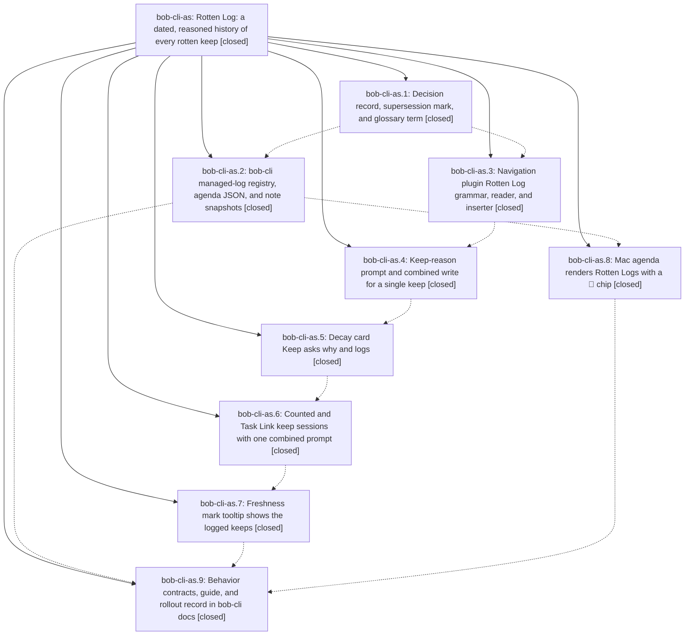

# Bead: bob-cli-as — Rotten Log: a dated, reasoned history of every rotten keep

[Bead Pages](../README.md) / bob-cli-as

**Status:** ✓ closed · **Resolution:** done · **Type:** ▸ plan · **Tier:** epic
**Owner:** `bryanbugyi34@gmail.com` · **Created by:** [bbugyi200.athena.research.55.linker.w2](https://github.com/bobs-org/bob-cli--agents/blob/main/sessions/bbugyi200.athena.research.55.linker.w2.md) · **Assignee:** `bob-cli-as.land`
**Created:** 2026-10-23 08:24:12 EDT · **Closed:** 2026-10-23 11:58:17 EDT
**Plan:** [202610/rotten\_log.md](https://github.com/bobs-org/bob-cli--plans/blob/main/202610/rotten_log.md)

<!-- sase:links:start -->

## Links

| Relation | Artifact | Why |
| --- | --- | --- |
| implemented-by | [plan:202610/rotten_log.md][1] | derived from the plan's `bead_id:` frontmatter field |

_Plus 5 automatic references — see [Referenced By](#referenced-by)._

[1]: https://github.com/bobs-org/bob-cli--plans/blob/main/202610/rotten_log.md

<!-- sase:links:end -->

## Description

Every counted keep of a rotten task (Alt+F or Ctrl+Alt+F on an exact due Ready ROTTEN or scheduled TICKLER row, and Keep on the approved-decay card) asks "Why keep it as written?" and, in the same transaction as the stamp, writes one dated entry under a `🥀 **ROTTEN LOG**` child. Each task then shows how many times, when, and why it was kept: in the note, in the prompt, on the decay card, on the freshness mark tooltip, in note snapshots, and in the Mac agenda.

## Notes

[2026-10-23T15:36:31Z · bob-cli-as.land] LAND TRIAGE of PROPOSED FOLLOW-UP notes (all pre-existing, none caused by this epic, each reproduced on clean bases by the proposing phases): bob-cli-6v (4 wall-clock unblocked-glyph tests; from as.3/.4/.5/.6) -> +1 corroborated, reproduced by the lander at bob-plugins f5557ec; bob-cli-7i (forward/reverse conversion keeps BLOCKS [[Work_ship#^prj]]; from as.3/.4/.5/.6) -> +1 corroborated, reproduced at f5557ec; bob-cli-3w (stage-ranker 16 ms perf flake; from as.4/.6) -> +1 corroborated from as.4/as.6 observations (passed in the lander's run); bob-cli-6w (Keep test sees review-journal missing-API notice; from as.3/.4 and the plan baseline) -> note only, no +1: as.5 rewrote the Keep notice tests so the assertion no longer fails at f5557ec while the async notice interference persists; status unchanged per plan. No new task beads were created: every proposal was a duplicate of an existing task. Audit (plan nav-grammar item 6, unrecorded by as.3): block-id-prompt and task-status-cycler only use kind-specific SCHEDULE_LOG_PARENT_RE / WORK_LOG_PARENT_RE finders and bob-ledger-tools has no managed-log recogniser besides the new tooltip parser, so none claims a Rotten Log marker or entry as prose, a section, or a Task Link; no change needed.

[2026-10-23T15:58:17Z · bob-cli-as.land] Land verification: All nine phases checked against plan and code. bob-cli just check passes (3175 lib + 1940 integration, 0 failures). bob-plugins npm test 3523/3528 passing with only known 6v/7i failures (4 unblocked-glyph + 1 forward conversion). Nav marker grammar matches every Rust vector. block-id-prompt/task-status-cycler/ledger audit needed no change. No commits outside epic needed integration (bob-plugins quick-roll ceb311b predates nav phases; bob-mac-capture 3343c5e unrelated). Follow-up triage: 6v, 7i, 3w +1'd; 6w noted; no new tasks. Fixes: (A) ledger tooltip now byte-compatible with nav (1 keep logged singular, Oct 16 dates, 48-char truncation, rotten before action, child-block reads via doc.line, Tasks/Dataview excluded, new tests, 1.65.0); (B) new test-navigation-rotten-log.cjs in npm test, card header shows unreadable on unknown, decay-card Keep subtitle uses reviews copy, 2.56.1; (C) Rust anchor/insertion/work-log consequence tests; (D) docs/freshness.md 1.65.0 x3 + nav 2.56.1 rollout, just docs-check passes.

[2026-10-23T15:58:30Z · bob-cli-as.land] Live verification: Obsidian was not running on athena during landing, so the tooltip was not live-verified in Live Preview/Reading view. Automated mark-surface and modal interaction tests pass (97 focused, 3523 full with only known 6v/7i failures).

## Phases

| Bead | Title | Status | Size | Created | Agents | Commits |
|---|---|---|---|---|---:|---:|
| [bob-cli-as.1](bob-cli-as.1.md) | Decision record, supersession mark, and glossary term | ✓ closed | small | 2026-10-23 | 1 | 1 |
| [bob-cli-as.2](bob-cli-as.2.md) | bob-cli managed-log registry, agenda JSON, and note snapshots | ✓ closed | medium | 2026-10-23 | 1 | 1 |
| [bob-cli-as.3](bob-cli-as.3.md) | Navigation plugin Rotten Log grammar, reader, and inserter | ✓ closed | small | 2026-10-23 | 1 | 1 |
| [bob-cli-as.4](bob-cli-as.4.md) | Keep-reason prompt and combined write for a single keep | ✓ closed | medium | 2026-10-23 | 1 | 1 |
| [bob-cli-as.5](bob-cli-as.5.md) | Decay card Keep asks why and logs | ✓ closed | medium | 2026-10-23 | 1 | 1 |
| [bob-cli-as.6](bob-cli-as.6.md) | Counted and Task Link keep sessions with one combined prompt | ✓ closed | medium | 2026-10-23 | 1 | 1 |
| [bob-cli-as.7](bob-cli-as.7.md) | Freshness mark tooltip shows the logged keeps | ✓ closed | small | 2026-10-23 | 1 | 1 |
| [bob-cli-as.8](bob-cli-as.8.md) | Mac agenda renders Rotten Logs with a 🥀 chip | ✓ closed | small | 2026-10-23 | 1 | 1 |
| [bob-cli-as.9](bob-cli-as.9.md) | Behavior contracts, guide, and rollout record in bob-cli docs | ✓ closed | small | 2026-10-23 | 1 | 1 |

## Lineage

## Agents

| Agent | Bead | Commits |
|---|---|---:|
| [bbugyi200.athena.bob-cli-as.1](https://github.com/bobs-org/bob-cli--agents/blob/main/agents/bbugyi200.athena.bob-cli-as.1/README.md) | [bob-cli-as.1](bob-cli-as.1.md) | 1 |
| [bbugyi200.athena.bob-cli-as.2](https://github.com/bobs-org/bob-cli--agents/blob/main/agents/bbugyi200.athena.bob-cli-as.2/README.md) | [bob-cli-as.2](bob-cli-as.2.md) | 1 |
| [bbugyi200.athena.bob-cli-as.3](https://github.com/bobs-org/bob-cli--agents/blob/main/agents/bbugyi200.athena.bob-cli-as.3/README.md) | [bob-cli-as.3](bob-cli-as.3.md) | 1 |
| [bbugyi200.athena.bob-cli-as.4](https://github.com/bobs-org/bob-cli--agents/blob/main/sessions/bbugyi200.athena.bob-cli-as.4.md) | [bob-cli-as.4](bob-cli-as.4.md) | 1 |
| [bbugyi200.athena.bob-cli-as.5](https://github.com/bobs-org/bob-cli--agents/blob/main/agents/bbugyi200.athena.bob-cli-as.5/README.md) | [bob-cli-as.5](bob-cli-as.5.md) | 1 |
| [bbugyi200.athena.bob-cli-as.6](https://github.com/bobs-org/bob-cli--agents/blob/main/agents/bbugyi200.athena.bob-cli-as.6/README.md) | [bob-cli-as.6](bob-cli-as.6.md) | 1 |
| [bbugyi200.athena.bob-cli-as.7](https://github.com/bobs-org/bob-cli--agents/blob/main/agents/bbugyi200.athena.bob-cli-as.7/README.md) | [bob-cli-as.7](bob-cli-as.7.md) | 1 |
| [bbugyi200.athena.bob-cli-as.8](https://github.com/bobs-org/bob-cli--agents/blob/main/agents/bbugyi200.athena.bob-cli-as.8/README.md) | [bob-cli-as.8](bob-cli-as.8.md) | 1 |
| [bbugyi200.athena.bob-cli-as.9](https://github.com/bobs-org/bob-cli--agents/blob/main/agents/bbugyi200.athena.bob-cli-as.9/README.md) | [bob-cli-as.9](bob-cli-as.9.md) | 1 |
| [bbugyi200.athena.bob-cli-as.land](https://github.com/bobs-org/bob-cli--agents/blob/main/sessions/bbugyi200.athena.bob-cli-as.land.md) | [bob-cli-as](README.md) | 3 |

## Commits

| Repo | Commit | Subject | Bead | Committed |
|---|---|---|---|---|
| bob-cli | [`9c0a19a`](https://github.com/bobs-org/bob-cli/commit/9c0a19a4de9e6d3594c279b14706a8efa8cb0806) | feat(memory): record rotten-keeps-are-logged decision and Rotten Log glossary | [bob-cli-as.1](bob-cli-as.1.md) | 2026-10-23 08:32:30 EDT |
| bob-plugins | [`bob-plugins@1b1a5ba`](https://github.com/bobs-org/bob-plugins/commit/1b1a5ba7e9da03f7ffe522560ab032d21872c9b5) | feat(navigation): add Rotten Log grammar and reader | [bob-cli-as.3](bob-cli-as.3.md) | 2026-10-23 08:46:13 EDT |
| bob-cli | [`5eed7df`](https://github.com/bobs-org/bob-cli/commit/5eed7df96a7ce1ca2d07d13c9859e434c34a73ec) | feat(managed-log): register Rotten Log kind with agenda and snapshot support | [bob-cli-as.2](bob-cli-as.2.md) | 2026-10-23 08:50:36 EDT |
| bob-mac-capture | [`bob-mac-capture@73202c8`](https://github.com/bobs-org/bob-mac-capture/commit/73202c8142ca2fd4b3335d524df6153bc9ed3ef0) | feat(agenda): render Rotten Logs with a rotten chip | [bob-cli-as.8](bob-cli-as.8.md) | 2026-10-23 09:01:31 EDT |
| bob-plugins | [`bob-plugins@22ec6b2`](https://github.com/bobs-org/bob-plugins/commit/22ec6b2f338700f96d25388ef24d81e950bea90f) | feat(navigation): log reasons for single-task rotten keeps | [bob-cli-as.4](bob-cli-as.4.md) | 2026-10-23 10:03:51 EDT |
| bob-plugins | [`bob-plugins@973acea`](https://github.com/bobs-org/bob-plugins/commit/973aceafeb9c61c1ca1a61792787aa908b89b3de) | feat(navigation): decay card Keep asks why and logs Rotten Log entry | [bob-cli-as.5](bob-cli-as.5.md) | 2026-10-23 10:24:42 EDT |
| bob-plugins | [`bob-plugins@b8ef471`](https://github.com/bobs-org/bob-plugins/commit/b8ef4710a70910a4183a8bceffbea65bd4b0d269) | feat(navigation): log counted keeps across task batches | [bob-cli-as.6](bob-cli-as.6.md) | 2026-10-23 10:50:44 EDT |
| bob-plugins | [`bob-plugins@f5557ec`](https://github.com/bobs-org/bob-plugins/commit/f5557ecc4b0a1fd4e2bed05d049d6cabbc7ee089) | feat(freshness): show rotten keeps in mark tooltips | [bob-cli-as.7](bob-cli-as.7.md) | 2026-10-23 11:04:07 EDT |
| bob-cli | [`dd9bdb8`](https://github.com/bobs-org/bob-cli/commit/dd9bdb86daee393cb4b7da9fa1c39daca7c7ba6c) | docs(freshness): document Rotten Log keep flow | [bob-cli-as.9](bob-cli-as.9.md) | 2026-10-23 11:15:55 EDT |
| bob-cli | [`c07a65c`](https://github.com/bobs-org/bob-cli/commit/c07a65cc704bc33a31cda61a918e310fabe5d2f9) | feat(rotten-log): land Rotten Log consequence tests and docs | [bob-cli-as](README.md) | 2026-10-23 11:59:45 EDT |
| bob-plugins | [`bob-plugins@c9364b0`](https://github.com/bobs-org/bob-plugins/commit/c9364b02ba04ad6e9c20382891e8a79c24f46e22) | feat(rotten-log): land tooltip contract, grammar tests and card fixes | [bob-cli-as](README.md) | 2026-10-23 12:00:23 EDT |
| bob-cli--plans | [`bob-cli--plans@82c1c6a`](https://github.com/bobs-org/bob-cli--plans/commit/82c1c6ad8ab532adc3dee30251058d6be0eefe3b) | chore(rotten-log): mark landing plan done | [bob-cli-as](README.md) | 2026-10-23 12:00:54 EDT |

<!-- sase:referenced-by:start -->

## Referenced By

| Relation | Artifact | Why | Uses |
| --- | --- | --- | ---: |
| read-by | [agent:bob-cli-as.1][1] | Need epic DECISIONS and plan context | 1 |
| read-by | [agent:bob-cli-as.2][2] | Need epic DECISIONS and scope for phase 2 | 1 |
| read-by | [agent:bob-cli-as.5][3] | epic context | 1 |
| read-by | [agent:bob-cli-as.8][4] | epic scope | 1 |
| read-by | [agent:bob-cli-as.9][5] | docs phase needs shipped plugin versions and rollout context | 1 |

[1]: https://github.com/bobs-org/bob-cli--agents/blob/main/agents/bbugyi200.athena.bob-cli-as.1/README.md
[2]: https://github.com/bobs-org/bob-cli--agents/blob/main/agents/bbugyi200.athena.bob-cli-as.2/README.md
[3]: https://github.com/bobs-org/bob-cli--agents/blob/main/agents/bbugyi200.athena.bob-cli-as.5/README.md
[4]: https://github.com/bobs-org/bob-cli--agents/blob/main/agents/bbugyi200.athena.bob-cli-as.8/README.md
[5]: https://github.com/bobs-org/bob-cli--agents/blob/main/agents/bbugyi200.athena.bob-cli-as.9/README.md

<!-- sase:referenced-by:end -->
