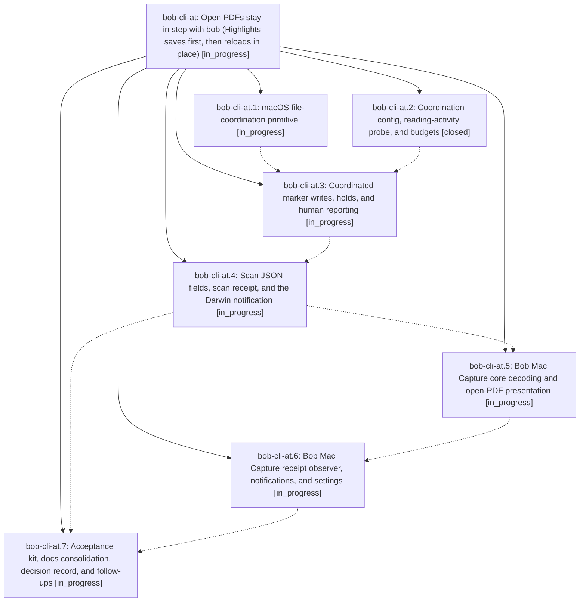

# Bead: bob-cli-at — Open PDFs stay in step with bob (Highlights saves first, then reloads in place)

[Bead Pages](../README.md) / bob-cli-at

**Status:** ◐ in_progress · **Type:** ▸ plan · **Tier:** epic
**Owner:** `bryanbugyi34@gmail.com` · **Created by:** [bbugyi200.athena.research.56.linker.w0](https://github.com/bobs-org/bob-cli--agents/blob/main/sessions/bbugyi200.athena.research.56.linker.w0.md) · **Assignee:** `bob-cli-at.land`
**Created:** 2026-10-23 11:44:15 EDT
**Plan:** [202610/highlights\_coordinated\_marker\_writes.md](https://github.com/bobs-org/bob-cli--plans/blob/main/202610/highlights_coordinated_marker_writes.md)

<!-- sase:links:start -->

## Links

| Relation | Artifact | Why |
| --- | --- | --- |
| implemented-by | [plan:202610/highlights_coordinated_marker_writes.md][1] | derived from the plan's `bead_id:` frontmatter field |

[1]: https://github.com/bobs-org/bob-cli--plans/blob/main/202610/highlights_coordinated_marker_writes.md

<!-- sase:links:end -->

## Description

When `bob ref scan` or `bob ref sync -w` on the Mac updates a ref PDF's page-1 marker, it never again strands an open Highlights document. bob writes through a bounded macOS file-coordination write (`NSFileCoordinator`, `.forMerging`). macOS has Highlights save your unsaved annotations first, bob re-checks the marker in the fresh bytes and writes, and Highlights reloads the same tab in place: no dialog, no keystroke, no tab change. Anything uncertain becomes a hold: nothing is written for that PDF, and the next scan retries. That covers you actively reading in Highlights, Highlights not answering, and the marker changing under bob. CLI and JSON always report what happened. Bob Mac Capture posts one quiet, grouped notification, only when a PDF that is open in Highlights was refreshed or Highlights needs you. The feature ships behind `highlights.coordinate_pdf_writes` and is enabled after a guided real-Highlights acceptance test.

## Phases

| Bead | Title | Status | Size | Created | Agents | Commits |
|---|---|---|---|---|---:|---:|
| [bob-cli-at.1](bob-cli-at.1.md) | macOS file-coordination primitive | ◐ in_progress | medium | 2026-10-23 | 1 | 0 |
| [bob-cli-at.2](bob-cli-at.2.md) | Coordination config, reading-activity probe, and budgets | ✓ closed | small | 2026-10-23 | 1 | 1 |
| [bob-cli-at.3](bob-cli-at.3.md) | Coordinated marker writes, holds, and human reporting | ◐ in_progress | medium | 2026-10-23 | 1 | 0 |
| [bob-cli-at.4](bob-cli-at.4.md) | Scan JSON fields, scan receipt, and the Darwin notification | ◐ in_progress | medium | 2026-10-23 | 1 | 0 |
| [bob-cli-at.5](bob-cli-at.5.md) | Bob Mac Capture core decoding and open-PDF presentation | ◐ in_progress | medium | 2026-10-23 | 1 | 0 |
| [bob-cli-at.6](bob-cli-at.6.md) | Bob Mac Capture receipt observer, notifications, and settings | ◐ in_progress | medium | 2026-10-23 | 1 | 0 |
| [bob-cli-at.7](bob-cli-at.7.md) | Acceptance kit, docs consolidation, decision record, and follow-ups | ◐ in_progress | medium | 2026-10-23 | 1 | 0 |

## Lineage

## Agents

| Agent | Bead | Commits |
|---|---|---:|
| [bbugyi200.athena.bob-cli-at.1](https://github.com/bobs-org/bob-cli--agents/blob/main/agents/bbugyi200.athena.bob-cli-at.1/README.md) | [bob-cli-at.1](bob-cli-at.1.md) | 0 |
| [bbugyi200.athena.bob-cli-at.2](https://github.com/bobs-org/bob-cli--agents/blob/main/sessions/bbugyi200.athena.bob-cli-at.2.md) | [bob-cli-at.2](bob-cli-at.2.md) | 1 |
| [bbugyi200.athena.bob-cli-at.3](https://github.com/bobs-org/bob-cli--agents/blob/main/agents/bbugyi200.athena.bob-cli-at.3/README.md) | [bob-cli-at.3](bob-cli-at.3.md) | 0 |
| [bbugyi200.athena.bob-cli-at.4](https://github.com/bobs-org/bob-cli--agents/blob/main/agents/bbugyi200.athena.bob-cli-at.4/README.md) | [bob-cli-at.4](bob-cli-at.4.md) | 0 |
| [bbugyi200.athena.bob-cli-at.5](https://github.com/bobs-org/bob-cli--agents/blob/main/agents/bbugyi200.athena.bob-cli-at.5/README.md) | [bob-cli-at.5](bob-cli-at.5.md) | 0 |
| [bbugyi200.athena.bob-cli-at.6](https://github.com/bobs-org/bob-cli--agents/blob/main/agents/bbugyi200.athena.bob-cli-at.6/README.md) | [bob-cli-at.6](bob-cli-at.6.md) | 0 |
| [bbugyi200.athena.bob-cli-at.7](https://github.com/bobs-org/bob-cli--agents/blob/main/agents/bbugyi200.athena.bob-cli-at.7/README.md) | [bob-cli-at.7](bob-cli-at.7.md) | 0 |
| [bbugyi200.athena.bob-cli-at.land](https://github.com/bobs-org/bob-cli--agents/blob/main/agents/bbugyi200.athena.bob-cli-at.land/README.md) | [bob-cli-at](README.md) | 0 |

## Commits

| Repo | Commit | Subject | Bead | Committed |
|---|---|---|---|---|
| bob-cli | [`6480e7c`](https://github.com/bobs-org/bob-cli/commit/6480e7cc7c84d168559cad6b4d3ec9c5831af3d6) | feat(highlights-ref): stage PDF write policy and reading-activity probe | [bob-cli-at.2](bob-cli-at.2.md) | 2026-10-23 12:21:55 EDT |
