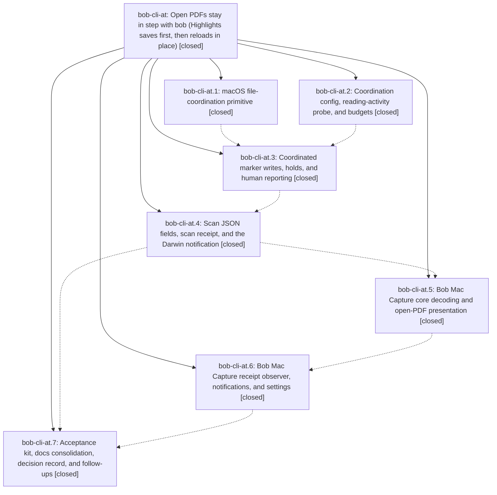

# Bead: bob-cli-at — Open PDFs stay in step with bob (Highlights saves first, then reloads in place)

[Bead Pages](../README.md) / bob-cli-at

**Status:** ✓ closed · **Resolution:** done · **Type:** ▸ plan · **Tier:** epic
**Owner:** `bryanbugyi34@gmail.com` · **Created by:** [bbugyi200.athena.research.56.linker.w0](https://github.com/bobs-org/bob-cli--agents/blob/main/sessions/bbugyi200.athena.research.56.linker.w0.md) · **Assignee:** `bob-cli-at.land`
**Created:** 2026-10-23 11:44:15 EDT · **Closed:** 2026-10-23 16:51:14 EDT
**Plan:** [202610/highlights\_coordinated\_marker\_writes.md](https://github.com/bobs-org/bob-cli--plans/blob/main/202610/highlights_coordinated_marker_writes.md)

<!-- sase:links:start -->

## Links

| Relation | Artifact | Why |
| --- | --- | --- |
| implemented-by | [plan:202610/highlights_coordinated_marker_writes.md][1] | derived from the plan's `bead_id:` frontmatter field |
| related | [bead:bob-cli-ay][2] | Follow-up proposed by bob-cli-at.7; builds on the coordinated marker-write executor, hold vocabulary, and decisions:open-pdf-writes-are-coordinated |
| related | [bead:bob-cli-az][3] | Follow-up proposed by bob-cli-at.7; builds on the coordinated marker-write executor, hold vocabulary, and decisions:open-pdf-writes-are-coordinated |
| related | [bead:bob-cli-b0][4] | Follow-up proposed by bob-cli-at.7; builds on the coordinated marker-write executor, hold vocabulary, and decisions:open-pdf-writes-are-coordinated |
| related | [bead:bob-cli-b1][5] | Follow-up proposed by bob-cli-at.7; builds on the coordinated marker-write executor, hold vocabulary, and decisions:open-pdf-writes-are-coordinated |

_Plus 5 automatic references — see [Referenced By](#referenced-by)._

[1]: https://github.com/bobs-org/bob-cli--plans/blob/main/202610/highlights_coordinated_marker_writes.md
[2]: https://github.com/bobs-org/bob-cli--beads/blob/main/pages/bob-cli-ay/README.md
[3]: https://github.com/bobs-org/bob-cli--beads/blob/main/pages/bob-cli-az/README.md
[4]: https://github.com/bobs-org/bob-cli--beads/blob/main/pages/bob-cli-b0/README.md
[5]: https://github.com/bobs-org/bob-cli--beads/blob/main/pages/bob-cli-b1/README.md

<!-- sase:links:end -->

## Description

When `bob ref scan` or `bob ref sync -w` on the Mac updates a ref PDF's page-1 marker, it never again strands an open Highlights document. bob writes through a bounded macOS file-coordination write (`NSFileCoordinator`, `.forMerging`). macOS has Highlights save your unsaved annotations first, bob re-checks the marker in the fresh bytes and writes, and Highlights reloads the same tab in place: no dialog, no keystroke, no tab change. Anything uncertain becomes a hold: nothing is written for that PDF, and the next scan retries. That covers you actively reading in Highlights, Highlights not answering, and the marker changing under bob. CLI and JSON always report what happened. Bob Mac Capture posts one quiet, grouped notification, only when a PDF that is open in Highlights was refreshed or Highlights needs you. The feature ships behind `highlights.coordinate_pdf_writes` and is enabled after a guided real-Highlights acceptance test.

## Notes

[2026-10-23T20:51:14Z · bob-cli-at.land] Land verification: read all 7 phase beads and notes and the epic commits (bob-cli 6480e7cc, 0aec807c, cd4bc7a0, faa9a757, 134016ce; bob-mac-capture 9fb67f3, 6dc2c12), and reviewed the source. It matches the DECISIONS: -a/--attended flag (not env); decisions:open-pdf-writes-are-coordinated strand written. Checked: ForMerging primitive with watchdog cancel and atomic gate; PdfWritePolicy and probe; executor wraps the whole v1/v2 sequence with the in-accessor digest/marker re-check, all three hold reasons, scan cap, and Failed->write failure (never an uncoordinated fallback); held lines/summary; JSON summary.held, notes[].marker_write, and held[] in contract order; 0600 receipt plus notify_post on every locked writing scan; Mac observer, classifier, passive notifications, settings toggle, and -a retry; acceptance kit and docs. Live evidence: the Mac cron wrote a valid receipt at 16:45. Epic-caused issues fixed while landing: (1) bob-cli CI lint was red on 134016ce because the acceptance --self-test minted its seed via ref create seed.md, which needs pandoc+xelatex. It now writes a minimal local PDF (stamp route) and prints the log tail on failure; just check-scripts passes with BOB_PANDOC_COMMAND=/nonexistent. (2) bob-mac-capture master did not compile on macOS CI (6dc2c12: missing 'import notify', covariant Self in a default argument, XCTAssertTrue on a Void performBannerAction). Fixed and compiled on the Mac (bundle.sh plus just typecheck-tests exit 0); XCTest runtime is left to macOS CI. (3) Removed the stale test-only dead_code allow on HoldReason::as_str (now used by scan JSON) and moved hold_verbose_phrase into tests. Verified: just check, just fmt, just lint, just check-scripts, just check-release-tools exit 0; epic-symbols empty. Integration: the non-epic commits since start (c07a65cc rotten-log, e860379a vault-sync doc, 9885bde1 ref ID allocation; mac 8674946, 3343c5e) don't touch coordinated writes; 9885bde1's stamp atomic_save_pdf caller is covered by bob-cli-az. Follow-ups from bob-cli-at.7: #1 -> bob-cli-ay (small, gated on Bryan's Mac acceptance run); #2 -> bob-cli-az (large); #3+#4 merged -> bob-cli-b0 (large; #4's answer decides whether #3 is needed); #5 -> bob-cli-b1 (large); #6 duplicate of bob-cli-30 (+1 with a fresh Mac crontab and empty-log re-check, and the receipt as partial mitigation); #7 recorded as a note on bob-cli-6h (receipt channel exists); #8 Plan B declined: it applies only if acceptance fails, and the decision record's Reopens-when and the kit verdict already route that outcome.

## Phases

| Bead | Title | Status | Size | Created | Agents | Commits |
|---|---|---|---|---|---:|---:|
| [bob-cli-at.1](bob-cli-at.1.md) | macOS file-coordination primitive | ✓ closed | medium | 2026-10-23 | 1 | 1 |
| [bob-cli-at.2](bob-cli-at.2.md) | Coordination config, reading-activity probe, and budgets | ✓ closed | small | 2026-10-23 | 1 | 1 |
| [bob-cli-at.3](bob-cli-at.3.md) | Coordinated marker writes, holds, and human reporting | ✓ closed | medium | 2026-10-23 | 1 | 1 |
| [bob-cli-at.4](bob-cli-at.4.md) | Scan JSON fields, scan receipt, and the Darwin notification | ✓ closed | medium | 2026-10-23 | 1 | 1 |
| [bob-cli-at.5](bob-cli-at.5.md) | Bob Mac Capture core decoding and open-PDF presentation | ✓ closed | medium | 2026-10-23 | 1 | 1 |
| [bob-cli-at.6](bob-cli-at.6.md) | Bob Mac Capture receipt observer, notifications, and settings | ✓ closed | medium | 2026-10-23 | 1 | 1 |
| [bob-cli-at.7](bob-cli-at.7.md) | Acceptance kit, docs consolidation, decision record, and follow-ups | ✓ closed | medium | 2026-10-23 | 1 | 1 |

## Lineage

## Agents

| Agent | Bead | Commits |
|---|---|---:|
| [bbugyi200.athena.bob-cli-at.1](https://github.com/bobs-org/bob-cli--agents/blob/main/sessions/bbugyi200.athena.bob-cli-at.1.md) | [bob-cli-at.1](bob-cli-at.1.md) | 1 |
| [bbugyi200.athena.bob-cli-at.2](https://github.com/bobs-org/bob-cli--agents/blob/main/sessions/bbugyi200.athena.bob-cli-at.2.md) | [bob-cli-at.2](bob-cli-at.2.md) | 1 |
| [bbugyi200.athena.bob-cli-at.3](https://github.com/bobs-org/bob-cli--agents/blob/main/agents/bbugyi200.athena.bob-cli-at.3/README.md) | [bob-cli-at.3](bob-cli-at.3.md) | 1 |
| [bbugyi200.athena.bob-cli-at.4](https://github.com/bobs-org/bob-cli--agents/blob/main/agents/bbugyi200.athena.bob-cli-at.4/README.md) | [bob-cli-at.4](bob-cli-at.4.md) | 1 |
| [bbugyi200.athena.bob-cli-at.5](https://github.com/bobs-org/bob-cli--agents/blob/main/sessions/bbugyi200.athena.bob-cli-at.5.md) | [bob-cli-at.5](bob-cli-at.5.md) | 1 |
| [bbugyi200.athena.bob-cli-at.6](https://github.com/bobs-org/bob-cli--agents/blob/main/agents/bbugyi200.athena.bob-cli-at.6/README.md) | [bob-cli-at.6](bob-cli-at.6.md) | 1 |
| [bbugyi200.athena.bob-cli-at.7](https://github.com/bobs-org/bob-cli--agents/blob/main/agents/bbugyi200.athena.bob-cli-at.7/README.md) | [bob-cli-at.7](bob-cli-at.7.md) | 1 |
| [bbugyi200.athena.bob-cli-at.land](https://github.com/bobs-org/bob-cli--agents/blob/main/agents/bbugyi200.athena.bob-cli-at.land/README.md) | [bob-cli-at](README.md) | 2 |

## Commits

| Repo | Commit | Subject | Bead | Committed |
|---|---|---|---|---|
| bob-cli | [`6480e7c`](https://github.com/bobs-org/bob-cli/commit/6480e7cc7c84d168559cad6b4d3ec9c5831af3d6) | feat(highlights-ref): stage PDF write policy and reading-activity probe | [bob-cli-at.2](bob-cli-at.2.md) | 2026-10-23 12:21:55 EDT |
| bob-cli | [`0aec807`](https://github.com/bobs-org/bob-cli/commit/0aec807c422c4a1d3d1be6ba5daa078473242071) | feat(native): add bounded macOS file coordination | [bob-cli-at.1](bob-cli-at.1.md) | 2026-10-23 12:44:36 EDT |
| bob-cli | [`cd4bc7a`](https://github.com/bobs-org/bob-cli/commit/cd4bc7a0cb23cb6d1eb13fc2c66da7d17d6a9eb7) | feat(highlights): coordinate PDF marker writes with holds and human reporting | [bob-cli-at.3](bob-cli-at.3.md) | 2026-10-23 13:49:27 EDT |
| bob-cli | [`faa9a75`](https://github.com/bobs-org/bob-cli/commit/faa9a7579d681a4ccbfe47c39155b183df1ec13a) | feat(highlights-ref): add scan JSON held fields, scan receipt, and Darwin notification | [bob-cli-at.4](bob-cli-at.4.md) | 2026-10-23 14:32:05 EDT |
| bob-mac-capture | [`bob-mac-capture@9fb67f3`](https://github.com/bobs-org/bob-mac-capture/commit/9fb67f324f7500a63a184add96b4b03f4254f74f) | feat(refs): decode scan receipts and present PDF updates | [bob-cli-at.5](bob-cli-at.5.md) | 2026-10-23 15:28:44 EDT |
| bob-mac-capture | [`bob-mac-capture@6dc2c12`](https://github.com/bobs-org/bob-mac-capture/commit/6dc2c126ea4c1c7de683c672c714f48828690171) | feat(refs): observe scan receipts and notify for open PDF updates | [bob-cli-at.6](bob-cli-at.6.md) | 2026-10-23 15:56:42 EDT |
| bob-cli | [`134016c`](https://github.com/bobs-org/bob-cli/commit/134016cec23b93c2191c404a812d050f50653833) | feat(highlights): add coordinated PDF writes acceptance kit and docs | [bob-cli-at.7](bob-cli-at.7.md) | 2026-10-23 16:18:23 EDT |
| bob-cli | [`7e3bdb2`](https://github.com/bobs-org/bob-cli/commit/7e3bdb2e25285d788d82975dcf7958ffabb17ae7) | fix(highlights): make the coordination acceptance self-test run without pandoc | [bob-cli-at](README.md) | 2026-10-23 16:52:13 EDT |
| bob-mac-capture | [`bob-mac-capture@6e1f84c`](https://github.com/bobs-org/bob-mac-capture/commit/6e1f84c10748598cdf862469aeec2baa136103a7) | fix(refs): compile the scan receipt observer on macOS | [bob-cli-at](README.md) | 2026-10-23 16:52:56 EDT |

<!-- sase:referenced-by:start -->

## Referenced By

| Relation | Artifact | Why | Uses |
| --- | --- | --- | ---: |
| read-by | [agent:bob-cli-at.2--2][1] | Need epic DECISIONS and phase list to confirm this phase's remaining work | 1 |
| read-by | [agent:bob-cli-at.3][2] | Need parent epic decisions, phase list, and design context | 1 |
| read-by | [agent:bob-cli-at.4][3] | epic context for phase 4 | 1 |
| read-by | [agent:bob-cli-at.6][4] | Need epic-level DECISIONS, phase list, and remaining work context | 1 |
| read-by | [agent:bob-cli-at.7][5] | epic context | 1 |

[1]: https://github.com/bobs-org/bob-cli--agents/blob/main/sessions/bbugyi200.athena.bob-cli-at.2.md
[2]: https://github.com/bobs-org/bob-cli--agents/blob/main/agents/bbugyi200.athena.bob-cli-at.3/README.md
[3]: https://github.com/bobs-org/bob-cli--agents/blob/main/agents/bbugyi200.athena.bob-cli-at.4/README.md
[4]: https://github.com/bobs-org/bob-cli--agents/blob/main/agents/bbugyi200.athena.bob-cli-at.6/README.md
[5]: https://github.com/bobs-org/bob-cli--agents/blob/main/agents/bbugyi200.athena.bob-cli-at.7/README.md

<!-- sase:referenced-by:end -->
