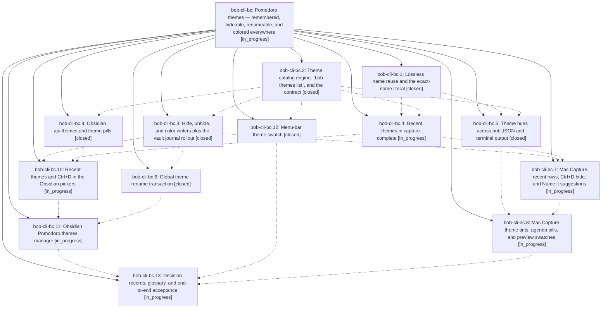

# Bead: bob-cli-bc — Pomodoro themes — remembered, hideable, renameable, and colored everywhere

[Bead Pages](../README.md) / bob-cli-bc

**Status:** ◐ in_progress · **Type:** ▸ plan · **Tier:** epic
**Owner:** `bryanbugyi34@gmail.com` · **Created by:** [bbugyi200.apollo.research.2c.linker.w1](https://github.com/bobs-org/bob-cli--agents/blob/main/sessions/bbugyi200.apollo.research.2c.linker.w1.md) · **Assignee:** `bob-cli-bc.land`
**Created:** 2026-10-24 07:52:22 EDT
**Plan:** [202610/pomodoro\_themes.md](https://github.com/bobs-org/bob-cli--plans/blob/main/202610/pomodoro_themes.md)

<!-- sase:links:start -->

## Links

| Relation | Artifact | Why |
| --- | --- | --- |
| implemented-by | [plan:202610/pomodoro_themes.md][1] | derived from the plan's `bead_id:` frontmatter field |

_Plus 1 automatic references — see [Referenced By](#referenced-by)._

[1]: https://github.com/bobs-org/bob-cli--plans/blob/main/202610/pomodoro_themes.md

<!-- sase:links:end -->

## Description

Every Pomodoro-name menu (Bob Mac Capture, zsh, and the Obsidian pickers) lists today's names first and then previously used themes, and accepting a row submits exactly the name it shows. Ctrl+D hides a stale theme from suggestions in place, with undo. One bob transaction renames a theme across every daily note in a single revertable commit. Each theme wears a stable, learnable hue — in Obsidian Live Preview and Reading view, the plan block, Stats, Mac Capture, the CLI, tmux, and the menu bar — from one rule owned by bob.

## Phases

| Bead | Title | Status | Size | Created | Agents | Commits |
|---|---|---|---|---|---:|---:|
| [bob-cli-bc.1](bob-cli-bc.1.md) | Lossless name reuse and the exact-name literal | ✓ closed | medium | 2026-10-24 | 1 | 1 |
| [bob-cli-bc.10](bob-cli-bc.10.md) | Recent themes and Ctrl+D in the Obsidian pickers | ◐ in_progress | medium | 2026-10-24 | 1 | 0 |
| [bob-cli-bc.11](bob-cli-bc.11.md) | Obsidian Pomodoro themes manager | ◐ in_progress | medium | 2026-10-24 | 1 | 0 |
| [bob-cli-bc.12](bob-cli-bc.12.md) | Menu-bar theme swatch | ✓ closed | small | 2026-10-24 | 1 | 0 |
| [bob-cli-bc.13](bob-cli-bc.13.md) | Decision records, glossary, and end-to-end acceptance | ◐ in_progress | medium | 2026-10-24 | 1 | 0 |
| [bob-cli-bc.2](bob-cli-bc.2.md) | Theme catalog engine, \`bob themes list\`, and the contract | ✓ closed | medium | 2026-10-24 | 1 | 1 |
| [bob-cli-bc.3](bob-cli-bc.3.md) | Hide, unhide, and color writers plus the vault journal rollout | ✓ closed | medium | 2026-10-24 | 1 | 1 |
| [bob-cli-bc.4](bob-cli-bc.4.md) | Recent themes in capture-complete | ◐ in_progress | medium | 2026-10-24 | 1 | 0 |
| [bob-cli-bc.5](bob-cli-bc.5.md) | Theme hues across bob JSON and terminal output | ✓ closed | medium | 2026-10-24 | 1 | 1 |
| [bob-cli-bc.6](bob-cli-bc.6.md) | Global theme rename transaction | ✓ closed | medium | 2026-10-24 | 1 | 1 |
| [bob-cli-bc.7](bob-cli-bc.7.md) | Mac Capture recent rows, Ctrl+D hide, and Name it suggestions | ◐ in_progress | medium | 2026-10-24 | 1 | 0 |
| [bob-cli-bc.8](bob-cli-bc.8.md) | Mac Capture theme tints, agenda pills, and preview swatches | ◐ in_progress | medium | 2026-10-24 | 1 | 0 |
| [bob-cli-bc.9](bob-cli-bc.9.md) | Obsidian api.themes and theme pills | ✓ closed | medium | 2026-10-24 | 1 | 0 |

## Lineage

## Agents

| Agent | Bead | Commits |
|---|---|---:|
| [bbugyi200.apollo.bob-cli-bc.1](https://github.com/bobs-org/bob-cli--agents/blob/main/agents/bbugyi200.apollo.bob-cli-bc.1/README.md) | [bob-cli-bc.1](bob-cli-bc.1.md) | 1 |
| [bbugyi200.apollo.bob-cli-bc.10](https://github.com/bobs-org/bob-cli--agents/blob/main/agents/bbugyi200.apollo.bob-cli-bc.10/README.md) | [bob-cli-bc.10](bob-cli-bc.10.md) | 0 |
| [bbugyi200.apollo.bob-cli-bc.11](https://github.com/bobs-org/bob-cli--agents/blob/main/agents/bbugyi200.apollo.bob-cli-bc.11/README.md) | [bob-cli-bc.11](bob-cli-bc.11.md) | 0 |
| [bbugyi200.apollo.bob-cli-bc.12](https://github.com/bobs-org/bob-cli--agents/blob/main/agents/bbugyi200.apollo.bob-cli-bc.12/README.md) | [bob-cli-bc.12](bob-cli-bc.12.md) | 0 |
| [bbugyi200.apollo.bob-cli-bc.13](https://github.com/bobs-org/bob-cli--agents/blob/main/agents/bbugyi200.apollo.bob-cli-bc.13/README.md) | [bob-cli-bc.13](bob-cli-bc.13.md) | 0 |
| [bbugyi200.apollo.bob-cli-bc.2](https://github.com/bobs-org/bob-cli--agents/blob/main/agents/bbugyi200.apollo.bob-cli-bc.2/README.md) | [bob-cli-bc.2](bob-cli-bc.2.md) | 1 |
| [bbugyi200.apollo.bob-cli-bc.3](https://github.com/bobs-org/bob-cli--agents/blob/main/agents/bbugyi200.apollo.bob-cli-bc.3/README.md) | [bob-cli-bc.3](bob-cli-bc.3.md) | 1 |
| [bbugyi200.apollo.bob-cli-bc.4](https://github.com/bobs-org/bob-cli--agents/blob/main/sessions/bbugyi200.apollo.bob-cli-bc.4.md) | [bob-cli-bc.4](bob-cli-bc.4.md) | 0 |
| [bbugyi200.apollo.bob-cli-bc.5](https://github.com/bobs-org/bob-cli--agents/blob/main/sessions/bbugyi200.apollo.bob-cli-bc.5.md) | [bob-cli-bc.5](bob-cli-bc.5.md) | 1 |
| [bbugyi200.apollo.bob-cli-bc.6](https://github.com/bobs-org/bob-cli--agents/blob/main/agents/bbugyi200.apollo.bob-cli-bc.6/README.md) | [bob-cli-bc.6](bob-cli-bc.6.md) | 1 |
| [bbugyi200.apollo.bob-cli-bc.7](https://github.com/bobs-org/bob-cli--agents/blob/main/agents/bbugyi200.apollo.bob-cli-bc.7/README.md) | [bob-cli-bc.7](bob-cli-bc.7.md) | 0 |
| [bbugyi200.apollo.bob-cli-bc.8](https://github.com/bobs-org/bob-cli--agents/blob/main/agents/bbugyi200.apollo.bob-cli-bc.8/README.md) | [bob-cli-bc.8](bob-cli-bc.8.md) | 0 |
| [bbugyi200.apollo.bob-cli-bc.9](https://github.com/bobs-org/bob-cli--agents/blob/main/agents/bbugyi200.apollo.bob-cli-bc.9/README.md) | [bob-cli-bc.9](bob-cli-bc.9.md) | 0 |
| [bbugyi200.apollo.bob-cli-bc.land](https://github.com/bobs-org/bob-cli--agents/blob/main/agents/bbugyi200.apollo.bob-cli-bc.land/README.md) | [bob-cli-bc](README.md) | 0 |

## Commits

| Repo | Commit | Subject | Bead | Committed |
|---|---|---|---|---|
| bob-cli | [`5c9cfda`](https://github.com/bobs-org/bob-cli/commit/5c9cfda1271438107bac7f1fd8e47849181e4454) | feat(themes): add derived catalog and bob themes list | [bob-cli-bc.2](bob-cli-bc.2.md) | 2026-10-24 08:41:17 EDT |
| bob-cli | [`32e0e8f`](https://github.com/bobs-org/bob-cli/commit/32e0e8fa6b679793c7cc27b844f26fe285a3a254) | feat(capture): support exact-name literals with docs and regression tests | [bob-cli-bc.1](bob-cli-bc.1.md) | 2026-10-24 09:36:57 EDT |
| bob-cli | [`f6f7909`](https://github.com/bobs-org/bob-cli/commit/f6f79099a6ca7a5c9f94b30c7e5280825a6331b8) | feat(themes): add hide, unhide, and color journal writers | [bob-cli-bc.3](bob-cli-bc.3.md) | 2026-10-24 09:41:48 EDT |
| bob-cli | [`4a6f449`](https://github.com/bobs-org/bob-cli/commit/4a6f4494fdfb8a40c2d7c0e002040b52f37b2014) | feat(themes): add global theme rename transaction | [bob-cli-bc.6](bob-cli-bc.6.md) | 2026-10-24 10:21:49 EDT |
| bob-cli | [`8628ce2`](https://github.com/bobs-org/bob-cli/commit/8628ce2f7acdf9a27f4d8ba1c6117638afe34371) | feat(themes): add theme refs to capture-parse spans, agenda, plan, stats and capture output plus CLI and tmux swatches | [bob-cli-bc.5](bob-cli-bc.5.md) | 2026-10-24 11:56:30 EDT |

<!-- sase:referenced-by:start -->

## Referenced By

| Relation | Artifact | Why | Uses |
| --- | --- | --- | ---: |
| read-by | [agent:bob-cli-bc.9][1] | epic context for phase | 1 |

[1]: https://github.com/bobs-org/bob-cli--agents/blob/main/agents/bbugyi200.apollo.bob-cli-bc.9/README.md

<!-- sase:referenced-by:end -->
