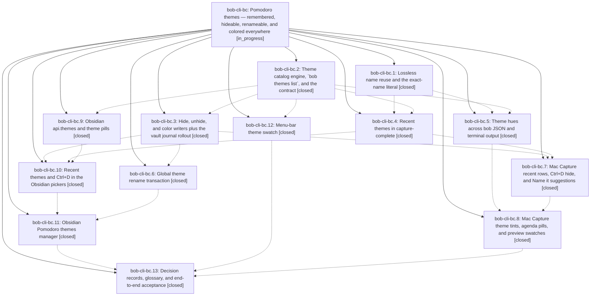

# Bead: bob-cli-bc — Pomodoro themes — remembered, hideable, renameable, and colored everywhere

[Bead Pages](../README.md) / bob-cli-bc

**Status:** ◐ in_progress · **Type:** ▸ plan · **Tier:** epic
**Owner:** `bryanbugyi34@gmail.com` · **Created by:** [bbugyi200.apollo.research.2c.linker.w1](https://github.com/bobs-org/bob-cli--agents/blob/main/sessions/bbugyi200.apollo.research.2c.linker.w1.md) · **Assignee:** `bob-cli-bc.land`
**Created:** 2026-10-24 07:52:22 EDT
**Plan:** [202610/pomodoro\_themes.md](https://github.com/bobs-org/bob-cli--plans/blob/main/202610/pomodoro_themes.md)

<!-- sase:links:start -->

## Links

| Relation | Artifact | Why |
| --- | --- | --- |
| implemented-by | [plan:202610/pomodoro_themes.md][1] | derived from the plan's `bead_id:` frontmatter field |

_Plus 3 automatic references — see [Referenced By](#referenced-by)._

[1]: https://github.com/bobs-org/bob-cli--plans/blob/main/202610/pomodoro_themes.md

<!-- sase:links:end -->

## Description

Every Pomodoro-name menu (Bob Mac Capture, zsh, and the Obsidian pickers) lists today's names first and then previously used themes, and accepting a row submits exactly the name it shows. Ctrl+D hides a stale theme from suggestions in place, with undo. One bob transaction renames a theme across every daily note in a single revertable commit. Each theme wears a stable, learnable hue — in Obsidian Live Preview and Reading view, the plan block, Stats, Mac Capture, the CLI, tmux, and the menu bar — from one rule owned by bob.

## Notes

[2026-10-24T16:04:36Z · bob-cli-an.6.6.6.5.6.land--1] DISCOVERED ISSUE: batch-6 lander canonical just check at ae3a432b (monitor k6801vdb6tkm, tool run 2f76e99b9e130bffae47a70bab134ae6) fails native::completion::kinds::tests::every_value_arg_has_a_decision: value-taking args without a kinds decision [themes rename:old, themes rename:new]. Root cause: bc.6 commit 4a6f4494 added the two rename positionals without the completion registry decisions in src/native/completion/kinds.rs. All theme behavior tests passed; fmt/clippy pass. This is unrelated to batch 6. All-status task search plus recent CI sweep found only closed 4j (audio argument, distinct cause); no new task because this active epic owns rename integration.

[2026-10-24T17:09:05Z · bob-cli-bd.land] DISCOVERED ISSUE corroboration from bob-cli-bd.land (proposed by bob-cli-bd.6 note #1 and bob-cli-bd.7--1 note #2): just check on master 2eb98129 (plus bd landing's sidecar-only diff) still fails exactly one node, native::completion::kinds::tests::every_value_arg_has_a_decision — value-taking args without a kinds decision: [themes rename:old, themes rename:new]. All 2005 CLI tests and every other lib test pass. Root cause is bc.6 commit 4a6f4494, as note #1 says; no task created because this active epic owns it.

[2026-10-24T17:27:09Z · bob-cli-an.6.6.6.5.6.5.land] DISCOVERED ISSUE corroboration from bob-cli-an.6.6.6.5.6.5.land: proposals from .1 note #4, .2 note #1, and .3 note #1 all reproduce every_value_arg_has_a_decision missing themes rename:old/new on their clean bases and changed trees (including 8628ce2f and ToolRun 9e9ae28d687b3e9d1f225fb95db35ec1). Read bc.6 and commit 4a6f4494; same active causal ownership as notes #1/#2. All-status/recent CI searches find only closed 4j for a distinct --audio argument; no duplicate task filed. Evidence is relayed from the proposing phases, not a new check run by this lander.

[2026-10-24T18:02:29Z · bob-cli-an.6.6.6.5.6.5.land--1] DISCOVERED ISSUE from batch-7 canonical check (2026-10-24): on current HEAD 2da7bbef, tests/cli/help_options.rs::capture_complete_help_lists_options_alphabetically fails even when run alone. The assertion has required `creates the named placeholder later` since 7d1c8dd30 (2026-09-28). The captured `bob capture-complete --help` output contains the other asserted strings but omits this required phrase; 2da7bbef changed the corresponding Pomodoro-start-name help paragraph, replacing the placeholder/create-row description with `A planned placeholder that a bare = would start carries next_up`. The change is in the active themes completion work, not batch 7; route the help-contract repair through this epic. The batch-7 work did not change capture-complete help.

## Phases

| Bead | Title | Status | Size | Created | Agents | Commits |
|---|---|---|---|---|---:|---:|
| [bob-cli-bc.1](bob-cli-bc.1.md) | Lossless name reuse and the exact-name literal | ✓ closed | medium | 2026-10-24 | 1 | 1 |
| [bob-cli-bc.10](bob-cli-bc.10.md) | Recent themes and Ctrl+D in the Obsidian pickers | ✓ closed | medium | 2026-10-24 | 1 | 1 |
| [bob-cli-bc.11](bob-cli-bc.11.md) | Obsidian Pomodoro themes manager | ✓ closed | medium | 2026-10-24 | 1 | 1 |
| [bob-cli-bc.12](bob-cli-bc.12.md) | Menu-bar theme swatch | ✓ closed | small | 2026-10-24 | 1 | 1 |
| [bob-cli-bc.13](bob-cli-bc.13.md) | Decision records, glossary, and end-to-end acceptance | ✓ closed | medium | 2026-10-24 | 1 | 1 |
| [bob-cli-bc.2](bob-cli-bc.2.md) | Theme catalog engine, \`bob themes list\`, and the contract | ✓ closed | medium | 2026-10-24 | 1 | 1 |
| [bob-cli-bc.3](bob-cli-bc.3.md) | Hide, unhide, and color writers plus the vault journal rollout | ✓ closed | medium | 2026-10-24 | 1 | 1 |
| [bob-cli-bc.4](bob-cli-bc.4.md) | Recent themes in capture-complete | ✓ closed | medium | 2026-10-24 | 1 | 1 |
| [bob-cli-bc.5](bob-cli-bc.5.md) | Theme hues across bob JSON and terminal output | ✓ closed | medium | 2026-10-24 | 1 | 1 |
| [bob-cli-bc.6](bob-cli-bc.6.md) | Global theme rename transaction | ✓ closed | medium | 2026-10-24 | 1 | 1 |
| [bob-cli-bc.7](bob-cli-bc.7.md) | Mac Capture recent rows, Ctrl+D hide, and Name it suggestions | ✓ closed | medium | 2026-10-24 | 1 | 1 |
| [bob-cli-bc.8](bob-cli-bc.8.md) | Mac Capture theme tints, agenda pills, and preview swatches | ✓ closed | medium | 2026-10-24 | 1 | 1 |
| [bob-cli-bc.9](bob-cli-bc.9.md) | Obsidian api.themes and theme pills | ✓ closed | medium | 2026-10-24 | 1 | 1 |

## Lineage

## Agents

| Agent | Bead | Commits |
|---|---|---:|
| [bbugyi200.apollo.bob-cli-bc.1](https://github.com/bobs-org/bob-cli--agents/blob/main/agents/bbugyi200.apollo.bob-cli-bc.1/README.md) | [bob-cli-bc.1](bob-cli-bc.1.md) | 1 |
| [bbugyi200.apollo.bob-cli-bc.10](https://github.com/bobs-org/bob-cli--agents/blob/main/agents/bbugyi200.apollo.bob-cli-bc.10/README.md) | [bob-cli-bc.10](bob-cli-bc.10.md) | 1 |
| [bbugyi200.apollo.bob-cli-bc.11](https://github.com/bobs-org/bob-cli--agents/blob/main/agents/bbugyi200.apollo.bob-cli-bc.11/README.md) | [bob-cli-bc.11](bob-cli-bc.11.md) | 1 |
| [bbugyi200.apollo.bob-cli-bc.12](https://github.com/bobs-org/bob-cli--agents/blob/main/agents/bbugyi200.apollo.bob-cli-bc.12/README.md) | [bob-cli-bc.12](bob-cli-bc.12.md) | 1 |
| [bbugyi200.apollo.bob-cli-bc.13](https://github.com/bobs-org/bob-cli--agents/blob/main/agents/bbugyi200.apollo.bob-cli-bc.13/README.md) | [bob-cli-bc.13](bob-cli-bc.13.md) | 1 |
| [bbugyi200.apollo.bob-cli-bc.2](https://github.com/bobs-org/bob-cli--agents/blob/main/agents/bbugyi200.apollo.bob-cli-bc.2/README.md) | [bob-cli-bc.2](bob-cli-bc.2.md) | 1 |
| [bbugyi200.apollo.bob-cli-bc.3](https://github.com/bobs-org/bob-cli--agents/blob/main/agents/bbugyi200.apollo.bob-cli-bc.3/README.md) | [bob-cli-bc.3](bob-cli-bc.3.md) | 1 |
| [bbugyi200.apollo.bob-cli-bc.4](https://github.com/bobs-org/bob-cli--agents/blob/main/agents/bbugyi200.apollo.bob-cli-bc.4/README.md) | [bob-cli-bc.4](bob-cli-bc.4.md) | 1 |
| [bbugyi200.apollo.bob-cli-bc.5](https://github.com/bobs-org/bob-cli--agents/blob/main/sessions/bbugyi200.apollo.bob-cli-bc.5.md) | [bob-cli-bc.5](bob-cli-bc.5.md) | 1 |
| [bbugyi200.apollo.bob-cli-bc.6](https://github.com/bobs-org/bob-cli--agents/blob/main/agents/bbugyi200.apollo.bob-cli-bc.6/README.md) | [bob-cli-bc.6](bob-cli-bc.6.md) | 1 |
| [bbugyi200.apollo.bob-cli-bc.7](https://github.com/bobs-org/bob-cli--agents/blob/main/sessions/bbugyi200.apollo.bob-cli-bc.7.md) | [bob-cli-bc.7](bob-cli-bc.7.md) | 1 |
| [bbugyi200.apollo.bob-cli-bc.8](https://github.com/bobs-org/bob-cli--agents/blob/main/agents/bbugyi200.apollo.bob-cli-bc.8/README.md) | [bob-cli-bc.8](bob-cli-bc.8.md) | 1 |
| [bbugyi200.apollo.bob-cli-bc.9](https://github.com/bobs-org/bob-cli--agents/blob/main/agents/bbugyi200.apollo.bob-cli-bc.9/README.md) | [bob-cli-bc.9](bob-cli-bc.9.md) | 1 |
| [bbugyi200.apollo.bob-cli-bc.land](https://github.com/bobs-org/bob-cli--agents/blob/main/agents/bbugyi200.apollo.bob-cli-bc.land/README.md) | [bob-cli-bc](README.md) | 0 |

## Commits

| Repo | Commit | Subject | Bead | Committed |
|---|---|---|---|---|
| bob-cli | [`5c9cfda`](https://github.com/bobs-org/bob-cli/commit/5c9cfda1271438107bac7f1fd8e47849181e4454) | feat(themes): add derived catalog and bob themes list | [bob-cli-bc.2](bob-cli-bc.2.md) | 2026-10-24 08:41:17 EDT |
| chezmoi | [`chezmoi@a078759`](https://github.com/bbugyi200/dotfiles/commit/a07875989fa4f67eed4c491fc8c26329c2c369b1) | feat(hammerspoon): prepend Pomodoro theme swatches in the menu bar | [bob-cli-bc.12](bob-cli-bc.12.md) | 2026-10-24 08:59:05 EDT |
| bob-plugins | [`bob-plugins@d2699df`](https://github.com/bobs-org/bob-plugins/commit/d2699df8c5a6bcba72f45a58661cafc9991f3860) | feat(ledger-tools): add api.themes v1 and theme pills rendering | [bob-cli-bc.9](bob-cli-bc.9.md) | 2026-10-24 09:17:01 EDT |
| bob-cli | [`32e0e8f`](https://github.com/bobs-org/bob-cli/commit/32e0e8fa6b679793c7cc27b844f26fe285a3a254) | feat(capture): support exact-name literals with docs and regression tests | [bob-cli-bc.1](bob-cli-bc.1.md) | 2026-10-24 09:36:57 EDT |
| bob-cli | [`f6f7909`](https://github.com/bobs-org/bob-cli/commit/f6f79099a6ca7a5c9f94b30c7e5280825a6331b8) | feat(themes): add hide, unhide, and color journal writers | [bob-cli-bc.3](bob-cli-bc.3.md) | 2026-10-24 09:41:48 EDT |
| bob-cli | [`4a6f449`](https://github.com/bobs-org/bob-cli/commit/4a6f4494fdfb8a40c2d7c0e002040b52f37b2014) | feat(themes): add global theme rename transaction | [bob-cli-bc.6](bob-cli-bc.6.md) | 2026-10-24 10:21:49 EDT |
| bob-cli | [`8628ce2`](https://github.com/bobs-org/bob-cli/commit/8628ce2f7acdf9a27f4d8ba1c6117638afe34371) | feat(themes): add theme refs to capture-parse spans, agenda, plan, stats and capture output plus CLI and tmux swatches | [bob-cli-bc.5](bob-cli-bc.5.md) | 2026-10-24 11:56:30 EDT |
| bob-cli | [`2da7bbe`](https://github.com/bobs-org/bob-cli/commit/2da7bbef2ee00e27c0dba4420fc6d2b4a2c61b3a) | feat(capture): suggest recent themes with lossless names | [bob-cli-bc.4](bob-cli-bc.4.md) | 2026-10-24 13:16:00 EDT |
| bob-plugins | [`bob-plugins@3825f19`](https://github.com/bobs-org/bob-plugins/commit/3825f19b832da75064f6684c7b1256f33bc9cd4b) | feat(plugins): add recent theme suggestions to Obsidian pickers | [bob-cli-bc.10](bob-cli-bc.10.md) | 2026-10-24 13:55:34 EDT |
| bob-mac-capture | [`bob-mac-capture@a49a08b`](https://github.com/bobs-org/bob-mac-capture/commit/a49a08b0c5bfb8ed50baec9424388188583c12e3) | feat(capture): add recent theme menus and name suggestions | [bob-cli-bc.7](bob-cli-bc.7.md) | 2026-10-24 14:11:37 EDT |
| bob-plugins | [`bob-plugins@1202c6a`](https://github.com/bobs-org/bob-plugins/commit/1202c6a0b1b47cdd973eb5d97d19ff3407bfb596) | feat(navigation): add Obsidian Pomodoro themes manager | [bob-cli-bc.11](bob-cli-bc.11.md) | 2026-10-24 14:26:00 EDT |
| bob-mac-capture | [`bob-mac-capture@a306745`](https://github.com/bobs-org/bob-mac-capture/commit/a3067457c12a016607582b699b68e643fd72ef61) | feat(mac-capture): theme tints, agenda pills, and preview swatches | [bob-cli-bc.8](bob-cli-bc.8.md) | 2026-10-24 14:52:45 EDT |
| bob-cli | [`7e41788`](https://github.com/bobs-org/bob-cli/commit/7e41788c090b8321ef914b7f245edfa6a9503fa5) | docs(themes): reconcile Pomodoro theme contract and glossary | [bob-cli-bc.13](bob-cli-bc.13.md) | 2026-10-24 15:36:18 EDT |

<!-- sase:referenced-by:start -->

## Referenced By

| Relation | Artifact | Why | Uses |
| --- | --- | --- | ---: |
| read-by | [agent:bob-cli-an.6.6.6.5.6.5.2][1] | Identify the existing owner and task evidence for clean-base just check failures | 1 |
| read-by | [agent:bob-cli-bc.5--6][2] | Need epic DECISIONS and phase list for theme-json close | 1 |
| read-by | [agent:bob-cli-bc.9][3] | epic context for phase | 1 |

[1]: https://github.com/bobs-org/bob-cli--agents/blob/main/agents/bbugyi200.apollo.bob-cli-an.6.6.6.5.6.5.2/README.md
[2]: https://github.com/bobs-org/bob-cli--agents/blob/main/sessions/bbugyi200.apollo.bob-cli-bc.5.md
[3]: https://github.com/bobs-org/bob-cli--agents/blob/main/agents/bbugyi200.apollo.bob-cli-bc.9/README.md

<!-- sase:referenced-by:end -->
