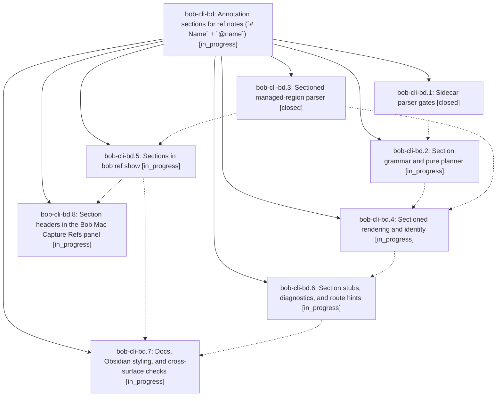

# Bead: bob-cli-bd — Annotation sections for ref notes (\`# Name\` + \`@name\`)

[Bead Pages](../README.md) / bob-cli-bd

**Status:** ◐ in_progress · **Type:** ▸ plan · **Tier:** epic
**Owner:** `bryanbugyi34@gmail.com` · **Created by:** [bbugyi200.apollo.research.2d.linker.w0](https://github.com/bobs-org/bob-cli--agents/blob/main/sessions/bbugyi200.apollo.research.2d.linker.w0.md) · **Assignee:** `bob-cli-bd.land`
**Created:** 2026-10-24 07:59:21 EDT
**Plan:** [202610/ref\_note\_annotation\_sections.md](https://github.com/bobs-org/bob-cli--plans/blob/main/202610/ref_note_annotation_sections.md)

<!-- sase:links:start -->

## Links

| Relation | Artifact | Why |
| --- | --- | --- |
| implemented-by | [plan:202610/ref_note_annotation_sections.md][1] | derived from the plan's `bead_id:` frontmatter field |

[1]: https://github.com/bobs-org/bob-cli--plans/blob/main/202610/ref_note_annotation_sections.md

<!-- sase:links:end -->

## Description

A Highlights sticky note whose first line is `# Name` declares a section, and every highlight, underline, image, or sticky note tagged `@name` renders grouped under it: real headings with a quiet section card in Obsidian, native section headers in the Bob Mac Capture Refs panel, and grouped output in every `bob ref show` format. Notes that never declare a section stay byte-identical, the grouping is re-derived from the annotations on every scan (nothing new is persisted), and adding, removing, or moving a tag never changes a `^h-` ID or re-creates a task.

## Phases

| Bead | Title | Status | Size | Created | Agents | Commits |
|---|---|---|---|---|---:|---:|
| [bob-cli-bd.1](bob-cli-bd.1.md) | Sidecar parser gates | ✓ closed | medium | 2026-10-24 | 1 | 1 |
| [bob-cli-bd.2](bob-cli-bd.2.md) | Section grammar and pure planner | ◐ in_progress | medium | 2026-10-24 | 1 | 0 |
| [bob-cli-bd.3](bob-cli-bd.3.md) | Sectioned managed-region parser | ✓ closed | medium | 2026-10-24 | 1 | 1 |
| [bob-cli-bd.4](bob-cli-bd.4.md) | Sectioned rendering and identity | ◐ in_progress | large | 2026-10-24 | 1 | 0 |
| [bob-cli-bd.5](bob-cli-bd.5.md) | Sections in bob ref show | ◐ in_progress | medium | 2026-10-24 | 1 | 0 |
| [bob-cli-bd.6](bob-cli-bd.6.md) | Section stubs, diagnostics, and route hints | ◐ in_progress | medium | 2026-10-24 | 1 | 0 |
| [bob-cli-bd.7](bob-cli-bd.7.md) | Docs, Obsidian styling, and cross-surface checks | ◐ in_progress | medium | 2026-10-24 | 1 | 0 |
| [bob-cli-bd.8](bob-cli-bd.8.md) | Section headers in the Bob Mac Capture Refs panel | ◐ in_progress | large | 2026-10-24 | 1 | 0 |

## Lineage

## Agents

| Agent | Bead | Commits |
|---|---|---:|
| [bbugyi200.apollo.bob-cli-bd.1](https://github.com/bobs-org/bob-cli--agents/blob/main/agents/bbugyi200.apollo.bob-cli-bd.1/README.md) | [bob-cli-bd.1](bob-cli-bd.1.md) | 1 |
| [bbugyi200.apollo.bob-cli-bd.2](https://github.com/bobs-org/bob-cli--agents/blob/main/agents/bbugyi200.apollo.bob-cli-bd.2/README.md) | [bob-cli-bd.2](bob-cli-bd.2.md) | 0 |
| [bbugyi200.apollo.bob-cli-bd.3](https://github.com/bobs-org/bob-cli--agents/blob/main/agents/bbugyi200.apollo.bob-cli-bd.3/README.md) | [bob-cli-bd.3](bob-cli-bd.3.md) | 1 |
| [bbugyi200.apollo.bob-cli-bd.4](https://github.com/bobs-org/bob-cli--agents/blob/main/agents/bbugyi200.apollo.bob-cli-bd.4/README.md) | [bob-cli-bd.4](bob-cli-bd.4.md) | 0 |
| [bbugyi200.apollo.bob-cli-bd.5](https://github.com/bobs-org/bob-cli--agents/blob/main/agents/bbugyi200.apollo.bob-cli-bd.5/README.md) | [bob-cli-bd.5](bob-cli-bd.5.md) | 0 |
| [bbugyi200.apollo.bob-cli-bd.6](https://github.com/bobs-org/bob-cli--agents/blob/main/agents/bbugyi200.apollo.bob-cli-bd.6/README.md) | [bob-cli-bd.6](bob-cli-bd.6.md) | 0 |
| [bbugyi200.apollo.bob-cli-bd.7](https://github.com/bobs-org/bob-cli--agents/blob/main/agents/bbugyi200.apollo.bob-cli-bd.7/README.md) | [bob-cli-bd.7](bob-cli-bd.7.md) | 0 |
| [bbugyi200.apollo.bob-cli-bd.8](https://github.com/bobs-org/bob-cli--agents/blob/main/agents/bbugyi200.apollo.bob-cli-bd.8/README.md) | [bob-cli-bd.8](bob-cli-bd.8.md) | 0 |
| [bbugyi200.apollo.bob-cli-bd.land](https://github.com/bobs-org/bob-cli--agents/blob/main/agents/bbugyi200.apollo.bob-cli-bd.land/README.md) | [bob-cli-bd](README.md) | 0 |

## Commits

| Repo | Commit | Subject | Bead | Committed |
|---|---|---|---|---|
| bob-cli | [`b7645d1`](https://github.com/bobs-org/bob-cli/commit/b7645d17ba1a98caf43b8607e863e16c03bb5fc1) | feat(highlights-ref): parse sectioned managed regions | [bob-cli-bd.3](bob-cli-bd.3.md) | 2026-10-24 08:22:20 EDT |
| bob-cli | [`6ec2f16`](https://github.com/bobs-org/bob-cli/commit/6ec2f16a564fe99b5582b15daa52dfdb9e785e64) | feat(highlights): keep hard-wrapped hash lines in quotes and scope page headings by level | [bob-cli-bd.1](bob-cli-bd.1.md) | 2026-10-24 08:48:27 EDT |
