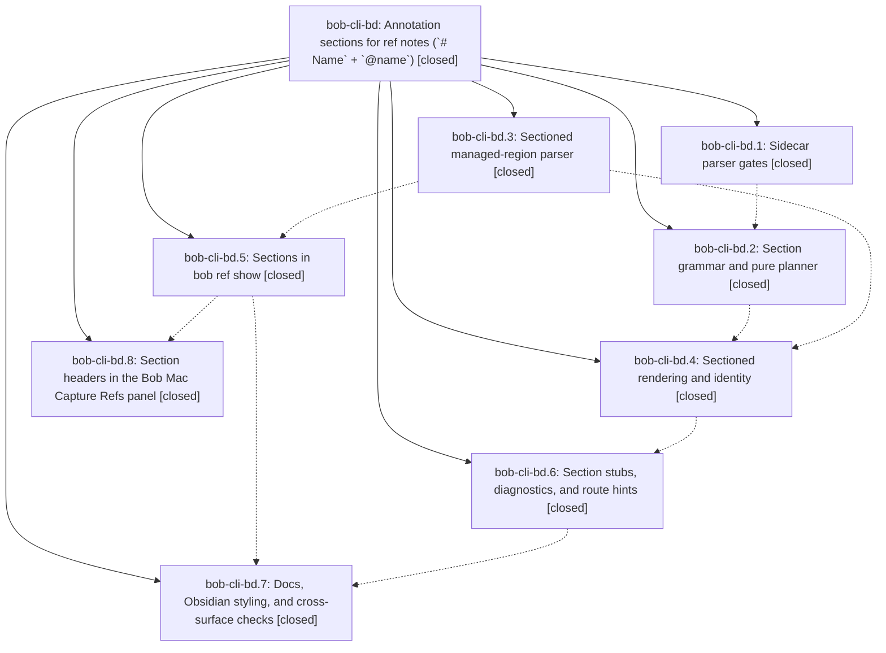

# Bead: bob-cli-bd — Annotation sections for ref notes (\`# Name\` + \`@name\`)

[Bead Pages](../README.md) / bob-cli-bd

**Status:** ✓ closed · **Resolution:** done · **Type:** ▸ plan · **Tier:** epic
**Owner:** `bryanbugyi34@gmail.com` · **Created by:** [bbugyi200.apollo.research.2d.linker.w0](https://github.com/bobs-org/bob-cli--agents/blob/main/sessions/bbugyi200.apollo.research.2d.linker.w0.md) · **Assignee:** `bob-cli-bd.land`
**Created:** 2026-10-24 07:59:21 EDT · **Closed:** 2026-10-24 14:38:01 EDT
**Plan:** [202610/ref\_note\_annotation\_sections.md](https://github.com/bobs-org/bob-cli--plans/blob/main/202610/ref_note_annotation_sections.md)

<!-- sase:links:start -->

## Links

| Relation | Artifact | Why |
| --- | --- | --- |
| implemented-by | [plan:202610/ref_note_annotation_sections.md][1] | derived from the plan's `bead_id:` frontmatter field |

_Plus 2 automatic references — see [Referenced By](#referenced-by)._

[1]: https://github.com/bobs-org/bob-cli--plans/blob/main/202610/ref_note_annotation_sections.md

<!-- sase:links:end -->

## Description

A Highlights sticky note whose first line is `# Name` declares a section, and every highlight, underline, image, or sticky note tagged `@name` renders grouped under it: real headings with a quiet section card in Obsidian, native section headers in the Bob Mac Capture Refs panel, and grouped output in every `bob ref show` format. Notes that never declare a section stay byte-identical, the grouping is re-derived from the annotations on every scan (nothing new is persisted), and adding, removing, or moving a tag never changes a `^h-` ID or re-creates a task.

## Notes

[2026-10-24T13:25:53Z · bob-cli-an.6.6.6.5.land] DISCOVERED ISSUE (from bob-cli-an.6.6.6.5 lander, 2026-10-24): bob-cli master CI is red on both test jobs because of bd.1 commit 6ec2f16a (level-aware sidecar page headings). Failing nodes: tests/cli/highlights/continuations.rs::continuation_scan_tucks_two_pages_and_is_idempotent (line 218) and ::continuation_scan_reports_dangling_marker (line 313). CI run 40095684849 on 94591ea6: test (ubuntu-latest) and test (macos-latest) fail exactly these two (1992/2 and 1990/2); lint and package pass. Bisect on athena: cargo test --test cli highlights::continuations passes 3/3 at bff7bc72 (6ec2f16a^) and fails 2/3 at 6ec2f16a. Root cause: parse_sidecar_markdown now takes page_heading_level from the FIRST page-shaped heading. These fixtures start with a simple-style marker page '## Page 1' and then use linked '#### [Page 11](highlights://...)' headings, so level=2 and the #### page headings no longer split the stream; every highlight renders under '### Page 1', continuations=0, and the dangling line names Page 1. bd.1 validated only lib highlights_ref tests (631), not the CLI suite. Read-only vault scan: 0 of the live sidecars mix page-heading levels, so live impact is nil today, but the first-heading rule is fragile (a level-1 '# P values' sticky before the first real page heading would disable all page splits). The fix belongs to this epic (choose the level from linked-style or most-common page headings, or accept any level for linked [Page N](highlights://) headings), then rerun cargo test --test cli highlights::. Not caused by bob-cli-an.6.6.6.5; no task created because this active epic owns the causal commit.

[2026-10-24T14:54:24Z · bryanbugyi34@gmail.com] I don't think this worked. See the 🔒 the\_ai\_native\_sdlc\_playbook.md ref note and 🔒 20261024\_105206.png screenshot context. The Epic Lander should look into this and fix it if it's really an issue.

[2026-10-24T15:45:04Z · bob-cli-an.6.6.6.5.6.land] DISCOVERED ISSUE corroboration from bob-cli-an.6.6.6.5.6.land: phase bob-cli-an.6.6.6.5.6.1 note #1 proposed the two continuation_scan failures (reports_dangling_marker and tucks_two_pages_and_is_idempotent). That phase reproduced both on its clean base. Current source still selects page_heading_level from the first heading; the mixed simple marker page/linked page fixture mismatch described in note #1 remains. SASE new-task all-status searches (CI then all types) and recent-task sweep found no separate task. Routed here because bd.1/6ec2f16a is the causal change; no duplicate task created. Final integrated check is pending and any changed result will be recorded.

[2026-10-24T17:09:41Z · bob-cli-bd.land] LANDING TRIAGE (bob-cli-bd.land, step 3) — outcome for every PROPOSED FOLLOW-UP and discovered issue:
(1) decisions:annotation-sections-are-name-keyed-folds strand (bd.1#1, bd.2#1, bd.3#1, bd.4#1, bd.5#1, bd.6#3, bd.7--3#3, bd.8#2) — DECLINED: the epic's DECISIONS answered decision_record=no; re-raising it as a task would override that answer.
(2) glossary:annotation-section (bd.1#2, bd.2#2, bd.3#2, bd.4#2, bd.5#2, bd.6#4, bd.8#2) — DECLINED for the same reason (glossary_term=no).
(3) continuation_scan_reports_dangling_marker / continuation_scan_tucks_two_pages_and_is_idempotent CLI failures (epic notes #1/#3, bd.4#3, bd.6#2, bd.7--1#2) — EPIC WORK, caused by bd.1 commit 6ec2f16a. The landing fixes it: linked [Page N](highlights://) headings always split pages, whatever their level.
(4) themes rename:old/new lack completion kinds decisions (bd.6#1, bd.7--1#2) — ROUTED to active epic bob-cli-bc (caused by bc.6 commit 4a6f4494; bc note #1 already holds it); corroboration note added there; no task.
(5) capture perf-gate timing + flaky capture_text named-start tests (bd.6#2) — DECLINED: the proposal names no failing node IDs, the bd.6 transcript keeps no tool output, and the landing's full just check passed every CLI test (2005/2005), so there is no reproducible evidence to file a flake bead on.
(6) docs/reference/mac-capture/refs.md over the 6000-word budget (bd.7#1) — DUPLICATE of bob-cli-bh, caused by Mac commit 72cd721, not this epic; bob-mac-capture c5d560c trimmed it and just docs-check now passes; supplementary note added to bob-cli-bh.
(7) macOS XCTest and design PNG review (bd.8#1/#3) — VERIFIED: bob-mac-capture CI run 40105623623 at 9759771 is green, including RefsPanelDesignTests.testRefsInspectorSectionsToPNG and the section feed/loader tests; the light/dark 880/1344 section renders were inspected and look correct. The f9cd88a run failed only on CapturePanelModelTests argv assertions (bob-cli-be). No follow-up needed.
(8) Obsidian CSS visual check (bd.7--3#4) — human-only check; reported to Bryan, not a task.
(9) Bryan note #2 (the_ai_native_sdlc_playbook) — REAL ISSUE, EPIC WORK: the sidecar shows Highlights exported '# what is it' verbatim, but as a highlight comment, and comments never declare. plan_sections returns before emitting section_declaration_in_comment when no sticky declares, so the attempt failed silently and rendered a literal '\# what is it' in Obsidian and the Mac panel. Bryan's vault has exactly one real sticky note, and every annotation he writes is a highlight comment, so the sticky-only rule (deferred 'highlight-anchored declarations') is the wrong fit. The landing tale adds comment declarations and keeps the diagnostic from going silent.

[2026-10-24T17:27:13Z · bob-cli-an.6.6.6.5.6.5.land] DISCOVERED ISSUE corroboration from bob-cli-an.6.6.6.5.6.5.land: proposals from .1 note #4, .2 note #1, and .3 note #1 reproduce continuation_scan_reports_dangling_marker and continuation_scan_tucks_two_pages_and_is_idempotent on clean base trees (including 8628ce2f). Read bd.1, current parser, and this epic note #4: this is the same linked-page-heading defect already owned by the landing work. No new task; all-status and recent-task searches found no distinct report. Phase evidence is relayed, not a fresh reproduction by this lander. Refresh acceptance against your landed repair when available.

[2026-10-24T18:38:01Z · bob-cli-bd.land] Lander verified all 8 phases code and notes; macOS CI run 40105623623 at bob-mac-capture 9759771 green including section render tests; light/dark renders inspected; triage on epic. Tale: linked [Page N] headings always split pages fixing continuations 3/3; comment first-line # declarations for highlights/underlines/images with declaration-beats-tags, merging, conflict, rejected, identity-stable h-IDs; added 7 tests (sidecar parse, planner 3, render 2, edges update) all passing; just check lib 3359 passed 1 failed (expected bc themes rename) 1 ignored, cli 2008 passed; docs-check 447 passed 1 skipped; vault dry-run 522 unchanged 0 updated, playbook comment is #what without space so correctly no section

## Attachments

- 🔒 20261024\_105206.png · image/png · 2854×1686 · 2.66297 MiB (private attachment)
- 🔒 the\_ai\_native\_sdlc\_playbook.md · text/markdown · 2.2832 KiB (private attachment)

## Phases

| Bead | Title | Status | Size | Created | Agents | Commits |
|---|---|---|---|---|---:|---:|
| [bob-cli-bd.1](bob-cli-bd.1.md) | Sidecar parser gates | ✓ closed | medium | 2026-10-24 | 1 | 1 |
| [bob-cli-bd.2](bob-cli-bd.2.md) | Section grammar and pure planner | ✓ closed | medium | 2026-10-24 | 1 | 1 |
| [bob-cli-bd.3](bob-cli-bd.3.md) | Sectioned managed-region parser | ✓ closed | medium | 2026-10-24 | 1 | 1 |
| [bob-cli-bd.4](bob-cli-bd.4.md) | Sectioned rendering and identity | ✓ closed | large | 2026-10-24 | 1 | 1 |
| [bob-cli-bd.5](bob-cli-bd.5.md) | Sections in bob ref show | ✓ closed | medium | 2026-10-24 | 1 | 1 |
| [bob-cli-bd.6](bob-cli-bd.6.md) | Section stubs, diagnostics, and route hints | ✓ closed | medium | 2026-10-24 | 1 | 1 |
| [bob-cli-bd.7](bob-cli-bd.7.md) | Docs, Obsidian styling, and cross-surface checks | ✓ closed | medium | 2026-10-24 | 1 | 1 |
| [bob-cli-bd.8](bob-cli-bd.8.md) | Section headers in the Bob Mac Capture Refs panel | ✓ closed | large | 2026-10-24 | 1 | 1 |

## Lineage

## Agents

| Agent | Bead | Commits |
|---|---|---:|
| [bbugyi200.apollo.bob-cli-bd.1](https://github.com/bobs-org/bob-cli--agents/blob/main/agents/bbugyi200.apollo.bob-cli-bd.1/README.md) | [bob-cli-bd.1](bob-cli-bd.1.md) | 1 |
| [bbugyi200.apollo.bob-cli-bd.2](https://github.com/bobs-org/bob-cli--agents/blob/main/sessions/bbugyi200.apollo.bob-cli-bd.2.md) | [bob-cli-bd.2](bob-cli-bd.2.md) | 1 |
| [bbugyi200.apollo.bob-cli-bd.3](https://github.com/bobs-org/bob-cli--agents/blob/main/agents/bbugyi200.apollo.bob-cli-bd.3/README.md) | [bob-cli-bd.3](bob-cli-bd.3.md) | 1 |
| [bbugyi200.apollo.bob-cli-bd.4](https://github.com/bobs-org/bob-cli--agents/blob/main/sessions/bbugyi200.apollo.bob-cli-bd.4.md) | [bob-cli-bd.4](bob-cli-bd.4.md) | 1 |
| [bbugyi200.apollo.bob-cli-bd.5](https://github.com/bobs-org/bob-cli--agents/blob/main/agents/bbugyi200.apollo.bob-cli-bd.5/README.md) | [bob-cli-bd.5](bob-cli-bd.5.md) | 1 |
| [bbugyi200.apollo.bob-cli-bd.6](https://github.com/bobs-org/bob-cli--agents/blob/main/agents/bbugyi200.apollo.bob-cli-bd.6/README.md) | [bob-cli-bd.6](bob-cli-bd.6.md) | 1 |
| [bbugyi200.apollo.bob-cli-bd.7](https://github.com/bobs-org/bob-cli--agents/blob/main/sessions/bbugyi200.apollo.bob-cli-bd.7.md) | [bob-cli-bd.7](bob-cli-bd.7.md) | 1 |
| [bbugyi200.apollo.bob-cli-bd.8](https://github.com/bobs-org/bob-cli--agents/blob/main/sessions/bbugyi200.apollo.bob-cli-bd.8.md) | [bob-cli-bd.8](bob-cli-bd.8.md) | 1 |
| [bbugyi200.apollo.bob-cli-bd.land](https://github.com/bobs-org/bob-cli--agents/blob/main/sessions/bbugyi200.apollo.bob-cli-bd.land.md) | [bob-cli-bd](README.md) | 1 |

## Commits

| Repo | Commit | Subject | Bead | Committed |
|---|---|---|---|---|
| bob-cli | [`b7645d1`](https://github.com/bobs-org/bob-cli/commit/b7645d17ba1a98caf43b8607e863e16c03bb5fc1) | feat(highlights-ref): parse sectioned managed regions | [bob-cli-bd.3](bob-cli-bd.3.md) | 2026-10-24 08:22:20 EDT |
| bob-cli | [`6ec2f16`](https://github.com/bobs-org/bob-cli/commit/6ec2f16a564fe99b5582b15daa52dfdb9e785e64) | feat(highlights): keep hard-wrapped hash lines in quotes and scope page headings by level | [bob-cli-bd.1](bob-cli-bd.1.md) | 2026-10-24 08:48:27 EDT |
| bob-cli | [`94591ea`](https://github.com/bobs-org/bob-cli/commit/94591ea66d48c89fba305344c40d0df5bfceecc6) | feat(ref): group bob ref show output by annotation sections | [bob-cli-bd.5](bob-cli-bd.5.md) | 2026-10-24 08:51:41 EDT |
| bob-mac-capture | [`bob-mac-capture@f9cd88a`](https://github.com/bobs-org/bob-mac-capture/commit/f9cd88add5f2b4bdb8ca5a0dffde9b42617b7253) | feat(refs): present annotation sections in the inspector and Copy card | [bob-cli-bd.8](bob-cli-bd.8.md) | 2026-10-24 09:48:43 EDT |
| bob-cli | [`453b07e`](https://github.com/bobs-org/bob-cli/commit/453b07e74ea1aafce753b9a8de69db680079cfe9) | feat(highlights): parse reference sections | [bob-cli-bd.2](bob-cli-bd.2.md) | 2026-10-24 09:49:33 EDT |
| bob-cli | [`9398c5b`](https://github.com/bobs-org/bob-cli/commit/9398c5bbcca27fce050e67e029bd5a02bc60fbeb) | feat(highlights): sectioned annotation rendering with stable IDs | [bob-cli-bd.4](bob-cli-bd.4.md) | 2026-10-24 10:43:22 EDT |
| bob-cli | [`be18197`](https://github.com/bobs-org/bob-cli/commit/be1819783e6285882bb05d66e38d5d6b0a139056) | feat(highlights): section stubs, diagnostics, and route hints | [bob-cli-bd.6](bob-cli-bd.6.md) | 2026-10-24 11:34:25 EDT |
| bob-cli | [`2eb9812`](https://github.com/bobs-org/bob-cli/commit/2eb98129f0416b17b0a181b6d212d79c6a321474) | docs(highlights): document annotation sections and add cross-surface checks | [bob-cli-bd.7](bob-cli-bd.7.md) | 2026-10-24 12:35:52 EDT |
| bob-cli | [`8a7b02e`](https://github.com/bobs-org/bob-cli/commit/8a7b02e1b9a61b79bf8f3ced17a02d2e605ba1a8) | feat(highlights-ref): land annotation sections comment declarations with CI fix | [bob-cli-bd](README.md) | 2026-10-24 14:40:08 EDT |

<!-- sase:referenced-by:start -->

## Referenced By

| Relation | Artifact | Why | Uses |
| --- | --- | --- | ---: |
| read-by | [agent:bob-cli-an.6.6.6.5.6.5.2][1] | Identify the existing owner and task evidence for clean-base just check failures | 1 |
| read-by | [agent:bob-cli-an.6.6.6.5.land][2] | Active epic causally linked to master CI break (6ec2f16a level-aware page headings break continuations CLI tests); check scope and notes before DISCOVERED ISSUE note | 1 |

[1]: https://github.com/bobs-org/bob-cli--agents/blob/main/agents/bbugyi200.apollo.bob-cli-an.6.6.6.5.6.5.2/README.md
[2]: https://github.com/bobs-org/bob-cli--agents/blob/main/agents/bbugyi200.apollo.bob-cli-an.6.6.6.5.land/README.md

<!-- sase:referenced-by:end -->
